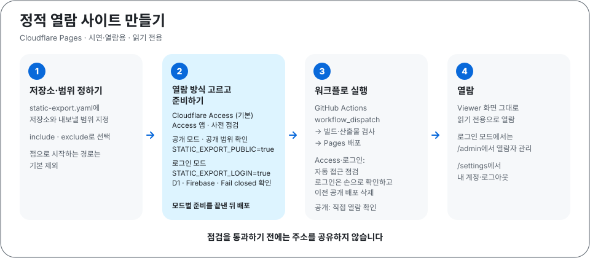

<h1 align="center">
  <picture>
    <source media="(prefers-color-scheme: dark)" srcset="docs/brand/synctx-logo-dark.svg">
    
  </picture>
</h1>

  <picture>
    <source media="(prefers-color-scheme: dark)" srcset="docs/readme/hero-dark.svg">
    
  </picture>

<b>sync + context — 외부에서 AI와 쓴 문서를 폐쇄망 안에서 읽고, 회의하고, 동기화합니다</b> 
현재 버전 <b>0.8.2</b> · <a href="https://github.com/sch0718/synctx/releases">릴리스</a> · 외부 CDN·인터넷 없이 사내 브라우저에서

금융권 폐쇄망의 현업 팀은 외부망에 접근할 수 없어서, 외부에서 AI 도구(Claude Code·Codex·Cursor)로 만든 요건 문서·회의 자료·이슈를 바로 쓰기 어렵습니다. synctx는 이미 자동화된 **외부 → 내부 Git 동기화** 경로를 그대로 써서, Git에 올린 Markdown을 폐쇄망 안에서 웹으로 읽고, 회의와 발표에 쓰고, 팀이 쓰는 XWiki·OpenProject에 맞춰 넣습니다. Git이 원본이고 내부 도구의 내용은 거기서 만든 파생 데이터입니다.

## 이런 걸 할 수 있어요

| | |
| --- | --- |
| 📖 **문서 열람** | Git 저장소의 Markdown을 파일 트리·목차와 함께 웹에서 읽습니다. Mermaid 그림, 코드 강조, 7가지 테마가 오프라인에서도 그대로 보입니다. |
| 🌐 **정적 열람 사이트** | 비공개 저장소의 Markdown을 Viewer 화면 그대로 정적 사이트로 내보내 Cloudflare Pages에 올립니다. Cloudflare Access로 제한하거나, 공개 모드로 누구나 보게 하거나, 로그인 모드(Google·카카오·네이버)로 저장소마다 볼 사람을 정할 수 있습니다. 읽기 전용이며 검색·회의·발표 같은 서버 기능은 빠집니다. 폐쇄망 운영 구성이 아니라 시연·열람용입니다. |
| 🔎 **찾기** | `⌘K`로 파일 이름과 여러 저장소의 본문을 한 번에 찾습니다. |
| 🗒️ **회의** | 회의 문서에 메모·형광펜을 달고, 결정·액션 아이템을 모아 `.md`나 메모 포함 HTML로 내보냅니다. |
| 📹 **화상 회의** | 회의 화면에서 화상 회의에 참여하고 발표자의 문서 이동을 따라갑니다. |
| 💬 **채팅 알림·명령** | 선택 배포인 Collab Gateway가 회의 안내·변경·취소·요약을 Mattermost 채널로 전하고, `/synctx` 명령으로 회의·문서 검색·근거를 조회합니다. |
| 🎤 **발표** | 회의 문서를 제목마다 한 장씩 넘기는 발표 화면으로 바로 띄웁니다. |
| 📎 **근거 확인** | 회의 문서가 인용한 규정·설계 문서의 조문을 말풍선과 문서 끝 근거 모음에서 확인합니다. |
| 🧩 **인터랙티브 HTML** | 운영자가 허용한 저장소의 HTML 묶음(모션 그래픽 등)을 문서 안에서 재생하고 `크게 보기`로 키웁니다. `.html` 파일은 `렌더링`으로 실행해 보고, 문서 안 링크도 같은 커밋으로 엽니다. |
| 🖼️ **슬라이드** | `marp: true` 문서를 슬라이드로 미리 보고, PDF로 받거나 팀 슬라이드 저장소에 출판합니다. |
| 🔄 **내부 도구 동기화** | Front Matter의 `type`·`route`에 따라 문서는 XWiki로, 작업은 OpenProject로 자동 동기화합니다. |
| ✏️ **다이어그램** | 폐쇄망 안에 셀프호스팅한 Draw.io(`/drawio/`)에서 그림을 그리고 `.drawio` 파일로 저장해 Git에 올립니다. |
| 📦 **라이브러리 서빙** | 렌더링에 쓰는 프론트엔드 라이브러리를 내부 CDN에서 받아 외부 CDN 없이 동작합니다. |

## 시작하기

1. **읽기** — 사내 브라우저로 운영자가 알려 준 synctx 주소의 `/view/`를 엽니다. 등록된 저장소가 카드로 보입니다.
2. **쓰기** — 외부망에서 문서를 Markdown으로 쓰고 GitHub에 올립니다. 내부 GitLab 미러로 반입되면 Viewer에 나타납니다. 회의 문서는 Front Matter에 `synctx.type: meeting`과 `synctx.meeting`(id·title·starts_at·channel)을 적습니다.
3. **혼자 써 보기** — 이 저장소를 받아 `./run.sh --repo <Git 주소>`를 실행하면 문서·회의 Viewer만 http://127.0.0.1:18000/view/ 에 뜹니다(`uv`·Git 필요). `./run.sh --docker --build --repo <Git 주소>`는 Viewer 컨테이너 하나로 띄웁니다. Marp 미리보기까지 보려면 `scripts/local/run-viewer.sh`를 씁니다. 자세한 내용은 [개발 문서](docs/development.md)의 「Markdown·회의 Viewer 빠른 시작」과 [로컬 개발 환경](docs/local-development.md)에 있습니다.
4. **설치 방식 고르기** — 전체·서비스별·정적 열람 중 무엇을 어디에 설치할지는 [설치 방식 선택](docs/install.md)에서 고릅니다. 정적 열람은 운영 구성이 아니라 별도 시연·열람용입니다.

정적 열람 사이트를 만드는 흐름입니다.

  <picture>
    <source media="(prefers-color-scheme: dark)" srcset="docs/readme/usage-dark.svg">
    
  </picture>

자세한 절차는 [설치 방식 선택](docs/install.md)의 「정적 Viewer(Cloudflare Pages)」에 있습니다.

## 간단한 사용법

- **문서 찾아가기** — `/view/`에서 저장소를 고르고 왼쪽 파일 트리에서 문서를, 오른쪽 `이 문서` 목차에서 절을 고릅니다. → [저장소·문서 찾아가기](docs/help/browse.md)
- **검색** — `⌘K`(Ctrl K)나 `/`로 검색 상자를 열고 두 글자 이상 입력합니다. → [문서 검색](docs/help/search.md)
- **보기·내려받기** — 상단 바에서 테마·브랜치를 바꾸고, 문서 위 `내려받기`에서 원본·HTML·PDF를 받습니다. → [문서 보기·내려받기](docs/help/document.md)
- **회의** — 회의 문서에서 `회의 모드로 열기` → `+ 메모` → `회의 정리`에서 내보내기. → [회의 모드](docs/help/meeting.md)
- **회의 모아 보기** — 상단 바 `회의`에서 저장소 전체 회의를 상태·저장소·채널로 거르고, `<문서명>.memo.md`를 커밋하면 결정·액션 아이템을 모아 봅니다.
- **발표** — 회의 문서에서 `발표하기`, →로 넘기고 Esc로 끝냅니다. → [발표 화면](docs/help/present.md)
- **근거** — 근거 링크에 마우스를 올려 발췌를 보고, 문서 끝 `근거 모음`에서 `원문 열기`. → [근거 미리보기·근거 모음](docs/help/evidence.md)
- **슬라이드** — `marp: true` 문서에서 `슬라이드 미리보기`·`PDF 만들기`·`출판…`. → [슬라이드(Marp)](docs/help/slides.md)

## 메뉴별 도움말

움직이는 그림으로 실제 화면 흐름을 단계별로 보여 줍니다. 모아 보기는 [도움말 모음](docs/help/README.md)에 있습니다. Viewer에서는 `?`를 누르면 단축키를 볼 수 있습니다.

| 메뉴 | 무엇을 하나요 |
| --- | --- |
| [저장소·문서 찾아가기](docs/help/browse.md) | 저장소 목록, 파일 트리, 본문, 목차 |
| [문서 검색](docs/help/search.md) | `⌘K`·`/`로 파일·본문 찾기, 전체 결과 |
| [문서 보기·내려받기](docs/help/document.md) | 테마·브랜치 바꾸기, 원본·HTML·PDF, 단축키 |
| [회의 모드](docs/help/meeting.md) | 메모·형광펜, 결정·액션, 회의 정리와 내보내기 |
| [발표 화면](docs/help/present.md) | 장 넘기기, 메모 보기, 발표 끝내기 |
| [근거 미리보기·근거 모음](docs/help/evidence.md) | 근거 말풍선, 근거 모음, 원문 열기 |
| [슬라이드(Marp)](docs/help/slides.md) | 슬라이드 미리보기, PDF 만들기, 출판 |

**사용 데모 영상**(4분 30초, 한국어 AI 음성 설명): https://youtu.be/FVkVNfMvjnA — 유튜브 일부 공개라 링크가 있는 사람만 볼 수 있습니다. 가상의 도서 대여 서비스 문서로 위 메뉴를 차례로 써 봅니다.

챕터: 0:00 저장소·문서 찾아가기 · 0:37 문서 검색 · 1:07 문서 보기·내려받기 · 1:49 회의 모드 · 2:43 발표 화면 · 3:09 근거 미리보기·근거 모음 · 3:39 슬라이드(Marp) · 4:06 마무리

## 데이터는 어디에 있나요?

- **원본은 Git입니다.** 문서는 외부 GitHub에서 쓰고 내부 GitLab 미러로 들어옵니다. Viewer는 그 저장소를 읽기만 하고, XWiki·OpenProject의 내용은 Git에서 만든 파생 데이터입니다. 내부 도구에서 고친 내용은 Git에 반영되지 않습니다(아래 Outbound Feedback의 외부 PR만 예외).
- **회의 메모·형광펜은 지금 쓰는 브라우저에만**(localStorage) 저장되고 서버나 다른 사람에게 가지 않습니다. 함께 보려면 `.md로 내보내기`로 받은 파일을 전합니다. 테마와 최근 본 문서도 브라우저에 남습니다.
- **밖으로 나가는 것은 선택 기능 하나뿐입니다.** Outbound Feedback을 켠 환경에서만, OpenProject 상태 같은 허용된 메타데이터를 민감 정보를 지우고 서명한 메일 이벤트로 승인된 메일 게이트웨이를 거쳐 보내고, 외부에서 그 이벤트로 PR을 만듭니다. 문서 본문은 보내지 않습니다.
- 정적 열람 사이트를 쓰면 내보낸 문서가 Cloudflare Pages에 올라갑니다. 외부 GitHub 저장소를 읽어 만든 시연·열람용 사본이며, 폐쇄망 안의 데이터가 나가는 경로가 아닙니다. 올리기 전에 `include`·`exclude`로 공개해도 되는 경로만 남겼는지 확인해 주세요.
- 슬라이드 `출판…`은 설정된 팀 슬라이드 저장소(내부 Git)에 커밋합니다.

## 릴리스

버전 체계는 0.6.0부터 도입했고, 그 이전 버전 태그는 주요 기능이 들어간 커밋에 나중에 붙였다(그 커밋들의 Chart·패키지 버전 표기는 `0.1.0`). 버전마다 바뀐 PR 목록과 전체 비교는 각 릴리스에 있다.

| 버전 | 날짜 | 주요 변경 |
|------|------|-----------|
| [0.8.2](https://github.com/sch0718/synctx/releases/tag/v0.8.2) | 2026-11-17 | **라이선스와 공개 준비.** PolyForm Noncommercial 1.0.0 라이선스(`LICENSE`)와 서드파티 고지(`THIRD_PARTY_NOTICES.md`) 추가, 패키지에 라이선스 표기, 문서·예시 설정에서 특정 사내 환경 정보를 일반 예시로 정리 |
| [0.8.1](https://github.com/sch0718/synctx/releases/tag/v0.8.1) | 2026-11-16 | **로고와 사용 데모 영상.** 로고·마크(SVG, 밝은·어두운 판 PNG)를 `docs/brand/`에 추가하고 README 머리에 표시, CDN·Slides 목록 화면의 머리 마크를 같은 모양으로 맞추고 브라우저 탭 아이콘 추가, README에 사용 데모 영상(한국어 자막) 링크와 챕터 추가 |
| [0.8.0](https://github.com/sch0718/synctx/releases/tag/v0.8.0) | 2026-11-09 | **정적 Viewer 내보내기와 로그인·열람 제한.** Viewer를 정적 사이트로 내보내 Cloudflare Pages에 배포(Access·공개 모드), 로그인 모드의 저장소별 열람 제한·`/admin`·`/settings`, 브라우저 탭 아이콘, 회의 대시보드·Collab Gateway의 Mattermost 알림과 `/synctx` 명령·Jitsi 내장(Phase 8), Phase 9 Chromium 시험, 알림·Alert·Jitsi 프록시·로컬 배포 수정 |
| [0.7.0](https://github.com/sch0718/synctx/releases/tag/v0.7.0) | 2026-10-28 | **경량 Viewer와 HTML 렌더 보기.** `./run.sh` 한 줄 실행과 단일 컨테이너(`--docker`)로 문서·회의용 Viewer 띄우기, 신뢰 저장소의 HTML을 `mode=render`로 실행해 보고 문서 안 링크를 같은 커밋으로 여는 렌더 보기(`/render` 서명 토큰), 화면 맞춤·전체 화면·`synctx-html` 블록 크게 보기, README를 서비스 소개로 바꾸고 메뉴별 도움말 추가, Feedback이 OpenProject 변경을 실제로 반출하도록 수정, Marp 출판에 출판 전용 토큰 사용 |
| [0.6.0](https://github.com/sch0718/synctx/releases/tag/v0.6.0) | 2026-10-22 | **Phase 8.1b 회의 근거와 CronJob 메트릭.** 회의 문서의 근거 링크에 원문 발췌 말풍선과 근거 모음(`synctx.meeting.references`), Sync·Feedback CronJob 메트릭을 Pushgateway로 수집해 Alert를 실제로 평가, Helm 의존성 규칙 D8(메트릭을 켰는데 sync-state PVC가 없으면 렌더 실패), Markdown 인라인 렌더 선형화, 문서 전체를 코드와 맞춤 |
| [0.5.0](https://github.com/sch0718/synctx/releases/tag/v0.5.0) | 2026-10-22 | **Viewer UX 개편.** 상단 바·서랍·3단 문서 화면의 공통 틀, 파일 찾기·최근 문서, 저장소 본문 검색(`git grep`), `run-viewer.sh`로 Docker 없이 Viewer 실행, 회의 정보 카드·발표 화면·첫 사용 안내, Git 토큰이 오류 응답에 새지 않게 수정 |
| [0.4.0](https://github.com/sch0718/synctx/releases/tag/v0.4.0) | 2026-10-16 | **Phase 9 인터랙티브 HTML 임베드와 배포 옵션.** `synctx-html` 블록을 한 파일로 합쳐 Viewer sandbox iframe과 XWiki html 매크로로 보여 줌, 서비스별 배포 옵션·Docker Compose 배포, 문서 파일 트리, Sync lease 강화, Python 3.13 |
| [0.3.0](https://github.com/sch0718/synctx/releases/tag/v0.3.0) | 2026-10-03 | **Phase 8.1a 회의 모드.** 회의 Front Matter(`synctx.meeting`), 메모·형광펜·패널, 메모 내보내기·가져오기, 메모 포함 오프라인 HTML, XSS 수정, 모든 테마 글자 대비 4.5:1 이상 |
| [0.2.0](https://github.com/sch0718/synctx/releases/tag/v0.2.0) | 2026-10-03 | **운영 준비.** 로컬 minikube 시뮬레이션, Prometheus 실계측·Alert, CDN 업로드, Viewer 인덱스·브랜치 선택, Marp Mermaid·미리보기, Slides 인덱스 |
| [0.1.0](https://github.com/sch0718/synctx/releases/tag/v0.1.0) | 2026-06-20 | **Phase 1–7 핵심 구현.** 공통 라이브러리, Viewer·CDN·Marp·Slides·Draw.io, Sync Engine(XWiki·OpenProject), 관측성, Harness Validator, Outbound Feedback |

## 라이선스

소스를 공개한 비상업 라이선스 PolyForm Noncommercial 1.0.0([LICENSE](LICENSE))을 적용하며, OSI가 승인한 오픈소스 라이선스는 아닙니다.
개인·비상업 용도로 쓰고 고칠 수 있습니다.
상업적 이용은 별도로 문의해 주세요.
재배포할 때는 LICENSE의 `Required Notice:` 줄을 함께 전달해야 합니다.
함께 쓰는 서드파티 라이브러리 고지는 [THIRD_PARTY_NOTICES.md](THIRD_PARTY_NOTICES.md)를 참고해 주세요.

## 개발자용

- [개발 문서](docs/development.md) — 프로젝트 배경, 아키텍처 다이어그램, 서비스 구성, 배포 방식, 서비스별 기능, 동기화 흐름, 프로젝트 구조, 기술 스택
- [아키텍처 설계](docs/architecture.md) — 설계 결정, 서비스별 설계, 모듈 구조, Helm Chart, 개발 단계
- [운영 서비스 설계](docs/production-service-design.md) — 보안, `.synctx.yaml` 스키마, API, 배포, 관측성, Runbook
- [로컬 개발 환경](docs/local-development.md) — Viewer 단독 실행과 minikube 로컬 환경
- [스크립트](scripts/README.md) — 배포·로컬·운영 스크립트 사용법
- 도움말 그림과 글은 `python3 scripts/build_motion.py`가 `scripts/motion/help_pages.py`로 만듭니다. 화면 문구가 바뀌면 그 파일을 고치고 다시 만드세요.
