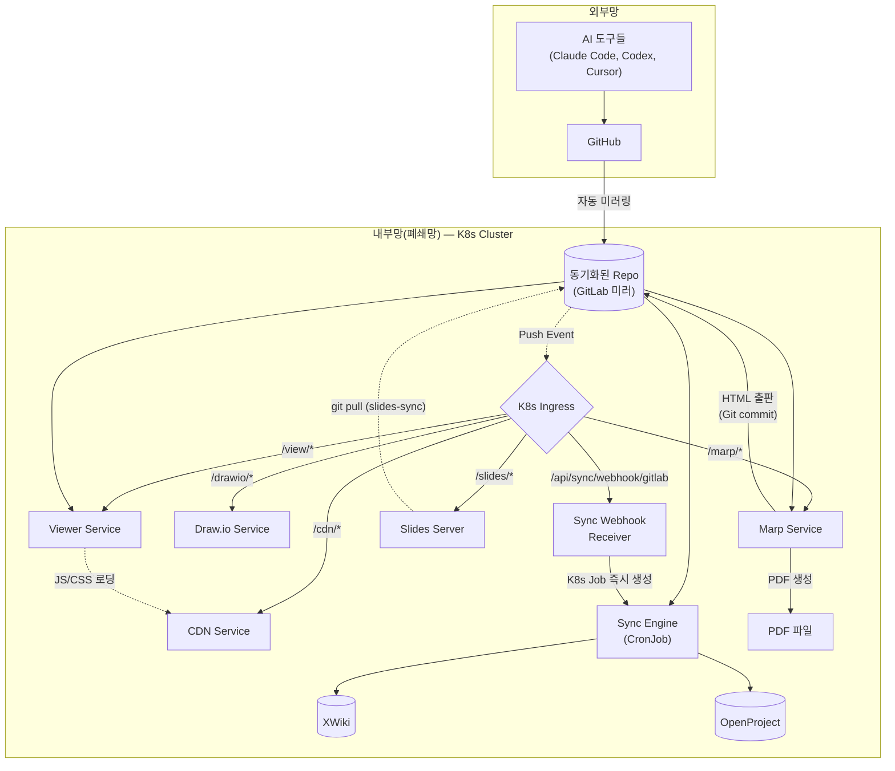
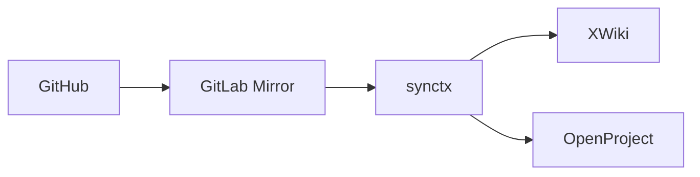
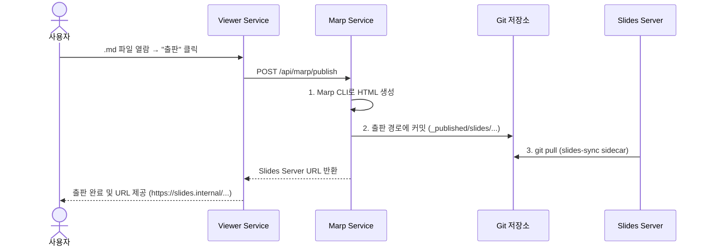

# synctx

**sync + context** — 폐쇄망 환경에서 AI 기반 개발 컨텍스트를 동기화하는 마이크로서비스 플랫폼

## 프로젝트 배경

### 문제

금융권 폐쇄망에서 AI 도구(Claude Code, Codex, Cursor 등)를 활용한 개발이 진행되고 있다.
개발 자체는 외부 인터넷 환경에서 이루어지고, GitHub을 통해 코드가 관리되며, 내부망으로 동기화되어 빌드·배포된다.

그런데 개발 서비스를 실제 사용하는 **현업 팀은 외부망에 접근할 수 없다**.
프로젝트 관리(OpenProject), 지식 관리(XWiki) 등 팀 협업 도구는 모두 내부에 있기 때문에, AI를 활용한 요건 분석, 문서 작성, 이슈 관리 등에서 생산성 한계가 발생한다.

또한 폐쇄망 특성상 외부 CDN에 접근할 수 없어, 마크다운 렌더링에 필요한 라이브러리(Mermaid, highlight.js 등)를 내부에서 자체 서빙해야 한다.

### 해결 방향

내부에서 외부로 데이터를 반출할 수는 없지만, **외부에서 내부로의 반입은 Git 동기화로 거의 자동화**되어 있다.
이 단방향 경로를 활용하여 다섯 가지 문제를 해결한다:

1. **문서 열람**: 외부에서 작성된 마크다운 문서를 내부에서 웹 기반으로 열람
2. **프레젠테이션**: 마크다운 문서를 Marp로 PDF/슬라이드 HTML로 변환하여 발표 자료로 활용
3. **다이어그램**: draw.io를 폐쇄망에서 셀프호스팅하여 다이어그램 작성·편집
4. **도구 동기화**: Git 저장소의 마크다운과 메타데이터를 내부 도구(XWiki, OpenProject)에 자동 동기화
5. **라이브러리 서빙**: 폐쇄망에서 프론트엔드 라이브러리를 서빙하는 내부 CDN 제공

### 핵심 가치

- **Human-AI Collaboration (사람-AI 협업)**: AI는 마크다운을 통해 지식을 생성/공유하고, 사람은 웹 뷰어와 내부 도구를 통해 이를 소비·관리하는 완벽한 협업 체계 구축
- **Harness Engineering & OKF**: 서로 다른 LLM(Cursor, Claude 등)이 마크다운을 공통 컨텍스트(메모리)로 사용하여 지식의 흐름(Orchestrated Knowledge Flow)을 끊김 없이 유지
- **Markdown 기반 스크럼/대시보드**: 외부망에서는 마크다운 기반의 칸반(Kanban)/대시보드로 프로젝트를 관리하고, 이는 내부망의 OpenProject로 자동 연동
- **지능형 라우팅**: 마크다운의 목적(프로젝트 관리 vs 지식 공유)에 따라 OpenProject와 XWiki로 자동 분기되어 동기화
- **오프라인 독립성**: 외부 CDN 없이 모든 렌더링 라이브러리를 내부 CDN에서 서빙
- **문서→발표 전환**: 마크다운으로 작성한 문서를 바로 프레젠테이션으로 변환·출판
- **다이어그램 자급자족**: draw.io를 내부에서 운영하여 인터넷 없이 다이어그램 작성

## 아키텍처

마이크로서비스 구조로 K8s에서 운영되며, 각 서비스는 독립적으로 배포·확장된다.



### 마이크로서비스 구성

| 서비스 | 역할 | 기반 기술 | K8s 리소스 |
|--------|------|-----------|------------|
| **Viewer Service** | 마크다운 렌더링·열람, HTML/PDF 다운로드 | FastAPI + python-markdown | Deployment |
| **CDN Service** | 정적 라이브러리 서빙 + 파일 업로드 관리 | FastAPI + StaticFiles | Deployment + PVC |
| **Marp Service** | 마크다운 → PDF/프레젠테이션 HTML 변환 + 출판 | FastAPI + @marp-team/marp-cli | Deployment |
| **Draw.io Service** | 다이어그램 작성·편집 웹 도구 (셀프호스팅) | jgraph/drawio (Tomcat) | Deployment |
| **Sync Webhook** | GitLab Push Event 수신 및 Sync Job 트리거 | Deployment |
| **Sync Engine** | Git 변경 감지 → XWiki/OpenProject 동기화 | Python CLI + httpx | CronJob |
| **Slides Server** | 출판된 프레젠테이션 HTML 정적 서빙 | Nginx | Deployment + PVC |

## Viewer Service (마크다운 뷰어)

기존 `markdown_converter`(md-preview)의 발전형. Git 저장소의 마크다운 문서를 웹에서 열람한다.

### 주요 기능

- **Git 저장소 뷰어** — 다중 저장소 트리 탐색, 문서 열람, webhook/polling 동기화
- **마크다운 렌더링** — 서버사이드 렌더링 (python-markdown), 7개 테마 지원
- **Mermaid 다이어그램** — 클라이언트 사이드 렌더링 (CDN Service에서 mermaid.js 로딩)
- **코드 하이라이팅** — highlight.js 기반 190+ 언어 구문 강조
- **HTML/PDF 다운로드** — 자체 완결형 HTML, Chrome CDP 기반 PDF
- **완전 오프라인** — 모든 외부 라이브러리를 CDN Service에서 로딩

## CDN Service (내부 CDN)

폐쇄망에서 프론트엔드 라이브러리를 서빙하는 정적 파일 서버. Viewer, Marp, XWiki 등 내부 서비스가 공유한다.

### 주요 기능

- **정적 파일 서빙** — JS, CSS, 폰트 등을 HTTP로 서빙
- **파일 업로드** — 웹 UI 드래그앤드롭 + REST API
- **버전 관리** — `/{library}/{version}/{file}` 디렉토리 구조
- **디렉토리 탐색** — 업로드된 파일 목록 조회 및 관리

### 기본 제공 라이브러리

| 라이브러리 | 버전 | 용도 |
|-----------|------|------|
| mermaid | 10.9.1 | 다이어그램 렌더링 |
| highlight.js | — | 코드 구문 강조 |
| Chart.js | 4.4.4 | 차트/그래프 |

## Marp Service (프레젠테이션)

마크다운 문서를 [Marp](https://marp.app/)를 사용하여 PDF 또는 프레젠테이션 HTML로 변환한다.

### 주요 기능

- **PDF 변환 + 다운로드** — Marp CLI로 마크다운 → 슬라이드 PDF 생성, 브라우저에서 다운로드
- **프레젠테이션 HTML 출판** — 마크다운 → 자체 완결형 슬라이드 HTML 생성 → Git 저장소의 지정 경로에 커밋 → Slides Server에서 바로 열람
- **Marp 테마 지원** — 기본 테마(default, gaia, uncover) + 커스텀 테마(CDN에서 CSS 로딩)
- **실시간 미리보기** — 변환 전 슬라이드 미리보기

### Marp 마크다운 예시

````markdown
---
marp: true
theme: gaia
paginate: true
---

# 프로젝트 아키텍처

synctx 시스템 설계 개요

---

## 마이크로서비스 구성

- Viewer Service
- CDN Service
- Marp Service
- Sync Engine

---

## 동기화 흐름


````

### 출판 흐름



## Sync Engine (동기화 엔진)

Git 저장소의 마크다운과 메타데이터를 내부 협업 도구에 자동 반영하는 서비스.
기본적으로 5분 주기의 **CronJob**으로 동작하며, Git 커밋 시 즉각적인 반영을 위해 GitLab 웹훅을 수신하여 동기화를 즉시 트리거하는 **Webhook Receiver**가 함께 구성된다.

### 동기화 대상

| 산출물 | 외부 형태 | 내부 도구 | 동기화 방식 |
|--------|-----------|-----------|-------------|
| 기술 문서 | Markdown | XWiki | REST API (`markdown/1.2`) |
| 이슈/작업 | Markdown + Front Matter | OpenProject | REST API |
| 요건 정의 | Markdown | XWiki / OpenProject | REST API |
| 회의록/의사결정 | Markdown | XWiki | REST API |
| 다이어그램 | Mermaid / draw.io | XWiki (첨부파일) | SVG 변환 → 첨부 API |

## Draw.io Service (다이어그램 편집기)

[draw.io](https://www.drawio.com/)(diagrams.net)를 폐쇄망에서 셀프호스팅한다. 공식 Docker 이미지(`jgraph/drawio`)를 사용하며, 인터넷 연결 없이 완전히 독립적으로 동작한다.

### 주요 기능

- **다이어그램 작성·편집** — 플로우차트, 시퀀스, ERD, 네트워크, UML 등 모든 draw.io 기능
- **완전 오프라인** — 외부 연결 없이 내부에서 독립 운영
- **파일 저장** — 브라우저 로컬 저장 또는 `.drawio` 파일 다운로드, Git 저장소에 커밋하여 공유
- **이미지 내보내기** — SVG, PNG, PDF 형태로 내보내기
- **Viewer 연동** — Viewer에서 `.drawio` 파일을 감지하면 Draw.io Service로 열기 링크 제공

### 배포

별도 개발 없이 공식 Docker 이미지를 K8s에 배포한다:

```yaml
# 검증한 jgraph/drawio 버전을 내부 레지스트리에 미러링 후 사용
image: registry.internal/jgraph/drawio:<pinned-version>
```

## Slides Server (프레젠테이션 서버)

Marp Service가 출판한 프레젠테이션 HTML 파일을 정적으로 서빙하는 경량 서버.

- Nginx 기반 정적 파일 서버
- 출판된 HTML 파일을 PVC에서 읽어 서빙
- URL 패턴: `https://slides.internal/{repo}/{path}/{제목}.html`

## 주요 개념 (Harness Engineering & OKF)

synctx는 단순한 동기화 도구를 넘어, **AI와 사람이 지식을 공유하는 하네스(Harness)** 역할을 합니다.

- **OKF (Orchestrated Knowledge Flow)**: 지식의 생성(AI/사람) → 저장(Git/Markdown) → 소비(XWiki/OpenProject/Viewer)로 이어지는 흐름을 체계적으로 오케스트레이션합니다. 서로 다른 LLM 간에도 마크다운 문서를 통해 컨텍스트가 끊김 없이 흐릅니다.
- **Harness Engineering**: AI가 쉽게 읽고 쓸 수 있도록 마크다운 문서의 구조(Front Matter, Task List 등)를 규격화합니다. 이 규격화된 문서는 AI에게는 '프롬프트 컨텍스트'가 되고, 사람에게는 '스크럼 보드'나 '기술 문서'가 됩니다.
- **Context Routing**: 마크다운 파일의 메타데이터(Front Matter)를 분석하여, 이슈 트래킹 용도면 **OpenProject**로, 지식 공유 및 설계 용도면 **XWiki**로 자동 라우팅하여 동기화합니다.

## 프로젝트 구조 (계획)

```
synctx/
├── README.md
├── docs/                              # 프로젝트 참고 문서
│   ├── architecture.md
│   ├── reusable-assets.md
│   └── xwiki-api-reference.md
│
├── services/                          # 마이크로서비스
│   ├── viewer/                        # Viewer Service
│   │   ├── Dockerfile
│   │   ├── pyproject.toml
│   │   └── src/
│   │       ├── app.py                 # FastAPI 서버
│   │       ├── repo_routes.py         # 저장소 API
│   │       ├── renderer.py            # Markdown → HTML 렌더링
│   │       ├── git_manager.py         # Git 저장소 관리
│   │       ├── config.py              # 설정 로더
│   │       └── static/                # 프론트엔드 (HTML, CSS, JS)
│   │
│   ├── cdn/                           # CDN Service
│   │   ├── Dockerfile
│   │   ├── pyproject.toml
│   │   └── src/
│   │       ├── app.py                 # FastAPI 서버
│   │       ├── cdn_routes.py          # CDN API (서빙 + 업로드)
│   │       └── static/                # 업로드 관리 웹 UI
│   │
│   ├── marp/                          # Marp Service
│   │   ├── Dockerfile
│   │   ├── pyproject.toml
│   │   └── src/
│   │       ├── app.py                 # FastAPI 서버
│   │       ├── marp_routes.py         # 변환 + 출판 API
│   │       ├── git_publisher.py       # HTML → Git 커밋 출판
│   │       └── config.py              # Marp 설정
│   │
│   ├── sync/                          # Sync Engine
│   │   ├── Dockerfile
│   │   ├── pyproject.toml
│   │   └── src/
│   │       ├── cli.py                 # CLI 엔트리포인트
│   │       ├── sync_engine.py         # 동기화 오케스트레이션
│   │       ├── path_mapper.py         # 경로 매핑
│   │       ├── git_manager.py         # Git 변경 감지
│   │       └── targets/               # 동기화 대상
│   │           ├── xwiki.py
│   │           └── openproject.py
│   │
│   ├── drawio/                        # Draw.io Service
│   │   └── values-override.yaml      # jgraph/drawio 이미지 설정
│   │
│   └── slides/                        # Slides Server
│       ├── Dockerfile
│       └── nginx.conf
│
├── shared/                            # 서비스 간 공유 라이브러리
│   └── synctx-common/
│       ├── pyproject.toml
│       └── src/synctx_common/
│           ├── config.py              # 공통 설정 스키마
│           ├── git_manager.py         # 공통 Git 모듈
│           └── auth.py                # 공통 인증
│
├── helm/                              # Helm Charts
│   └── synctx/
│       ├── Chart.yaml
│       ├── values.yaml
│       └── templates/
│           ├── viewer-deployment.yaml
│           ├── cdn-deployment.yaml
│           ├── marp-deployment.yaml
│           ├── drawio-deployment.yaml
│           ├── sync-cronjob.yaml
│           ├── slides-deployment.yaml
│           ├── ingress.yaml
│           ├── pvc.yaml
│           └── configmap.yaml
│
├── cdn-data/                          # CDN 초기 벤더 파일
│   ├── mermaid/10.9.1/
│   ├── highlight.js/
│   └── ...
│
└── scripts/
    ├── download-cdn-vendor.sh         # CDN 벤더 파일 다운로드
    └── pull-and-save-images.sh        # Docker 이미지 오프라인 반입
```

## 기술 스택

| 영역 | 기술 |
|------|------|
| 언어 | Python 3.10+, Node.js (Marp CLI) |
| 프론트엔드 | HTML/CSS/Vanilla JS (서버 렌더링 기반, Phase 6 고인터랙션 기능에 한해 React/Vite 별도 번들로 선택 도입) |
| 웹 서버 | FastAPI + Uvicorn |
| Markdown 렌더링 | `markdown` 라이브러리 (서버사이드) |
| 프레젠테이션 | `@marp-team/marp-cli` |
| 다이어그램 | draw.io / diagrams.net (`jgraph/drawio`) |
| HTTP 클라이언트 | `httpx` (비동기 지원) |
| 설정 | YAML (`pyyaml`) |
| Mermaid 변환 | `@mermaid-js/mermaid-cli` (mmdc) |
| PDF 변환 | Marp CLI (슬라이드), Chrome CDP (문서) |
| CDN 파일 관리 | FastAPI + `aiofiles` |
| 정적 서빙 | Nginx (Slides Server) |
| 컨테이너 | Docker |
| 오케스트레이션 | Kubernetes + Helm Chart |
| 동기화 실행 | K8s CronJob / GitLab CI pipeline |

## 기존 자산 활용

| 소스 | 활용 모듈 | 용도 |
|------|-----------|------|
| `markdown_converter` | renderer.py, git_repo.py, config.py, app.py | Viewer Service 핵심 엔진 |
| `example-infra/문서변환` | mermaid_to_svg.py, convert_to_pdf.py | 문서 변환 파이프라인 |
| `example-infra/docsify` | CDN 벤더 파일, download-cdn-vendor.sh, Helm Chart, nginx.conf | CDN 초기 데이터 + Slides Server + 배포 참고 |

상세 자산 목록은 [docs/reusable-assets.md](docs/reusable-assets.md) 참조.

## 문서

| 문서 | 설명 |
|------|------|
| [아키텍처 설계](docs/architecture.md) | 마이크로서비스 설계, Marp, CDN, Helm Chart, 설정 체계 |
| [운영 서비스 설계](docs/production-service-design.md) | 실제 서비스 운영을 위한 보안, 상태 관리, 배포, 체크리스트 |
| [재활용 자산 목록](docs/reusable-assets.md) | 기존 저장소에서 가져올 코드와 활용 방안 |
| [XWiki API 레퍼런스](docs/xwiki-api-reference.md) | XWiki REST API 사용법과 제약 사항 |
