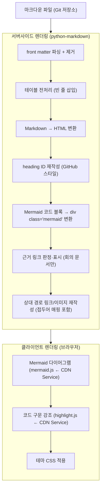
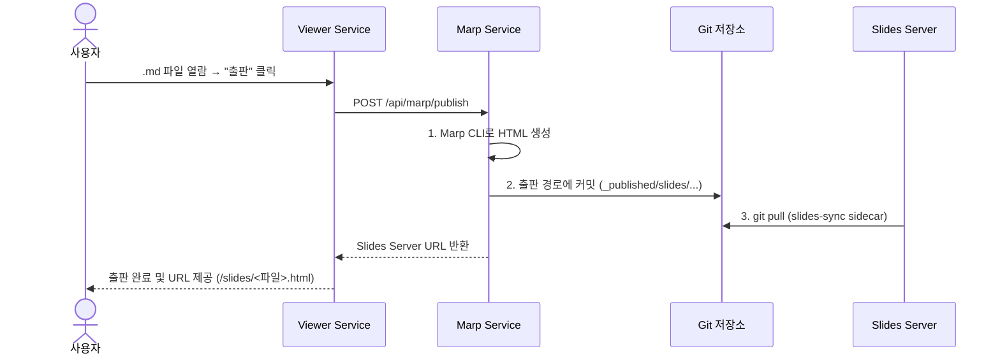
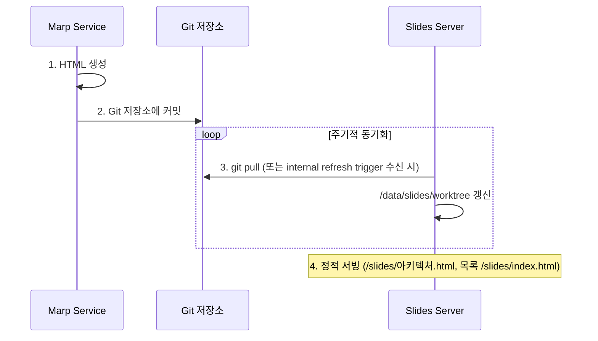
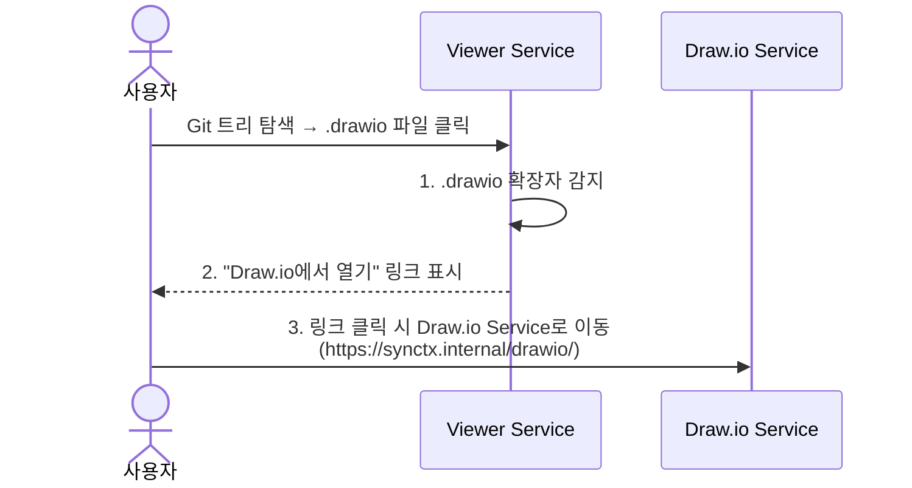
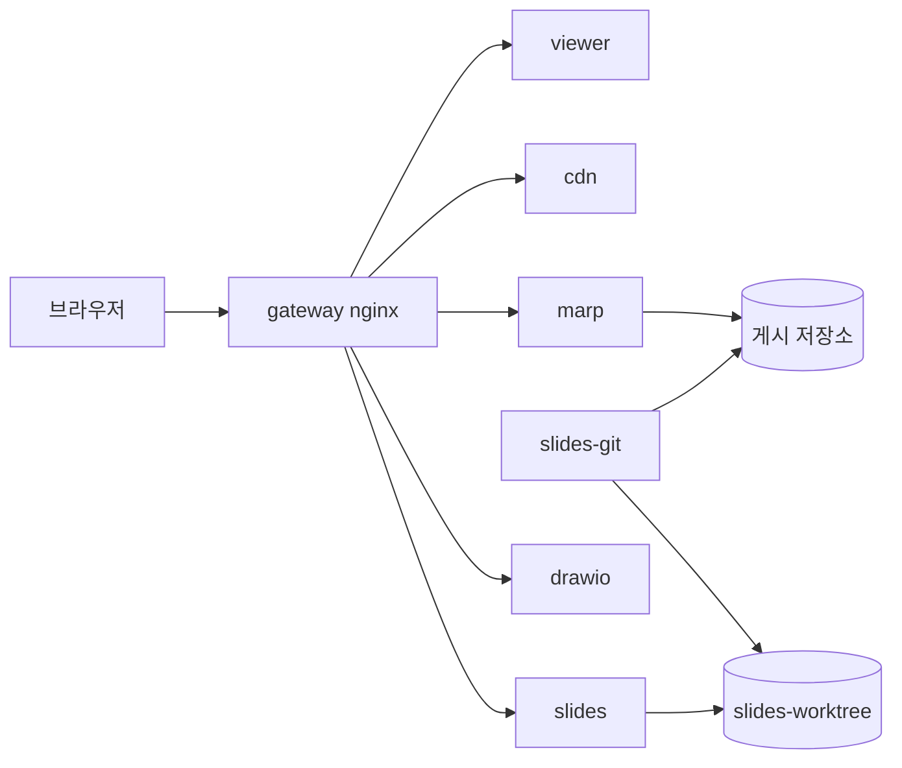
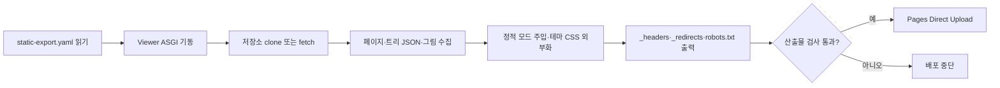

# 아키텍처 설계

이 문서는 synctx의 기본 시스템 구조와 서비스별 책임을 정의한다.
실제 운영 가능한 서비스 수준의 상세 정책, 보안, 상태 관리, 배포 기준, 단계별 체크리스트는 [production-service-design.md](production-service-design.md)를 기준으로 한다.

## 1. 시스템 개요

synctx는 마이크로서비스 아키텍처로 구성되며, K8s 클러스터에서 운영된다.

| 서비스 | 역할 | K8s 리소스 |
|--------|------|------------|
| **Viewer Service** | 마크다운 렌더링·열람 | Deployment |
| **CDN Service** | 정적 라이브러리 서빙 + 파일 업로드 | Deployment + PVC |
| **Marp Service** | 마크다운 → PDF/슬라이드 HTML 변환 + 출판 | Deployment |
| **Draw.io Service** | 다이어그램 작성·편집 (셀프호스팅) | Deployment |
| **Sync Webhook** | GitLab Push Event 수신 및 Sync Job 트리거 (설계만 있음. 코드와 Helm 리소스는 아직 없다) | Deployment |
| **Sync Engine** | Git → XWiki/OpenProject 동기화 | CronJob + PVC |
| **Slides Server** | 출판된 프레젠테이션 HTML 서빙 | Deployment + PVC |
| **Outbound Feedback Exporter** | OpenProject 제한 필드 변경을 서명된 메일 이벤트로 반출 (선택 기능) | CronJob |
| **Jitsi (보조 구성요소)** | JWT 화상 참여·발표자 데이터 채널(선택) | Deployment 4개 + Service + HTTPS Ingress |
| **Collab Gateway** | 회의 안내·변경·취소·요약을 Mattermost 채널로 전달 (선택 기능, Phase 8.3) | Deployment(1개) + PVC |

```mermaid
flowchart TB
    GitLab[("Git 저장소<br>(GitLab 미러)")]
    Ingress{"K8s Ingress"}

    Viewer["Viewer Service"]
    CDN["CDN Service"]
    Drawio["Draw.io Service"]
    Marp["Marp Service"]
    Slides["Slides Server"]
    SyncWebhook["Sync Webhook<br>Receiver (미구현)"]
    Sync["Sync Engine<br>(CronJob)"]
    Jitsi["Jitsi 보조 구성요소<br>(web·prosody·jicofo·jvb, 선택)"]
    Browser["사용자 브라우저"]
    Browser -- "HTTPS·JWT" --> Ingress
    Ingress -- "Jitsi 호스트·HTTPS·WebSocket" --> Jitsi
    Browser -- "UDP 미디어(JVB)" --> Jitsi
    Viewer -. "JWT: 서명·Prosody 검증<br>(앱 키 공유)" .-> Jitsi
    Pushgateway["Pushgateway<br>(CronJob 메트릭)"]
    Prometheus[("Prometheus")]
    Feedback["Outbound Feedback<br>Exporter (optional)"]
    MailGateway[("Approved<br>Mail Gateway")]
    ExternalInbox[("External Mailbox<br>/ Importer")]
    PR["Markdown Update PR"]
    ExternalGit[("External Git<br>Repository")]

    XWiki[("XWiki")]
    OP[("OpenProject")]

    GitLab -. "Push Event" .-> Ingress

    Ingress -- "/view/*" --> Viewer
    Ingress -- "/cdn/*" --> CDN
    Ingress -- "/slides/*" --> Slides
    Ingress -- "/marp/*" --> Marp
    Ingress -- "/drawio/*" --> Drawio
    Ingress -- "/api/sync/webhook/gitlab" --> SyncWebhook

    GitLab --> Viewer
    GitLab --> Marp
    GitLab --> Sync

    Viewer -. "JS/CSS 로딩" .-> CDN

    Marp -- "PDF 생성" --> PDF["PDF 파일"]
    Marp -- "HTML 출판<br>(Git 커밋)" --> GitLab

    Slides -. "git pull (slides-sync)" .-> GitLab

    SyncWebhook -- "K8s Job 즉시 생성" --> Sync
    Sync --> XWiki
    Sync --> OP
    Sync -. "누적 메트릭 push" .-> Pushgateway
    Prometheus -. "scrape" .-> Pushgateway

    OP -. "허용 필드 변경" .-> Feedback
    Feedback -. "redacted + signed email" .-> MailGateway
    Feedback -. "누적 메트릭 push" .-> Pushgateway
    MailGateway -. "mail" .-> ExternalInbox
    ExternalInbox -. "PR 생성" .-> PR
    PR -. "review + merge" .-> ExternalGit
    ExternalGit -. "mirror" .-> GitLab
```



## 2. 핵심 설계 결정

### 2.1 마이크로서비스 아키텍처

각 기능을 독립 서비스로 분리한다.

- **독립 배포**: 각 서비스를 개별적으로 업데이트·롤백
- **독립 확장**: 뷰어 트래픽이 많으면 Viewer만 스케일 아웃
- **기술 다양성**: Viewer/CDN은 Python, Marp는 Python(FastAPI) + Node.js(Marp CLI), Slides는 Nginx
- **장애 격리**: Marp Service 장애가 Viewer에 영향을 주지 않음

서비스 간 통신은 K8s 내부 Service DNS를 사용한다:
- `http://synctx-cdn/mermaid/10.9.1/mermaid.min.js` (CDN Service 포트 80, 앱은 `/`에 마운트하고 Ingress가 `/cdn`을 떼어 넘긴다)
- `http://synctx-marp:8000/api/marp/convert` (Viewer → Marp PDF 변환, `viewer.marp_service_url` 기본값)

### 2.2 단방향 동기화 (외부→내부)

양방향 동기화는 충돌 해결이 복잡하고, 일반적인 내부→외부 반출이 보안 정책상 제한되므로 기본 동기화는 단방향으로 한정한다.

- **소스 오브 트루스**: Git 저장소 (외부에서 작성, 내부 GitLab에 미러링)
- **파생 데이터**: XWiki 페이지, OpenProject 이슈, 출판된 프레젠테이션 HTML
- 내부에서 직접 수정하면 다음 동기화 시 덮어써짐

#### 2.2.1 제한적 Outbound Feedback 예외

운영 정책상 승인된 메일 게이트웨이를 통해 내부에서 외부로 메일 발송이 가능한 경우, OpenProject의 일부 상태 변경을 외부 개발 흐름에 전달하는 선택 기능을 둘 수 있다.
이 기능은 양방향 동기화가 아니라 **서명된 이벤트 반출 + 외부 PR 생성**으로 한정한다.

- 대상은 `synctx_external_key`가 있는 OpenProject Work Package로 제한한다.
- 반출 필드는 allowlist 방식으로 `status`, `priority`, `version`, `due_date` 등 메타데이터만 허용한다.
- 제목, 본문, 댓글, 첨부파일, 개인정보는 기본 반출 금지다.
- 내부 Exporter는 redaction과 HMAC 서명을 적용한 JSON payload를 전용 외부 메일 계정으로 전송한다.
- 외부 Importer는 서명과 중복 이벤트를 검증한 뒤 Markdown 변경 PR만 생성한다. main branch 직접 push는 금지한다.
- PR merge 후 기존 외부→내부 Git 동기화가 다시 OpenProject에 반영되므로 최종 source of truth는 여전히 Git/Markdown이다.
- Exporter도 실행마다 새로 뜨는 CronJob이라 메트릭 누적값을 sync-state의 `feedback_metrics.json`에 두고 실행이 끝날 때 Pushgateway로 push한다(Sync와 같은 `synctx_common.metrics_push` 사용, 상세: production-service-design.md 9.2).

### 2.3 Git diff 기반 증분 동기화

전체 문서를 매번 동기화하지 않고, 마지막 동기화 이후 변경된 파일만 처리한다.

```bash
git diff --name-status -M <last-successful-sha>..HEAD -- <watch-paths>
```

- 마지막 성공 커밋 SHA는 내부 PVC의 repo별 상태 파일에 기록
- 중복 실행 방지를 위해 CronJob 간 중복은 `concurrencyPolicy: Forbid`로, Webhook과 CronJob 간의 중복은 Kubernetes Lease lock으로 제어
- Added/Modified/Deleted 구분하여 처리
- Rename은 기존 리소스 마킹 후 새 리소스 upsert로 처리
- 삭제 시 대상 도구 반영은 설정으로 제어 (기본: 마킹)
- 부분 실패가 있으면 마지막 성공 SHA를 전진하지 않고 다음 실행에서 재시도
- 실행마다 프로세스가 새로 뜨므로 메트릭은 저장소별 누적값을 sync-state의 `metrics/{repo_id}.json`에 두고, 실행이 끝날 때 Pushgateway로 push한다. Prometheus는 Pushgateway를 수집한다(상세: production-service-design.md 9.2)

### 2.4 목적 기반 지능형 라우팅 (OpenProject vs XWiki)

마크다운 파일의 용도에 따라 동기화 대상이 자동으로 결정됩니다. 이는 파일 경로(`mappings`) 또는 Front Matter의 `synctx.target` 속성(`xwiki`·`openproject`·`both`)으로 구분됩니다.

- **프로젝트 관리 및 이슈 트래킹 (OpenProject)**: 요건, 버그, 태스크 등 진행 상태 트래킹이 필요한 문서. 외부망에서는 이를 모아 **마크다운 기반 스크럼 보드(Kanban)** 로 활용합니다.
- **지식 공유 및 설계 (XWiki)**: 아키텍처 설계, API 규격, 회의록 등 영구적인 지식 자산.

```text
workspace/
├── .context/                 → LLM 간 공유되는 시스템 프롬프트 및 글로벌 컨텍스트 (동기화 제외)
│   ├── system_prompt.md      → AI 에이전트의 역할, 코딩 컨벤션, 제약사항
│   ├── project_state.yaml    → 현재 프로젝트 진행 단계, 주요 마일스톤
│   ├── glossary.md           → 도메인 용어와 금지/권장 표현
│   ├── decision-log.md       → 주요 의사결정과 근거
│   ├── blueprints/           → 문서/요건/작업 작성 표준 템플릿
│   └── memory/               → LLM이 남기는 작업 로그 및 트러블슈팅 기록
├── board/
│   └── sprint-1.md           → Viewer에서 칸반 보드로 렌더링, OpenProject 버전/스프린트로 매핑
├── issues/
│   └── TASK-001.md           → OpenProject: Work Package (상태, 담당자 동기화)
├── reports/
│   └── harness/              → Harness Validator 결과(JSON/Markdown)
└── docs/
    └── 아키텍처/
        └── 시스템-설계.md        → XWiki: Space=아키텍처, Page=시스템-설계
```

### 2.5 Front Matter 기반 메타데이터 및 하네스 규격

마크다운 파일 상단의 YAML front matter로 동기화 대상과 메타데이터를 지정한다.

```yaml
---
synctx:
  target: xwiki
  space: "아키텍처"
  page: "시스템 설계"
  tags: [설계, v2]
---
```

OpenProject 이슈:

```yaml
---
synctx:
  target: openproject
  project: example-project
  type: task
  status: in_progress
  assignee: "홍길동"
---
```

스크럼 보드 (스프린트/버전 관리):

```yaml
---
synctx:
  target: openproject
  project: example-project
  type: version
  name: "Sprint 1"
  start_date: "2026-06-20"
  end_date: "2026-07-04"
  status: open
  issues:
    - "issues/TASK-001.md"
    - "issues/TASK-002.md"
---
```

OpenProject Work Package의 Version 연결은 각 Task 문서의 `synctx.version` 필드를 기준으로 한다.
Version 문서의 `issues` 목록은 Viewer 보드 렌더링과 dry-run 검증용 manifest로 사용한다.

Marp 프레젠테이션:

```yaml
---
marp: true
theme: gaia
paginate: true
synctx:
  publish_path: "slides/아키텍처"    # 출판 경로 (선택)
---
```

#### 2.5.1 Harness Validator와 agent-readiness

하네스 엔지니어링은 문서 규격을 만드는 것에서 끝나지 않고, AI가 만든 산출물이 실제로 사람과 내부 도구가 소비할 수 있는지 검증해야 한다.
이를 위해 Sync Engine과 별도로 실행 가능한 `synctx validate-harness` 명령을 제공한다.

검증 대상:

- `.context/` 필수 파일 존재와 YAML/Markdown 형식
- Front Matter schema와 필수 필드
- `issues/` Task 문서와 `board/` Version manifest의 관계
- `synctx.version`과 Version 문서 `issues` 목록의 불일치
- OpenProject/XWiki routing 가능성
- 문서 제목, 요약, 결정 사항, TODO, 출처 링크 등 agent-readiness 품질
- Mermaid, 링크, 이미지, 첨부 경로의 유효성

Hermes류 multi-agent 문서 진단 프레임워크의 아이디어는 여기서 **외부 런타임 의존성**이 아니라 검증 패턴으로만 차용한다.
즉, synctx의 핵심 동기화 경로는 LLM 추론에 의존하지 않고, 필요 시 하네스 검증 리포트에 AI 수정 제안만 추가한다.

출력:

```text
reports/harness/
├── latest.json                 # 기계 처리용 결과
├── latest.md                   # 사람 검토용 요약
└── fixes/
    └── suggested-patches.md    # AI 또는 사람이 적용할 수정 제안 (미구현: 현재 latest.json·latest.md만 만든다)
```

### 2.6 내부 CDN을 통한 라이브러리 서빙

폐쇄망에서는 외부 CDN에 접근할 수 없다. 기본 배포는 CDN Service가 프론트엔드 라이브러리를 서빙한다. 경량 Viewer는 `viewer.asset_source: bundled`로 기존 `static/vendor/` 파일을 직접 제공하며 CDN Service 없이 실행한다(10.7). 기본값은 `cdn`이므로 기존 Helm·Compose 동작은 유지된다.

- **웹 UI + API로 파일 관리**: 새 라이브러리 추가 시 재배포 불필요
- **버전 디렉토리 구조**: `/{library}/{version}/{file}`
- **공유 CDN**: Viewer, Marp, XWiki, 기타 내부 서비스가 동일한 CDN을 사용

### 2.7 서비스 옵션과 의존성

서비스마다 켜고 끌 수 있어 필요한 것만 배포한다(예: Viewer·Marp·Slides만, 여기에 Draw.io 추가). K8s(Helm)와 Docker Compose가 같은 서비스 이름과 순서(`viewer, cdn, marp, slides, drawio, sync, feedback`)를 쓴다.

#### 옵션 모델

| 옵션 | 기본값 | Helm | Docker Compose |
|------|--------|------|----------------|
| `viewer` | 켬 | `viewer.enabled` | `SYNCTX_SERVICES`에 포함 |
| `cdn` | 켬 | `cdn.enabled` | 위와 같음 |
| `marp` | 켬 | `marp.enabled` | 위와 같음 |
| `slides` | 켬 | `slides.enabled` | 위와 같음 |
| `drawio` | 켬 | `drawio.enabled` | 위와 같음 |
| `sync` | 켬 | `sync.enabled` | 2단계 |
| `feedback` | 끔 | `feedback.enabled` | 2단계 |

- 배포 도구는 켜진 서비스를 위 순서대로 쉼표로 이은 값(예: `viewer,marp,slides,drawio`)을 Viewer 환경변수 `SYNCTX_ENABLED_SERVICES`로 넘긴다. Viewer는 값이 없거나 공백이면 모든 서비스가 켜진 것으로 보므로 기존 배포는 동작이 바뀌지 않는다.
- Docker Compose 1단계는 `viewer, cdn, marp, slides, drawio`만 받는다. `sync`·`feedback`을 `SYNCTX_SERVICES`에 적으면 "2단계" 오류로 중단한다.

#### 의존성 규칙

| # | 상황 | 처리 | 검사 위치 |
|---|------|------|-----------|
| D1 | 켜진 서비스가 없음 | 중단 | Helm `fail`, `deploy.sh` |
| D2 | Viewer 켜짐, CDN 꺼짐, `viewer.cdn_base_url`이 상대 경로(`/`로 시작하고 `//`가 아님) | 중단(앱은 `asset_source: cdn`일 때) | Helm `fail`(설정을 차트가 만들 때), Viewer 시작 검사 |
| D3 | Slides 켜짐, Marp 꺼짐 | 경고. 게시 저장소를 직접 채우면 쓸 수 있다 | Helm NOTES, `deploy.sh` |
| D4 | Marp 꺼짐 | Viewer에서 Marp 버튼 3개(PDF·미리보기·출판)를 숨기고 `format=pdf`는 503 | Viewer |
| D5 | Draw.io 꺼짐 | Viewer에서 Draw.io 버튼을 숨김 | Viewer |
| D6 | Docker에서 `sync`·`feedback` 지정 | 중단(2단계 전) | `deploy.sh` |
| D7 | Slides 켜짐, 게시 저장소 주소 없음 | 중단 | `deploy.sh` (Helm은 기본값이 있어 그대로) |
| D8 | `metrics.enabled`, Sync나 Feedback 켜짐, `sync.persistence.enabled=false` | 중단. Sync·Feedback 메트릭 누적값을 sync-state PVC에 두므로 PVC 없이는 Sync·Feedback Alert가 울리지 않는다 | Helm `fail` |

- D2를 Viewer 시작 검사로도 두는 이유: 외부 ConfigMap(`synctxConfig.create: false`)이나 Docker는 배포 도구가 `.synctx.yaml`을 읽지 않는다. Viewer가 시작할 때 오류 메시지를 남기고 종료하면 어느 배포 방식이든 잡힌다.
- 경량 실행은 Helm 렌더를 쓰지 않으며 `bundled`에서는 앱의 CDN 의존성 검사를 건너뛴다. Helm의 기존 CDN 상대 경로 검증은 그대로다.
- D4에서 Marp가 꺼진 Marp 문서에는 버튼이 하나도 남지 않으므로 다운로드 버튼이 나온다.

#### 내부망 CDN을 쓸 때 조건

CDN을 끄고 사내에 이미 있는 CDN을 쓰려면 `viewer.cdn_base_url`을 그 CDN의 절대 주소로 지정한다(코드가 절대 주소와 CSP 허용을 이미 지원한다).

- 파일 경로와 버전이 같아야 한다: `mermaid/10.9.1/mermaid.min.js`, `highlight.js/11.9.0/highlight.min.js`, `highlight.js/11.9.0/styles/*.css`
- 사용자 PC에서 접속할 수 있어야 하고, Viewer가 https이면 CDN도 https여야 한다.
- `synctx-html` 블록이 그 CDN을 쓰면 `html_embed.allowed_origins`에도 넣는다.

#### 알려진 한계

- `.drawio` 파일은 Viewer 보기 대상 확장자(`CODE_LANGUAGE_MAP`)에 없어 415가 난다. 그래서 지금도 Draw.io 버튼이 실제로 표시되는 경로가 없다. 버튼 표시 조건만 옵션에 맞추고 보기 지원은 다루지 않는다.
- D2 검사는 상대 경로만 잡는다. 절대 주소가 꺼진 자기 자신의 `/cdn`을 가리키는 경우는 알 수 없다. Helm D2 검사는 `synctxConfig.create: false`이면 건너뛰며(차트가 설정을 읽지 않음), 이때는 Viewer 시작 검사가 잡는다.
- 알림 규칙(PrometheusRule)은 서비스를 꺼도 그대로 둔다. 대상 메트릭이 없으면 발생하지 않는다.
- K8s Ingress에는 시간 제한 주석이 없어 ingress-nginx 기본 60초를 쓴다. Viewer가 Marp를 부르는 PDF 다운로드도 httpx 제한이 60초다. 둘 다 Marp 변환 제한 120초보다 짧은 기존 문제이며 이번 범위 밖이다. Docker 게이트웨이만 Marp 경로를 180초로 둔다.

## 3. Viewer Service 설계

### 3.1 렌더링 파이프라인



문서 화면(`_render_file_response`)의 처리 순서는 렌더 → `_sanitize_html` → 근거 판정·표시(회의 문서만) → `rewrite_links`(접두어 매핑) → `embed_view.fill`이다. 근거 판정은 링크를 고치기 전 원문 href를 해석하므로 메모 포함 HTML 내보내기도 같은 함수를 쓴다(3.6). `rewrite_links`는 상대 `img src`와 `img`·`<picture>`의 `source srcset`(다크 모드 그림 등, 후보마다 설명자 유지)을 `/raw/<저장소>/…`로, 상대 Markdown 링크를 `/view/<저장소>/…`로 바꾼다.

설계: `.html`·`.htm`은 기본 소스 보기를 유지하고, `repositories[].html_embed.enabled`와 별도 opt-in `render_files`(신규, 기본 false)가 모두 true인 저장소에만 `?mode=render` 화면을 추가한다. 이 opt-in은 모든 `.html`·`.htm`과 모든 브랜치의 실행 신뢰를 뜻한다. 경고·도구 막대·iframe으로 구성하고, 새 탭도 같은 화면의 `layout=full`을 쓴다. iframe의 앱 내부 경로는 `/render/{token}/{repo_id}/{path}`(공개 주소 `/view/render/…`)이며 상대 링크·`target=pf`를 유지해 같은 커밋 SHA의 중첩 문서를 연다. 토큰·`render_token` 모듈·`bundle(frame_src=…)`·`viewer.render_token_ttl_seconds`(기본 14400초)는 PR #63에서 추가했다. `resolve_ref()`는 현재 `origin/<브랜치>`를 돌려주므로 새 `GitRepoManager.resolve_commit_sha()`로 SHA를 확정하고 WP1의 `resolved_reader(manager, sha)`로 읽는다. 토큰은 `v1.{exp}.{ref_b64}.{sha}.{signature}`이며 서명 입력은 `render|v1|{repo_id}|{ref}|{sha}|{exp}`다. ref는 UTF-8 1~255바이트를 패딩 없는 base64url로 싣는다(정규형·최대 길이는 상세 설계 14.2). 파드별 clone이므로 `/render`에서 SHA가 없으면 서명된 ref를 fetch한 뒤 같은 SHA를 다시 확인하고 여전히 없으면 404·새로 고침 안내를 낸다. XWiki·Sync Engine은 기존 합본 기본값을 쓴다.

렌더 화면만 Viewer CSP를 `frame-src 'self'`로 바꾸고 XFO `DENY`는 유지한다. `/render`는 authz → 토큰 → `Sec-Fetch-Dest`(`iframe`·`frame`만) → 신뢰 정책 → HTML 확장자 → 경로 → SHA 존재·필요 시 ref fetch → 읽기 전 `blob_size_resolved(path, sha)` 크기를 확인해 SHA로 읽고, 성공·오류(JSON 포함) 모두 `sandbox allow-scripts`·`no-referrer`·`nosniff`·`no-store` 헤더를 쓴다. 출처 `null`인 조상이 중첩 프레임을 막으므로 `frame-ancestors`·XFO는 넣지 않는다. 다른 Viewer HTML 화면의 `frame-src 'none'`·`DENY`는 유지한다. 현행 XFO는 `text/html`에만 붙으므로 `/api` JSON·`/raw`에는 없다. 같은 출처 `/cdn`·`/marp`·`/slides`·`/drawio`도 프레임 대상이며 sandbox는 물려받지만 합본 meta CSP의 네트워크 제한은 물려받지 않는다. 운영 SSO 중첩 쿠키 시험과 실패 시 대안, `runtime.public_base_url`로 만든 `/view/render/` 경로 소스의 CSP 매칭, Viewer 전용 저장소의 기존 XWiki 전용 계정 요건 완화는 결정 필요다. 설정 해제는 Viewer 재시작 후 적용하고 운영 키는 공유 Secret으로 유지한다. route·응답 표식으로 standalone·K8s 경로를 식별한다. 세부 보안·검증·작업 묶음은 `html-embed-design.md` 13~14장에 둔다.

### 3.2 API

```
GET /api/repos                      저장소 목록
GET /api/repos/{id}/branches        브랜치 목록
GET /api/repos/{id}/tree            트리 탐색
GET /api/repos/{id}/files           볼 수 있는 파일 경로 목록(파일 찾기용)
GET /api/search                     본문 검색(q·repo·ref·collab_only). 서비스 토큰은 협업 저장소·기본 브랜치만
GET /api/repos/{id}/render          마크다운 렌더링
GET /api/repos/{id}/download        HTML/PDF 다운로드
GET /api/repos/{id}/meeting-export  회의 메모 포함 HTML 틀(오프라인, 메모 없음)
GET /api/meetings/{repo_id}/{meeting_id}/evidence  근거 문서 제목·경로·링크(발췌·메모 제외)
GET /api/meetings                   회의 목록(대시보드 데이터. collab.enabled 저장소만. status·repo·channel·presenter·q·from·to·order)
GET /meetings                       회의 대시보드 화면(`meetings`는 예약 경로)
GET /api/repos/{id}/board/{version} 스크럼 보드(칸반) HTML
GET /raw/{id}/{path}                원본 파일(이미지 등 본문이 참조하는 파일)
POST /api/repos/{id}/webhook        Git push 알림
```

렌더 보기: `GET /render/{token}/{repo_id}/{path}`는 렌더 화면 iframe 전용이며, `/view/{repo_id}/{path}?mode=render&layout=full`은 새 탭 화면이다. 토큰은 권한·두 플래그를 확인한 Viewer 화면 생성 함수에서 발급하며 이를 공유하는 `render_file` API 응답에도 실릴 수 있다. 토큰 전용 발급 API는 두지 않는다. 실행 화면은 iframe의 `postMessage`로 갱신 확인(`GET /api/repos/{repo_id}/head`로 SHA 비교 후 화면 새로 고침)과 같은 저장소 문서 열기, GitHub 주소 새 창 열기를 받는다(`html-embed-design.md` 14.13). 새 창으로 여는 HTML은 같은 토큰의 `GET /open/{token}/{repo_id}/{path}`가 파일을 합치지 않고 그대로(크기 상한 없음, CSS·JS·그림은 각 형식으로) `/render`와 같은 sandbox 헤더로 내보낸다.

`/raw/`는 png·jpg·gif·webp·svg를 그 이미지 형식으로, 나머지는 `application/octet-stream`으로 준다. 저장소의 SVG는 스크립트를 담을 수 있으므로 `Content-Security-Policy: default-src 'none'; style-src 'unsafe-inline'; sandbox`와 `X-Content-Type-Options: nosniff`를 붙여 주소를 직접 열어도 실행되지 않게 한다.

### 3.3 기능 목록

| 기능 | 설명 | 기존 md-preview |
|------|------|-----------------|
| Git 저장소 탐색 | 다중 저장소, 브랜치, 트리 | 있음 (재활용) |
| 마크다운 렌더링 | python-markdown 기반 HTML 변환 | 있음 (재활용) |
| 스크럼 보드 렌더링 | 이슈 마크다운 목록을 Trello 형태의 칸반 보드로 시각화 | **신규 (Phase 6)** |
| 테마 | 7개 테마 CSS | 있음 (재활용) |
| Mermaid | 클라이언트 사이드 렌더링 | CDN 방식으로 변경 |
| 코드 하이라이팅 | highlight.js 구문 강조 | CDN 방식으로 변경 |
| HTML 다운로드 | 일반 다운로드는 기본 렌더 HTML. 회의 내보내기는 vendor·브라우저 메모 포함 자체 완결형 HTML | 있음 (재활용) |
| PDF 다운로드 | Marp Service(`/api/marp/convert`)로 변환 | Marp 방식으로 변경 |
| Marp 연동 | "PDF 변환" / "출판" 버튼 | **신규** |
| 회의 모드 | `?mode=meeting`: 메모·형광펜·회의 정리, `.md`·메모 포함 HTML 내보내기/가져오기. 서버 판단은 `meeting.py`, 화면은 `static/meeting/`. 회의 문서는 정보 카드(`meeting_card.py`)와 발표 화면 `?mode=present`도 쓰고, 회의 모드 화면은 첫 사용 안내를 보인다(3.6) | **신규 (Phase 8.1a)** |
| 근거 미리보기·근거 모음 | 회의 문서가 인용한 다른 md 문서의 조문·절을 링크 말풍선(미리보기)과 문서 끝 근거 모음으로 보임. 서버 판단은 `evidence.py`, 화면은 `static/meeting/evidence*.js·css`. `synctx.meeting.references` 접두어 매핑으로 다른 저장소의 문서도 가리킴(3.6) | **신규 (Phase 8.1b)** |
| 회의 대시보드 | `/meetings`·`GET /api/meetings`: 저장소 전체 회의 목록·상태 탭·필터와 결정·액션 집계. 서버 판단은 `meeting_index.py`(`git grep`으로 후보를 찾고 `(저장소, 커밋 SHA)`로 캐시), 화면은 `viewer_ui.py`(3.6) | **신규 (Phase 8.1c)** |
| front matter 분리 | 렌더링 전에 front matter를 본문에서 떼어 냄(일반 보기 포함) | **신규 (Phase 8.1a)** |
| 인터랙티브 HTML 임베드 | ` ```synctx-html ` 블록을 `synctx_common.html_bundle`로 합본해 CSP meta가 든 sandbox srcdoc iframe으로 렌더링. sanitizer 뒤에 자리표시를 채운다(`embed_view.py`). `enabled`·`render_files`를 함께 켠 HTML `mode=render`, Viewer 화면의 블록 크게 보기 오버레이(다운로드 제외) | **신규 (Phase 9)** |

### 3.4 Marp 연동

Viewer에서 마크다운 파일을 열람할 때, `marp: true` front matter가 감지되면 추가 UI를 표시한다:

- **슬라이드 미리보기 버튼** → Marp Service의 미리보기 API 호출 → 슬라이드 HTML 표시
- **PDF 만들기 버튼** → Marp Service의 변환 API 호출 → PDF 다운로드
- **출판 버튼** → Marp Service의 출판 API 호출 → Git에 HTML 커밋 → Slides Server URL 반환 (`marp.publish_repo`가 설정됐을 때만 표시)

### 3.5 UI/UX 및 디자인 시스템

웹에서 보여지는 레이아웃과 디자인은 사용자 경험(UX)에 매우 중요한 요소이다. 일관성 있고 완성도 높은 UI를 제공하기 위해 기존 사내 프로젝트의 디자인 자산을 적극 재활용한다.

- **디자인 레퍼런스**: 사내 example-fe 디자인 시스템 자산을 참조하여 색상 팔레트, 타이포그래피, 레이아웃 구조를 차용한다. (상세 내용은 `docs/reusable-assets.md` 참조)
- **일관된 사용자 경험**: 기존 사내 서비스에 익숙한 사용자가 synctx Viewer 및 스크럼 보드(Kanban)를 사용할 때 이질감을 느끼지 않도록 시각적 스타일을 통일한다. 단, React 컴포넌트를 직접 재사용하지 않고 CSS 변수, 레이아웃 패턴, CSS 스타일시트만 추출하여 서버사이드 렌더링 환경(FastAPI)에 맞게 적용한다. (Phase 1~4의 Viewer는 순수 서버 렌더링 + Vanilla JS/CSS로 구현하며, 향후 Phase 6의 스크럼 보드 등 고도의 인터랙션이 필요한 기능 개발 시에만 `example-fe`의 React/Vite 스택을 별도 번들로 도입하는 것을 원칙으로 하여 프론트엔드의 이중 구조화를 방지한다.)
- **반응형 웹 및 접근성**: 데스크탑 및 태블릿 환경에 최적화된 반응형 레이아웃을 구성하며, 마크다운 렌더링 결과물(테이블, 코드 블록, 인용구 등)이 기존 디자인 시스템 내에서 조화롭게 표시되도록 CSS를 세밀하게 조정한다.

### 3.6 화면 구성

모든 화면(첫 화면 `/`, 저장소 `/{repo}`, 문서 `/{repo}/{path}`, 오류 화면)은 `viewer_ui.py`가 만드는 공통 틀을 쓴다.

- **공통 상단 바**: 저장소·브랜치 선택, 문서 검색(`⌘K`·`/`), 저장소 상태, 테마 선택, 단축키 안내(`?`. 회의 모드 문서 화면에서만 이 안내 창 안에 「회의 모드 안내 보기」 버튼이 보인다). 첫 포커스는 "본문으로 건너뛰기" 링크다.
- **문서 화면 3단**: 1100px 이상에서 `파일 트리 | 본문 | 이 문서(목차)`. 768-1099px에서는 목차가 왼쪽 열의 "이 문서" 탭으로 들어가고, 767px 이하에서는 본문만 두고 ☰ 서랍(파일·이 문서 탭, 저장소·브랜치·테마 선택)과 "목차" 버튼을 쓴다.
- **오류 화면**: 화면 경로의 `HTTPException`은 같은 상단 바를 가진 HTML 안내 화면(404 저장소·파일, 413, 415, 조회 실패 502, 그리기 실패 500)으로 돌려주고, `/api/...`·`/raw/...` 경로는 JSON을 유지한다. 예약 경로(`/api`·`/static`·`/healthz` 등을 첫 경로로 쓴 요청)의 404와 접근 거부(`verify_viewer_access`의 403)도 JSON이다. 예외 메시지는 화면에 넣지 않는다.
- **정적 자산**: `static/viewer.css`(레이아웃·반응형), `static/viewer-core.js`(DOM에 의존하지 않는 로직: 문서 검색 묶음·검색 예약, 파일 목록 로더, 최근 본 문서, 회의 진행 상태 계산, 안건 칩의 소속 절 판단, 발표 장 나누기·`#slide-N`·넘기기 키 판단, 회의 모드 안내를 자동으로 열지 판단), `static/viewer.js`(상단 바·서랍·목차와 안건 칩 추적·회의 진행 상태 갱신·회의 모드 안내·발표 화면·알림·확인 창 동작). 회의 모드 자산(`static/meeting/`)과 본문 `<article class="markdown-body">`는 그대로 쓴다. `/static/` 아래 파일은 `Cache-Control: no-cache`로 내보내 브라우저가 매번 ETag로 재확인한다. 파일 이름에 버전이 없어 Viewer를 새 버전으로 띄운 뒤 예전 스크립트가 캐시에서 쓰이는 것을 막는다.
- **파일 찾기 데이터**: `GET /api/repos/{repo_id}/files?ref=`가 볼 수 있는 파일 경로 목록을 한 번 돌려주고, 브라우저에서 부분 일치로 거른다. 조회가 실패하면 502다.
- **문서 검색**: 상단 입력 "문서 검색"의 결과 상자는 "파일"(현재 저장소의 파일 이름 일치, 최대 8개)과 "본문"(본문 일치 최대 5건) 묶음, 맨 끝의 "‘검색어’ 전체 결과 보기"로 이뤄진다. 본문은 입력이 멈추고 250ms 뒤 `GET /api/search`를 부르고, 새 입력·Esc·검색어 지움이면 예약과 진행 중 요청을 취소하며 가장 최근 요청의 응답만 받는다. 저장소를 고르지 않은 첫 화면에서는 "파일" 묶음 없이 모든 저장소의 본문을 찾는다. 전체 결과는 `GET /search?q=&repo=&ref=&ref_repo=` HTML 페이지(저장소별 묶음, 일치 부분 `<mark>`, 저장소 선택)이며, `ref`는 `ref_repo`와 같은 저장소를 다시 찾을 때만 유지한다. `search`는 저장소 id로 쓸 수 없는 예약 경로이고, 설정에 그런 저장소가 있으면 시작할 때 경고를 남긴다.
- **본문 검색 API**: `GET /api/search?q=&repo=&ref=&collab_only=`는 `git grep -n -I -F -i -z --max-count=5 --threads=1`(고정 문자열·대소문자 무시·이진 파일 제외·파일당 최대 5줄·한 스레드)로 해당 ref 트리를 찾는다. 검색어는 앞뒤 공백을 뺀 뒤 2~100글자이고 줄바꿈·NUL이 없어야 하며(어기면 400), `ref`는 `repo`와 함께만 쓰고(아니면 400), 모르는 저장소는 404, 접근 권한은 `verify_viewer_or_service_access`다. `collab_only=true`이면 협업 저장소만 찾으며 서비스 토큰은 이 필터를 강제하고 `ref`를 거부한다(빈 값 포함, 400). 서비스 토큰은 `repo`를 생략하면 전체 협업 저장소를 검색하고, 지정한 id가 없거나 비협업이면 404다. 일반 권한의 기존 전체 검색·ref 동작은 유지한다. 결과마다 "볼 수 있는 파일" 판정을 다시 적용하고 제어 문자나 점으로 시작하는 경로 조각이 있는 파일은 뺀다. 한 저장소당 최대 50건, git 출력 2 MiB를 넘으면 끝내고 `truncated`로 표시한다. 기한은 저장소마다 3초이며 기본이 아닌 브랜치의 fetch와 실행 차례를 기다린 시간을 포함한다. 검색은 전용 실행기(프로세스(파드)마다 동시 4개)에서 돌아 다른 저장소 작업을 막지 않는다. 저장소별 `status`는 `ok`·`timeout`·`unsupported`(부분 복제 `blobless`·`treeless`는 검색하지 않음)·`unavailable`(받는 중·동기화 실패)·`failed`이고, 일반 Viewer 권한의 결과 한 건은 `path`·`line`·`before`·`match`·`after`(세 문자열 합쳐 160자 이하)이며, 서비스 토큰은 저장소 정보와 `path`만 반환한다. 검색 응답에는 예외 문구를 넣지 않고, 검색 경로가 새로 남기는 로그는 예외 종류만 담는다. 기본이 아닌 브랜치를 받는 git 호출의 기존 로그(`git_command_failed`·`fetch_ref_failed`)는 URL 인증정보와 Authorization 헤더를 가린 채 남는다. 다른 Viewer JSON API의 오류 `detail`도 고정 문구이고, git 실패 예외의 명령 목록에는 인증 헤더 설정 인자가 들어가지 않는다.
- **회의 정보 카드**: Front Matter의 `synctx.meeting`이 검증을 통과한 문서는 회의 모드를 쓸 수 없는 저장소·브랜치에서도 본문 머리의 경로 아래, 문서 정보 줄 위에 카드를 보인다. 제목, 일시(`starts_at`을 KST로 바꿔 "2026-10-15 (목) 15:00–15:30", 끝 시각은 `starts_at + duration_minutes`), 발표자(`presenters`가 있을 때만), 채널과 진행 상태를 담는다. 상태 글 "취소된 회의"는 서버가 그려 스크립트 없이도 보이고, 나머지는 스크립트가 현재 시각으로 30초마다 바꾼다("시작 전 · N분 후", 하루 이상 남으면 "시작 전", "진행 중 · N분 지남 · M분 남음", "끝남"). 카드 아래 안건 칩은 본문 `h2` 제목(최대 20개)을 링크로 보이고, 화면에 보이는 절의 칩이 현재 항목(`aria-current`)이다. `h3`·`h4` 안에서는 소속 `h2` 칩이 현재 항목으로 남는다. 목차와 안건 칩의 링크 id는 본문 제목 id와 같다(렌더러가 목차 데이터 id를 본문 제목 id에 맞추고, 원시 HTML로 쓴 제목은 목차에 넣지 않는다).
- **발표 화면 `?mode=present`**: 회의 문서에서만 열리고, 회의 문서가 아니면 일반 문서 화면에 "발표 화면은 회의 문서에서만 쓸 수 있습니다" 안내를 보인다. 회의 문서의 동작 버튼 줄에 "발표하기"가 있다. 상단 바·파일 트리·목차를 숨기고 본문을 한 열로 크게 보이며, 위쪽 띠(회의 제목·시간)와 아래쪽 막대(진행 막대, "이전(←)" "N / M" "다음(→)" "메모 보기(N)" "발표 끝내기(Esc)")를 둔다. 장은 본문 최상위 요소를 `h2`마다 나누고(첫 `h2` 앞 내용이 첫 장), DOM을 옮기지 않고 다른 장의 요소만 숨긴다. 회의 모드의 형광펜·메모가 본문 글자 위치에 붙기 때문이다. 키는 →·PageDown·Space(다음), ←·PageUp·Shift+Space(이전), Home(첫 장), End(마지막 장), N(메모 패널), Esc(발표 끝내기, 문서 화면으로 돌아감)이다. 조합키를 누른 채이거나 입력칸·메모 패널 안에서 입력할 때는 어떤 키도 장을 넘기지 않고, 버튼·링크에 포커스가 있을 때는 Space만 그 요소의 기본 동작에 맡긴다. 현재 장은 `#slide-N`에 남아 새로 고쳐도 그 장에서 시작하고, 장이 바뀌면 화면 낭독기에 "N / M장: 제목"을 알린다. 회의 모드를 쓸 수 있는 문서면 발표 화면에도 회의 모드 자산을 싣고 "메모 보기(N)"는 회의 모드의 메모 버튼을 누른 것과 같으며, 쓸 수 없으면 이 버튼을 숨긴다. 메모 패널이 열려 있으면 Esc는 패널만 닫고, 숨긴 장의 메모 인용문·회의 정리 항목으로 가면 그 장으로 바뀐다. 본문이 비어 있으면 "발표할 내용이 없습니다"를 보이고 이전·다음을 끈다. 발표 중에는 숨긴 화면 요소를 여는 문서 화면 단축키(`t`·`/`·`?`·⌘K)를 쓰지 않는다.
- **회의 모드 첫 사용 안내**: 회의 모드가 켜진 문서 화면(`?mode=meeting`)에서만 문서 머리의 「회의 모드 나가기」 아래에 "회의 모드 안내" 상자를 보인다. 발표 화면, 회의 모드를 쓸 수 없다는 안내 화면, 일반 문서 화면, 내보낸 HTML에는 없다. 모달이 아니라 본문을 가리지 않고, 첫 자동 표시는 포커스를 옮기지 않는다. 내용은 네 줄이다(메모는 이 브라우저에만 저장되고 공유되지 않음, 「+ 메모」나 본문 드래그로 메모 추가, 「메모」 패널의 「회의 정리」 탭에 결정·액션 메모가 모임, 「.md로 내보내기」로 전하고 「가져오기」로 합침). 「닫기」(안내 안에 포커스가 있을 때는 Esc도 같다)는 이 화면에서만 숨기고 새로 고치면 다시 뜬다. 「다시 보지 않기」는 브라우저 localStorage에 `synctx-meeting-guide=hidden`을 남겨 다른 회의 문서에서도 뜨지 않으며, 저장소를 쓸 수 없으면 이 화면에서만 숨긴다. 다시 열기는 「회의 모드 나가기」 옆 「사용법」 버튼(`?` 버튼이 숨는 767px 이하에서는 이 길뿐)과 `?` 단축키 창의 「회의 모드 안내 보기」이며, 다시 열면 포커스가 안내 제목으로 가고, 저장된 「다시 보지 않기」 값은 지우지 않는다. 표시 판단은 `viewer-core.js`의 `meetingGuideAutoOpen`, 마크업은 `viewer_ui.py`, 동작은 `viewer.js`가 맡는다.
- **회의 대시보드**: 상단 바의 「회의」(`collab.enabled` 저장소가 있을 때)와 회의 정보 카드의 「회의 대시보드로」가 `/meetings`로 간다. 저장소 전체 회의를 한 화면에서 모아 보는 대시보드 `/view/meetings`(상태 탭 전체·예정·진행 중·종료·취소, 저장소·채널·발표자·기간·제목 필터, 결정사항·액션 아이템 탭)와 JSON `GET /api/meetings`. `collab.enabled`인 저장소의 기본 브랜치에서 `synctx.type: meeting`이고 검증을 통과한 문서만 모으며, 오류 문서는 사유와 함께 「확인 필요」에 보인다. 결정·액션은 회의 문서와 같은 폴더의 `<문서명>.memo.md`(회의 모드 `.md` 내보내기)를 저장소에 커밋하면 그 데이터 블록에서 읽고 서버에는 메모를 저장하지 않는다. 필터는 서버가 처리하는 GET 폼(쿼리 `tab`·`repo`·`channel`·`presenter`·`owner`·`q`·`from`·`to`·`order`)이라 새 스크립트가 없고, 상태는 글자로 표시한다(색 단독 아님). 저장소당 회의 500건, 문서 512 KiB, 메모 파일 256 KiB·메모 1000개까지 읽고 넘으면 일부만 표시한다. 부분 복제(blobless·treeless) 저장소는 안내만 보인다.
- **회의 근거 API**: `GET /api/meetings/{repo_id}/{meeting_id}/evidence`는 일반 Viewer 권한·서비스 토큰을 허용한다. `meeting_index`로 협업 저장소 기본 브랜치의 검증된 회의를 찾고 없으면 404다. 기존 렌더·근거 매핑·리더·빌더로 조립한 뒤 `meeting_id`, `status`, `omitted`, `evidence`의 `title`(문서 제목)·`repo_id`·`path`·`url`만 반환한다. 서비스 토큰은 참조 대상도 협업 저장소로 제한하고 범위 밖 저장소는 읽지 않는다. 읽기 실패·설정에 없는 저장소·서비스 토큰 범위 밖의 참조는 문서와 디코딩한 앵커별 중복을 합쳐 `omitted`로 세며, 생략이 있으면 목록이 비어도 `status=partial`이다. 발췌·메모·인용 문맥을 제외하며 전체 실패는 빈 목록과 `status=failed`, `omitted=0`으로 처리한다. 일반 Viewer 화면의 근거 처리는 유지한다.
- **근거 미리보기·근거 모음**: 검증을 통과한 `synctx.meeting`이 있는 문서(일반 보기·발표 화면은 회의 모드를 쓸 수 없는 저장소·브랜치에서도, 회의 모드·메모 포함 HTML은 회의 모드를 쓸 수 있는 곳에서)에서 본문 링크 중 같은 문서가 아닌 `.md`/`.markdown` 파일(Git blob)이고 실제로 있는 것을 근거로 본다. 폴더·이미지·외부 링크·같은 문서 `#앵커`·없는 파일은 근거가 아니며 기존 링크 처리 그대로다. 서버(`evidence.py`)는 근거 링크에 `data-evidence="evidence-N"` 속성만 더하고 링크 글자·href는 바꾸지 않아, 본문 글자 오프셋으로 붙는 회의 모드 메모의 위치와 내보내기 본문 일치가 유지된다. 근거 모음은 본문 `<article>` 바깥 바로 뒤의 `<section class="evidence-list">`로 서버가 그리고(근거가 0건이면 없음), 근거 문서별 묶음(본문에 처음 나온 순서) 안에 항목(위치, 발췌, "인용한 곳", "원문 열기")을 둔다. 같은 대상(문서+퍼센트 디코딩한 앵커)은 한 항목으로 합치고, "인용한 곳"은 링크가 든 가장 가까운 앞 `h2`·`h3` 제목 링크다. 문서명은 근거 문서의 front matter `title:` → 첫 `#` 제목 → 파일 이름 순으로 정한다. 발췌는 앵커 위치에 따라 제목 절·표 행·굵은 조문 줄·앵커 없음(문서 첫 부분, 최대 14줄) 규칙으로 잘라 그 부분만 렌더링하고(앵커를 못 찾으면 문서 첫 부분과 안내), 해설 블록(`<div class="commentary">`)은 뺀다. 근거 원문의 `synctx-html` 블록은 설정 줄 대신 "[인터랙티브 HTML: <title>]"(title이 없으면 `src` 파일 이름) 한 줄로 보인다. 발췌 하나는 80줄·16 KiB, 근거 링크 처리는 200개, 서로 다른 근거 파일은 50개까지다. 발췌는 렌더 뒤 발췌 전용 허용 목록 정화를 거쳐(허용 밖 태그는 글자만, `script` 등은 내용째 삭제, 모든 속성 삭제, 링크는 글자만, 이미지는 `[그림: alt]`) 말풍선 데이터(`<script type="application/json" data-synctx-evidence>`, `encode_for_script`)와 근거 모음에 쓴다. 근거 하나가 실패해도 문서는 정상으로 보이고, 근거 조립 전체가 실패하면 근거 없이 보인다.
  - **다른 저장소**: `synctx.meeting.references`(접두어 → `<저장소 id>:<저장소 루트 기준 경로 접두어>`, 최대 20개)가 href 원문 접두어를 다른 저장소 경로로 바꾸며 가장 긴 키가 이긴다. 같은 저장소 근거는 본문과 같은 ref, 다른 저장소 근거는 그 저장소의 기본 ref로 읽는다. 매핑된 링크는 근거가 아니어도 `rewrite_links`가 `/view/<저장소>/<경로>`로 바꾼다(저장소 루트·폴더를 가리키면 `/view/<저장소>?path=<폴더>`). 설정에 없는 저장소를 가리키는 매핑은 무시하고 그 접두어의 링크를 href 원문 그대로 두며, 문서 머리에 "근거 저장소를 찾지 못했습니다: <id>" 안내를 한 번 보인다.
  - **말풍선**: 근거 링크에 포인터를 올리거나 포커스하면 `role="tooltip"` 말풍선(링크의 `aria-describedby`)에 문서명·위치·발췌가 뜬다. 링크 아래에 두고 화면 아래를 넘으면 위로 뒤집으며, 떠난 뒤 200ms에 닫고 말풍선 위에 포인터가 있으면 유지한다. 터치 기기(hover 없음)는 말풍선 없이 이동한다. 말풍선은 `body` 끝에 `data-meeting-ui`로 하나만 두고 z-index는 메모 패널·선택 버튼보다 위다.
  - **이동**: 근거 링크를 누르면 `location.hash`를 바꾸지 않고 근거 모음의 해당 항목으로 스크롤하고 포커스한다(발표 화면의 `#slide-N` 처리와 부딪히지 않게 하기 위함). Ctrl/⌘·Shift·Alt·가운데 클릭과 `target`이 `_self`가 아닌 링크는 원래 href로 간다. 오프라인 사본의 "원문 열기"는 빼고, "인용한 곳"은 같은 파일 안 `#id`라 그대로 둔다.
  - **Esc와 발표 화면**: 말풍선이 열려 있을 때의 Esc는 말풍선만 닫고(메모 패널·발표 끝내기보다 먼저, `viewer.js`의 발표 키 처리도 이 경우 건너뛴다), 메모 패널이 함께 열려 있으면 다음 Esc가 패널을 닫는다. 발표 화면의 화면에서는 근거 모음을 숨기고(인쇄 때는 보임), 수정 키 없는 근거 링크 클릭은 이동하지 않고 그 링크의 말풍선을 열며(다시 누르거나 Esc로 닫음) 장과 `#slide-N`은 그대로다.
  - **메모 포함 HTML**: `meeting-export`가 같은 근거 데이터·근거 모음·`evidence-core.js`·`evidence.js`·`evidence.css`를 인라인으로 넣는다(근거 모음·근거 데이터에는 외부 참조가 없다). 이 사본은 링크를 매핑으로 고치지 않는다(8.1a 규칙 그대로).
  - **정적 자산**: 순수 로직(말풍선 위치 계산, 수정 키 판정)은 `evidence-core.js`로 빼 `node --test`로 검사하고, 동작은 `evidence.js`, 스타일은 `evidence.css`(7개 테마 글자 대비 4.5:1, `prefers-reduced-motion`에서 전환 끔)가 맡는다. 회의 모드 스크립트와 별개라 회의 모드가 꺼져도 동작한다.

## 4. CDN Service 설계

### 4.1 디렉토리 구조

```
cdn-data/
├── mermaid/10.9.1/mermaid.min.js
├── highlight.js/11.9.0/
│   ├── highlight.min.js
│   └── styles/{github,github-dark,monokai,atom-one-light}.min.css
└── chart.js/4.4.4/chart.umd.min.js
```

### 4.2 API

```
GET    /cdn/{path}                  정적 파일 서빙
POST   /api/cdn/upload              단일/다중 파일 업로드
GET    /api/cdn/list                전체 라이브러리 목록
GET    /api/cdn/list/{library}      특정 라이브러리의 버전 목록(버전별 파일 수)
GET    /api/cdn/manifest            라이브러리 manifest
POST   /api/cdn/scan                저장소에 있는데 manifest에 없는 파일 등록
DELETE /api/cdn/{path}              파일 삭제
GET    /api/cdn/admin               업로드 관리 웹 UI
```

### 4.3 파일 업로드

```bash
# 단일 파일
curl -X POST "http://synctx-cdn/api/cdn/upload" \
  -F "file=@mermaid.min.js" \
  -F "path=mermaid/11.0.0/mermaid.min.js"

# 다중 파일
curl -X POST "http://synctx-cdn/api/cdn/upload" \
  -F "files=@github.min.css" \
  -F "files=@github-dark.min.css" \
  -F "base_path=highlight.js/11.9.0/styles/"
```

### 4.4 캐시 전략

버전이 URL에 포함되므로 영구 캐시 가능:

```
Cache-Control: public, max-age=31536000, immutable
```

## 5. Marp Service 설계

### 5.1 개요

[Marp](https://marp.app/)는 마크다운을 슬라이드로 변환하는 도구다. `@marp-team/marp-cli`를 사용하여 PDF와 프레젠테이션 HTML을 생성한다.

### 5.2 변환 모드

| 모드 | 입력 | 출력 | 사용 시나리오 |
|------|------|------|---------------|
| PDF 다운로드 | 마크다운 (.md) | PDF 파일 | 발표 자료 인쇄/배포 |
| HTML 다운로드 | 마크다운 (.md) | 자체 완결형 HTML | 오프라인 프레젠테이션 |
| HTML 출판 | 마크다운 (.md) | HTML → Git 커밋 → 웹 접근 | 팀 내 공유 |

### 5.3 API

```
POST /api/marp/convert              PDF/HTML 변환 + 다운로드
POST /api/marp/publish              HTML 생성 → Git 커밋 → URL 반환
POST /api/marp/preview              슬라이드 미리보기 HTML 반환
GET  /api/marp/themes               사용 가능한 테마 목록
GET  /api/marp/published            출판된 슬라이드 목록
DELETE /api/marp/published/{filename} 출판 취소(파일 삭제 + 커밋)
```

### 5.4 PDF 변환 흐름

```
POST /api/marp/convert
  Body: { markdown, format: "pdf" }   # Viewer가 Git에서 읽은 마크다운을 넘긴다

  1. Mermaid 코드 블록을 mmdc로 SVG로 바꿔 인라인으로 넣기
  2. marp input.md --html --allow-local-files --pdf -o output.pdf
  3. PDF 파일을 응답으로 반환 (Content-Disposition: attachment)
```

```bash
# Marp CLI 명령어 (변환 제한 marp.conversion_timeout_seconds, 기본 120초)
marp input.md --html --allow-local-files --pdf -o output.pdf
```

### 5.5 HTML 출판 흐름



### 5.6 Git 출판 기능 (`marp/src/app.py`)

```
Marp publish API
├── publish_html(markdown, filename)
│   ├── clone/fetch 출판 대상 저장소
│   ├── HTML 파일을 지정 경로에 배치
│   ├── git add + commit
│   └── git push (내부 GitLab)
├── list_published()                  # 출판된 슬라이드 목록
└── unpublish(filename)               # 출판 취소 (파일 삭제 + 커밋)
```

출판된 HTML은 Git 저장소에 커밋되므로 이력 관리가 가능하다.
출판 저장소 인증은 소스 저장소의 읽기 토큰과 분리한다. `marp.publish_auth`가 있으면 그것을, 없으면 출판 전용 `GIT_PUBLISH_TOKEN`을 쓴다. 둘 다 없을 때만 0.6.0까지처럼 `repositories[0].auth`로 출판하고 `publish_auth_fallback` 경고를 남긴다(production-service-design.md 3.4).
운영 기준에서 출판 데이터의 단일 원천은 `publish_repo` Git 저장소다.
Slides Server는 PVC에 직접 쓰지 않고, `slides-sync` sidecar가 `publish_repo`를 pull한 working tree를 읽기 전용으로 서빙한다.

### 5.7 Marp 테마

`GET /api/marp/themes`는 Marp 내장 테마(`default`, `gaia`, `uncover`)를 돌려준다. 문서는 front matter `theme:`으로 고른다.

CDN Service에 둔 커스텀 테마를 쓰는 설정(`marp.themes`·`marp.custom_themes`)은 아직 없다. 설정 모델(`MarpConfig`)에 이 키가 없어 `.synctx.yaml`에 적어도 무시된다.

### 5.8 Dockerfile

Marp CLI는 Node.js 기반이므로 Python + Node.js 멀티 런타임 이미지를 사용한다. Node 단계에서 Marp CLI와 Mermaid CLI(`mmdc`)를 설치하고 Python 이미지로 복사한다(`services/marp/Dockerfile`, 저장소 루트에서 빌드).

```dockerfile
ARG NODE_IMAGE=node:20-slim
ARG PYTHON_IMAGE=python:3.13.16-slim-trixie

FROM ${NODE_IMAGE} AS node-env
RUN npm install -g @marp-team/marp-cli @mermaid-js/mermaid-cli

FROM ${PYTHON_IMAGE}
WORKDIR /app

# Chromium(Marp PDF·mmdc용)과 한글 글꼴
RUN apt-get update && apt-get install -y --no-install-recommends git chromium fonts-noto-cjk && \
    rm -rf /var/lib/apt/lists/*

COPY --from=node-env /usr/local/bin/node /usr/local/bin/
COPY --from=node-env /usr/local/lib/node_modules /usr/local/lib/node_modules
# marp·mmdc·npm 심볼릭 링크 생략

ENV CHROME_PATH=/usr/bin/chromium
ENV PUPPETEER_EXECUTABLE_PATH=/usr/bin/chromium

COPY shared/synctx-common /app/shared/synctx-common
COPY services/marp /app/services/marp
COPY pyproject.toml /app/
RUN pip install --no-cache-dir uv && \
    uv pip install --system -e shared/synctx-common -e services/marp

ENV PYTHONPATH=/app/services/marp/src
EXPOSE 8000
CMD ["uvicorn", "app:app", "--host", "0.0.0.0", "--port", "8000"]
```

## 6. Slides Server 설계

### 6.1 개요

Marp Service가 출판한 프레젠테이션 HTML을 정적으로 서빙하는 경량 Nginx 서버.

### 6.2 Nginx 설정

원본은 `helm/synctx/files/nginx.conf`(Helm ConfigMap과 Docker Compose가 같은 파일을 쓴다). 핵심 부분:

```nginx
server {
    listen       80;
    server_name  localhost;

    # slides-sync sidecar가 받은 출판 저장소 working tree
    root   /data/slides/worktree/_published/slides;
    index  index.html;   # 목록은 sidecar가 generate-index.sh로 만든다(autoindex 미사용)

    location / {
        try_files $uri $uri/ =404;
        add_header X-Frame-Options "SAMEORIGIN";
        add_header X-Content-Type-Options "nosniff";

        # 출판물은 바뀔 수 있으므로 HTML은 항상 재검증
        if ($request_filename ~* \.(html|htm)$) {
            add_header Cache-Control "no-cache, no-store, must-revalidate";
        }
    }
}
```

### 6.3 데이터 흐름



Slides Server는 `slides-sync` sidecar를 통해 출판 저장소를 주기적으로(`slides.pollingIntervalSeconds`, 기본 60초) `git pull`한다.
sidecar는 SIGUSR1을 받으면 바로 pull하지만, 현재 Marp Service는 push 뒤 refresh를 부르지 않고 Helm·Docker Compose도 refresh 서버(`services/slides/refresh-server.sh`)를 띄우지 않으므로 출판물은 polling으로 반영된다.

## 7. Draw.io Service 설계

### 7.1 개요

[draw.io](https://www.drawio.com/)(diagrams.net)의 셀프호스팅 버전. 공식 Docker 이미지(`jgraph/drawio`)를 그대로 사용하므로 별도 코드 개발이 불필요하다. Tomcat 기반 Java 웹 애플리케이션으로, 완전 오프라인 환경에서 동작한다.

### 7.2 기능

| 기능 | 설명 |
|------|------|
| 다이어그램 작성 | 플로우차트, 시퀀스, ERD, 네트워크, UML, C4 등 |
| 템플릿 | 내장 템플릿 라이브러리 (소프트웨어, 네트워크, 비즈니스 등) |
| 파일 저장 | 브라우저 로컬 저장, `.drawio`/`.xml` 다운로드 |
| 이미지 내보내기 | SVG, PNG, PDF, JPEG |
| 공유 다이어그램 | `.drawio` 파일을 Git에 커밋하여 팀원과 공유 |
| 완전 오프라인 | 외부 서비스 연결 없이 독립 동작 |

### 7.3 배포

별도 개발 없이 공식 이미지를 내부 레지스트리에 미러링하여 배포한다:

```bash
# 외부 네트워크에서 검증한 버전의 이미지 가져오기
docker pull jgraph/drawio:<pinned-version>
docker tag jgraph/drawio:<pinned-version> registry.internal/jgraph/drawio:<pinned-version>
docker save registry.internal/jgraph/drawio:<pinned-version> -o drawio.tar

# 내부망에서 로딩
docker load -i drawio.tar
docker push registry.internal/jgraph/drawio:<pinned-version>
```

### 7.4 환경 변수 설정

draw.io 컨테이너의 주요 설정(설계 값). 현재 Helm 차트(`drawio-deployment.yaml`)와 Docker Compose는 이 환경 변수를 넣지 않고 이미지 기본값으로 띄운다:

```yaml
env:
  - name: DRAWIO_SELF_CONTAINED
    value: "1"                    # 외부 서비스 연결 차단 (완전 오프라인)
  - name: DRAWIO_CSP_HEADER
    value: "default-src 'self';"  # Content Security Policy
  - name: PLANTUML_URL
    value: ""                     # PlantUML 서버 없음 (폐쇄망)
```

### 7.5 Viewer 연동

Viewer Service에서 `.drawio` 파일을 감지하면 draw.io 편집 링크를 제공한다:



`.drawio` 파일은 XML 기반이므로 Viewer에서 직접 렌더링하지 않고, Draw.io Service로 안내한다.
다만 지금은 `.drawio`가 Viewer 보기 대상 확장자(`CODE_LANGUAGE_MAP`)에 없어 415가 나므로 이 링크가 실제로 표시되는 경로가 없다(2.7 알려진 한계).
향후 서버사이드에서 `.drawio` → SVG/PNG 변환 기능을 추가하면 Viewer 인라인 미리보기도 가능하다.

### 7.6 XWiki 연동

Sync Engine이 `.drawio` 파일을 감지하면 SVG로 변환하여 XWiki 첨부파일로 업로드할 수 있다.
draw.io CLI(`draw.io --export`)를 사용하거나, draw.io의 XML을 파싱하여 처리한다. (미구현: 현재 Sync Engine은 `.md` 파일만 처리한다.)

## 8. 설정 체계

### 8.1 통합 설정 (`.synctx.yaml`)

모든 서비스의 설정을 하나의 ConfigMap으로 관리한다(Helm `synctxConfig.create: true`이면 `synctxConfig.data`로 차트가 만들고, 아니면 외부 ConfigMap을 쓴다). 설정 모델은 `shared/synctx-common/src/synctx_common/config.py`의 `SynctxConfig`이고, 최상위 `synctx:`에는 `version`만 둔다. 나머지 키는 최상위에 둔다. 전체 스키마는 [production-service-design.md](production-service-design.md) 4장을 따른다.

```yaml
synctx:
  version: "1"

# 저장소별 Git 설정 (감시·제외 경로는 저장소마다 둔다)
repositories:
  - id: project-docs
    name: "Team Docs"
    url: "https://gitlab.internal/team/docs.git"
    default_ref: main
    auth:
      type: token
      credential_env: GIT_READ_TOKEN
    watch_paths:
      - "docs/**/*.md"
      - "issues/**/*.md"
      - "slides/**/*.md"
    ignore_paths:
      - "docs/drafts/**"
      - "_published/**"

# 디렉토리 → 대상 매핑
mappings:
  - match:
      path_prefix: "docs/"
      extensions: [".md"]
    target: xwiki
    xwiki:
      space_from: directory
      page_from: filename
  - match:
      path_prefix: "issues/"
      extensions: [".md"]
    target: openproject
    openproject:
      project: example-project

# 동기화 대상
targets:
  xwiki:
    base_url: "https://wiki.internal"
    wiki: xwiki
    auth:
      type: basic
      credential_env: XWIKI_CREDENTIAL
  openproject:
    base_url: "https://op.internal"
    auth:
      type: token
      credential_env: OPENPROJECT_API_KEY

# Viewer 설정
viewer:
  repo_cache_path: "/data/repos"
  cdn_base_url: "/cdn"
  asset_source: cdn                # bundled는 경량 실행(./run.sh)
  render_token_ttl_seconds: 14400  # HTML 렌더 토큰 만료(초)
  marp_service_url: "http://synctx-marp:8000"

# CDN 설정
cdn:
  storage_path: "/data/cdn"
  max_upload_size_bytes: 50000000
  allowed_extensions: [".js", ".css", ".woff", ".woff2", ".ttf", ".svg", ".png", ".map"]
  upload_auth:
    enabled: true
    required_role: cdn-admin

# Marp 설정
marp:
  publish_repo: "https://gitlab.internal/team/published-slides.git"
  # publish_auth: {type: token, credential_env: GIT_PUBLISH_TOKEN}  # 생략 시 GIT_PUBLISH_TOKEN → repositories[0].auth
  publish_branch: main
  publish_base_path: "_published/slides"
  worktree_path: "/data/marp/publish-worktree"
  conversion_timeout_seconds: 120

# Sync 설정
sync:
  on_delete: mark
  dry_run: false
  state_path: /data/sync-state
  lease_namespace: synctx
```

이 밖에 `runtime`, `authz`, `slides`, `harness`, `outbound_feedback`, `html_embed`(Phase 9) 블록이 있다. Viewer 테마는 설정이 아니라 화면에서 고른다(7개 테마 내장). Sync의 Mermaid → SVG 변환은 XWiki에 게시할 때 별도 설정 없이 항상 한다.

### 8.2 상태 파일

```json
{
  "schema_version": 1,
  "repo_id": "project-docs",
  "last_successful_sha": "abc1234",
  "last_run_id": "2026-06-19T10-30-00Z",
  "synced_files": {
    "docs/아키텍처/시스템-설계.md": {
      "content_sha": "sha256:...",
      "target": "xwiki",
      "external_key": "project-docs:docs/아키텍처/시스템-설계.md",
      "resource_id": "아키텍처.시스템-설계",
      "last_synced_sha": "def5678",
      "last_synced_at": "2026-06-19T10:30:00Z"
    }
  }
}
```

운영 환경의 상세 상태 모델은 [production-service-design.md](production-service-design.md)의 Sync Engine 설계를 따른다.

## 9. 모듈 설계

### 9.1 shared/synctx-common

서비스 간 공유하는 공통 라이브러리. 각 서비스가 pip dependency로 참조한다.

```
synctx-common/src/synctx_common/
├── config.py          # 공통 설정 스키마 (Pydantic model)
├── git_manager.py     # Git 저장소 관리 (clone, fetch, tree, read, diff)
├── auth.py            # 인증 헬퍼 (credential_env → header 변환)
├── frontmatter.py     # YAML front matter 파서 및 Pydantic 검증
├── html_bundle.py     # synctx-html 블록 파싱·HTML 묶음 합본·CSP meta·sandbox iframe (Phase 9)
├── render_token.py    # HTML 렌더 토큰 발급·검증, SYNCTX_RENDER_SECRET(_PREVIOUS)(_FILE) 키 읽기
├── logging.py         # 구조화 JSON 로그 설정
├── observability.py   # healthz/readyz/version/metrics 공통 라우트
├── metrics_push.py    # CronJob 메트릭 실행 간 누적(0 기준값·보류분) + Pushgateway push (Sync·Feedback 공용)
├── harness.py         # Harness Validator 로직 (context schema, agent-readiness)
└── cli.py             # CLI 엔트리포인트 (validate-harness)
```

### 9.2 Viewer Service 모듈

```
viewer/src/
├── standalone.py       # 경량 진입점: 설정·번들 자산·주기적 async Git 갱신
├── app.py              # FastAPI 앱 (라우트 통합, lifespan, 칸반 보드)
├── renderer.py         # Markdown → HTML 렌더링 엔진
│   ├── render_markdown()
│   ├── rewrite_links()
│   └── extract_title()
├── linear_inline.py    # Python-Markdown 인라인 처리 선형화(긴 입력에서 제곱 이상 느려지는 패턴 교체)
├── embed_view.py       # synctx-html 자리표시·iframe 채우기·PDF 치환
├── viewer_ui.py        # 공통 화면 틀(상단 바·서랍·오류 화면)·검색 결과 페이지 마크업
├── meeting.py          # 회의 모드 판단·설정 JSON·템플릿 조각·메모 포함 HTML 내보내기
├── meeting_card.py     # 회의 정보 카드의 한국 시간 일시·안건 가공
├── meeting_index.py    # 회의 대시보드: 회의 문서 수집·상태·필터·.memo.md 결정·액션 집계
├── evidence.py         # 회의 문서의 근거 링크 판정·접두어 매핑·발췌·발췌 정화·근거 모음 데이터
├── search.py           # 본문 검색(기한·동시 실행 제한·줄 일부 나누기)
└── static/
    ├── style.css       # 사용하지 않는 이전 스타일시트(코드가 참조하지 않음)
    ├── viewer.css      # 화면 틀·3단 배치·반응형
    ├── viewer-core.js  # 문서 검색 묶음·검색 예약·파일 목록 로더·최근 본 문서·회의 진행 상태·안건 소속 절·발표 장 나누기와 키 판단·회의 모드 안내 표시 판단 로직
    ├── viewer.js       # 상단 바·서랍·목차·안건 추적·회의 진행 상태 갱신·회의 모드 안내·발표 화면·알림·확인 창 동작
    ├── vendor/         # 회의 내보내기·경량 Viewer의 highlight.js·mermaid.js
    └── meeting/
        ├── memo-core.js      # 회의 모드 메모 로직(DOM 무관)
        ├── meeting.js        # 회의 모드 화면(메모 버튼·형광펜·패널·저장)
        ├── meeting.css       # 회의 모드 스타일
        ├── evidence-core.js  # 근거 말풍선 위치 계산·수정 키 판정(DOM 무관)
        ├── evidence.js       # 근거 말풍선·근거 모음으로 이동·Esc 처리
        └── evidence.css      # 말풍선·근거 모음·발표 화면·인쇄 스타일
```

### 9.3 CDN Service 모듈

```
cdn/src/
└── app.py              # FastAPI 앱 + StaticFiles 마운트
    ├── upload()            # 업로드 + MIME 검증 + manifest
    ├── get_manifest_api()
    ├── scan_filesystem()   # 저장소 파일을 manifest에 등록
    ├── list_libraries()
    ├── list_library_versions()
    ├── cdn_admin()         # 관리 웹 UI (HTML)
    └── delete_file()
```

### 9.4 Marp Service 모듈

```
marp/src/
└── app.py              # FastAPI 앱 (라우트 통합)
    ├── convert_presentation()  # PDF/HTML 변환 + 다운로드
    ├── publish_html()      # HTML 출판 (Git 커밋, O_CREAT|O_EXCL lock)
    ├── preview_html()      # 슬라이드 미리보기
    ├── list_themes()       # 내장 테마 목록
    ├── list_published()    # 출판된 슬라이드 목록
    └── unpublish()         # 슬라이드 삭제
```

### 9.5 Sync Engine 모듈

```
sync/src/
├── sync_cli.py         # CLI 엔트리포인트 (synctx-sync)
├── sync_engine.py      # 동기화 오케스트레이션(run_sync 중심)
├── harness_validator.py # synctx validate-harness (synctx_common.harness 위임)
├── state.py            # state.json atomic read/write
├── embed_sync.py       # synctx-html 분석·합본 반영 해시·XWiki 매크로 변환
├── lease.py            # 저장소별 실행 잠금 (K8s Lease, 클러스터 밖에서는 /tmp 파일 O_CREAT|O_EXCL)
├── metrics_push.py     # 저장소별 메트릭 누적 보존 + Pushgateway push (synctx_common.metrics_push 사용)
├── sync_converters/
│   └── mermaid.py      # Mermaid → SVG 변환
└── targets/
    ├── xwiki.py        # XWiki REST API 클라이언트
    └── openproject.py  # OpenProject REST API 클라이언트
```

### 9.6 Outbound Feedback 모듈 (Phase 7 선택)

```
feedback/src/
├── feedback_cli.py     # polling/exporter 실행 엔트리포인트
├── app.py              # FastAPI 관리 API (dry-run, resend, event 목록)
├── exporter.py         # OpenProject 변경 감지 + 이벤트 생성
├── redactor.py         # allowlist 필드 추출 및 금지 필드 제거
├── signer.py           # HMAC 서명과 key_id 처리
├── mailer.py           # approved SMTP relay 발송
├── event_store.py      # event_id 중복 방지와 재전송 상태
└── feedback_metrics.py # Feedback 메트릭 누적 보존 + Pushgateway push (synctx_common.metrics_push 사용)
```

### 9.7 Collab Gateway 모듈 (Phase 8.3 선택)

`/synctx` 검색·근거는 회의 목록과 채널 키로 범위를 확인한 뒤 앱이 비동기 조회하고 순수 함수 `handle`에 결과를 주입한다. 검색은 채널 회의의 저장소 id를 정렬해 최대 5개까지 각각 `repo=<id>`로 순차 요청하고, 응답도 요청 저장소로 거른 뒤 링크를 검증한다. 목록·저장소별 검색·근거 조회 전체를 하나의 `asyncio.timeout`으로 2초로 제한한다. 링크 검증 실패는 해당 항목만 생략하고 건수만 로그에 남긴다. 검색 5건·근거 20건 초과는 `… 외 N건`, 근거 `partial`은 "일부 근거를 읽지 못했습니다(N건 생략)"을 표시하며 빈 목록을 근거 없음으로 단정하지 않는다. 실패는 `unavailable`과 명령별 안내(검색 결과·근거·기존 회의 정보), 정상 명령 응답은 ephemeral 200이다. 속도 제한·감사 로그를 공통 적용하고 메트릭 명령 라벨에 `search`·`evidence`를 포함한다. 서비스 토큰은 `/api/meetings`, 하위 근거 목록, `/api/search`에만 허용한다.

```
collab-gateway/src/
├── app.py              # FastAPI: healthz·readyz·metrics + 폴링 루프(lifespan) + /api/collab/mattermost/command
├── commands.py         # /synctx 명령 해석·응답·조회 요청(순수 함수, 검색·근거 데이터 주입)
├── ratelimit.py        # 사용자별 분당 슬라이딩 윈도 속도 제한
├── runner.py           # 한 주기: 회의 읽기 → 알림 결정 → 발송 → 상태 저장
├── scheduler.py        # 회의 하나의 알림 판정(순수 함수): 예고·변경·취소·요약
├── gateway_state.py            # 알림 상태 파일(원자적 저장, 파일 잠금, 손상 시 격리)
├── messages.py         # 한국어 메시지, 문서 유래 글의 멘션·마크다운 이스케이프
├── viewer_client.py    # Viewer 회의·검색·근거 API (Bearer 서비스 토큰, 명령 조회 2초)
├── models.py           # Meeting·MemoItem·DocumentLink·SearchResult·EvidenceResult
└── adapters/
    ├── base.py         # MessengerAdapter 인터페이스, SendError(retryable·reason)
    └── mattermost.py   # 봇 토큰으로 채널 조회·글 게시, 429·5xx 재시도, 슬래시 명령 form 파싱·토큰 검증
```

## 10. Helm Chart 설계

### 10.1 Chart 구조

```
helm/synctx/
├── Chart.yaml
├── values.yaml
├── values-production.yaml          # 운영 환경 오버라이드
├── values-local.yaml               # 로컬 minikube 오버라이드
├── files/
│   ├── nginx.conf                  # Slides Nginx 설정
│   ├── sync-sidecar.sh             # Slides sync sidecar 스크립트
│   └── generate-index.sh           # Slides 목록 index.html 생성 (sidecar가 호출)
└── templates/
    ├── _helpers.tpl                # 서비스 옵션 검사(synctx.validate) 포함
    ├── validate.yaml               # D1·D2·D8 의존성 검사와 렌더 키 검사 (fail)
    ├── NOTES.txt                   # 켜진 서비스 요약, D3 경고
    ├── configmap.yaml              # .synctx.yaml → ConfigMap
    ├── secret.yaml                 # Feedback HMAC/salt/SMTP, OpenProject·XWiki 자격 증명 Secret (feedback.secrets.create)
    ├── git-secret.yaml             # Git 읽기·출판 토큰 Secret (git.secrets.create)
    ├── services.yaml               # 전 서비스 Service 리소스 (통합)
    │
    ├── viewer-deployment.yaml
    ├── jitsi-*.yaml                # 선택 Jitsi 스택·Secret·Service·HTTPS Ingress
    ├── viewer-render-secret.yaml   # 렌더 토큰 키 Secret (viewer.renderTokenSecret.create)
    │
    ├── cdn-deployment.yaml
    ├── cdn-pvc.yaml                # CDN 파일 저장소
    │
    ├── marp-deployment.yaml
    │
    ├── drawio-deployment.yaml
    │
    ├── sync-cronjob.yaml           # 동기화 CronJob
    ├── sync-state-pvc.yaml         # Sync 상태 파일 저장소
    ├── sync-rbac.yaml              # ServiceAccount/Role/RoleBinding
    ├── sync-networkpolicy.yaml     # Egress 제한 NetworkPolicy
    │
    ├── feedback-cronjob.yaml       # Phase 7 선택: Outbound Feedback Exporter
    │
    ├── collab-gateway-deployment.yaml   # Phase 8.3 선택: Collab Gateway (복제본 1, Recreate)
    ├── collab-gateway-service.yaml      # 메트릭 수집용 synctx/metrics 라벨
    ├── collab-gateway-pvc.yaml          # 알림 중복 방지 상태 파일
    ├── collab-gateway-secret.yaml       # 봇 토큰·Viewer 서비스 토큰·명령 토큰
    ├── collab-gateway-networkpolicy.yaml # Egress: DNS·Viewer·Mattermost만
    │
    ├── slides-deployment.yaml
    ├── slides-configmap.yaml       # Nginx 설정 + sidecar 스크립트 (ConfigMap 2개)
    ├── slides-pvc.yaml             # 출판 저장소 working tree (slides-worktree)
    │
    ├── ingress.yaml                # 통합 Ingress
    ├── servicemonitor.yaml         # Prometheus ServiceMonitor
    ├── pushgateway.yaml            # Sync·Feedback 메트릭용 Pushgateway + ServiceMonitor (metrics.enabled·sync.persistence·sync 또는 feedback)
    └── prometheusrule.yaml         # Prometheus Alert Rule
```

### 10.2 values.yaml 핵심 설정

`helm/synctx/values.yaml`의 기본값에서 핵심만 줄여 옮긴다(`pullPolicy`·`resources` 일부 생략). 이미지 태그 기본값은 `"0.8.2"`이고 아래 예시는 배포할 때 고정하는 `"0.8.2-<git-sha>"` 형식으로 적었다. 운영 레지스트리 주소는 `values-production.yaml`이 `repository`에 접두사(`registry.internal/...`)로 붙인다.

```yaml
podSecurityContext:
  runAsNonRoot: true

metrics:
  enabled: true                     # ServiceMonitor·PrometheusRule, sync.persistence와 Sync 또는 Feedback이 켜졌으면 Pushgateway
  pushgateway:
    image:
      repository: prom/pushgateway
      tag: "v1.11.1"

synctxConfig:
  create: false                     # true면 data를 .synctx.yaml ConfigMap으로 만든다
  data: ""

viewer:
  enabled: true
  replicaCount: 1                   # 운영 values는 2
  renderTokenSecret:                # 렌더 보기 공유 키 (create·existingSecret 중 하나)
    create: false
    existingSecret: ""
    current: ""
    previous: ""
  image:
    repository: synctx/viewer
    tag: "0.8.2-<git-sha>"
  resources:
    requests: { cpu: 100m, memory: 256Mi }
    limits: { cpu: 1000m, memory: 1Gi }

cdn:
  enabled: true
  replicaCount: 1
  image:
    repository: synctx/cdn
    tag: "0.8.2-<git-sha>"
  persistence:
    enabled: true
    size: 10Gi
    accessMode: ReadWriteMany
    storageClass: ""

sync:
  enabled: true
  schedule: "*/5 * * * *"
  image:
    repository: synctx/sync
    tag: "0.8.2-<git-sha>"
  persistence:                      # sync-state PVC (state.json, 메트릭 누적값)
    enabled: true
    size: 1Gi
    accessMode: ReadWriteOnce
    storageClass: ""

feedback:
  enabled: false                    # Phase 7 선택
  schedule: "*/5 * * * *"
  image:
    repository: synctx/feedback
    tag: "0.8.2-<git-sha>"
  secrets:                          # HMAC·salt·SMTP + OpenProject·XWiki 자격 증명 (Sync도 사용)
    create: false
    existingSecret: ""

marp:
  enabled: true
  replicaCount: 1
  image:
    repository: synctx/marp
    tag: "0.8.2-<git-sha>"
  resources:
    requests: { cpu: 100m, memory: 512Mi }
    limits: { cpu: 1000m, memory: 2Gi }  # Chromium 사용으로 리소스 다소 필요

slides:
  enabled: true
  replicaCount: 1
  image:
    repository: nginx
    tag: "1.25.4-alpine"
  sidecar:
    image:
      repository: alpine/git
      tag: "2.43.0"
  publishRepoUrl: "https://gitlab.internal/team/published-slides.git"
  pollingIntervalSeconds: "60"
  persistence:
    enabled: true
    size: 5Gi
    accessMode: ReadWriteMany
    storageClass: ""

drawio:
  enabled: true
  replicaCount: 1
  image:
    repository: jgraph/drawio
    tag: "24.2.5"
  resources:
    requests: { cpu: 100m, memory: 512Mi }
    limits: { cpu: 1000m, memory: 1Gi }

ingress:
  enabled: true
  className: nginx
  annotations:
    nginx.ingress.kubernetes.io/proxy-body-size: "50m"   # CDN 업로드
    nginx.ingress.kubernetes.io/rewrite-target: /$2
  hosts:
    - host: synctx.internal
      paths:
        - path: /view(/(.*))?
          pathType: ImplementationSpecific
          backend: viewer
        - path: /cdn(/(.*))?
          pathType: ImplementationSpecific
          backend: cdn
        - path: /marp(/(.*))?
          pathType: ImplementationSpecific
          backend: marp
        - path: /slides(/(.*))?
          pathType: ImplementationSpecific
          backend: slides
        - path: /drawio(/(.*))?
          pathType: ImplementationSpecific
          backend: drawio

git:
  secrets:                          # Git 읽기(read-token)·출판(publish-token) 토큰
    create: false
    existingSecret: ""
```

### 10.3 Ingress 라우팅

`templates/ingress.yaml`이 `ingress.hosts[].paths`를 켜진 서비스만 골라 렌더링한다. 기본 values로 렌더링한 결과(일부):

```yaml
apiVersion: networking.k8s.io/v1
kind: Ingress
metadata:
  name: synctx
  annotations:
    nginx.ingress.kubernetes.io/proxy-body-size: "50m"  # CDN 업로드
    nginx.ingress.kubernetes.io/rewrite-target: /$2     # /view/a → 서비스에는 /a
spec:
  ingressClassName: nginx
  rules:
    - host: synctx.internal
      http:
        paths:
          - path: /view(/(.*))?
            pathType: ImplementationSpecific
            backend:
              service:
                name: synctx-viewer
                port:
                  name: http
          - path: /cdn(/(.*))?
            pathType: ImplementationSpecific
            backend:
              service:
                name: synctx-cdn
                port:
                  name: http
          # /marp, /slides, /drawio도 같은 모양 (Service 포트: viewer·cdn·slides 80, marp 8000, drawio 8080)
```

서비스를 끄면 그 서비스를 가리키는 경로는 Ingress에서 빠지고, 경로가 하나도 남지 않으면 Ingress를 만들지 않는다. `ingress.hosts[].paths[].backend`가 values에 없는 서비스이면 `fail`로 알린다.

### 10.4 PVC (Persistent Volume Claim)

CDN 파일, Slides가 서빙하는 출판 저장소 working tree, Sync 상태는 PVC로 영속화한다(`cdn-pvc.yaml`, `slides-pvc.yaml`, `sync-state-pvc.yaml`). 각 `<서비스>.persistence.enabled`가 꺼지면 만들지 않고, CDN·Slides는 `emptyDir`을 쓰며 Sync는 상태 볼륨 없이 돈다.

```yaml
# CDN PVC
apiVersion: v1
kind: PersistentVolumeClaim
metadata:
  name: {{ include "synctx.fullname" . }}-cdn-data
spec:
  accessModes:
    - {{ .Values.cdn.persistence.accessMode | default "ReadWriteMany" }}
  storageClassName: {{ .Values.cdn.persistence.storageClass | default "" | quote }}
  resources:
    requests:
      storage: {{ .Values.cdn.persistence.size | default "10Gi" }}

# Slides PVC (slides-sync sidecar가 쓰고 nginx가 읽음)
apiVersion: v1
kind: PersistentVolumeClaim
metadata:
  name: {{ include "synctx.fullname" . }}-slides-worktree
spec:
  accessModes:
    - {{ .Values.slides.persistence.accessMode | default "ReadWriteMany" }}
  storageClassName: {{ .Values.slides.persistence.storageClass | default "" | quote }}
  resources:
    requests:
      storage: {{ .Values.slides.persistence.size | default "5Gi" }}

# Sync 상태 PVC (state.json, Sync·Feedback 메트릭 누적값)
apiVersion: v1
kind: PersistentVolumeClaim
metadata:
  name: {{ include "synctx.fullname" . }}-sync-state
spec:
  accessModes:
    - {{ .Values.sync.persistence.accessMode | default "ReadWriteOnce" }}
  storageClassName: {{ .Values.sync.persistence.storageClass | default "" | quote }}
  resources:
    requests:
      storage: {{ .Values.sync.persistence.size | default "1Gi" }}
```

### 10.5 배포 명령

```bash
# 폐쇄망에서 Helm 배포
helm install synctx ./helm/synctx \
  --namespace synctx \
  --create-namespace \
  -f values-production.yaml

# 업그레이드
helm upgrade synctx ./helm/synctx \
  --namespace synctx \
  -f values-production.yaml

# 개별 서비스만 이미지 업데이트
helm upgrade synctx ./helm/synctx \
  --namespace synctx \
  -f values-production.yaml \
  --set marp.image.tag=0.8.2-<git-sha>

# 서비스 끄기 (예: Draw.io 제외)
helm upgrade synctx ./helm/synctx \
  --namespace synctx \
  -f values-production.yaml \
  --set drawio.enabled=false
```

업그레이드는 항상 values 파일(`-f values-production.yaml`)을 넘긴다. `--reuse-values`는 이전 릴리스 값을 그대로 쓰므로 차트에 새로 생긴 기본값이 반영되지 않는다.

#### 서비스 옵션 동작

- `viewer`·`cdn`·`marp`·`slides`·`drawio`·`sync`는 `enabled`(기본 `true`), `feedback`은 `enabled`(기본 `false`)로 켜고 끈다.
- `viewer`·`cdn`·`marp`·`slides`·`drawio`·`sync`는 `enabled` 키가 없거나 `null`이면 켜진 것으로 본다(`synctx.isEnabled`). `enabled` 키가 없던 이전 릴리스를 `--reuse-values`로 업그레이드해도 서비스가 사라지지 않게 하기 위해서다. `feedback`은 키가 없으면 꺼진 것으로 본다.
- 꺼진 서비스는 아래 리소스를 만들지 않는다.

| 서비스 | 만들지 않는 리소스 |
|--------|-------------------|
| viewer · cdn · marp · drawio | Deployment, Service |
| slides | Deployment, Service, ConfigMap 2개 |
| sync | CronJob, ServiceAccount·Role·RoleBinding, NetworkPolicy |
| feedback | CronJob |

- **PVC(`cdn-data`, `slides-worktree`, `sync-state`)는 서비스를 꺼도 남긴다(데이터 보호).** 렌더 결과에서 빠지면 Helm upgrade가 PVC를 지우고, 동적 프로비저닝 기본값 `reclaimPolicy: Delete`에서는 데이터도 사라진다. 서비스를 다시 켜면 남은 PVC를 그대로 쓴다. 데이터를 지우려면 운영자가 PVC를 직접 삭제한다(production-service-design.md Runbook 참조).
- Viewer Deployment는 항상 `SYNCTX_ENABLED_SERVICES`를 받는다. 기본값으로 렌더한 결과는 이 환경변수 하나를 빼면 이전과 같다.
- `templates/validate.yaml`이 `synctx.validate`(`_helpers.tpl`)를 불러 D1(켜진 서비스 없음)과 D2(Viewer 켜짐·CDN 꺼짐인데 `viewer.cdn_base_url`이 상대 경로)를 `fail`로 중단한다. D2는 `synctxConfig.create`일 때만 `synctxConfig.data`를 읽어 검사한다. D8(메트릭이 켜졌고 Sync나 Feedback이 켜졌는데 `sync.persistence.enabled=false`)도 `fail`로 중단한다. 렌더 키 검사도 `fail`로 중단한다: `viewer.renderTokenSecret`의 `create`·`existingSecret` 동시 지정, `current` 없는 `create`·`previous`, `synctxConfig.data`의 양의 정수가 아닌 `viewer.render_token_ttl_seconds`, `render_files: true` 저장소가 있고 `replicaCount>1`인데 공유 키(`create`·`existingSecret`)가 없을 때(production-service-design.md 4장).
- Ingress 경로의 `backend`는 `viewer`·`cdn`·`marp`·`slides`·`drawio` 중 하나여야 한다. 다른 값이면 렌더가 실패한다.
- `templates/NOTES.txt`는 켜진 서비스 목록과 D3(Slides 켜짐·Marp 꺼짐) 경고를 출력한다.
- `scripts/local/steps/deploy-synctx.sh`는 추가 인자를 `helm upgrade`에 넘기고(예: `--set drawio.enabled=false`), CDN Service가 없으면 CDN 채우기를 건너뛴다.

### 10.6 Docker Compose 배포

K8s가 아닌 Docker 서버에서 여러 서비스를 함께 실행하는 배포 방식이다. Markdown·회의만 필요한 단일 Viewer 컨테이너는 10.7을 따른다. 서비스 선택은 Compose profile과 옵션 파일(`SYNCTX_SERVICES`)로 한다. 1단계는 Viewer·CDN·Marp·Slides·Draw.io를 지원하고, Sync·Feedback은 2단계에서 다룬다.



| 컨테이너 | profile | 이미지 | 볼륨 |
|----------|---------|--------|------|
| gateway | 없음(항상) | `nginx:1.25.4-alpine` | `.generated/gateway.conf`, TLS일 때 인증서 |
| viewer | `viewer` | `synctx/viewer` | `.synctx.yaml`, `viewer-repos`, 렌더 키 파일(`_FILE` 지정 시 `/run/secrets/synctx-render-secret[-previous]`, 읽기 전용) |
| cdn | `cdn` | `synctx/cdn` | `.synctx.yaml`, `cdn-data`, `cdn-data/`→`/seed`(읽기 전용) |
| marp | `marp` | `synctx/marp` | `.synctx.yaml`, `marp-work` |
| slides | `slides` | `nginx:1.25.4-alpine` | `slides-worktree`, `helm/synctx/files/nginx.conf` |
| slides-git | `slides` | `alpine/git:2.43.0` | `slides-worktree`, `helm/synctx/files/`→`/scripts` |
| drawio | `drawio` | `jgraph/drawio:24.2.5` | 없음 |

- **게이트웨이만 외부 포트를 연다.** 다른 컨테이너는 compose 네트워크 안에서만 닿으며, K8s의 "Ingress 우회 차단"에 해당한다.
- `deploy.sh`가 `SYNCTX_SERVICES`에 든 서비스의 경로만으로 `.generated/gateway.conf`를 만든다. 꺼진 서비스 경로는 404다. 경로 규칙(`/view`, `/cdn`, `/marp`, `/slides`, `/drawio`)은 ingress-nginx의 rewrite와 같다. 새 설정은 후보 파일로 만들어 같은 nginx 이미지의 일회용 컨테이너로 `nginx -t`를 통과한 뒤에만 `gateway.conf`에 반영한다. 깨진 설정(인증서·키 불일치 등)이 운영 중인 게이트웨이에 들어가 재시작 때 계속 죽는 일을 막기 위해서다.
- `resolver 127.0.0.11`과 변수 `proxy_pass`로 Docker DNS를 다시 조회한다. 컨테이너가 재시작해 IP가 바뀌어도 이어지고, 시작할 때 대상 컨테이너가 없어도 nginx가 실패하지 않는다.
- Marp 경로의 게이트웨이 응답 대기는 `SYNCTX_MARP_PROXY_TIMEOUT`(기본 180초)이다. Marp 변환 제한(기본 120초)보다 짧은 nginx 기본값 60초로는 정상 변환이 끊긴다.
- 권한 헤더(`X-Forwarded-User`·`X-Forwarded-Email`·`X-Forwarded-Groups`)는 기본적으로 지운다. 신뢰 프록시 모드와 TLS는 production-service-design.md의 3.1과 8.6을 따른다.
- marp 컨테이너는 네트워크 별칭 `synctx-marp`를 가져, Viewer 기본 설정 `viewer.marp_service_url`(`http://synctx-marp:8000`)을 바꾸지 않아도 PDF 변환이 이어진다.
- `.synctx.yaml`의 sha256을 라벨 `synctx.config-hash`로 viewer·cdn·marp에 넣는다. 앱은 시작할 때만 설정을 읽으므로, 파일 내용만 바꾸고 `deploy.sh`를 다시 실행해도 해당 컨테이너가 다시 만들어진다.
- Slides의 nginx 설정과 sidecar 스크립트는 Helm 차트의 `helm/synctx/files/`를 그대로 마운트해 원본을 하나로 둔다.
- 이미지 주소는 `${SYNCTX_IMAGE_PREFIX}<이름>:<태그>`(접두사 기본값 `registry.local:5000/`)이고, `SYNCTX_IMAGE_TAG`는 필수이며 `latest`는 거부한다.
- 인증 프록시가 없으면 `.synctx.yaml`에 `authz.enabled: false`를 둔다(기본값 `true`라 모든 요청이 403).
- 사용법은 `scripts/docker/deploy.sh [--env-file] [--secrets-file] [--check]`, `down.sh [--volumes]`, `compose.sh -- <compose 인자>`다. 절차와 Runbook은 production-service-design.md 8.6과 12.7을 참조한다.

### 10.7 경량 Markdown·회의 Viewer

기존 Viewer의 추가 실행 방식이며 새 서비스나 Phase가 아니다. `./run.sh --repo https://git.example/team/docs.git`는 `uv`·Git이 있는 체크아웃에서 Viewer만 실행하고, `./run.sh --docker --build --repo https://git.example/team/docs.git`는 기존 Viewer 이미지를 빌드해 컨테이너 하나로 실행한다. 사전 빌드 이미지는 `--image synctx/viewer:0.8.2-abcdef0`으로 선택한다. `--docker`는 첫 인자이며 `--build`와 `--image`는 함께 쓰지 않는다.

- `standalone.py`가 기존 Viewer를 `/view`에 마운트하고 `asset_source: bundled`, `SYNCTX_ENABLED_SERVICES=viewer`로 실행한다. Marp 앱·CDN 서비스·게이트웨이를 시작하지 않고, 기존 vendor 파일을 재사용한다. 기본 Helm·Compose의 `asset_source`는 `cdn`이다.
- `--repo` 반복 또는 `--config` 중 하나를 받는다. 생성 프로필은 `collab.enabled: true`, `authz.enabled: false`이며, 명시한 설정 파일의 authz·collab 정책은 유지한다. `--ref`는 `--repo` 전용이며 `--config`와 함께 주면 거부한다. Git URL에 인증정보를 넣지 않고 `GIT_READ_TOKEN`을 참조한다. 로컬 경로는 캐시 ID를 만들기 전에 실제 경로로 정규화한다.
- 시작 시 clone/fetch 후 기본 60초마다 기존 async Git 메서드로 갱신한다(`--refresh-interval`, 0이면 주기 갱신 끔). 생성 YAML에는 토큰 대신 환경변수 이름만 남긴다.
- Docker는 기본 `127.0.0.1:18000`을 컨테이너 `0.0.0.0:8000`으로 공개하고, 이름 있는 `synctx-viewer-cache` 볼륨을 `/data/viewer`에 연결한다. `--bind`·`--port`·`--name`·`--volume`으로 바꾼다. 설정 파일과 명시적 로컬 `--repo` 디렉터리만 읽기 전용으로 마운트한다. 로컬 file URL(빈 호스트 또는 `localhost`)은 URL 이스케이프를 해석해 같은 실제 경로로 바꾼다. 다른 file URL 호스트와 `.git` 파일이 있는 linked worktree·submodule은 Docker 실행 전에 거부하고 원격 Git URL을 안내한다. Git 관리 경로를 추가로 마운트하지 않는다. 컨테이너는 root로 돌기 때문에 마운트한 디렉터리마다 `GIT_CONFIG_*`로 `safe.directory`를 등록한다. `docker run --rm`을 `exec`하므로 Ctrl-C로 종료하고 캐시는 남는다.
- 이미지 기본값은 `${DOCKER_REGISTRY:-synctx}/viewer:0.8.2-<git-sha>`다. `--build`는 `scripts/local/steps/build.sh --only viewer --no-load --tag <태그>`로만 빌드한다. `--image`도 SemVer-SHA 태그를 요구하고 `latest`는 거부한다. `DOCKER_REGISTRY` 없이 기본 이미지를 쓰면 `--pull never`로 로컬 이미지만 쓴다(Docker Hub에서 받지 않음). Python 베이스 이미지는 바꾸지 않는다.
- Docker는 `GIT_READ_TOKEN`·`SYNCTX_SERVICE_TOKEN`·`SYNCTX_RENDER_SECRET`·`SYNCTX_RENDER_SECRET_PREVIOUS`와 추가 `--env NAME`을 값 없이 이름으로 전달하고, `_FILE` 변형은 해당 파일을 읽기 전용으로 마운트한다(직접 값과 함께 지정하면 거부). 공개 URL 우선순위는 CLI → 명시적 설정 → `SYNCTX_VIEWER_PUBLIC_BASE_URL` → 로컬 바인딩 주소다. Docker는 환경변수가 비어 있으면 호스트 공개 주소를 넣는다. 외부 공개 시 인증 프록시·접근 제한과 실제 `--public-base-url`을 구성한다.
- 회의 플랫폼은 일반 HTTPS Markdown 링크로 연다. `meeting.channel` 등 필수 메타데이터와 브라우저 localStorage 메모는 유지한다. 일반 HTML 다운로드와 vendor·로컬 메모를 포함하는 회의 내보내기를 구분한다. PDF·Marp 출판은 이 실행 방식에서 제공하지 않는다.

자세한 설치·캐시·환경변수·검증 범위는 local-development.md 0.1과 production-service-design.md 8.7을 따른다.

### 10.8 선택 Jitsi Helm·Compose 구성 (Phase 8.2 A2)

Jitsi는 Pushgateway와 같은 보조 구성요소다. `jitsi.enabled: false`가 기본이며 `values-local.yaml`·`values-production.yaml`에서 켜지 않는다. 모듈은 `jitsi-deployment.yaml`(네 구성요소·emptyDir·probe·resources), `jitsi-service.yaml`, `jitsi-ingress.yaml`(별도 HTTPS 호스트·Colibri WebSocket), `jitsi-secret.yaml`, `validate.yaml`로 나눈다. `viewer-deployment.yaml`은 `.synctx.yaml`의 `secret_env`·`room_secret_env` 이름으로 현재·이전 키를 Secret에서 연결한다. 방 이름 키는 Viewer에만 전달한다.

`jitsi.images`는 공식 네 이미지의 repository만 지정한다. 태그는 `values.yaml`의 `jitsi.imageTag` 한 곳에서 지정하며 `--set jitsi.imageTag=...`도 네 이미지 모두에 적용한다. 운영 repository는 `registry.local:5000/jitsi/*`로 덮어쓴다. Compose와 반입 목록도 같은 기본값을 읽는다. Docker Hub 실존·아키텍처는 미확인이며 반입 전 `docker manifest inspect`가 필요하다. `jitsi.jwtSecret`·`roomSecret`은 create/existingSecret/current/previous, `xmppSecret`은 create/existingSecret/jicofoPassword/jvbPassword를 받는다. 운영은 existingSecret을 쓴다. `jitsi.host/publicUrl/appId`와 생성 설정의 `collab.jitsi`가 다르면 거부한다. 고정 stable 태그, 앱·방 키 길이·분리, XMPP 암호 최소 32바이트(create일 때), TLS, 쉼표 구분 JVB IP 목록(포트·# 거부)·NodePort 범위도 검사한다. existingSecret의 실제 값은 렌더로 검사할 수 없다. 기존 외부 Jitsi는 차트 스택을 끄고 Viewer 키 참조와 `collab.jitsi`만 사용한다.

JVB는 `jitsi.jvb.exposure: NodePort` 또는 `hostPort`를 사용한다. NodePort는 `JVB_PORT`·containerPort·Service port·nodePort를 모두 같은 값(기본 UDP 31000)으로 맞춘다. hostPort·Compose는 UDP 10000을 유지한다. `advertisedIPs`는 브라우저가 도달할 수 있는 쉼표 구분 IP 목록이며 포트는 붙이지 않는다. stable-9823 jvb.conf는 IP와 포트를 분리하지 않는다. `tcpFallback`은 기본 false다. stable-9823 템플릿에 TCP 하베스터 처리가 없어 동작하지 않는다. TCP 포트를 열어도 폴백을 제공하지 않는다. NAT·UDP 방화벽 통과는 런타임 확인 항목이다. Java heap은 256m, 컨테이너 메모리 상한은 구성요소별 256/512Mi로 둔다. s6 `/init`가 설정 생성·소유권 변경 후 프로세스 권한을 바꾸므로 공식 이미지 시작은 UID 0을 허용하고 RuntimeDefault seccomp를 유지한다. 이미지 반입 후 이 동작을 검증하며 비특권 실행을 보장한 것으로 표시하지 않는다.

Compose profile `jitsi`는 `SYNCTX_JITSI=true`로 선택한다. 게이트웨이는 별도 `SYNCTX_JITSI_HOST`에서 HTTPS·WebSocket을 프록시하고, Viewer 키 파일을 읽기 전용 마운트한다. Prosody는 동일 앱 현재 키를 `JWT_APP_SECRET`으로 받는다. Compose에서는 `_FILE`로 준 앱 키도 Prosody 컨테이너 환경변수로 풀려 `docker inspect`·`compose.sh -- config`에 보인다. 키 파일 권한과 호스트 접근 통제가 필요하다. JVB에는 Jicofo 암호·JWT 설정 등 불필요한 환경변수를 전달하지 않는다. Compose의 tmpfs는 /config·/tmp만 두고 /run은 덮지 않는다.

Prosody만 JWT를 검증하도록 Jicofo의 기존 `ENABLE_AUTH`를 0으로 덮어쓰고 `ENABLE_AUTO_OWNER=0`을 유지한다. Prosody `token_affiliation`이 moderator를 정한다. 이 조합은 실제 Jitsi 기동으로 확인하지 못했다(소스 대조 기준). stable-9823 원본 템플릿이 로컬에 없어 Jicofo의 `ENABLE_AUTH=0` 처리와 web의 `ENABLE_P2P=false` 유효성은 확인 필요다. JVB에 `JVB_DISABLE_STUN=1`, web에 `ENABLE_P2P=false`를 지정해 외부 STUN 의존을 끊는 구성으로 한다. 브라우저의 외부 STUN 요청 차단 여부는 실제 기동 시 확인한다. 공식 환경변수의 단일 앱 키에 맞춰 Prosody의 이전 앱 키 동시 검증은 구현하지 않는다. 교체는 운영 설계 12.11의 점검 시간 절차를 따른다.

Viewer는 JWT를 로컬 서명하며 Jitsi 요청은 브라우저가 보낸다. 현재 NetworkPolicy는 Sync·Gateway만 선택하므로 Viewer egress 규칙을 늘리지 않는다. 외부 public_url 방식도 동일하다. Alert `SynctxJitsiTokenFailures`는 스택 배포 여부와 무관하게 `collab.jitsi.enabled`일 때 렌더한다.

### 10.9 정적 Viewer 내보내기 (시연·열람용, 운영 구성 아님)

기존 Viewer 화면을 빌드 때 정적 파일로 구워 Cloudflare Pages(Direct Upload)에 올리는 별도 시연·열람용 기능이다. 새 서비스·Phase·이미지가 아니며 폐쇄망 운영 구성(런타임 외부망 없음, 이미지 태그 규칙)의 대상이 아니다. 설계 전문은 [정적 Viewer 내보내기 설계](superpowers/specs/2026-11-05-static-viewer-export-design.md)에 있다.



- 새 코드는 `services/viewer/src/static_export/`에만 둔다. `app.py`·`renderer.py`는 `corporate` 테마 상수 외에 바꾸지 않는다(`corporate`는 참고 양식 색·글꼴로 갱신, 운영 Viewer의 `corporate` 모양도 바뀐다).
- 정적 사이트는 항상 `/view/` 아래에 두고 `/`는 `_redirects`로 보낸다. 저장소당 ref 하나이며 검색·회의 API·발표·다운로드·`synctx-html` 블록은 제외하고 진입점을 숨긴다. 점(`.`)으로 시작하는 경로 구간(`.claude/`·`.github/` 등)은 `include`가 직접 적지 않는 한 기본 제외한다. 테마 7종은 외부 CSS로 내보내고 `localStorage` 선택값을 shim이 반영한다(저장소가 막힌 브라우저에서는 전환이 유지되지 않는다).
- 한도(파일 20,000개·파일당 25 MiB) 초과, 깨진 내부 링크, 토큰 문자열·`.git`, 저장소 페이지의 `data-expand-path`는 산출물 검사(`verify.py`)에서 빌드를 실패시킨다.
- 로그인 모드(저장소 변수 `STATIC_EXPORT_LOGIN=true`): 같은 산출물 위에 `deploy/pages/`의 Pages Functions를 얹는다. middleware가 세션 쿠키와 D1 역할로 `/view/<id>/`·`/raw/<id>/`·`/view/api/repos/<id>/`를 판정하고, 첫 화면의 볼 수 없는 저장소 항목(`data-repo-id`)을 지운다. 정적 내보내기는 페이지와 같은 저장소의 근거 발췌만 넣는다. 설계는 [로그인·열람 제한 설계](superpowers/specs/2026-11-07-static-viewer-login-admin-design.md).
- 알려진 한계: Cloudflare Access 설정은 자동 시험으로 보장되지 않아 배포 후 `check-access.sh` 점검이 유일한 확인 수단이다. 저장소 변수 `STATIC_EXPORT_PUBLIC=true`인 공개 모드는 이 점검 없이 Access 없이 배포한다. 일부 Cloudflare 조건(Access 무료 조건, 미리보기 별칭 보호, Direct Upload 월 한도)은 공식 문서로 확인하지 못했다(설계 13절).

## 11. 제약 사항과 고려 사항

| 항목 | 상태 | 비고 |
|------|------|------|
| 외부 CDN 접근 | 불가 | 폐쇄망 → CDN Service로 대체 |
| 외부 이미지 레지스트리 | 불가 | `pull-and-save-images.sh`로 tar 반입 |
| Marp CLI Chromium | 필요 | Marp PDF 변환 시 headless Chromium 사용, 이미지에 번들 |
| XWiki Incoming Webhook | 미제공 | pull 모델(CronJob) 사용 |
| XWiki 배치 API | 미제공 | 파일마다 단건 PUT을 차례로 실행 (`httpx.AsyncClient`). `targets.xwiki.concurrency` 설정은 아직 쓰지 않음 |
| 양방향 동기화 | 미지원 | 단, 승인된 메일 게이트웨이를 통한 allowlist 기반 Outbound Feedback 이벤트 반출은 선택 기능으로 허용 가능 |
| 한글 파일명 | 지원 | `git -c core.quotepath=false` |
| 삭제 동기화 | 선택적 | 기본: 마킹 |
| CDN/Slides 영속성 | PVC 필수 | NFS StorageClass 권장 (ReadWriteMany) |
| Draw.io 외부 연결 | 차단 | 폐쇄망이라 외부 연결 불가. `DRAWIO_SELF_CONTAINED=1` 등은 설계 값이며 차트·Compose에는 아직 넣지 않음(7.4) |
| Draw.io 파일 저장 | 브라우저 로컬 | 서버사이드 저장소 미제공, Git 커밋으로 공유 |

## 12. 구현 우선순위

### Phase 1: Viewer Service + CDN Service

1. `shared/synctx-common` 공통 라이브러리 (git_manager, config, auth)
2. CDN Service: 정적 파일 서빙 + 업로드 API + 웹 UI
3. Viewer Service: md-preview 코드 이식, CDN 연동
4. 코드 하이라이팅 (highlight.js) 통합
5. Docker 이미지 빌드
6. Helm Chart 기본 구조 (viewer + cdn + ingress)

### Phase 2: Marp Service + Slides Server + Draw.io Service

1. Marp Service: PDF 변환 + 다운로드 API
2. Marp Service: HTML 출판 + Git 커밋 (`marp/src/app.py`)
3. Slides Server: Nginx 정적 서빙
4. Draw.io Service: `jgraph/drawio` 이미지 미러링 + Helm 배포 (별도 개발 불필요)
5. Viewer에 Marp 연동 UI (PDF 다운로드 / 출판 버튼)
6. Viewer에 `.drawio` 파일 감지 → Draw.io 열기 링크
7. Helm Chart에 marp + slides + drawio 추가

### Phase 3: Sync Engine (XWiki)

1. Git 변경 감지 (`git_manager.py` 확장)
2. 마크다운 파싱 + front matter 추출
3. XWiki REST API 클라이언트 (`xwiki.py`)
4. Mermaid → SVG 변환 + 첨부파일 업로드
5. Helm Chart에 sync CronJob 추가

### Phase 4: Sync Engine (OpenProject)

1. OpenProject REST API 클라이언트 (`openproject.py`)
2. Front matter → Work Package 매핑
3. 이슈 생성/업데이트 로직

### Phase 5: 운영 준비

1. Production values 작성 및 Secret 참조 방식 확정
2. 이미지/벤더 artifact SHA-256 manifest 작성
3. Offline build 및 폐쇄망 반입 검증
4. Metrics, alert, runbook, 백업/복구 절차 작성
5. 운영 권한 매핑 검토

### Phase 6: 하네스 엔지니어링 및 스크럼 보드 (OKF)

1. **LLM 컨텍스트 하네스**: `.context/` 디렉토리 구조 설계 및 서로 다른 LLM(Cursor, Claude 등) 간 컨텍스트 공유 포맷(YAML/Markdown) 정의
2. **Harness Validator**: `.context`, Front Matter, board/issue 관계, agent-readiness를 검사하는 `synctx validate-harness` CLI 구현
3. **Hermes-style 진단 패턴**: 외부 Hermes 런타임을 의존하지 않고 문서 smell/agent-readiness linter 규칙으로 선택 적용
4. **스크럼 보드 뷰어**: Viewer Service에 마크다운 이슈 목록을 칸반(Kanban) 보드로 렌더링하는 프론트엔드 기능 추가
5. **상태 변환 매핑 규칙 (단방향)**: 마크다운의 `status: in_progress` 값을 OpenProject의 내부 상태 코드로 변환하는 단방향 매핑 로직 고도화

### Phase 7: 제한적 Outbound Feedback (선택)

1. OpenProject 변경 이벤트 중 반출 허용 필드 allowlist 정의
2. 내부 Exporter: 변경 감지, redaction, HMAC 서명, 메일 발송 구현
3. 외부 Importer: 메일 수신, 서명 검증, replay 방지, Markdown 변경 PR 생성 구현
4. PR 리뷰와 merge 후 기존 외부→내부 동기화로 재반영되는 폐루프 검증
5. Exporter 메트릭을 Pushgateway로 수집해 메일 발송 실패·redaction 실패 Alert 평가

### Phase 8: 협업 통합 (회의 모드 · Jitsi · 메신저)

1. 8.1a 회의 모드 기반: front matter 분리, `synctx.meeting` 검증, `repositories[].collab.enabled`, 메모·형광펜·회의 정리, `.md`·메모 포함 HTML 내보내기/가져오기
2. 8.1b 근거 미리보기·근거 모음: `synctx.meeting.references` 접두어 매핑(저장소 간 링크 해석), 근거 링크 판정과 발췌 규칙, 발췌 정화, 링크 말풍선, 근거 모음, 메모 포함 HTML 반영
3. 8.1c 회의 문서 대시보드: `/meetings`·`GET /api/meetings`, 상태 탭·필터, 결정·액션 집계(`<문서명>.memo.md`를 Git에 커밋, 서버 저장 없음)
4. 8.2 Jitsi 내장과 발표자 따라가기: A1 Viewer·Gateway 구현, A2 Helm·Compose·로컬 스크립트의 정적 검증. 실제 입장·moderator·미디어는 미확인
5. 8.3 Collab Gateway(메신저 어댑터, 회의 안내·알림): `services/collab-gateway`(Viewer `/api/meetings`를 서비스 토큰으로 읽어 Mattermost에 예고·변경·취소·요약 전달), Helm `collabGateway`(복제본 1·PVC·Secret·NetworkPolicy), Alert 5종. 로컬 Mattermost 시뮬레이션과 Docker Compose는 아직 없다
6. 8.4 `/synctx` 명령과 채널: Gateway의 `POST /api/collab/mattermost/command`가 `오늘`·`예정`·`회의`·`정리`·`도움말`에 요청자에게만 보이는 메시지로 답한다(채널 범위, 명령 토큰 인증, 사용자별 속도 제한, 감사 로그, Alert). `검색`(`search`)은 채널에 매핑된 회의의 저장소 id 최대 5개를 각각 요청해 경로·링크 최대 5건, `근거`(`evidence`)는 채널 안 회의의 근거 제목·링크 최대 20건을 발췌 없이 표시한다. 초과 건수와 일부 근거 생략을 안내한다. 참여(`join`)는 회의 문서·발표 링크와 참여 시간 사유를 안내(8.2 A1)

### Phase 9: 인터랙티브 HTML 임베드

1. `HtmlEmbedConfig`·`PlatformHtmlEmbedConfig` 설정과 출처 검사
2. `synctx_common.html_bundle`: 블록 파싱, 합본, CSP meta, 이스케이프
3. Viewer 렌더링·CSP·다운로드
4. Sync Engine 변환과 다시 처리할 조건(역참조 색인, 합본 반영 해시, 정책 지문)
5. 메트릭·Alert, 운영 문서 (Sync CronJob 메트릭은 Pushgateway로 수집)
6. HTML 렌더 보기(PR #63): Viewer 전용 `mode=render`·서명 토큰·동일 SHA 중첩 프레임, `frame_src`·CSP 예외, 화면 맞춤·전체 화면·블록 크게 보기, 공유 키 배포·교체와 렌더 메트릭. 기존 `synctx-html` 블록의 Viewer·XWiki 실효 정책 동등성은 유지한다

설계: `docs/html-embed-design.md`. Viewer(Phase 1)와 XWiki Sync(Phase 3)에 의존한다.

### 배포 옵션 (Phase 번호와 별개)

서비스별 옵션(Helm `<서비스>.enabled`), Docker Compose와 경량 Viewer 실행은 새 Phase가 아니라 Phase 1-9 어디에서든 쓰는 배포 방식이다. Phase 번호 체계(1-9)는 바꾸지 않는다.

- **경량 Viewer**: 소스 프로세스 또는 단일 Viewer 컨테이너, Markdown·회의 열람 (10.7)
- **Docker Compose 배포 1단계**: Viewer·CDN·Marp·Slides·Draw.io (구현됨)
- **Docker Compose 배포 2단계**: Sync·Feedback (미구현)
  - Compose에 `sync`·`feedback` profile 추가. 주기 실행은 서비스 안 반복 실행(`--interval`) 또는 호스트 cron의 `docker compose run --rm` 중 2단계 설계에서 고른다.
  - `lease.py`의 파일 잠금 경로를 설정 가능하게 하고 공유 볼륨에 둔다(현재 `/tmp`).
  - 시작 시 대상 시스템 접속을 확인한다(Sync: XWiki·OpenProject 중 하나 이상, Feedback: OpenProject·SMTP).
