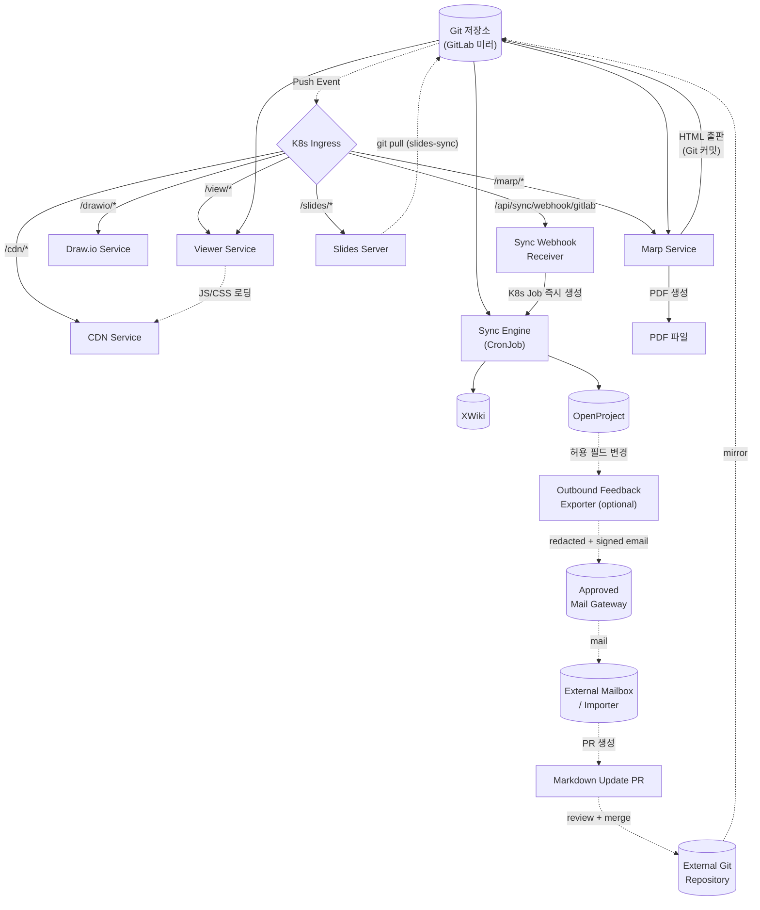
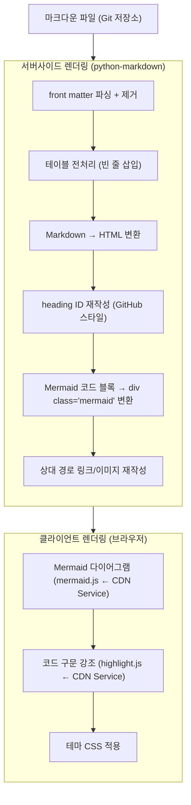
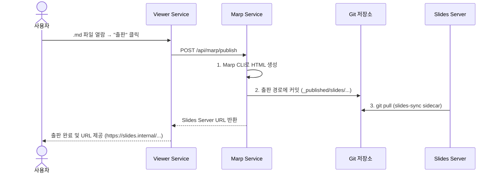
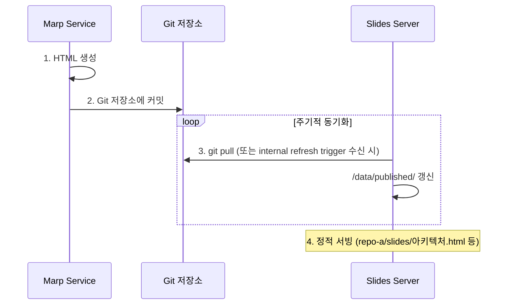
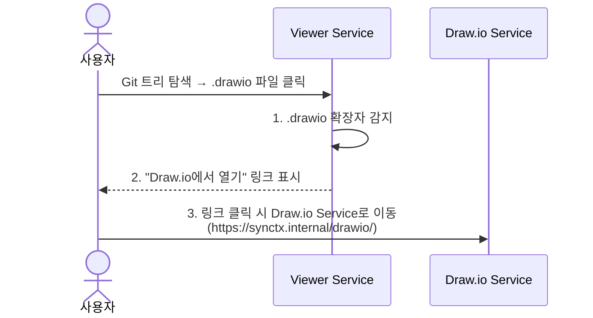
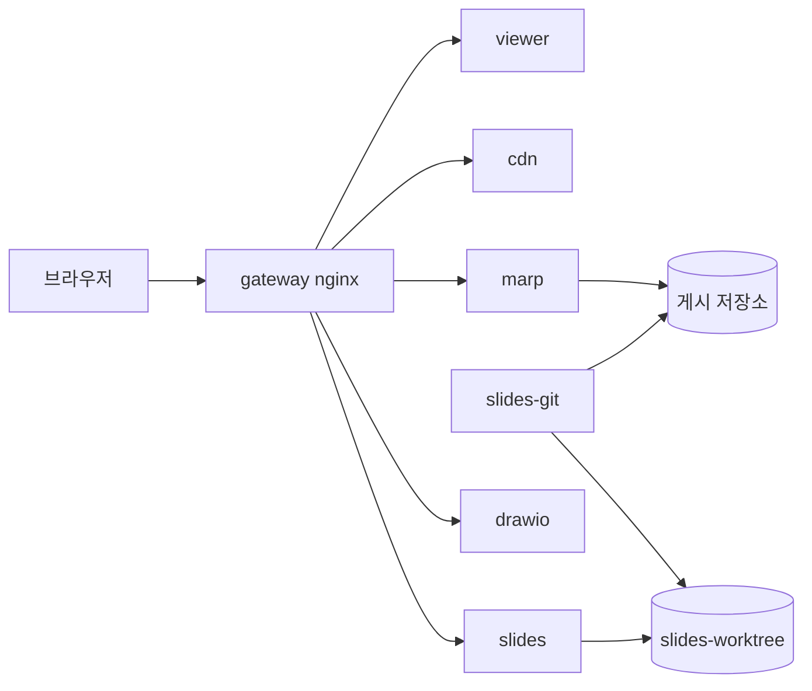

# 아키텍처 설계

이 문서는 synctx의 기본 시스템 구조와 서비스별 책임을 정의한다.
실제 운영 가능한 서비스 수준의 상세 정책, 보안, 상태 관리, 배포 기준, 단계별 체크리스트는 [production-service-design.md](production-service-design.md)를 기준으로 한다.

## 1. 시스템 개요

synctx는 마이크로서비스 아키텍처로 구성되며, K8s 클러스터에서 운영된다.

| 서비스 | 역할 | K8s 리소스 |
|--------|------|------------|
| **Viewer Service** | 마크다운 렌더링·열람 | Deployment |
| **CDN Service** | 정적 라이브러리 서빙 + 파일 업로드 | Deployment + PVC |
| **Marp Service** | 마크다운 → PDF/슬라이드 HTML 변환 + 출판 | Deployment |
| **Draw.io Service** | 다이어그램 작성·편집 (셀프호스팅) | Deployment |
| **Sync Webhook** | GitLab Push Event 수신 및 Sync Job 트리거 | Deployment |
| **Sync Engine** | Git → XWiki/OpenProject 동기화 | CronJob |
| **Slides Server** | 출판된 프레젠테이션 HTML 서빙 | Deployment + PVC |
| **Outbound Feedback Exporter** | OpenProject 제한 필드 변경을 서명된 메일 이벤트로 반출 (선택 기능) | CronJob 또는 Deployment |



## 2. 핵심 설계 결정

### 2.1 마이크로서비스 아키텍처

각 기능을 독립 서비스로 분리한다.

- **독립 배포**: 각 서비스를 개별적으로 업데이트·롤백
- **독립 확장**: 뷰어 트래픽이 많으면 Viewer만 스케일 아웃
- **기술 다양성**: Viewer/CDN은 Python, Marp는 Node.js, Slides는 Nginx
- **장애 격리**: Marp Service 장애가 Viewer에 영향을 주지 않음

서비스 간 통신은 K8s 내부 Service DNS를 사용한다:
- `http://cdn-service:8000/cdn/mermaid/10.9.1/mermaid.min.js`
- `http://marp-service:8000/api/marp/convert`

### 2.2 단방향 동기화 (외부→내부)

양방향 동기화는 충돌 해결이 복잡하고, 일반적인 내부→외부 반출이 보안 정책상 제한되므로 기본 동기화는 단방향으로 한정한다.

- **소스 오브 트루스**: Git 저장소 (외부에서 작성, 내부 GitLab에 미러링)
- **파생 데이터**: XWiki 페이지, OpenProject 이슈, 출판된 프레젠테이션 HTML
- 내부에서 직접 수정하면 다음 동기화 시 덮어써짐

#### 2.2.1 제한적 Outbound Feedback 예외

운영 정책상 승인된 메일 게이트웨이를 통해 내부에서 외부로 메일 발송이 가능한 경우, OpenProject의 일부 상태 변경을 외부 개발 흐름에 전달하는 선택 기능을 둘 수 있다.
이 기능은 양방향 동기화가 아니라 **서명된 이벤트 반출 + 외부 PR 생성**으로 한정한다.

- 대상은 `synctx_external_key`가 있는 OpenProject Work Package로 제한한다.
- 반출 필드는 allowlist 방식으로 `status`, `priority`, `version`, `due_date` 등 메타데이터만 허용한다.
- 제목, 본문, 댓글, 첨부파일, 개인정보는 기본 반출 금지다.
- 내부 Exporter는 redaction과 HMAC 서명을 적용한 JSON payload를 전용 외부 메일 계정으로 전송한다.
- 외부 Importer는 서명과 중복 이벤트를 검증한 뒤 Markdown 변경 PR만 생성한다. main branch 직접 push는 금지한다.
- PR merge 후 기존 외부→내부 Git 동기화가 다시 OpenProject에 반영되므로 최종 source of truth는 여전히 Git/Markdown이다.

### 2.3 Git diff 기반 증분 동기화

전체 문서를 매번 동기화하지 않고, 마지막 동기화 이후 변경된 파일만 처리한다.

```bash
git diff --name-status -M <last-successful-sha>..HEAD -- <watch-paths>
```

- 마지막 성공 커밋 SHA는 내부 PVC의 repo별 상태 파일에 기록
- 중복 실행 방지를 위해 CronJob 간 중복은 `concurrencyPolicy: Forbid`로, Webhook과 CronJob 간의 중복은 Kubernetes Lease lock으로 제어
- Added/Modified/Deleted 구분하여 처리
- Rename은 기존 리소스 마킹 후 새 리소스 upsert로 처리
- 삭제 시 대상 도구 반영은 설정으로 제어 (기본: 마킹)
- 부분 실패가 있으면 마지막 성공 SHA를 전진하지 않고 다음 실행에서 재시도

### 2.4 목적 기반 지능형 라우팅 (OpenProject vs XWiki)

마크다운 파일의 용도에 따라 동기화 대상이 자동으로 결정됩니다. 이는 파일 경로 또는 Front Matter의 `type` 속성으로 구분됩니다.

- **프로젝트 관리 및 이슈 트래킹 (OpenProject)**: 요건, 버그, 태스크 등 진행 상태 트래킹이 필요한 문서. 외부망에서는 이를 모아 **마크다운 기반 스크럼 보드(Kanban)** 로 활용합니다.
- **지식 공유 및 설계 (XWiki)**: 아키텍처 설계, API 규격, 회의록 등 영구적인 지식 자산.

```text
workspace/
├── .context/                 → LLM 간 공유되는 시스템 프롬프트 및 글로벌 컨텍스트 (동기화 제외)
│   ├── system_prompt.md      → AI 에이전트의 역할, 코딩 컨벤션, 제약사항
│   ├── project_state.yaml    → 현재 프로젝트 진행 단계, 주요 마일스톤
│   ├── glossary.md           → 도메인 용어와 금지/권장 표현
│   ├── decision-log.md       → 주요 의사결정과 근거
│   ├── blueprints/           → 문서/요건/작업 작성 표준 템플릿
│   └── memory/               → LLM이 남기는 작업 로그 및 트러블슈팅 기록
├── board/
│   └── sprint-1.md           → Viewer에서 칸반 보드로 렌더링, OpenProject 버전/스프린트로 매핑
├── issues/
│   └── TASK-001.md           → OpenProject: Work Package (상태, 담당자 동기화)
├── reports/
│   └── harness/              → Harness Validator 결과(JSON/Markdown)
└── docs/
    └── 아키텍처/
        └── 시스템-설계.md        → XWiki: Space=아키텍처, Page=시스템-설계
```

### 2.5 Front Matter 기반 메타데이터 및 하네스 규격

마크다운 파일 상단의 YAML front matter로 동기화 대상과 메타데이터를 지정한다.

```yaml
---
synctx:
  target: xwiki
  space: "아키텍처"
  page: "시스템 설계"
  tags: [설계, v2]
---
```

OpenProject 이슈:

```yaml
---
synctx:
  target: openproject
  project: example-project
  type: task
  status: in_progress
  assignee: "홍길동"
---
```

스크럼 보드 (스프린트/버전 관리):

```yaml
---
synctx:
  target: openproject
  project: example-project
  type: version
  name: "Sprint 1"
  start_date: "2026-06-20"
  end_date: "2026-07-04"
  status: open
  issues:
    - "issues/TASK-001.md"
    - "issues/TASK-002.md"
---
```

OpenProject Work Package의 Version 연결은 각 Task 문서의 `synctx.version` 필드를 기준으로 한다.
Version 문서의 `issues` 목록은 Viewer 보드 렌더링과 dry-run 검증용 manifest로 사용한다.

Marp 프레젠테이션:

```yaml
---
marp: true
theme: gaia
paginate: true
synctx:
  publish_path: "slides/아키텍처"    # 출판 경로 (선택)
---
```

#### 2.5.1 Harness Validator와 agent-readiness

하네스 엔지니어링은 문서 규격을 만드는 것에서 끝나지 않고, AI가 만든 산출물이 실제로 사람과 내부 도구가 소비할 수 있는지 검증해야 한다.
이를 위해 Sync Engine과 별도로 실행 가능한 `synctx validate-harness` 명령을 제공한다.

검증 대상:

- `.context/` 필수 파일 존재와 YAML/Markdown 형식
- Front Matter schema와 필수 필드
- `issues/` Task 문서와 `board/` Version manifest의 관계
- `synctx.version`과 Version 문서 `issues` 목록의 불일치
- OpenProject/XWiki routing 가능성
- 문서 제목, 요약, 결정 사항, TODO, 출처 링크 등 agent-readiness 품질
- Mermaid, 링크, 이미지, 첨부 경로의 유효성

Hermes류 multi-agent 문서 진단 프레임워크의 아이디어는 여기서 **외부 런타임 의존성**이 아니라 검증 패턴으로만 차용한다.
즉, synctx의 핵심 동기화 경로는 LLM 추론에 의존하지 않고, 필요 시 하네스 검증 리포트에 AI 수정 제안만 추가한다.

출력:

```text
reports/harness/
├── latest.json                 # 기계 처리용 결과
├── latest.md                   # 사람 검토용 요약
└── fixes/
    └── suggested-patches.md    # AI 또는 사람이 적용할 수정 제안
```

### 2.6 내부 CDN을 통한 라이브러리 서빙

폐쇄망에서는 외부 CDN에 접근할 수 없다. CDN Service가 모든 프론트엔드 라이브러리를 서빙한다.

- **웹 UI + API로 파일 관리**: 새 라이브러리 추가 시 재배포 불필요
- **버전 디렉토리 구조**: `/{library}/{version}/{file}`
- **공유 CDN**: Viewer, Marp, XWiki, 기타 내부 서비스가 동일한 CDN을 사용

### 2.7 서비스 옵션과 의존성

서비스마다 켜고 끌 수 있어 필요한 것만 배포한다(예: Viewer·Marp·Slides만, 여기에 Draw.io 추가). K8s(Helm)와 Docker Compose가 같은 서비스 이름과 순서(`viewer, cdn, marp, slides, drawio, sync, feedback`)를 쓴다.

#### 옵션 모델

| 옵션 | 기본값 | Helm | Docker Compose |
|------|--------|------|----------------|
| `viewer` | 켬 | `viewer.enabled` | `SYNCTX_SERVICES`에 포함 |
| `cdn` | 켬 | `cdn.enabled` | 위와 같음 |
| `marp` | 켬 | `marp.enabled` | 위와 같음 |
| `slides` | 켬 | `slides.enabled` | 위와 같음 |
| `drawio` | 켬 | `drawio.enabled` | 위와 같음 |
| `sync` | 켬 | `sync.enabled` | 2단계 |
| `feedback` | 끔 | `feedback.enabled` | 2단계 |

- 배포 도구는 켜진 서비스를 위 순서대로 쉼표로 이은 값(예: `viewer,marp,slides,drawio`)을 Viewer 환경변수 `SYNCTX_ENABLED_SERVICES`로 넘긴다. Viewer는 값이 없거나 공백이면 모든 서비스가 켜진 것으로 보므로 기존 배포는 동작이 바뀌지 않는다.
- Docker Compose 1단계는 `viewer, cdn, marp, slides, drawio`만 받는다. `sync`·`feedback`을 `SYNCTX_SERVICES`에 적으면 "2단계" 오류로 중단한다.

#### 의존성 규칙

| # | 상황 | 처리 | 검사 위치 |
|---|------|------|-----------|
| D1 | 켜진 서비스가 없음 | 중단 | Helm `fail`, `deploy.sh` |
| D2 | Viewer 켜짐, CDN 꺼짐, `viewer.cdn_base_url`이 상대 경로(`/`로 시작하고 `//`가 아님) | 중단 | Helm `fail`(설정을 차트가 만들 때), Viewer 시작 검사(항상) |
| D3 | Slides 켜짐, Marp 꺼짐 | 경고. 게시 저장소를 직접 채우면 쓸 수 있다 | Helm NOTES, `deploy.sh` |
| D4 | Marp 꺼짐 | Viewer에서 Marp 버튼 3개(PDF·미리보기·출판)를 숨기고 `format=pdf`는 503 | Viewer |
| D5 | Draw.io 꺼짐 | Viewer에서 Draw.io 버튼을 숨김 | Viewer |
| D6 | Docker에서 `sync`·`feedback` 지정 | 중단(2단계 전) | `deploy.sh` |
| D7 | Slides 켜짐, 게시 저장소 주소 없음 | 중단 | `deploy.sh` (Helm은 기본값이 있어 그대로) |

- D2를 Viewer 시작 검사로도 두는 이유: 외부 ConfigMap(`synctxConfig.create: false`)이나 Docker는 배포 도구가 `.synctx.yaml`을 읽지 않는다. Viewer가 시작할 때 오류 메시지를 남기고 종료하면 어느 배포 방식이든 잡힌다.
- D4에서 Marp가 꺼진 Marp 문서에는 버튼이 하나도 남지 않으므로 다운로드 버튼이 나온다.

#### 내부망 CDN을 쓸 때 조건

CDN을 끄고 사내에 이미 있는 CDN을 쓰려면 `viewer.cdn_base_url`을 그 CDN의 절대 주소로 지정한다(코드가 절대 주소와 CSP 허용을 이미 지원한다).

- 파일 경로와 버전이 같아야 한다: `mermaid/10.9.1/mermaid.min.js`, `highlight.js/11.9.0/highlight.min.js`, `highlight.js/11.9.0/styles/*.css`
- 사용자 PC에서 접속할 수 있어야 하고, Viewer가 https이면 CDN도 https여야 한다.
- `synctx-html` 블록이 그 CDN을 쓰면 `html_embed.allowed_origins`에도 넣는다.

#### 알려진 한계

- `.drawio` 파일은 Viewer 보기 대상 확장자(`CODE_LANGUAGE_MAP`)에 없어 415가 난다. 그래서 지금도 Draw.io 버튼이 실제로 표시되는 경로가 없다. 버튼 표시 조건만 옵션에 맞추고 보기 지원은 다루지 않는다.
- D2 검사는 상대 경로만 잡는다. 절대 주소가 꺼진 자기 자신의 `/cdn`을 가리키는 경우는 알 수 없다. Helm D2 검사는 `synctxConfig.create: false`이면 건너뛰며(차트가 설정을 읽지 않음), 이때는 Viewer 시작 검사가 잡는다.
- 알림 규칙(PrometheusRule)은 서비스를 꺼도 그대로 둔다. 대상 메트릭이 없으면 발생하지 않는다.
- K8s Ingress에는 시간 제한 주석이 없어 ingress-nginx 기본 60초를 쓴다. Viewer가 Marp를 부르는 PDF 다운로드도 httpx 제한이 60초다. 둘 다 Marp 변환 제한 120초보다 짧은 기존 문제이며 이번 범위 밖이다. Docker 게이트웨이만 Marp 경로를 180초로 둔다.

## 3. Viewer Service 설계

### 3.1 렌더링 파이프라인



### 3.2 API

```
GET /api/repos                      저장소 목록
GET /api/repos/{id}/tree            트리 탐색
GET /api/repos/{id}/files           볼 수 있는 파일 경로 목록(파일 찾기용)
GET /api/search                     본문 검색(q·repo·ref). repo가 없으면 모든 저장소
GET /api/repos/{id}/render          마크다운 렌더링
GET /api/repos/{id}/download        HTML/PDF 다운로드
GET /api/repos/{id}/meeting-export  회의 메모 포함 HTML 틀(오프라인, 메모 없음)
POST /api/repos/{id}/webhook        Git push 알림
```

### 3.3 기능 목록

| 기능 | 설명 | 기존 md-preview |
|------|------|-----------------|
| Git 저장소 탐색 | 다중 저장소, 브랜치, 트리 | 있음 (재활용) |
| 마크다운 렌더링 | python-markdown 기반 HTML 변환 | 있음 (재활용) |
| 스크럼 보드 렌더링 | 이슈 마크다운 목록을 Trello 형태의 칸반 보드로 시각화 | **신규 (Phase 6)** |
| 테마 | 7개 테마 CSS | 있음 (재활용) |
| Mermaid | 클라이언트 사이드 렌더링 | CDN 방식으로 변경 |
| 코드 하이라이팅 | highlight.js 구문 강조 | CDN 방식으로 변경 |
| HTML 다운로드 | 자체 완결형 HTML 생성 | 있음 (재활용) |
| PDF 다운로드 | Chrome CDP 기반 | 있음 (재활용) |
| Marp 연동 | "PDF 변환" / "출판" 버튼 | **신규** |
| 회의 모드 | `?mode=meeting`: 메모·형광펜·회의 정리, `.md`·메모 포함 HTML 내보내기/가져오기. 서버 판단은 `meeting.py`, 화면은 `static/meeting/` | **신규 (Phase 8.1a)** |
| front matter 분리 | 렌더링 전에 front matter를 본문에서 떼어 냄(일반 보기 포함) | **신규 (Phase 8.1a)** |
| 인터랙티브 HTML 임베드 | ` ```synctx-html ` 블록을 `synctx_common.html_bundle`로 합본해 CSP meta가 든 sandbox srcdoc iframe으로 렌더링. sanitizer 뒤에 자리표시를 채운다(`embed_view.py`) | **신규 (Phase 9)** |

### 3.4 Marp 연동

Viewer에서 마크다운 파일을 열람할 때, `marp: true` front matter가 감지되면 추가 UI를 표시한다:

- **PDF 다운로드 버튼** → Marp Service의 변환 API 호출 → PDF 다운로드
- **출판 버튼** → Marp Service의 출판 API 호출 → Git에 HTML 커밋 → Slides Server URL 반환

### 3.5 UI/UX 및 디자인 시스템

웹에서 보여지는 레이아웃과 디자인은 사용자 경험(UX)에 매우 중요한 요소이다. 일관성 있고 완성도 높은 UI를 제공하기 위해 기존 사내 프로젝트의 디자인 자산을 적극 재활용한다.

- **디자인 레퍼런스**: 사내 example-fe 디자인 시스템 자산을 참조하여 색상 팔레트, 타이포그래피, 레이아웃 구조를 차용한다. (상세 내용은 `docs/reusable-assets.md` 참조)
- **일관된 사용자 경험**: 기존 사내 서비스에 익숙한 사용자가 synctx Viewer 및 스크럼 보드(Kanban)를 사용할 때 이질감을 느끼지 않도록 시각적 스타일을 통일한다. 단, React 컴포넌트를 직접 재사용하지 않고 CSS 변수, 레이아웃 패턴, CSS 스타일시트만 추출하여 서버사이드 렌더링 환경(FastAPI)에 맞게 적용한다. (Phase 1~4의 Viewer는 순수 서버 렌더링 + Vanilla JS/CSS로 구현하며, 향후 Phase 6의 스크럼 보드 등 고도의 인터랙션이 필요한 기능 개발 시에만 `example-fe`의 React/Vite 스택을 별도 번들로 도입하는 것을 원칙으로 하여 프론트엔드의 이중 구조화를 방지한다.)
- **반응형 웹 및 접근성**: 데스크탑 및 태블릿 환경에 최적화된 반응형 레이아웃을 구성하며, 마크다운 렌더링 결과물(테이블, 코드 블록, 인용구 등)이 기존 디자인 시스템 내에서 조화롭게 표시되도록 CSS를 세밀하게 조정한다.

### 3.6 화면 구성

모든 화면(첫 화면 `/`, 저장소 `/{repo}`, 문서 `/{repo}/{path}`, 오류 화면)은 `viewer_ui.py`가 만드는 공통 틀을 쓴다.

- **공통 상단 바**: 저장소·브랜치 선택, 문서 검색(`⌘K`·`/`), 저장소 상태, 테마 선택, 단축키 안내(`?`). 첫 포커스는 "본문으로 건너뛰기" 링크다.
- **문서 화면 3단**: 1100px 이상에서 `파일 트리 | 본문 | 이 문서(목차)`. 768-1099px에서는 목차가 왼쪽 열의 "이 문서" 탭으로 들어가고, 767px 이하에서는 본문만 두고 ☰ 서랍(파일·이 문서 탭, 저장소·브랜치·테마 선택)과 "목차" 버튼을 쓴다.
- **오류 화면**: 화면 경로의 `HTTPException`은 같은 상단 바를 가진 HTML 안내 화면(404 저장소·파일, 413, 415, 조회 실패 502, 그리기 실패 500)으로 돌려주고, `/api/...`·`/raw/...` 경로는 JSON을 유지한다. 예약 경로(`/api`·`/static`·`/healthz` 등을 첫 경로로 쓴 요청)의 404와 접근 거부(`verify_viewer_access`의 403)도 JSON이다. 예외 메시지는 화면에 넣지 않는다.
- **정적 자산**: `static/viewer.css`(레이아웃·반응형), `static/viewer-core.js`(DOM에 의존하지 않는 로직: 문서 검색 묶음·검색 예약, 파일 목록 로더, 최근 본 문서), `static/viewer.js`(상단 바·서랍·목차 추적·알림·확인 창 동작). 회의 모드 자산(`static/meeting/`)과 본문 `<article class="markdown-body">`는 그대로 쓴다.
- **파일 찾기 데이터**: `GET /api/repos/{repo_id}/files?ref=`가 볼 수 있는 파일 경로 목록을 한 번 돌려주고, 브라우저에서 부분 일치로 거른다. 조회가 실패하면 502다.
- **문서 검색**: 상단 입력 "문서 검색"의 결과 상자는 "파일"(현재 저장소의 파일 이름 일치, 최대 8개)과 "본문"(본문 일치 최대 5건) 묶음, 맨 끝의 "‘검색어’ 전체 결과 보기"로 이뤄진다. 본문은 입력이 멈추고 250ms 뒤 `GET /api/search`를 부르고, 새 입력·Esc·검색어 지움이면 예약과 진행 중 요청을 취소하며 가장 최근 요청의 응답만 받는다. 저장소를 고르지 않은 첫 화면에서는 "파일" 묶음 없이 모든 저장소의 본문을 찾는다. 전체 결과는 `GET /search?q=&repo=&ref=&ref_repo=` HTML 페이지(저장소별 묶음, 일치 부분 `<mark>`, 저장소 선택)이며, `ref`는 `ref_repo`와 같은 저장소를 다시 찾을 때만 유지한다. `search`는 저장소 id로 쓸 수 없는 예약 경로이고, 설정에 그런 저장소가 있으면 시작할 때 경고를 남긴다.
- **본문 검색 API**: `GET /api/search?q=&repo=&ref=`는 `git grep -n -I -F -i -z --max-count=5`(고정 문자열·대소문자 무시·이진 파일 제외·파일당 최대 5줄)로 해당 ref 트리를 찾는다. 검색어는 앞뒤 공백을 뺀 뒤 2~100글자이고 줄바꿈·NUL이 없어야 하며(어기면 400), `ref`는 `repo`와 함께만 쓰고(아니면 400), 모르는 저장소는 404, 접근 권한은 `verify_viewer_access`다. 결과마다 "볼 수 있는 파일" 판정을 다시 적용하고 제어 문자나 점으로 시작하는 경로 조각이 있는 파일은 뺀다. 한 저장소당 최대 50건, git 출력 2 MiB를 넘으면 끝내고 `truncated`로 표시한다. 기한은 저장소마다 3초이며 기본이 아닌 브랜치의 fetch와 실행 차례를 기다린 시간을 포함한다. 검색은 전용 실행기(동시 4개)에서 돌아 다른 저장소 작업을 막지 않는다. 저장소별 `status`는 `ok`·`timeout`·`unsupported`(부분 복제 `blobless`·`treeless`는 검색하지 않음)·`unavailable`(받는 중·동기화 실패)·`failed`이고, 결과 한 건은 `path`·`line`·`before`·`match`·`after`(세 문자열 합쳐 160자 이하)다. 검색 응답과 로그에는 예외 문구를 넣지 않고 예외 종류만 남긴다.

## 4. CDN Service 설계

### 4.1 디렉토리 구조

```
cdn-data/
├── mermaid/10.9.1/mermaid.min.js
├── highlight.js/11.9.0/
│   ├── highlight.min.js
│   └── styles/{github,github-dark,monokai,atom-one-light}.min.css
└── chart.js/4.4.4/chart.umd.min.js
```

### 4.2 API

```
GET    /cdn/{path}                  정적 파일 서빙
POST   /api/cdn/upload              단일/다중 파일 업로드
GET    /api/cdn/list                전체 라이브러리 목록
GET    /api/cdn/list/{library}      특정 라이브러리의 버전·파일 목록
DELETE /api/cdn/{path}              파일 삭제
GET    /api/cdn/admin               업로드 관리 웹 UI
```

### 4.3 파일 업로드

```bash
# 단일 파일
curl -X POST "http://cdn-service:8000/api/cdn/upload" \
  -F "file=@mermaid.min.js" \
  -F "path=mermaid/11.0.0/mermaid.min.js"

# 다중 파일
curl -X POST "http://cdn-service:8000/api/cdn/upload" \
  -F "files=@github.min.css" \
  -F "files=@github-dark.min.css" \
  -F "base_path=highlight.js/11.9.0/styles/"
```

### 4.4 캐시 전략

버전이 URL에 포함되므로 영구 캐시 가능:

```
Cache-Control: max-age=31536000, immutable
```

## 5. Marp Service 설계

### 5.1 개요

[Marp](https://marp.app/)는 마크다운을 슬라이드로 변환하는 도구다. `@marp-team/marp-cli`를 사용하여 PDF와 프레젠테이션 HTML을 생성한다.

### 5.2 변환 모드

| 모드 | 입력 | 출력 | 사용 시나리오 |
|------|------|------|---------------|
| PDF 다운로드 | 마크다운 (.md) | PDF 파일 | 발표 자료 인쇄/배포 |
| HTML 다운로드 | 마크다운 (.md) | 자체 완결형 HTML | 오프라인 프레젠테이션 |
| HTML 출판 | 마크다운 (.md) | HTML → Git 커밋 → 웹 접근 | 팀 내 공유 |

### 5.3 API

```
POST /api/marp/convert              PDF/HTML 변환 + 다운로드
POST /api/marp/publish              HTML 생성 → Git 커밋 → URL 반환
POST /api/marp/preview              슬라이드 미리보기 HTML 반환
GET  /api/marp/themes               사용 가능한 테마 목록
```

### 5.4 PDF 변환 흐름

```
POST /api/marp/convert
  Body: { repo_id, file_path, ref, format: "pdf" }

  1. Git 저장소에서 .md 파일 읽기
  2. marp --pdf --allow-local-files input.md -o output.pdf
  3. PDF 파일을 응답으로 반환 (Content-Disposition: attachment)
```

```bash
# Marp CLI 명령어
marp --pdf --allow-local-files --html \
  --theme-set /themes/custom.css \
  input.md -o output.pdf
```

### 5.5 HTML 출판 흐름



### 5.6 Git 출판 기능 (`marp/src/app.py`)

```
Marp publish API
├── publish_html(markdown, filename)
│   ├── clone/fetch 출판 대상 저장소
│   ├── HTML 파일을 지정 경로에 배치
│   ├── git add + commit
│   └── git push (내부 GitLab)
├── list_published()                  # 출판된 슬라이드 목록
└── unpublish(filename)               # 출판 취소 (파일 삭제 + 커밋)
```

출판된 HTML은 Git 저장소에 커밋되므로 이력 관리가 가능하다.
운영 기준에서 출판 데이터의 단일 원천은 `publish_repo` Git 저장소다.
Slides Server는 PVC에 직접 쓰지 않고, `slides-sync` sidecar가 `publish_repo`를 pull한 working tree를 읽기 전용으로 서빙한다.

### 5.7 Marp 테마

기본 테마 외에 커스텀 테마를 CDN Service에서 관리할 수 있다:

```yaml
# .synctx.yaml
marp:
  themes:
    - default
    - gaia
    - uncover
  custom_themes:                     # CDN에서 로딩
    - name: corporate
      css_url: "/cdn/marp-themes/corporate.css"
```

### 5.8 Dockerfile

Marp CLI는 Node.js 기반이므로 Python + Node.js 멀티 런타임 이미지를 사용한다.

```dockerfile
FROM python:3.13.16-slim-trixie

# Node.js 설치 (Marp CLI 실행용)
RUN apt-get update && apt-get install -y nodejs npm chromium \
    && npm install -g @marp-team/marp-cli \
    && apt-get clean

# Chromium 경로 설정 (Marp PDF 변환용)
ENV CHROME_PATH=/usr/bin/chromium
ENV PUPPETEER_EXECUTABLE_PATH=/usr/bin/chromium

COPY . /app
WORKDIR /app
RUN pip install -e .

EXPOSE 8000
CMD ["uvicorn", "app:app", "--host", "0.0.0.0", "--port", "8000"]
```

## 6. Slides Server 설계

### 6.1 개요

Marp Service가 출판한 프레젠테이션 HTML을 정적으로 서빙하는 경량 Nginx 서버.

### 6.2 Nginx 설정

```nginx
server {
    listen 80;
    server_name slides.internal;

    root /data/published;

    location / {
        autoindex on;
        try_files $uri $uri/ =404;
    }

    # 캐시 설정 (출판물은 변경될 수 있으므로 짧은 캐시)
    location ~* \.html$ {
        add_header Cache-Control "no-cache, must-revalidate";
    }
}
```

### 6.3 데이터 흐름



Slides Server는 `slides-sync` sidecar를 통해 출판 저장소를 주기적으로 `git pull`한다.
Marp Service는 push 성공 후 내부 refresh API를 호출하며, refresh 실패 시에도 polling으로 최종 반영된다.

## 7. Draw.io Service 설계

### 7.1 개요

[draw.io](https://www.drawio.com/)(diagrams.net)의 셀프호스팅 버전. 공식 Docker 이미지(`jgraph/drawio`)를 그대로 사용하므로 별도 코드 개발이 불필요하다. Tomcat 기반 Java 웹 애플리케이션으로, 완전 오프라인 환경에서 동작한다.

### 7.2 기능

| 기능 | 설명 |
|------|------|
| 다이어그램 작성 | 플로우차트, 시퀀스, ERD, 네트워크, UML, C4 등 |
| 템플릿 | 내장 템플릿 라이브러리 (소프트웨어, 네트워크, 비즈니스 등) |
| 파일 저장 | 브라우저 로컬 저장, `.drawio`/`.xml` 다운로드 |
| 이미지 내보내기 | SVG, PNG, PDF, JPEG |
| 공유 다이어그램 | `.drawio` 파일을 Git에 커밋하여 팀원과 공유 |
| 완전 오프라인 | 외부 서비스 연결 없이 독립 동작 |

### 7.3 배포

별도 개발 없이 공식 이미지를 내부 레지스트리에 미러링하여 배포한다:

```bash
# 외부 네트워크에서 검증한 버전의 이미지 가져오기
docker pull jgraph/drawio:<pinned-version>
docker tag jgraph/drawio:<pinned-version> registry.internal/jgraph/drawio:<pinned-version>
docker save registry.internal/jgraph/drawio:<pinned-version> -o drawio.tar

# 내부망에서 로딩
docker load -i drawio.tar
docker push registry.internal/jgraph/drawio:<pinned-version>
```

### 7.4 환경 변수 설정

draw.io 컨테이너의 주요 설정:

```yaml
env:
  - name: DRAWIO_SELF_CONTAINED
    value: "1"                    # 외부 서비스 연결 차단 (완전 오프라인)
  - name: DRAWIO_CSP_HEADER
    value: "default-src 'self';"  # Content Security Policy
  - name: PLANTUML_URL
    value: ""                     # PlantUML 서버 없음 (폐쇄망)
```

### 7.5 Viewer 연동

Viewer Service에서 `.drawio` 파일을 감지하면 draw.io 편집 링크를 제공한다:



`.drawio` 파일은 XML 기반이므로 Viewer에서 직접 렌더링하지 않고, Draw.io Service로 안내한다.
향후 서버사이드에서 `.drawio` → SVG/PNG 변환 기능을 추가하면 Viewer 인라인 미리보기도 가능하다.

### 7.6 XWiki 연동

Sync Engine이 `.drawio` 파일을 감지하면 SVG로 변환하여 XWiki 첨부파일로 업로드할 수 있다.
draw.io CLI(`draw.io --export`)를 사용하거나, draw.io의 XML을 파싱하여 처리한다.

## 8. 설정 체계

### 8.1 통합 설정 (`.synctx.yaml`)

모든 서비스의 설정을 하나의 ConfigMap으로 관리한다.

```yaml
synctx:
  version: "1"

  # Git 설정
  git:
    watch_paths:
      - "docs/**/*.md"
      - "issues/**/*.md"
      - "slides/**/*.md"
    ignore_paths:
      - "docs/drafts/**"
      - "_published/**"
      - "**/README.md"

  # 디렉토리 → 대상 매핑
  mappings:
    - path: "docs/"
      target: xwiki
      space_from: directory
    - path: "issues/"
      target: openproject
      project: example-project

  # 동기화 대상
  targets:
    xwiki:
      base_url: "https://wiki.internal"
      wiki: xwiki
      auth:
        type: basic
        credential_env: XWIKI_TOKEN
    openproject:
      base_url: "https://op.internal"
      auth:
        type: token
        credential_env: OP_API_KEY

  # Viewer 설정
  viewer:
    host: "0.0.0.0"
    port: 8000
    cdn_base_url: "http://cdn-service:8000/cdn"
    themes: [github-light, github-dark, cayman]
    default_theme: github-light

  # CDN 설정
  cdn:
    storage_path: "/data/cdn"
    max_upload_size: 50_000_000
    allowed_extensions: [.js, .css, .woff, .woff2, .ttf, .svg, .png, .map]
    upload_auth:
      enabled: true
      required_role: cdn-admin

  # Marp 설정
  marp:
    publish_repo: "https://gitlab.internal/team/published-slides.git"
    publish_branch: main
    publish_base_path: "_published/slides"
    themes: [default, gaia, uncover]
    custom_themes: []
    chrome_path: "/usr/bin/chromium"

  # Sync 설정
  sync:
    on_delete: mark
    dry_run: false
    state_path: /data/sync-state
    lease_namespace: synctx

  # 변환 설정
  converters:
    mermaid:
      enabled: true
      output_format: svg
      theme: default
```

### 8.2 상태 파일

```json
{
  "schema_version": 1,
  "repo_id": "project-docs",
  "last_successful_sha": "abc1234",
  "last_run_id": "2026-06-19T10-30-00Z",
  "synced_files": {
    "docs/아키텍처/시스템-설계.md": {
      "content_sha": "sha256:...",
      "target": "xwiki",
      "external_key": "project-docs:docs/아키텍처/시스템-설계.md",
      "resource_id": "아키텍처.시스템-설계",
      "last_synced_sha": "def5678",
      "last_synced_at": "2026-06-19T10:30:00Z"
    }
  }
}
```

운영 환경의 상세 상태 모델은 [production-service-design.md](production-service-design.md)의 Sync Engine 설계를 따른다.

## 9. 모듈 설계

### 9.1 shared/synctx-common

서비스 간 공유하는 공통 라이브러리. 각 서비스가 pip dependency로 참조한다.

```
synctx-common/
├── config.py          # 공통 설정 스키마 (Pydantic model)
├── git_manager.py     # Git 저장소 관리 (clone, fetch, tree, read, diff)
├── auth.py            # 인증 헬퍼 (credential_env → header 변환)
├── frontmatter.py     # YAML front matter 파서 및 Pydantic 검증
├── observability.py   # healthz/readyz/version/metrics 공통 라우트
├── harness.py         # Harness Validator 로직 (context schema, agent-readiness)
└── cli.py             # CLI 엔트리포인트 (validate-harness)
```

### 9.2 Viewer Service 모듈

```
viewer/src/
├── app.py              # FastAPI 앱 (라우트 통합, lifespan, 칸반 보드)
├── renderer.py         # Markdown → HTML 렌더링 엔진
│   ├── render_markdown()
│   ├── rewrite_links()
│   └── extract_title()
├── embed_view.py       # synctx-html 자리표시·iframe 채우기·PDF 치환
├── viewer_ui.py        # 공통 화면 틀(상단 바·서랍·오류 화면)·검색 결과 페이지 마크업
├── search.py           # 본문 검색(기한·동시 실행 제한·줄 일부 나누기)
└── static/
    ├── style.css       # 사용하지 않는 이전 스타일시트(코드가 참조하지 않음)
    ├── viewer.css      # 화면 틀·3단 배치·반응형
    ├── viewer-core.js  # 문서 검색 묶음·검색 예약·파일 목록 로더·최근 본 문서 로직
    └── viewer.js       # 상단 바·서랍·목차 추적·알림·확인 창 동작
```

### 9.3 CDN Service 모듈

```
cdn/src/
└── app.py              # FastAPI 앱 + StaticFiles 마운트
    ├── upload_file()       # 업로드 + MIME 검증 + manifest
    ├── list_libraries()
    ├── list_library_versions()
    ├── cdn_admin()         # 관리 웹 UI (HTML)
    └── delete_file()
```

### 9.4 Marp Service 모듈

```
marp/src/
└── app.py              # FastAPI 앱 (라우트 통합)
    ├── convert()           # PDF/HTML 변환 + 다운로드
    ├── publish()           # HTML 출판 (Git 커밋, O_CREAT|O_EXCL lock)
    ├── preview()           # 슬라이드 미리보기
    ├── list_published()    # 출판된 슬라이드 목록
    └── unpublish()         # 슬라이드 삭제
```

### 9.5 Sync Engine 모듈

```
sync/src/
├── sync_cli.py         # CLI 엔트리포인트 (synctx-sync)
├── sync_engine.py      # 동기화 오케스트레이션(run_sync 중심)
├── harness_validator.py # synctx validate-harness (synctx_common.harness 위임)
├── state.py            # state.json atomic read/write
├── embed_sync.py       # synctx-html 분석·합본 반영 해시·XWiki 매크로 변환
├── lease.py            # 실행 잠금 (O_CREAT|O_EXCL 기반)
├── sync_converters/
│   └── mermaid.py      # Mermaid → SVG 변환
└── targets/
    ├── xwiki.py        # XWiki REST API 클라이언트
    └── openproject.py  # OpenProject REST API 클라이언트
```

### 9.6 Outbound Feedback 모듈 (Phase 7 선택)

```
feedback/src/
├── feedback_cli.py     # polling/exporter 실행 엔트리포인트
├── app.py              # FastAPI 관리 API (dry-run, resend, event 목록)
├── exporter.py         # OpenProject 변경 감지 + 이벤트 생성
├── redactor.py         # allowlist 필드 추출 및 금지 필드 제거
├── signer.py           # HMAC 서명과 key_id 처리
├── mailer.py           # approved SMTP relay 발송
└── event_store.py      # event_id 중복 방지와 재전송 상태
```

## 10. Helm Chart 설계

### 10.1 Chart 구조

```
helm/synctx/
├── Chart.yaml
├── values.yaml
├── values-production.yaml          # 운영 환경 오버라이드
├── files/
│   ├── nginx.conf                  # Slides Nginx 설정
│   └── sync-sidecar.sh             # Slides sync sidecar 스크립트
└── templates/
    ├── _helpers.tpl                # 서비스 옵션 검사(synctx.validate) 포함
    ├── validate.yaml               # D1·D2 의존성 검사 (fail)
    ├── NOTES.txt                   # 켜진 서비스 요약, D3 경고
    ├── configmap.yaml              # .synctx.yaml → ConfigMap
    ├── secret.yaml                 # Feedback HMAC/salt/SMTP Secret
    ├── services.yaml               # 전 서비스 Service 리소스 (통합)
    │
    ├── viewer-deployment.yaml
    │
    ├── cdn-deployment.yaml
    ├── cdn-pvc.yaml                # CDN 파일 저장소
    │
    ├── marp-deployment.yaml
    │
    ├── drawio-deployment.yaml
    │
    ├── sync-cronjob.yaml           # 동기화 CronJob
    ├── sync-state-pvc.yaml         # Sync 상태 파일 저장소
    ├── sync-rbac.yaml              # ServiceAccount/Role/RoleBinding
    ├── sync-networkpolicy.yaml     # Egress 제한 NetworkPolicy
    │
    ├── feedback-cronjob.yaml       # Phase 7 선택: Outbound Feedback Exporter
    │
    ├── slides-deployment.yaml
    ├── slides-configmap.yaml       # Nginx 설정
    ├── slides-pvc.yaml             # 출판된 HTML 저장소
    │
    ├── ingress.yaml                # 통합 Ingress
    ├── servicemonitor.yaml         # Prometheus ServiceMonitor
    └── prometheusrule.yaml         # Prometheus Alert Rule
```

### 10.2 values.yaml 핵심 설정

```yaml
global:
  imageRegistry: "registry.internal"
  imagePullSecrets:
    - name: registry-secret

viewer:
  enabled: true
  replicaCount: 2
  image:
    repository: synctx/viewer
    tag: "0.1.0-<git-sha>"
  resources:
    requests: { cpu: 100m, memory: 256Mi }
    limits: { cpu: 500m, memory: 512Mi }

cdn:
  enabled: true
  replicaCount: 1
  image:
    repository: synctx/cdn
    tag: "0.1.0-<git-sha>"
  persistence:
    enabled: true
    size: 10Gi
    storageClassName: nfs
  resources:
    requests: { cpu: 50m, memory: 128Mi }

marp:
  enabled: true
  replicaCount: 1
  image:
    repository: synctx/marp
    tag: "0.1.0-<git-sha>"
  resources:
    requests: { cpu: 200m, memory: 512Mi }
    limits: { cpu: 1000m, memory: 1Gi }  # Chromium 사용으로 리소스 다소 필요

sync:
  enabled: true
  schedule: "*/5 * * * *"
  image:
    repository: synctx/sync
    tag: "0.1.0-<git-sha>"
  resources:
    requests: { cpu: 50m, memory: 128Mi }

drawio:
  enabled: true
  replicaCount: 1
  image:
    repository: jgraph/drawio
    tag: "<pinned-version>"
  env:
    DRAWIO_SELF_CONTAINED: "1"
  resources:
    requests: { cpu: 100m, memory: 256Mi }
    limits: { cpu: 500m, memory: 512Mi }

slides:
  enabled: true
  replicaCount: 1
  image:
    repository: nginx
    tag: "1.25-alpine"
  persistence:
    enabled: true
    size: 5Gi
    storageClassName: nfs

ingress:
  enabled: true
  className: nginx
  hosts:
    - host: synctx.internal
      paths:
        - path: /view
          backend: viewer
        - path: /cdn
          backend: cdn
        - path: /marp
          backend: marp
        - path: /drawio
          backend: drawio
        - path: /slides
          backend: slides
  tls: []

config:
  # .synctx.yaml 내용이 ConfigMap으로 주입됨
```

### 10.3 Ingress 라우팅

```yaml
# templates/ingress.yaml
apiVersion: networking.k8s.io/v1
kind: Ingress
metadata:
  name: {{ include "synctx.fullname" . }}
  annotations:
    nginx.ingress.kubernetes.io/proxy-body-size: "50m"  # CDN 업로드
spec:
  ingressClassName: nginx
  rules:
    - host: synctx.internal
      http:
        paths:
          - path: /view
            pathType: Prefix
            backend:
              service:
                name: {{ include "synctx.fullname" . }}-viewer
                port: { number: 8000 }
          - path: /cdn
            pathType: Prefix
            backend:
              service:
                name: {{ include "synctx.fullname" . }}-cdn
                port: { number: 8000 }
          - path: /marp
            pathType: Prefix
            backend:
              service:
                name: {{ include "synctx.fullname" . }}-marp
                port: { number: 8000 }
          - path: /drawio
            pathType: Prefix
            backend:
              service:
                name: {{ include "synctx.fullname" . }}-drawio
                port: { number: 8080 }
          - path: /slides
            pathType: Prefix
            backend:
              service:
                name: {{ include "synctx.fullname" . }}-slides
                port: { number: 80 }
```

서비스를 끄면 그 서비스를 가리키는 경로는 Ingress에서 빠지고, 경로가 하나도 남지 않으면 Ingress를 만들지 않는다. `ingress.hosts[].paths[].backend`가 values에 없는 서비스이면 `fail`로 알린다.

### 10.4 PVC (Persistent Volume Claim)

CDN 파일과 출판된 HTML은 PVC로 영속화한다:

```yaml
# CDN PVC
apiVersion: v1
kind: PersistentVolumeClaim
metadata:
  name: {{ include "synctx.fullname" . }}-cdn-data
spec:
  accessModes: [ReadWriteMany]   # CDN Service + 초기 데이터 로딩
  storageClassName: nfs
  resources:
    requests:
      storage: {{ .Values.cdn.persistence.size }}

# Slides PVC
apiVersion: v1
kind: PersistentVolumeClaim
metadata:
  name: {{ include "synctx.fullname" . }}-slides-data
spec:
  accessModes: [ReadWriteMany]   # Marp Service (쓰기) + Slides Server (읽기)
  storageClassName: nfs
  resources:
    requests:
      storage: {{ .Values.slides.persistence.size }}
```

### 10.5 배포 명령

```bash
# 폐쇄망에서 Helm 배포
helm install synctx ./helm/synctx \
  --namespace synctx \
  --create-namespace \
  -f values-production.yaml

# 업그레이드
helm upgrade synctx ./helm/synctx \
  --namespace synctx \
  -f values-production.yaml

# 개별 서비스만 이미지 업데이트
helm upgrade synctx ./helm/synctx \
  --namespace synctx \
  -f values-production.yaml \
  --set marp.image.tag=v1.2.0

# 서비스 끄기 (예: Draw.io 제외)
helm upgrade synctx ./helm/synctx \
  --namespace synctx \
  -f values-production.yaml \
  --set drawio.enabled=false
```

업그레이드는 항상 values 파일(`-f values-production.yaml`)을 넘긴다. `--reuse-values`는 이전 릴리스 값을 그대로 쓰므로 차트에 새로 생긴 기본값이 반영되지 않는다.

#### 서비스 옵션 동작

- `viewer`·`cdn`·`marp`·`slides`·`drawio`·`sync`는 `enabled`(기본 `true`), `feedback`은 `enabled`(기본 `false`)로 켜고 끈다.
- `viewer`·`cdn`·`marp`·`slides`·`drawio`·`sync`는 `enabled` 키가 없거나 `null`이면 켜진 것으로 본다(`synctx.isEnabled`). `enabled` 키가 없던 이전 릴리스를 `--reuse-values`로 업그레이드해도 서비스가 사라지지 않게 하기 위해서다. `feedback`은 키가 없으면 꺼진 것으로 본다.
- 꺼진 서비스는 아래 리소스를 만들지 않는다.

| 서비스 | 만들지 않는 리소스 |
|--------|-------------------|
| viewer · cdn · marp · drawio | Deployment, Service |
| slides | Deployment, Service, ConfigMap 2개 |
| sync | CronJob, ServiceAccount·Role·RoleBinding, NetworkPolicy |
| feedback | CronJob |

- **PVC(`cdn-data`, `slides-worktree`, `sync-state`)는 서비스를 꺼도 남긴다(데이터 보호).** 렌더 결과에서 빠지면 Helm upgrade가 PVC를 지우고, 동적 프로비저닝 기본값 `reclaimPolicy: Delete`에서는 데이터도 사라진다. 서비스를 다시 켜면 남은 PVC를 그대로 쓴다. 데이터를 지우려면 운영자가 PVC를 직접 삭제한다(production-service-design.md Runbook 참조).
- Viewer Deployment는 항상 `SYNCTX_ENABLED_SERVICES`를 받는다. 기본값으로 렌더한 결과는 이 환경변수 하나를 빼면 이전과 같다.
- `templates/validate.yaml`이 `synctx.validate`(`_helpers.tpl`)를 불러 D1(켜진 서비스 없음)과 D2(Viewer 켜짐·CDN 꺼짐인데 `viewer.cdn_base_url`이 상대 경로)를 `fail`로 중단한다. D2는 `synctxConfig.create`일 때만 `synctxConfig.data`를 읽어 검사한다.
- Ingress 경로의 `backend`는 `viewer`·`cdn`·`marp`·`slides`·`drawio` 중 하나여야 한다. 다른 값이면 렌더가 실패한다.
- `templates/NOTES.txt`는 켜진 서비스 목록과 D3(Slides 켜짐·Marp 꺼짐) 경고를 출력한다.
- `scripts/local/steps/deploy-synctx.sh`는 추가 인자를 `helm upgrade`에 넘기고(예: `--set drawio.enabled=false`), CDN Service가 없으면 CDN 채우기를 건너뛴다.

### 10.6 Docker Compose 배포

K8s가 아닌 Docker 서버를 위한 배포 방식이다. Docker Compose만 제공하며 `docker run` 단독 배포는 제공하지 않는다. 서비스 선택은 Compose profile과 옵션 파일(`SYNCTX_SERVICES`)로 한다. 1단계는 Viewer·CDN·Marp·Slides·Draw.io를 지원하고, Sync·Feedback은 2단계에서 다룬다.



| 컨테이너 | profile | 이미지 | 볼륨 |
|----------|---------|--------|------|
| gateway | 없음(항상) | `nginx:1.25.4-alpine` | `.generated/gateway.conf`, TLS일 때 인증서 |
| viewer | `viewer` | `synctx/viewer` | `.synctx.yaml`, `viewer-repos` |
| cdn | `cdn` | `synctx/cdn` | `.synctx.yaml`, `cdn-data`, `cdn-data/`→`/seed`(읽기 전용) |
| marp | `marp` | `synctx/marp` | `.synctx.yaml`, `marp-work` |
| slides | `slides` | `nginx:1.25.4-alpine` | `slides-worktree`, `helm/synctx/files/nginx.conf` |
| slides-git | `slides` | `alpine/git:2.43.0` | `slides-worktree`, `helm/synctx/files/`→`/scripts` |
| drawio | `drawio` | `jgraph/drawio:24.2.5` | 없음 |

- **게이트웨이만 외부 포트를 연다.** 다른 컨테이너는 compose 네트워크 안에서만 닿으며, K8s의 "Ingress 우회 차단"에 해당한다.
- `deploy.sh`가 `SYNCTX_SERVICES`에 든 서비스의 경로만으로 `.generated/gateway.conf`를 만든다. 꺼진 서비스 경로는 404다. 경로 규칙(`/view`, `/cdn`, `/marp`, `/slides`, `/drawio`)은 ingress-nginx의 rewrite와 같다. 새 설정은 후보 파일로 만들어 같은 nginx 이미지의 일회용 컨테이너로 `nginx -t`를 통과한 뒤에만 `gateway.conf`에 반영한다. 깨진 설정(인증서·키 불일치 등)이 운영 중인 게이트웨이에 들어가 재시작 때 계속 죽는 일을 막기 위해서다.
- `resolver 127.0.0.11`과 변수 `proxy_pass`로 Docker DNS를 다시 조회한다. 컨테이너가 재시작해 IP가 바뀌어도 이어지고, 시작할 때 대상 컨테이너가 없어도 nginx가 실패하지 않는다.
- Marp 경로의 게이트웨이 응답 대기는 `SYNCTX_MARP_PROXY_TIMEOUT`(기본 180초)이다. Marp 변환 제한(기본 120초)보다 짧은 nginx 기본값 60초로는 정상 변환이 끊긴다.
- 권한 헤더(`X-Forwarded-User`·`X-Forwarded-Email`·`X-Forwarded-Groups`)는 기본적으로 지운다. 신뢰 프록시 모드와 TLS는 production-service-design.md의 3.1과 8.6을 따른다.
- marp 컨테이너는 네트워크 별칭 `synctx-marp`를 가져, Viewer 기본 설정 `viewer.marp_service_url`(`http://synctx-marp:8000`)을 바꾸지 않아도 PDF 변환이 이어진다.
- `.synctx.yaml`의 sha256을 라벨 `synctx.config-hash`로 viewer·cdn·marp에 넣는다. 앱은 시작할 때만 설정을 읽으므로, 파일 내용만 바꾸고 `deploy.sh`를 다시 실행해도 해당 컨테이너가 다시 만들어진다.
- Slides의 nginx 설정과 sidecar 스크립트는 Helm 차트의 `helm/synctx/files/`를 그대로 마운트해 원본을 하나로 둔다.
- 이미지 주소는 `${SYNCTX_IMAGE_PREFIX}<이름>:<태그>`(접두사 기본값 `registry.local:5000/`)이고, `SYNCTX_IMAGE_TAG`는 필수이며 `latest`는 거부한다.
- 인증 프록시가 없으면 `.synctx.yaml`에 `authz.enabled: false`를 둔다(기본값 `true`라 모든 요청이 403).
- 사용법은 `scripts/docker/deploy.sh [--env-file] [--secrets-file] [--check]`, `down.sh [--volumes]`, `compose.sh -- <compose 인자>`다. 절차와 Runbook은 production-service-design.md 8.6과 12.7을 참조한다.

## 11. 제약 사항과 고려 사항

| 항목 | 상태 | 비고 |
|------|------|------|
| 외부 CDN 접근 | 불가 | 폐쇄망 → CDN Service로 대체 |
| 외부 이미지 레지스트리 | 불가 | `pull-and-save-images.sh`로 tar 반입 |
| Marp CLI Chromium | 필요 | Marp PDF 변환 시 headless Chromium 사용, 이미지에 번들 |
| XWiki Incoming Webhook | 미제공 | pull 모델(CronJob) 사용 |
| XWiki 배치 API | 미제공 | 단건 PUT 병렬 실행 (`asyncio` + `httpx`) |
| 양방향 동기화 | 미지원 | 단, 승인된 메일 게이트웨이를 통한 allowlist 기반 Outbound Feedback 이벤트 반출은 선택 기능으로 허용 가능 |
| 한글 파일명 | 지원 | `git -c core.quotepath=false` |
| 삭제 동기화 | 선택적 | 기본: 마킹 |
| CDN/Slides 영속성 | PVC 필수 | NFS StorageClass 권장 (ReadWriteMany) |
| Draw.io 외부 연결 | 차단 | `DRAWIO_SELF_CONTAINED=1`로 완전 오프라인 동작 |
| Draw.io 파일 저장 | 브라우저 로컬 | 서버사이드 저장소 미제공, Git 커밋으로 공유 |

## 12. 구현 우선순위

### Phase 1: Viewer Service + CDN Service

1. `shared/synctx-common` 공통 라이브러리 (git_manager, config, auth)
2. CDN Service: 정적 파일 서빙 + 업로드 API + 웹 UI
3. Viewer Service: md-preview 코드 이식, CDN 연동
4. 코드 하이라이팅 (highlight.js) 통합
5. Docker 이미지 빌드
6. Helm Chart 기본 구조 (viewer + cdn + ingress)

### Phase 2: Marp Service + Slides Server + Draw.io Service

1. Marp Service: PDF 변환 + 다운로드 API
2. Marp Service: HTML 출판 + Git 커밋 (`marp/src/app.py`)
3. Slides Server: Nginx 정적 서빙
4. Draw.io Service: `jgraph/drawio` 이미지 미러링 + Helm 배포 (별도 개발 불필요)
5. Viewer에 Marp 연동 UI (PDF 다운로드 / 출판 버튼)
6. Viewer에 `.drawio` 파일 감지 → Draw.io 열기 링크
7. Helm Chart에 marp + slides + drawio 추가

### Phase 3: Sync Engine (XWiki)

1. Git 변경 감지 (`git_manager.py` 확장)
2. 마크다운 파싱 + front matter 추출
3. XWiki REST API 클라이언트 (`xwiki.py`)
4. Mermaid → SVG 변환 + 첨부파일 업로드
5. Helm Chart에 sync CronJob 추가

### Phase 4: Sync Engine (OpenProject)

1. OpenProject REST API 클라이언트 (`openproject.py`)
2. Front matter → Work Package 매핑
3. 이슈 생성/업데이트 로직

### Phase 5: 운영 준비

1. Production values 작성 및 Secret 참조 방식 확정
2. 이미지/벤더 artifact SHA-256 manifest 작성
3. Offline build 및 폐쇄망 반입 검증
4. Metrics, alert, runbook, 백업/복구 절차 작성
5. 운영 권한 매핑 검토

### Phase 6: 하네스 엔지니어링 및 스크럼 보드 (OKF)

1. **LLM 컨텍스트 하네스**: `.context/` 디렉토리 구조 설계 및 서로 다른 LLM(Cursor, Claude 등) 간 컨텍스트 공유 포맷(YAML/Markdown) 정의
2. **Harness Validator**: `.context`, Front Matter, board/issue 관계, agent-readiness를 검사하는 `synctx validate-harness` CLI 구현
3. **Hermes-style 진단 패턴**: 외부 Hermes 런타임을 의존하지 않고 문서 smell/agent-readiness linter 규칙으로 선택 적용
4. **스크럼 보드 뷰어**: Viewer Service에 마크다운 이슈 목록을 칸반(Kanban) 보드로 렌더링하는 프론트엔드 기능 추가
5. **상태 변환 매핑 규칙 (단방향)**: 마크다운의 `status: in_progress` 값을 OpenProject의 내부 상태 코드로 변환하는 단방향 매핑 로직 고도화

### Phase 7: 제한적 Outbound Feedback (선택)

1. OpenProject 변경 이벤트 중 반출 허용 필드 allowlist 정의
2. 내부 Exporter: 변경 감지, redaction, HMAC 서명, 메일 발송 구현
3. 외부 Importer: 메일 수신, 서명 검증, replay 방지, Markdown 변경 PR 생성 구현
4. PR 리뷰와 merge 후 기존 외부→내부 동기화로 재반영되는 폐루프 검증

### Phase 8: 협업 통합 (회의 모드 · Jitsi · 메신저)

1. 8.1a 회의 모드 기반: front matter 분리, `synctx.meeting` 검증, `repositories[].collab.enabled`, 메모·형광펜·회의 정리, `.md`·메모 포함 HTML 내보내기/가져오기
2. 8.1b 근거 미리보기·근거 모음(저장소 간 링크 해석)
3. 8.1c 회의 문서 대시보드
4. 8.2 Jitsi 내장과 발표자 따라가기
5. 8.3 Collab Gateway(메신저 어댑터, 회의 안내·알림)
6. 8.4 `/synctx` 명령과 채널

### Phase 9: 인터랙티브 HTML 임베드

1. `HtmlEmbedConfig`·`PlatformHtmlEmbedConfig` 설정과 출처 검사
2. `synctx_common.html_bundle`: 블록 파싱, 합본, CSP meta, 이스케이프
3. Viewer 렌더링·CSP·다운로드
4. Sync Engine 변환과 다시 처리할 조건(역참조 색인, 합본 반영 해시, 정책 지문)
5. 메트릭·Alert, 운영 문서

설계: `docs/html-embed-design.md`. Viewer(Phase 1)와 XWiki Sync(Phase 3)에 의존한다.

### 배포 옵션 (Phase 번호와 별개)

서비스별 옵션(Helm `<서비스>.enabled`)과 Docker Compose 배포는 새 Phase가 아니라 Phase 1-9 어디에서든 쓰는 배포 방식이다. Phase 번호 체계(1-9)는 바꾸지 않는다.

- **Docker Compose 배포 1단계**: Viewer·CDN·Marp·Slides·Draw.io (구현됨)
- **Docker Compose 배포 2단계**: Sync·Feedback (미구현)
  - Compose에 `sync`·`feedback` profile 추가. 주기 실행은 서비스 안 반복 실행(`--interval`) 또는 호스트 cron의 `docker compose run --rm` 중 2단계 설계에서 고른다.
  - `lease.py`의 파일 잠금 경로를 설정 가능하게 하고 공유 볼륨에 둔다(현재 `/tmp`).
  - 시작 시 대상 시스템 접속을 확인한다(Sync: XWiki·OpenProject 중 하나 이상, Feedback: OpenProject·SMTP).
