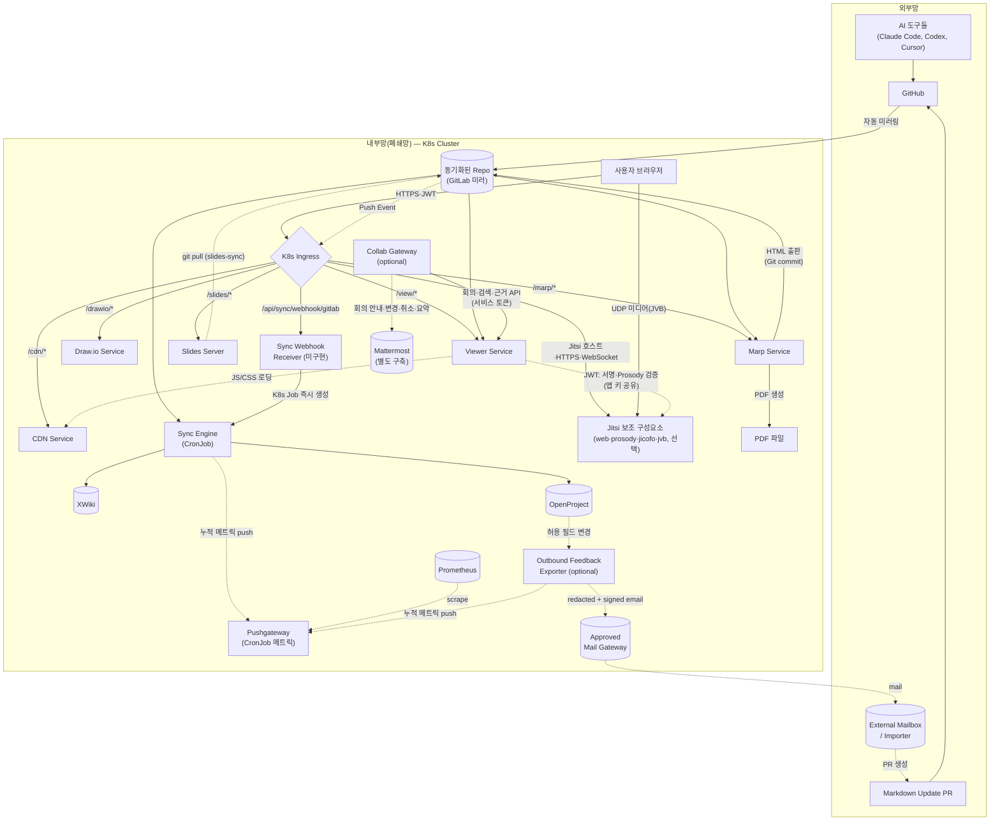
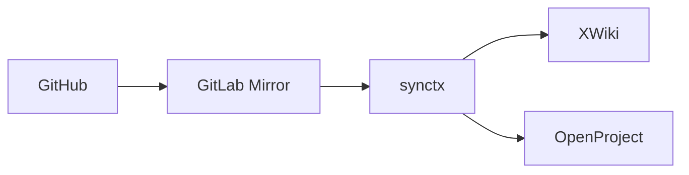
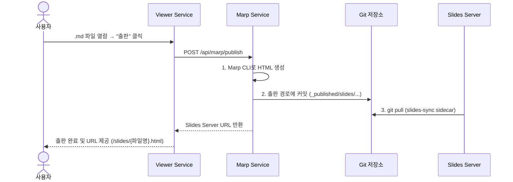

# synctx 개발 문서

서비스 소개와 사용법은 [README](../README.md)와 [도움말](help/README.md)에 있다. 이 문서는 개발·운영하는 사람을 위한 개요로, 프로젝트 배경, 아키텍처 다이어그램, 서비스 구성, 배포 방식, 서비스별 기능, 동기화 흐름, 프로젝트 구조, 기술 스택을 다룬다. 서비스·설정·역할을 바꾸면 이 문서와 [아키텍처 설계](architecture.md), [운영 서비스 설계](production-service-design.md)를 함께 갱신한다.

## 프로젝트 배경

### 문제

금융권 폐쇄망에서 AI 도구(Claude Code, Codex, Cursor 등)를 활용한 개발이 진행되고 있다.
개발 자체는 외부 인터넷 환경에서 이루어지고, GitHub을 통해 코드가 관리되며, 내부망으로 동기화되어 빌드·배포된다.

그런데 개발 서비스를 실제 사용하는 **현업 팀은 외부망에 접근할 수 없다**.
프로젝트 관리(OpenProject), 지식 관리(XWiki) 등 팀 협업 도구는 모두 내부에 있기 때문에, AI를 활용한 요건 분석, 문서 작성, 이슈 관리 등에서 생산성 한계가 발생한다.

또한 폐쇄망 특성상 외부 CDN에 접근할 수 없어, 마크다운 렌더링에 필요한 라이브러리(Mermaid, highlight.js 등)를 내부에서 자체 서빙해야 한다.

### 해결 방향

일반적인 내부→외부 데이터 반출은 제한되지만, **외부에서 내부로의 반입은 Git 동기화로 거의 자동화**되어 있다.
기본적으로 이 단방향 경로를 활용하여 다섯 가지 문제를 해결하며, 승인된 메일 게이트웨이가 있는 환경에서는 OpenProject의 제한된 메타데이터 변경만 외부 PR 생성 이벤트로 전달할 수 있다:

1. **문서 열람**: 외부에서 작성된 마크다운 문서를 내부에서 웹 기반으로 열람
2. **프레젠테이션**: 마크다운 문서를 Marp로 PDF/슬라이드 HTML로 변환하여 발표 자료로 활용
3. **다이어그램**: draw.io를 폐쇄망에서 셀프호스팅하여 다이어그램 작성·편집
4. **도구 동기화**: Git 저장소의 마크다운과 메타데이터를 내부 도구(XWiki, OpenProject)에 자동 동기화
5. **라이브러리 서빙**: 폐쇄망에서 프론트엔드 라이브러리를 서빙하는 내부 CDN 제공

### 핵심 가치

- **Human-AI Collaboration (사람-AI 협업)**: AI는 마크다운을 통해 지식을 생성/공유하고, 사람은 웹 뷰어와 내부 도구를 통해 이를 소비·관리하는 완벽한 협업 체계 구축
- **Harness Engineering & OKF**: 서로 다른 LLM(Cursor, Claude 등)이 마크다운을 공통 컨텍스트(메모리)로 사용하여 지식의 흐름(Orchestrated Knowledge Flow)을 끊김 없이 유지
- **Markdown 기반 스크럼/대시보드**: 외부망에서는 마크다운 기반의 칸반(Kanban)/대시보드로 프로젝트를 관리하고, 이는 내부망의 OpenProject로 자동 연동
- **지능형 라우팅**: 마크다운의 목적(프로젝트 관리 vs 지식 공유)에 따라 OpenProject와 XWiki로 자동 분기되어 동기화
- **제한적 피드백 반출**: OpenProject 상태 등 허용된 메타데이터만 서명된 메일 이벤트로 외부 PR 흐름에 전달
- **오프라인 독립성**: 외부 CDN 없이 모든 렌더링 라이브러리를 내부 CDN에서 서빙
- **문서→발표 전환**: 마크다운으로 작성한 문서를 바로 프레젠테이션으로 변환·출판
- **다이어그램 자급자족**: draw.io를 내부에서 운영하여 인터넷 없이 다이어그램 작성

## 아키텍처

마이크로서비스 구조로 K8s에서 운영되며, 각 서비스는 독립적으로 배포·확장된다.



### 마이크로서비스 구성

| 서비스 | 역할 | 기반 기술 | K8s 리소스 |
|--------|------|-----------|------------|
| **Viewer Service** | 마크다운 렌더링·열람, HTML/PDF 다운로드 | FastAPI + python-markdown | Deployment |
| **CDN Service** | 정적 라이브러리 서빙 + 파일 업로드 관리 | FastAPI + StaticFiles | Deployment + PVC |
| **Marp Service** | 마크다운 → PDF/프레젠테이션 HTML 변환 + 출판 | FastAPI + @marp-team/marp-cli | Deployment |
| **Draw.io Service** | 다이어그램 작성·편집 웹 도구 (셀프호스팅) | jgraph/drawio (Tomcat) | Deployment |
| **Sync Webhook** | GitLab Push Event 수신 및 Sync Job 트리거 (설계만 있고 아직 구현되지 않음) | — | Deployment |
| **Sync Engine** | Git 변경 감지 → XWiki/OpenProject 동기화 | Python CLI + httpx | CronJob |
| **Slides Server** | 출판된 프레젠테이션 HTML 정적 서빙 | Nginx | Deployment + PVC |
| **Outbound Feedback Exporter** | OpenProject 제한 필드 변경 → 서명된 메일 이벤트 반출 (선택) | Python CLI + SMTP | CronJob |
| **Jitsi (보조 구성요소)** | 회의 화면 화상 참여·발표자 따라가기의 데이터 채널(선택, 기본 꺼짐) | 공식 jitsi/web·prosody·jicofo·jvb | Deployment 4개 + Service + HTTPS Ingress |
| **Collab Gateway** | 회의 안내(예고)·변경·취소·요약을 Mattermost 채널로 전달하고 `/synctx` 슬래시 명령으로 회의·문서 검색·근거를 조회 (선택, Phase 8.3·8.4) | FastAPI + httpx | Deployment(1개) + PVC |

`/synctx 검색 <키워드>`(`search`)는 요청 채널에 매핑된 회의들의 저장소 id를 정렬해 최대 5개까지 각각 `repo=<id>`로 요청하고 경로·링크 최대 5건을, `근거 <id 또는 제목>`(`evidence`)는 채널 안 회의의 근거 제목·링크 최대 20건을 보여 준다. 검색어는 2~100자 한 줄이며 서비스 토큰 검색 응답부터 발췌를 제외한다. 검색·근거의 상한 초과는 `… 외 N건`, 근거의 `partial`·`omitted`는 "일부 근거를 읽지 못했습니다(N건 생략)"으로 안내한다. 응답은 요청 저장소 필터 후 링크를 검증하고 잘못된 항목만 생략해 건수만 로그에 남긴다. 명령 전체 Viewer 조회는 하나의 기한으로 합쳐 2초 제한, 실패는 `unavailable`과 명령별 안내(검색 결과·근거·기존 회의 정보), 응답은 요청자에게만 보이는 메시지다. 참여(`join`)는 회의 문서·발표 링크와 참여 시간 사유를 안내한다(8.2 A1). 검색·근거의 실제 Mattermost·클러스터 실행은 미확인이다.

### 배포 방식

서비스마다 켜고 끌 수 있다. 필요한 서비스만 배포하는 것이 기본 사용법이다(예: Viewer·Marp·Slides만, 여기에 Draw.io 추가).

| 서비스 | K8s (Helm) | Docker Compose | 옵션 이름 |
|--------|-----------|----------------|-----------|
| Viewer | 지원 | 지원 (1단계) | `viewer` |
| CDN | 지원 | 지원 (1단계) | `cdn` |
| Marp | 지원 | 지원 (1단계) | `marp` |
| Slides Server | 지원 | 지원 (1단계) | `slides` |
| Draw.io | 지원 | 지원 (1단계) | `drawio` |
| Sync Engine | 지원 | 2단계 | `sync` |
| Outbound Feedback | 지원 (기본 끔) | 2단계 | `feedback` |

- **K8s (Helm)**: `<서비스>.enabled`로 켜고 끈다. 예: `--set drawio.enabled=false`. 꺼진 서비스는 Deployment·Service·Ingress 경로를 만들지 않는다.
- **Docker Compose**: 옵션 파일 `deploy/docker/synctx.env`의 `SYNCTX_SERVICES=viewer,cdn,marp,slides`처럼 켤 서비스를 쉼표로 적는다. 외부 포트는 `gateway`(nginx) 하나만 연다.
- **정적 Viewer(시연·열람용)**: 위 표의 서비스가 아니라 Viewer 화면을 빌드 때 정적 파일로 구워 Cloudflare Pages(Direct Upload)에 올리고 Access로 열람자를 제한한다(공개 모드면 Access 없이 공개). 빌드는 `scripts/static-export/build.sh`, 배포는 GitHub Actions(`.github/workflows/static-export.yml`)다. 로그인 모드에서는 `deploy/pages/`의 Pages Functions·D1이 로그인과 저장소별 열람을 판정하고 `/admin`에서 열람자를 관리한다. 폐쇄망 운영 구성이 아니며 컨테이너 이미지를 만들지 않는다. 설치·롤백은 [설치 방식 선택](install.md), 설계는 [정적 Viewer 내보내기 설계](superpowers/specs/2026-11-05-static-viewer-export-design.md)를 따른다.
- 서비스 사이 의존성(CDN 없이 Viewer를 쓰는 경우 등)과 알려진 한계는 [아키텍처 설계](architecture.md)의 "서비스 옵션과 의존성"을 참조한다.

### Docker Compose 빠른 시작

폐쇄망 레지스트리(`registry.local:5000`)에 synctx 이미지가 올라가 있어야 한다. Docker Compose v2.17 이상이 필요하다.

```bash
cp deploy/docker/synctx.env.example deploy/docker/synctx.env
cp deploy/docker/secrets.env.example deploy/docker/secrets.env
# synctx.env: SYNCTX_SERVICES, SYNCTX_IMAGE_TAG(0.7.0-<git-sha>), SYNCTX_SLIDES_REPO_URL 수정
# secrets.env: GIT_READ_TOKEN, GIT_PUBLISH_TOKEN(출판 전용) 입력, 렌더 보기를 쓰면 SYNCTX_RENDER_SECRET
# SYNCTX_CONFIG_FILE이 가리키는 .synctx.yaml 준비 (인증 프록시가 없으면 authz.enabled: false)

scripts/docker/deploy.sh --check   # 옵션 검사와 게이트웨이 설정 미리 보기(배포하지 않음)
scripts/docker/deploy.sh           # 배포
scripts/docker/down.sh             # 중지 (볼륨 유지)
```

운영 명령은 `scripts/docker/compose.sh -- ps`처럼 실행한다. 절차 전체는 [운영 서비스 설계](production-service-design.md)의 Docker 배포 Runbook을 참조한다.

### Markdown·회의 Viewer 빠른 시작

저장소 체크아웃에서 실행한다. 소스 실행은 `uv`·Git·Python 3.13 이상이 필요하고, Docker 실행은 Docker Engine과 Bash가 필요하다. 예시 Git 주소는 실제 접근 가능한 저장소로 바꾼다.

```bash
./run.sh --repo https://git.example/team/docs.git
./run.sh --repo https://git.example/team/docs.git --repo https://git.example/team/meetings.git --ref main
./run.sh --docker --build --repo https://git.example/team/docs.git
./run.sh --docker --image synctx/viewer:0.7.0-abcdef0 --repo https://git.example/team/docs.git
```

접속 주소는 http://127.0.0.1:18000/view/ 이다. `--docker`는 첫 번째 인자에 둔다. Docker는 Viewer 컨테이너 하나만 실행하며 `--build`일 때만 기존 빌드 스크립트를 호출한다. 기본 이미지는 `${DOCKER_REGISTRY:-synctx}/viewer:0.7.0-<git-sha>`이고(`DOCKER_REGISTRY` 없이는 로컬 이미지만 쓰고 Docker Hub에서 받지 않는다), `--image`도 SemVer-SHA 태그를 요구한다(`latest` 불가). `--build`와 `--image`는 함께 쓰지 않는다.

`--repo`는 반복할 수 있고, 기존 설정은 `--config ./my.synctx.yaml`로 대신 지정한다. `--repo` 프로필은 회의 모드를 켜고 로컬 열람용으로 인증을 끈다. `--config`는 명시한 인증·협업 정책을 유지한다. Git 토큰은 `GIT_READ_TOKEN` 환경변수로 주며 URL이나 YAML에 값을 넣지 않는다. Docker는 토큰을 변수 이름으로 전달하고, 사용자 정의 `credential_env`는 `--env MY_GIT_TOKEN`으로 전달한다. HTML 렌더 보기는 `--config`에서 `html_embed.enabled`·`render_files`를 켠 저장소만 쓸 수 있고(`--repo` 프로필은 켜지 않는다), `SYNCTX_RENDER_SECRET`을 주지 않으면 실행마다 무작위 키를 쓰므로 다시 시작하면 원래 화면을 새로 고쳐야 한다.

Viewer는 기존 `static/vendor/`의 Mermaid·highlight.js를 직접 제공한다(`viewer.asset_source: bundled`, 기본 배포는 `cdn`). Marp를 로드하지 않으며 PDF·Marp 출판은 제공하지 않는다. 일반 HTML 다운로드는 기본 렌더 HTML이고, 회의 모드의 메모 포함 HTML 내보내기는 vendor와 브라우저 메모를 포함한 자체 완결형 사본이다. 회의 플랫폼은 본문의 일반 HTTPS Markdown 링크로 연다. `synctx.meeting.channel`을 포함한 기존 필수 메타데이터와 브라우저별 로컬 메모 저장 방식은 그대로다.

Docker의 로컬 `--repo`는 일반 디렉터리 경로와 `file:///path/to/repo`·`file://localhost/path/to/repo`를 받으며 URL의 `%20` 같은 이스케이프를 해석해 실제 디렉터리를 읽기 전용으로 마운트한다. 다른 file URL 호스트와 `.git`이 파일인 linked worktree·submodule은 실행 전에 거부한다. 이 경우 원격 Git URL을 사용한다.

Docker 캐시는 기본 이름 `synctx-viewer-cache`인 볼륨에 남으며 Ctrl-C로 컨테이너를 종료해도 유지된다. 호스트 포트·바인딩·캐시 이름은 `--port`, `--bind`, `--volume`으로 바꾼다. 외부 공개 시 인증 프록시와 접근 제한을 구성하고 `--public-base-url`을 실제 공개 URL로 지정한다. 자세한 설정·운영·검증 범위는 [로컬 개발 환경](local-development.md) 0.1절과 [운영 설계](production-service-design.md) 8.7절을 따른다.

### Marp를 포함한 로컬 실행

문서 보기·회의 모드·Marp 미리보기만 필요하면 Docker·minikube 없이 `scripts/local/run-viewer.sh`로 Viewer·Marp·CDN 파일을 한 프로세스로 띄운다(http://127.0.0.1:18000/view/). minikube 전체 환경(`scripts/local/setup.sh`)은 [로컬 개발 환경](local-development.md)을 참조한다.

## Viewer Service (마크다운 뷰어)

기존 `markdown_converter`(md-preview)의 발전형. Git 저장소의 마크다운 문서를 웹에서 열람한다.

### 주요 기능

- **Git 저장소 뷰어** — 다중 저장소 트리 탐색, 문서 열람, webhook/polling 동기화
- **공통 화면 틀** — 상단 바·서랍·3단 문서 화면(파일 트리·본문·목차), 파일 찾기(⌘K)·최근 본 문서, 화면 경로 오류는 같은 틀의 안내 화면으로 표시
- **저장소 본문 검색** — `/search` 화면과 `GET /api/search`, 여러 저장소를 `git grep`으로 찾는다. `collab_only=true`는 협업 저장소만 검색하고 서비스 토큰은 이 필터·기본 브랜치를 강제한다(`ref` 거부). 비협업 저장소를 지정하면 404이며 결과는 저장소 정보와 경로만 반환한다. 일반 권한의 전체 검색은 유지한다
- **마크다운 렌더링** — 서버사이드 렌더링 (python-markdown), 7개 테마 지원
- **Mermaid 다이어그램** — 클라이언트 사이드 렌더링 (CDN Service에서 mermaid.js 로딩)
- **코드 하이라이팅** — highlight.js 기반 190+ 언어 구문 강조
- **HTML/PDF 다운로드** — 일반 HTML은 기본 렌더 HTML, 회의 내보내기는 vendor·메모 포함 자체 완결형 HTML, PDF는 Marp Service로 변환
- **완전 오프라인** — 기본 배포는 CDN Service, 경량 Viewer는 번들 파일에서 렌더링 라이브러리 로딩
- **스크럼 보드** — 이슈 마크다운 목록을 버전별 칸반 보드로 렌더링 (`/api/repos/{id}/board/{version}`)
- **회의 모드** — 회의 문서(`synctx.type: meeting`)에서 메모·형광펜·회의 정리(결정·액션 아이템), `.md`·메모 포함 HTML(읽기 전용) 내보내기와 가져오기. 메모는 브라우저(localStorage)에만 저장 (Phase 8.1a)
- **회의 정보 카드·발표 화면** — 회의 문서 머리의 일시·진행 상태·안건 카드, `?mode=present` 발표 화면, 회의 모드 첫 사용 안내
- **회의 대시보드** — 저장소 전체 회의를 `/view/meetings`에서 상태·저장소·채널·발표자·기간으로 보고, 같은 폴더의 `<문서명>.memo.md`를 커밋하면 결정사항·액션 아이템(담당자·기한)을 모아 본다. JSON은 `GET /api/meetings`. `GET /api/meetings/{repo_id}/{meeting_id}/evidence`는 검증된 회의의 근거 제목·경로·링크만 반환하고 발췌·메모는 포함하지 않는다. 서비스 토큰은 회의·하위 근거 목록·검색 API에만 허용하며 근거 참조 대상도 협업 저장소로 제한한다. 근거 API는 읽기 실패·설정에 없는 저장소·토큰 범위 밖 참조의 생략 건수 `omitted`와 `status=partial`을 반환한다. 일반 Viewer 화면의 근거 동작은 유지한다. 메모는 서버에 저장하지 않는다 (Phase 8.1c)
- **근거 미리보기·근거 모음** — 회의 문서가 인용한 다른 md 문서의 조문·절을 링크 말풍선으로 미리 보고, 문서 끝 근거 모음에서 발췌·인용한 곳·원문 열기로 확인. `synctx.meeting.references` 접두어 매핑으로 다른 저장소의 문서도 가리키며, 메모 포함 HTML에서도 동작 (Phase 8.1b)
- **인터랙티브 HTML 임베드** — Markdown의 ` ```synctx-html ` 블록이 가리키는 저장소 HTML 묶음(모션 그래픽 등)을 한 파일로 합쳐 sandbox iframe으로 재생. 운영자가 지정한 신뢰 저장소에서만 동작하며, Viewer 화면에서는 `크게 보기`로 iframe을 다시 읽지 않고 키운다 (Phase 9)
- **HTML 렌더 보기** — `html_embed.enabled`·`render_files`가 모두 켜진 저장소의 `.html`을 `?mode=render`(새 탭은 `layout=full`)로 실행. 화면이 서명 토큰 경로(`/render/{token}/…`, ref·커밋 SHA 고정, 기본 4시간)로 sandbox iframe을 열어 문서 안 상대 링크도 같은 스냅샷으로 연다. 화면 맞춤·비율·전체 화면 지원. 복수 인스턴스는 `SYNCTX_RENDER_SECRET` 공유 필수 (Phase 9)

## CDN Service (내부 CDN)

폐쇄망에서 프론트엔드 라이브러리를 서빙하는 정적 파일 서버. Viewer, Marp, XWiki 등 내부 서비스가 공유한다.

### 주요 기능

- **정적 파일 서빙** — JS, CSS, 폰트 등을 HTTP로 서빙
- **파일 업로드** — 웹 UI 드래그앤드롭 + REST API
- **버전 관리** — `/{library}/{version}/{file}` 디렉토리 구조
- **디렉토리 탐색** — 업로드된 파일 목록 조회 및 관리

### 기본 제공 라이브러리

| 라이브러리 | 버전 | 용도 |
|-----------|------|------|
| mermaid | 10.9.1 | 다이어그램 렌더링 |
| highlight.js | 11.9.0 | 코드 구문 강조 |
| Chart.js | 4.4.4 | 차트/그래프 |

## Marp Service (프레젠테이션)

마크다운 문서를 [Marp](https://marp.app/)를 사용하여 PDF 또는 프레젠테이션 HTML로 변환한다.

### 주요 기능

- **PDF 변환 + 다운로드** — Marp CLI로 마크다운 → 슬라이드 PDF 생성, 브라우저에서 다운로드
- **프레젠테이션 HTML 출판** — 마크다운 → 자체 완결형 슬라이드 HTML 생성 → Git 저장소의 지정 경로에 커밋 → Slides Server에서 바로 열람. push는 `marp.publish_auth` 또는 출판 전용 `GIT_PUBLISH_TOKEN`으로 인증하고, 둘 다 없으면 첫 저장소의 읽기 인증으로 대신하며 경고 로그를 남긴다
- **Marp 테마 지원** — 기본 테마(default, gaia, uncover). CDN CSS 커스텀 테마는 아직 구현되지 않음
- **실시간 미리보기** — 변환 전 슬라이드 미리보기

### Marp 마크다운 예시

````markdown
---
marp: true
theme: gaia
paginate: true
---

# 프로젝트 아키텍처

synctx 시스템 설계 개요

---

## 동기화 흐름


````

### 출판 흐름



## Sync Engine (동기화 엔진)

Git 저장소의 마크다운과 메타데이터를 내부 협업 도구에 자동 반영하는 서비스.
기본적으로 5분 주기의 **CronJob**으로 동작한다. Git 커밋 시 즉각적인 반영을 위해 GitLab 웹훅을 수신하여 동기화를 즉시 트리거하는 **Webhook Receiver**는 설계만 있고 아직 구현되지 않았다.
실행이 끝나면 저장소별 누적 메트릭을 **Pushgateway**로 보내고 Prometheus가 이를 수집한다(`metrics.enabled`일 때).

### 동기화 대상

| 산출물 | 외부 형태 | 내부 도구 | 동기화 방식 |
|--------|-----------|-----------|-------------|
| 기술 문서 | Markdown | XWiki | REST API (`markdown/1.2`) |
| 이슈/작업 | Markdown + Front Matter | OpenProject | REST API |
| 요건 정의 | Markdown | XWiki / OpenProject | REST API |
| 회의록/의사결정 | Markdown | XWiki | REST API |
| 다이어그램 | Mermaid | XWiki (첨부파일) | SVG 변환 → 첨부 API (draw.io 파일 변환은 미구현) |
| 인터랙티브 HTML | Markdown의 `synctx-html` 블록 + 저장소 HTML 묶음 | XWiki / OpenProject | XWiki html 매크로 안 sandbox iframe, OpenProject는 Viewer 링크 (Phase 9) |

## Draw.io Service (다이어그램 편집기)

[draw.io](https://www.drawio.com/)(diagrams.net)를 폐쇄망에서 셀프호스팅한다. 공식 Docker 이미지(`jgraph/drawio`)를 사용하며, 인터넷 연결 없이 완전히 독립적으로 동작한다.

### 주요 기능

- **다이어그램 작성·편집** — 플로우차트, 시퀀스, ERD, 네트워크, UML 등 모든 draw.io 기능
- **완전 오프라인** — 외부 연결 없이 내부에서 독립 운영
- **파일 저장** — 브라우저 로컬 저장 또는 `.drawio` 파일 다운로드, Git 저장소에 커밋하여 공유
- **이미지 내보내기** — SVG, PNG, PDF 형태로 내보내기
- **Viewer 연동** — Viewer의 `.drawio` 문서 화면에 Draw.io 버튼을 두도록 했으나, `.drawio`는 Viewer 보기 대상 확장자가 아니어서(415) 지금은 버튼이 보이는 경로가 없음

### 배포

별도 개발 없이 공식 Docker 이미지를 K8s에 배포한다:

```yaml
# 검증한 jgraph/drawio 버전을 내부 레지스트리에 미러링 후 사용
image: registry.internal/jgraph/drawio:<pinned-version>
```

## Slides Server (프레젠테이션 서버)

Marp Service가 출판한 프레젠테이션 HTML 파일을 정적으로 서빙하는 경량 서버.

- Nginx 기반 정적 파일 서버
- 출판된 HTML 파일을 PVC에서 읽어 서빙 (sync sidecar가 출판 저장소를 git pull하고 목록 페이지 `index.html`을 만든다)
- URL 패턴: `/slides/{파일명}.html` (출판 저장소의 `_published/slides/` 아래 파일)

## 선택 Jitsi 보조 구성요소 (Phase 8.2)

`jitsi.enabled`는 기본 false이며 자체 synctx 서비스 수에는 포함하지 않는다. Helm은 web·prosody·jicofo·jvb를 각각 단일 Deployment로 배포한다. `scripts/local/steps/deploy-jitsi.sh`와 Compose profile `jitsi`를 선택해서 사용한다. 기본 `setup.sh`·`build.sh`의 제3자 이미지 목록과 경량 `run.sh`·`run-lite.sh`에는 넣지 않는다. 로컬 스크립트가 기존 `load_image`로 필요한 네 이미지만 로드한다.

Compose는 `SYNCTX_JITSI=true`로 `scripts/docker/deploy.sh`를 실행한다. 별도 HTTPS 호스트를 게이트웨이에서 web으로 전달하고 WebSocket·BOSH를 유지한다. JVB UDP 10000을 별도로 공개한다. 운영의 기존 Jitsi는 Helm `jitsi.enabled: false`를 유지하고 `.synctx.yaml`의 `collab.jitsi.enabled/public_url` 및 Viewer 키 참조만 지정한다. 상세 키·미디어 제약은 운영 설계 12.11을 따른다.

Jitsi HTTPS·JWT 요청은 브라우저에서 Ingress로, UDP 미디어는 JVB로 직접 전달된다. Viewer와 Prosody는 JWT 앱 키를 공유하며 Viewer가 로컬 서명한다. NodePort의 JVB 수신·Service·노드 포트는 모두 기본 31000이고 광고 주소는 IP만 사용한다(hostPort·Compose는 10000).

Prosody token_affiliation이 moderator를 정하며 Jicofo는 ENABLE_AUTH=0·ENABLE_AUTO_OWNER=0으로 지정한다. 이 조합은 실제 Jitsi 기동으로 확인하지 못했다(소스 대조 기준). stable-9823의 Jicofo ENABLE_AUTH 처리와 web ENABLE_P2P=false 유효성은 로컬 원본 템플릿이 없어 확인 필요다. JVB_DISABLE_STUN=1·web ENABLE_P2P=false로 외부 STUN 의존을 끊도록 구성한다. tcpFallback은 기본 false이며 stable-9823 템플릿에 TCP 하베스터 처리가 없어 동작하지 않는다. 상세 배포·키 노출 범위는 architecture.md 10.8과 production-service-design.md 12.11을 따른다.

구현 위치: `helm/synctx/templates/jitsi-*.yaml`, `scripts/local/steps/deploy-jitsi.sh`, `scripts/docker/validate_jitsi.py`, `deploy/docker/compose.yaml`.

## 주요 개념 (Harness Engineering & OKF)

synctx는 단순한 동기화 도구를 넘어, **AI와 사람이 지식을 공유하는 하네스(Harness)** 역할을 합니다.

- **OKF (Orchestrated Knowledge Flow)**: 지식의 생성(AI/사람) → 저장(Git/Markdown) → 소비(XWiki/OpenProject/Viewer)로 이어지는 흐름을 체계적으로 오케스트레이션합니다. 서로 다른 LLM 간에도 마크다운 문서를 통해 컨텍스트가 끊김 없이 흐릅니다.
- **Harness Engineering**: AI가 쉽게 읽고 쓸 수 있도록 마크다운 문서의 구조(Front Matter, Task List 등)를 규격화합니다. 이 규격화된 문서는 AI에게는 '프롬프트 컨텍스트'가 되고, 사람에게는 '스크럼 보드'나 '기술 문서'가 됩니다.
- **Context Routing**: 마크다운 파일의 메타데이터(Front Matter)를 분석하여, 이슈 트래킹 용도면 **OpenProject**로, 지식 공유 및 설계 용도면 **XWiki**로 자동 라우팅하여 동기화합니다.
- **Harness Validator**: `.context/`, Front Matter, board/issue 관계, 문서 agent-readiness를 검사하여 AI가 만든 산출물이 사람과 내부 도구 모두에서 소비 가능한지 검증합니다.

## 프로젝트 구조

### synctx 구현 저장소

```
synctx/
├── README.md                          # 서비스 소개 (개발 문서는 docs/development.md)
├── AGENTS.md                          # AI 도구용 프로젝트 지침 (Codex 등)
├── CLAUDE.md                          # Claude Code용 프로젝트 지침
├── Makefile                           # 빌드/테스트/배포 자동화
├── run.sh                             # Markdown·회의 Viewer 실행 (--docker 선택)
├── pyproject.toml                     # uv workspace (shared·services 묶음)
├── uv.lock
├── static-export.sample.yaml          # 정적 내보내기 설정 예시(static-export.yaml로 복사, 시연용)
├── .github/workflows/static-export.yml # 정적 Viewer 빌드·검사·Pages 배포(시연용, workflow_dispatch)
├── synctx-sample.yaml                 # .synctx.yaml 예시
├── .context/                          # 이 저장소의 하네스 컨텍스트
├── docs/                              # 프로젝트 참고 문서
│   ├── development.md                 # 개발 문서(이 문서)
│   ├── help/                          # 메뉴별 도움말과 움직이는 그림(build_motion.py가 생성)
│   ├── readme/                        # README 소개 그림(build_motion.py가 생성)
│   ├── architecture.md
│   ├── production-service-design.md
│   ├── local-development.md
│   ├── install.md                     # 설치 방식 선택(구성 프리셋, 정적 Viewer 설치·롤백)
│   ├── superpowers/                   # 설계(specs/)와 구현 계획(plans/) 문서
│   ├── html-embed-design.md
│   ├── viewer-index-design.md
│   ├── viewer-index-mockup.html
│   ├── reusable-assets.md
│   ├── xwiki-api-reference.md
│   └── presentations/                 # 발표 자료(Marp)
│
├── services/                          # 마이크로서비스
│   ├── viewer/                        # Viewer Service
│   │   ├── Dockerfile
│   │   ├── pyproject.toml
│   │   ├── src/
│   │   │   ├── standalone.py          # 번들 자산·설정 생성·주기적 Git 갱신의 경량 진입점
│   │   │   ├── app.py                 # FastAPI 서버 (라우트 통합, lifespan, 칸반)
│   │   │   ├── renderer.py            # Markdown → HTML 렌더링
│   │   │   ├── linear_inline.py       # Markdown 인라인 처리를 입력 길이에 선형으로 바꿔 끼움
│   │   │   ├── embed_view.py          # synctx-html 자리표시·iframe 채우기·PDF 치환
│   │   │   ├── meeting.py             # 회의 모드 판단·설정 JSON·메모 포함 HTML 조립
│   │   │   ├── viewer_ui.py           # 공통 화면 틀(상단 바·서랍·오류 화면)·검색 결과 페이지 마크업
│   │   │   ├── meeting_card.py        # 회의 정보 카드의 한국 시간 일시·안건 가공
│   │   │   ├── meeting_index.py       # 회의 대시보드: 회의 문서 수집·상태·필터·.memo.md 결정·액션 집계
│   │   │   ├── evidence.py            # 회의 문서의 근거 링크 판정·접두어 매핑·발췌·발췌 정화·근거 모음 데이터
│   │   │   ├── static_export/         # 정적 사이트 내보내기(config·runtime·crawl·pages·themes·build·verify·access_check, CLI는 __main__.py)
│   │   │   ├── search.py              # 본문 검색(기한·동시 실행 제한·줄 일부 나누기)
│   │   │   ├── static/viewer.css      # 화면 틀·3단 배치·반응형
│   │   │   ├── static/viewer-core.js  # 문서 검색 묶음·검색 예약·파일 목록 로더·최근 본 문서·회의 진행 상태·안건 소속 절·발표 장 나누기와 키 판단 로직
│   │   │   ├── static/viewer.js       # 상단 바·서랍·목차·안건 추적·회의 진행 상태 갱신·회의 모드 안내·발표 화면·알림·확인 창 동작
│   │   │   ├── static/meeting/        # 회의 모드 JS(memo-core.js, meeting.js)·근거 말풍선 JS(evidence-core.js, evidence.js)·CSS
│   │   │   ├── static/vendor/         # 회의 내보내기·경량 Viewer의 highlight.js·mermaid 사본
│   │   │   └── static/style.css       # 사용하지 않는 이전 스타일시트
│   │   └── tests/                     # pytest 단위·API 테스트, js/(node --test)
│   │
│   ├── cdn/                           # CDN Service
│   │   ├── Dockerfile
│   │   ├── pyproject.toml
│   │   ├── src/
│   │   │   └── app.py                 # FastAPI 서버 (업로드/서빙/관리 통합)
│   │   └── tests/
│   │       └── test_cdn_api.py        # API 테스트
│   │
│   ├── marp/                          # Marp Service
│   │   ├── Dockerfile                 # multi-stage (node + python)
│   │   ├── pyproject.toml
│   │   ├── src/
│   │   │   └── app.py                 # FastAPI 서버 (변환/출판/미리보기)
│   │   └── tests/
│   │       ├── test_marp_api.py       # API 통합 테스트
│   │       └── test_publish_auth.py   # 출판 인증 선택 순서
│   │
│   ├── sync/                          # Sync Engine
│   │   ├── Dockerfile                 # multi-stage (node + python)
│   │   ├── pyproject.toml
│   │   ├── puppeteer-config.json
│   │   ├── src/
│   │   │   ├── sync_cli.py            # CLI 엔트리포인트 (synctx-sync)
│   │   │   ├── sync_engine.py         # 동기화 오케스트레이션 + retry
│   │   │   ├── embed_sync.py          # synctx-html 블록 합본·XWiki/OpenProject 본문 변환
│   │   │   ├── harness_validator.py   # 하네스 검증 (synctx_common.harness 위임)
│   │   │   ├── state.py               # state.json atomic read/write
│   │   │   ├── lease.py               # 저장소별 실행 잠금 (K8s Lease, 클러스터 밖에서는 O_CREAT|O_EXCL 파일 잠금)
│   │   │   ├── metrics_push.py        # 저장소별 메트릭 누적 보존 + Pushgateway push
│   │   │   ├── sync_converters/mermaid.py # Mermaid → SVG 변환
│   │   │   └── targets/               # 동기화 대상
│   │   │       ├── xwiki.py           # XWiki REST API 클라이언트
│   │   │       └── openproject.py     # OpenProject REST API 클라이언트
│   │   └── tests/                     # 단위/통합 테스트
│   │       ├── test_state.py
│   │       ├── test_lease.py
│   │       ├── test_sync_engine.py
│   │       ├── test_embed_sync.py
│   │       ├── test_metrics_push.py
│   │       ├── test_xwiki_client.py
│   │       └── test_op_client.py
│   │
│   ├── feedback/                      # Outbound Feedback Exporter (Phase 7 선택)
│   ├── collab-gateway/                # Collab Gateway: 회의 알림·/synctx 명령 → Mattermost (Phase 8.3·8.4 선택)
│   │   ├── Dockerfile
│   │   ├── pyproject.toml
│   │   ├── src/
│   │   │   ├── feedback_cli.py        # polling/exporter 엔트리포인트
│   │   │   ├── app.py                 # FastAPI 관리 API
│   │   │   ├── exporter.py            # OpenProject 변경 감지
│   │   │   ├── redactor.py            # allowlist/redaction
│   │   │   ├── signer.py              # HMAC 서명 + key rotation
│   │   │   ├── mailer.py              # approved SMTP 발송
│   │   │   ├── event_store.py         # event_id 중복 방지와 재전송 상태
│   │   │   └── feedback_metrics.py    # Feedback 메트릭 누적 보존 + Pushgateway push
│   │   └── tests/                     # 단위 테스트
│   │       ├── test_signer.py
│   │       ├── test_redactor.py
│   │       ├── test_event_store.py
│   │       ├── test_exporter_query.py # OpenProject 변경 조회 필터·페이지 처리
│   │       └── test_feedback_metrics.py
│   │
│   └── slides/                        # Slides Server (Nginx). Draw.io는 외부 이미지라 디렉터리가 없다
│       ├── nginx.conf
│       ├── sync-sidecar.sh            # 출판 저장소 git pull
│       ├── generate-index.sh          # 출판 HTML 목록 index.html 생성
│       ├── refresh-server.sh          # 즉시 pull 요청을 받는 refresh 서버
│       └── tests/
│           └── test_slides_scripts.py
│
├── shared/                            # 서비스 간 공유 라이브러리
│   └── synctx-common/
│       ├── pyproject.toml
│       ├── tests/                     # 단위 테스트
│       │   ├── test_auth.py
│       │   ├── test_config_collab.py
│       │   ├── test_config_html_embed.py
│       │   ├── test_config_marp.py
│       │   ├── test_config_outbound_feedback.py
│       │   ├── test_cumulative_metrics.py
│       │   ├── test_frontmatter.py
│       │   ├── test_git_manager.py
│       │   ├── test_harness.py
│       │   ├── test_html_bundle.py
│       │   ├── test_html_bundle_blocks.py
│       │   ├── test_logging.py
│       │   ├── test_observability.py
│       │   └── test_render_token.py
│       └── src/synctx_common/
│           ├── config.py              # 공통 설정 스키마 (Pydantic)
│           ├── git_manager.py         # 공통 Git 모듈
│           ├── auth.py                # 공통 인증 헬퍼
│           ├── frontmatter.py         # Front matter 파서 + 검증
│           ├── observability.py       # healthz/readyz/version/metrics
│           ├── logging.py             # 구조화 JSON 로그 (인증정보 가림)
│           ├── html_bundle.py         # synctx-html 블록: HTML 묶음 합본 + sandbox iframe
│           ├── render_token.py        # HTML 렌더 보기 서명 토큰 발급·검증·키 읽기
│           ├── metrics_push.py        # CronJob 메트릭 실행 간 누적 + Pushgateway push (Sync·Feedback 공용)
│           ├── harness.py             # Harness Validator 로직
│           └── cli.py                 # CLI 엔트리포인트
│
├── helm/                              # Helm Charts
│   └── synctx/
│       ├── Chart.yaml
│       ├── values.yaml
│       ├── values-production.yaml
│       ├── values-local.yaml          # 로컬 minikube (run-viewer.sh 설정의 원본)
│       ├── values-profile-{docs,present,full}.yaml # 설치 프리셋(문서만·발표 포함·전체, 기본 값은 바뀌지 않음)
│       ├── files/
│       │   ├── nginx.conf             # Slides Nginx 설정
│       │   ├── sync-sidecar.sh        # Slides sync sidecar 스크립트
│       │   └── generate-index.sh      # Slides 목록 페이지 생성
│       └── templates/
│           ├── _helpers.tpl
│           ├── validate.yaml          # 서비스 옵션 의존성 검사 (synctx.validate)
│           ├── NOTES.txt              # 켜진 서비스 요약과 의존성 경고
│           ├── services.yaml          # 전 서비스 Service 리소스
│           ├── configmap.yaml         # .synctx.yaml ConfigMap
│           ├── secret.yaml            # Feedback HMAC/salt/SMTP, OpenProject·XWiki 자격증명
│           ├── git-secret.yaml        # Git 읽기·출판 토큰
│           ├── ingress.yaml
│           ├── viewer-deployment.yaml
│           ├── jitsi-*.yaml           # 선택 Jitsi 스택·Secret·Service·HTTPS Ingress
│           ├── viewer-render-secret.yaml # 렌더 토큰 키 Secret (viewer.renderTokenSecret.create)
│           ├── cdn-deployment.yaml
│           ├── cdn-pvc.yaml
│           ├── marp-deployment.yaml
│           ├── drawio-deployment.yaml
│           ├── sync-cronjob.yaml
│           ├── sync-state-pvc.yaml
│           ├── sync-rbac.yaml
│           ├── sync-networkpolicy.yaml
│           ├── feedback-cronjob.yaml  # Phase 7 선택
│           ├── slides-deployment.yaml
│           ├── slides-configmap.yaml
│           ├── slides-pvc.yaml
│           ├── servicemonitor.yaml
│           ├── pushgateway.yaml       # Sync·Feedback 메트릭용 Pushgateway + ServiceMonitor
│           └── prometheusrule.yaml
│
├── deploy/
│   ├── pages/                         # 정적 Viewer 로그인 모드: Pages Functions(로그인·열람 판정·관리), D1 마이그레이션, vitest
│   └── docker/                        # Docker Compose 배포
│       ├── compose.yaml               # 서비스 정의 (서비스마다 profile)
│       ├── compose.tls.yaml           # TLS일 때 덧붙이는 443 포트·인증서 마운트
│       ├── synctx.env.example         # 옵션·이미지·포트 예시 (복사해서 synctx.env로 사용)
│       ├── secrets.env.example        # 토큰 예시 (복사해서 secrets.env로 사용)
│       ├── profiles/                  # 설치 프리셋 옵션 파일(docs·present·all-supported)
│       └── .gitignore                 # synctx.env, secrets.env, .generated/, tls/ 제외
│
├── cdn-data/                          # CDN 초기 벤더 파일
│   ├── mermaid/10.9.1/
│   ├── highlight.js/11.9.0/
│   └── chart.js/4.4.4/
│
└── scripts/
    ├── static-export/                 # 정적 Viewer 빌드(build.sh)와 배포 후 Access 점검(check-access.sh), 시연용
    ├── docker/                        # Docker 단일 Viewer·Compose 배포 스크립트
    │   ├── run-viewer.sh              # 단일 Viewer 컨테이너 실행·기존 스크립트로 빌드 위임
    │   ├── deploy.sh                  # 검사 → 게이트웨이 설정 생성 → up → 꺼진 서비스 정리 → CDN 채우기
    │   ├── down.sh                    # 중지 (--volumes일 때만 볼륨 삭제)
    │   ├── compose.sh                 # 배포와 같은 인자로 docker compose 명령 실행
    │   ├── seed_cdn.py                # cdn 컨테이너 안에서 vendor 파일 채우기
    │   └── _common.sh                 # 공통 함수
    ├── local/                         # 로컬 개발 (minikube, Viewer 단독 실행)
    │   ├── run-lite.sh                # run.sh의 소스 실행 (Viewer만, uv workspace)
    │   ├── run-viewer.sh              # Docker·minikube 없이 Viewer+Marp+CDN 파일을 한 프로세스로 실행
    │   ├── run_viewer.py              # run-viewer.sh가 실행하는 묶음 앱(/view, /marp, /cdn)
    │   ├── setup.sh                   # minikube 전체 설치 (steps/ 순서 실행)
    │   ├── verify.sh                  # 환경 검증
    │   ├── cleanup.sh                 # 환경 정리
    │   ├── _common.sh
    │   └── steps/                     # infra.sh, build.sh, deploy-deps.sh, deploy-synctx.sh
    ├── download-cdn-vendor.sh         # CDN 벤더 파일 다운로드
    ├── generate-manifest.sh           # SHA-256 artifact manifest 생성
    ├── backup-restore.sh              # PVC 백업/복구
    ├── smoke-test.sh                  # 배포 후 smoke test
    ├── verify-authz.sh                # 권한 매핑 검증
    ├── external_importer.py           # External Mail Importer (Phase 7)
    ├── build_motion.py                # README 소개 그림·도움말 그림과 글 생성
    ├── motion/                        # build_motion.py의 그리기 도구와 메뉴별 단계 정의(help_pages.py)
    ├── test-all.sh                    # 전체 테스트(pytest + node --test), make test가 호출
    ├── README.md                      # 스크립트 사용법
    └── tests/
        ├── test_external_importer.py  # Importer 단위 테스트
        ├── test_helm_options.py       # Helm 서비스 옵션 렌더
        ├── test_docker_deploy.py      # Docker 배포 검사·게이트웨이 설정
        ├── test_run_viewer_docker.py  # 단일 Viewer 실행 인자·볼륨·토큰·빌드 위임
        ├── test_run_lite.py           # run.sh·소스 실행 인자 전달
        ├── test_local_scripts.py      # scripts/local·values-local·test-all.sh 정합성
        ├── test_seed_cdn.py
        ├── test_run_viewer.py
        ├── test_motion.py             # 생성한 그림·도움말이 최신인지, 링크가 살아 있는지
        ├── test_prometheus_rules.py   # PrometheusRule promtool 평가
        └── prometheus/                # Sync·Feedback Alert 평가 케이스
```

### 사용자 workspace 하네스 규격

```text
workspace/
├── .context/                          # LLM 공유 하네스 컨텍스트
│   ├── system_prompt.md
│   ├── project_state.yaml
│   ├── glossary.md
│   ├── decision-log.md
│   └── blueprints/                    # 작업/문서/요건 작성 표준
├── board/                             # 스프린트/버전 manifest
├── issues/                            # OpenProject Work Package source
├── docs/                              # XWiki source
└── reports/
    └── harness/                       # validate-harness 결과
```

## 기술 스택

| 영역 | 기술 |
|------|------|
| 언어 | Python 3.13, Node.js (Marp CLI) |
| 프론트엔드 | HTML/CSS/Vanilla JS (서버 렌더링 기반, Phase 6 고인터랙션 기능에 한해 React/Vite 별도 번들로 선택 도입) |
| 웹 서버 | FastAPI + Uvicorn |
| Markdown 렌더링 | `markdown` 라이브러리 (서버사이드) |
| 프레젠테이션 | `@marp-team/marp-cli` |
| 다이어그램 | draw.io / diagrams.net (`jgraph/drawio`) |
| HTTP 클라이언트 | `httpx` (비동기 지원) |
| 설정 | YAML (`pyyaml`) |
| Mermaid 변환 | `@mermaid-js/mermaid-cli` (mmdc) |
| PDF 변환 | Marp CLI (슬라이드, Viewer 문서 PDF도 Marp Service 경유) |
| CDN 파일 관리 | FastAPI + `aiofiles` |
| 정적 서빙 | Nginx (Slides Server) |
| 컨테이너 | Docker, Docker Compose (K8s 없는 서버 배포) |
| 오케스트레이션 | Kubernetes + Helm Chart |
| 동기화 실행 | K8s CronJob / GitLab CI pipeline |
| 관측성 | Prometheus (ServiceMonitor·PrometheusRule), Sync·Feedback CronJob 메트릭은 Pushgateway |

## 기존 자산 활용

| 소스 | 활용 모듈 | 용도 |
|------|-----------|------|
| `markdown_converter` | renderer.py, git_repo.py, config.py, app.py | Viewer Service 핵심 엔진 |
| `example-infra/문서변환` | mermaid_to_svg.py, convert_to_pdf.py | 문서 변환 파이프라인 |
| `example-infra/docsify` | CDN 벤더 파일, download-cdn-vendor.sh, Helm Chart, nginx.conf | CDN 초기 데이터 + Slides Server + 배포 참고 |

상세 자산 목록은 [docs/reusable-assets.md](reusable-assets.md) 참조.

## 문서

| 문서 | 설명 |
|------|------|
| [README](../README.md) | 서비스 소개, 시작하기, 메뉴별 도움말 표, 릴리스 |
| [도움말](help/README.md) | Viewer 메뉴별 사용법과 움직이는 그림 |
| [아키텍처 설계](architecture.md) | 마이크로서비스 설계, Marp, CDN, Helm Chart, 설정 체계 |
| [운영 서비스 설계](production-service-design.md) | 실제 서비스 운영을 위한 보안, 상태 관리, 배포, 체크리스트 |
| [로컬 개발 환경](local-development.md) | 경량 Viewer(`./run.sh`)·Marp 포함 로컬 실행(`run-viewer.sh`)과 minikube 로컬 환경 |
| [인터랙티브 HTML 임베드 설계](html-embed-design.md) | Phase 9 `synctx-html` 블록 설계 기록 |
| [Viewer Index Page 설계](viewer-index-design.md) | 저장소 목록·파일 트리 화면 초기 설계 기록 (현행 화면은 아키텍처 설계 3.6) |
| [재활용 자산 목록](reusable-assets.md) | 기존 저장소에서 가져올 코드와 활용 방안 |
| [XWiki API 레퍼런스](xwiki-api-reference.md) | XWiki REST API 사용법과 제약 사항 |
