# 저장소·문서 찾아가기

<!-- 이 파일은 python3 scripts/build_motion.py로 생성합니다. 문구는 scripts/motion/help_pages.py에서 고칩니다. -->

  <picture>
    <source media="(prefers-color-scheme: dark)" srcset="img/browse-dark.svg">
    
  </picture>

Git 저장소의 Markdown 문서를 웹에서 엽니다. 저장소 목록에서 파일 트리·목차로 찾아갑니다.

## 이렇게 써요

1. **저장소 고르기** — `/view/` 저장소 목록에서 카드를 누릅니다
2. **파일 트리에서 문서 고르기** — 왼쪽 트리에서 폴더를 펼치고 문서를 누릅니다
3. **본문 읽기** — Mermaid 그림과 코드 강조도 그대로 보입니다
4. **목차로 이동** — 오른쪽 `이 문서` 목차를 누르거나 `t`로 엽니다

## 알아 두면 좋아요

- 화면이 넓으면(1100px 이상) 파일 트리·본문·목차 3단으로, 좁으면 목차가 왼쪽 `이 문서` 탭으로 들어갑니다. 767px 이하에서는 ☰ `메뉴 열기`로 트리를 엽니다.
- 파일 트리와 본문 사이 경계를 끌면 트리 너비가 바뀝니다(200~600px). 경계에 초점을 두고 ←/→(Shift는 크게)·`Home`·`End`로도 바꾸고, 두 번 누르면 기본 너비로 돌아갑니다. 정한 너비는 이 브라우저에 남습니다.
- 상단 바 `저장소`·`브랜치`에서 다른 저장소나 브랜치로 바로 옮깁니다. 기본 브랜치에는 `(기본)`이 붙습니다.
- 저장소를 처음 받는 동안에는 `저장소 받는 중`, 동기화에 실패하면 `동기화 실패`가 상단 바에 보입니다.
- `최근 본 문서`는 이 브라우저에만 남습니다.
- 없는 문서 주소로 들어오면 `비슷한 이름`의 문서와 `저장소 처음으로`·`저장소 목록` 단추를 보여 줍니다.

---

[도움말 모음](README.md) · [README](../../README.md)
