# 문서 보기·내려받기

<!-- 이 파일은 python3 scripts/build_motion.py로 생성합니다. 문구는 scripts/motion/help_pages.py에서 고칩니다. -->

  <picture>
    <source media="(prefers-color-scheme: dark)" srcset="img/document-dark.svg">
    
  </picture>

오프라인에서도 그림·코드 강조가 그대로 보입니다. 테마를 고르고 원본·HTML·PDF로 내려받습니다.

## 이렇게 써요

1. **테마 바꾸기** — 상단 바 `테마`에서 7가지 중 고릅니다
2. **`내려받기` 열기** — `원본`·`HTML`·`PDF` 중 하나를 고릅니다
3. **브랜치 바꾸기** — 상단 바 `브랜치`에서 다른 브랜치의 문서를 봅니다
4. **단축키 보기** — `?`를 누르면 `단축키` 안내가 열립니다

## 알아 두면 좋아요

- 고른 테마는 이 브라우저에 기억됩니다. 주소에 `?theme=github-dark`처럼 붙이면 그 테마로 엽니다.
- `HTML`은 지금 보이는 문서를 HTML 파일 하나로, `PDF`는 Marp 서비스가 만든 PDF로 받습니다. Marp가 꺼진 배포에는 `PDF`가 없습니다.
- 다이어그램은 Viewer가 아니라 내부 Draw.io(`/drawio/`)에서 그리고, `.drawio` 파일로 저장해 Git에 올립니다. `.drawio` 파일은 Viewer에서 열리지 않으니 문서에는 PNG·SVG로 내보낸 그림을 넣습니다.
- 단축키: `⌘K`·`Ctrl K`·`/` 문서 검색 · `t` 이 문서 목차 열기 · `?` 이 안내 열기 · `Esc` 열린 창·메뉴 닫기

---

[도움말 모음](README.md) · [README](../../README.md)
