# 근거 미리보기·근거 모음

<!-- 이 파일은 python3 scripts/build_motion.py로 생성합니다. 문구는 scripts/motion/help_pages.py에서 고칩니다. -->

  <picture>
    <source media="(prefers-color-scheme: dark)" srcset="img/evidence-dark.svg">
    
  </picture>

회의 문서가 인용한 조문을 그 자리에서 봅니다. 문서 끝 `근거 모음`에서 한꺼번에 확인합니다.

## 이렇게 써요

1. **근거 링크에 올리기** — 근거 링크에 마우스를 올리거나 Tab으로 갑니다
2. **발췌 확인** — 말풍선에 원문 조문·절이 나옵니다. Esc로 닫기
3. **`근거 모음` 보기** — 링크를 누르면 문서 끝 근거 모음으로 이동합니다
4. **`원문 열기`** — `인용한 곳`을 보고 원래 문서의 그 절을 엽니다

## 알아 두면 좋아요

- 다른 저장소의 문서는 Front Matter의 `synctx.meeting.references` 접두어로 가리킵니다. 저장소를 찾지 못하면 `근거 저장소를 찾지 못했습니다`가 보입니다.
- `메모 포함 HTML로 내보내기`로 받은 파일에서도 근거 말풍선과 근거 모음이 동작합니다.
- 근거 모음은 문서별로 묶이고, 각 항목에 `인용한 곳`이 붙습니다.

---

[도움말 모음](README.md) · [README](../../README.md)
