# 회의 모드

<!-- 이 파일은 python3 scripts/build_motion.py로 생성합니다. 문구는 scripts/motion/help_pages.py에서 고칩니다. -->

  <picture>
    <source media="(prefers-color-scheme: dark)" srcset="img/meeting-dark.svg">
    
  </picture>

회의 문서에 메모·형광펜을 달며 회의합니다. 결정과 액션 아이템은 `회의 정리`에 모입니다.

## 이렇게 써요

1. **`회의 모드로 열기`** — 회의 문서 위의 단추를 누릅니다
2. **메모 달기** — `+ 메모`나 글을 골라 `+ 선택 영역에 메모`
3. **결정·액션 고르기** — `일반`·`결정`·`액션`과 담당자·기한을 적습니다
4. **`회의 정리`와 내보내기** — 모아 보고 `.md로 내보내기`로 받아 전합니다

## 알아 두면 좋아요

- 회의 문서는 Front Matter에 `synctx.type: meeting`과 `synctx.meeting`(id·title·starts_at·channel)이 있는 문서입니다. 문서 머리 카드에 일시·발표자·채널·안건과 `시작 전`·`진행 중 · N분 지남 · M분 남음`·`끝남`이 보입니다.
- 메모는 이 브라우저(localStorage)에만 저장되고 다른 사람과 공유되지 않습니다. 함께 보려면 `.md로 내보내기`로 받은 파일을 전하고, 받은 사람은 `가져오기`로 합칩니다.
- `메모 포함 HTML로 내보내기`는 메모와 렌더링 라이브러리를 모두 담은 읽기 전용 HTML 파일 하나를 만듭니다.
- 오른쪽 아래 `메모 N` 단추로 패널을 열고 닫습니다. `Esc`로 닫고, 패널 경계는 ←/→로 너비를 바꿉니다.
- 처음 들어오면 `회의 모드 안내`가 뜹니다. `다시 보지 않기`를 눌러도 `사용법`이나 `?`의 `회의 모드 안내 보기`로 다시 볼 수 있습니다.

---

[도움말 모음](README.md) · [README](../../README.md)
