# 발표 화면

<!-- 이 파일은 python3 scripts/build_motion.py로 생성합니다. 문구는 scripts/motion/help_pages.py에서 고칩니다. -->

  <picture>
    <source media="(prefers-color-scheme: dark)" srcset="img/present-dark.svg">
    
  </picture>

회의 문서를 `h2` 제목마다 한 장씩 넘깁니다. 내 회의 메모를 곁에 띄워 놓을 수 있습니다.

## 이렇게 써요

1. **`발표하기`** — 회의 문서 위의 단추로 발표 화면을 엽니다
2. **장 넘기기** — `다음(→)`·Space로 다음, `이전(←)`으로 앞 장
3. **메모 보기** — `메모 보기(N)`이나 N으로 내 메모를 곁에 엽니다
4. **발표 끝내기** — `발표 끝내기(Esc)`로 문서로 돌아갑니다

## 알아 두면 좋아요

- Home·End로 처음·마지막 장으로 갑니다. PageDown·PageUp도 다음·이전입니다.
- 주소 끝의 `#slide-3`처럼 장 번호가 남아 새로고침해도 같은 장에서 이어집니다.
- 발표 화면은 회의 문서에서만 열립니다. 일반 문서는 `발표 화면은 회의 문서에서만 쓸 수 있습니다`라고 알려 줍니다.
- 슬라이드 파일(PDF·HTML)이 필요하면 [슬라이드](slides.md)를 쓰세요.

---

[도움말 모음](README.md) · [README](../../README.md)
