# 문서 검색

<!-- 이 파일은 python3 scripts/build_motion.py로 생성합니다. 문구는 scripts/motion/help_pages.py에서 고칩니다. -->

  <picture>
    <source media="(prefers-color-scheme: dark)" srcset="img/search-dark.svg">
    
  </picture>

파일 이름과 본문을 함께 찾습니다. 여러 저장소의 본문은 Git에서 바로 검색합니다.

## 이렇게 써요

1. **검색 상자 열기** — `⌘K`·`/`를 누르거나 `문서 검색`을 누릅니다
2. **두 글자 이상 입력** — `파일`과 `본문` 결과가 나뉘어 바로 뜹니다
3. **결과 고르기** — ↑↓로 옮기고 Enter로 엽니다. Esc는 닫기
4. **전체 결과 보기** — ‘검색어’ 전체 결과 보기에서 저장소별로 봅니다

## 알아 두면 좋아요

- 검색어는 두 글자 이상, 100글자 이하로 한 줄만 입력합니다.
- 전체 결과 화면에서 `모든 저장소`를 한 저장소로 바꿔 좁힐 수 있습니다. 결과마다 몇 번째 줄(`12행`)인지 보여 줍니다.
- 파일 이름만 빨리 거르려면 파일 트리 위 `파일 이름으로 좁히기`를 씁니다.
- 검색 주소(`/view/search?q=…`)를 그대로 보내면 같은 결과를 함께 봅니다.

---

[도움말 모음](README.md) · [README](../../README.md)
