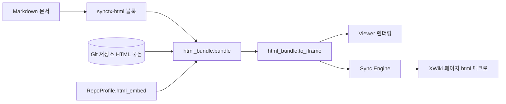
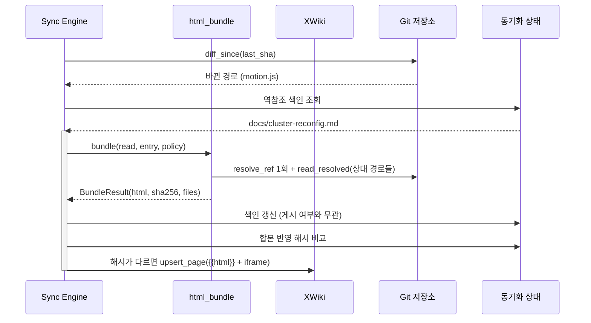

# 인터랙티브 HTML 임베드 설계

## 1. 개요

Markdown 문서 안에 저장소의 HTML 묶음(모션 그래픽처럼 JS로 움직이는 HTML 파일과 그 CSS·JS)을 넣는다. 넣은 HTML은 Viewer와 XWiki 양쪽에서 **조작 가능한 상태로** 보이게 한다.

### 목표

- ` ```synctx-html ` 블록 하나로 HTML 묶음을 문서 안 원하는 위치에 넣는다.
- Viewer와 XWiki 페이지 안에서 재생, 토글, 탐색을 그대로 쓸 수 있다.
- 넣은 HTML은 보는 사람의 Viewer·XWiki 세션에 접근할 수 없다.
- 폐쇄망 원칙을 지킨다. 런타임에 외부 네트워크에 접근하지 않고, 외부 주소는 허용 목록에 있는 사내 CDN만 쓴다.

### 범위 밖

- MP4·GIF 변환
- `.html` 파일 단독 동기화. Markdown에 포함된 경우만 다룬다.
- OpenProject 게시. OpenProject 대상 문서에서 블록은 안내 문구로 바꾼다.
- 신뢰하지 않는 저장소의 HTML 실행

## 2. 배경: XWiki 실험 결과 (2026-10-09, XWiki 16.10.17)

로컬 XWiki에서 파일 4개로 된 모션 그래픽(바닐라 JS, 외부 의존 없음)으로 임베드 방식 5가지를 시험했다. 결과는 **페이지 작성자의 권한**에 따라 갈렸다.

| 작성 계정 권한 | 첨부 + iframe | html 매크로에 직접 삽입 | 합본 + sandbox srcdoc |
|---|---|---|---|
| 프로그래밍 권한 | 동작 | 동작 | 동작 |
| 스크립트 권한만 (공간 한정) | 실패: HTML 첨부를 강제로 다운로드시킴 | 동작 | **동작** |
| 일반 사용자 | 실패: iframe 제거 | 실패: script 제거 | 실패: iframe 제거 |
| 격리 | XWiki와 같은 출처 | 격리 없음 (CSS도 XWiki 화면에 섞임) | **출처 분리 (`null`)** |

- `attachment.download.whitelist` 기본값에 `text/html`이 없다. 그래서 프로그래밍 권한이 없는 사용자가 올린 HTML 첨부는 `Content-Disposition: attachment`로 내려온다.
- 같은 CSP를 건 Viewer 시험 페이지에서 확인한 결과다(Chromium).
  - `frame-src 'none'`은 `src` iframe만 막는다. sandbox srcdoc iframe의 스크립트는 실행된다.
  - srcdoc 문서는 부모 페이지의 CSP를 물려받는다.

**결정:** HTML 묶음을 한 파일로 합치고, 실행 중 네트워크를 제한하는 CSP meta를 함께 넣어 `sandbox="allow-scripts"` srcdoc iframe으로 넣는다. 동기화 계정에는 대상 공간에 한정한 스크립트 권한만 준다. 첨부 방식은 프로그래밍 권한을 주거나 XWiki 전체의 다운로드 정책을 풀어야 해서 채택하지 않는다.

## 3. 구성 요소



| 구성 요소 | 위치 | 역할 |
|---|---|---|
| `html_bundle` | `shared/synctx-common/src/synctx_common/html_bundle.py` (신규) | 블록 파싱, 묶음을 한 파일로 합치기, iframe 감싸기 |
| `HtmlEmbedConfig` | `shared/synctx-common/src/synctx_common/config.py` | `RepoProfile.html_embed` (신뢰 저장소 지정) |
| Viewer | `services/viewer/src/renderer.py`, `app.py` | 블록을 자리표시로 바꾸고, sanitizer를 거친 뒤 iframe으로 바꾸기 |
| Sync Engine | `services/sync/src/sync_engine.py` | `_process_html_blocks`, 묶음 파일 변경 시 다시 동기화 |

새 외부 의존성은 없다. HTML 해석은 표준 라이브러리 `html.parser`로 한다.

## 4. 블록 문법

````markdown
```synctx-html
src: ./cluster-motion/index.html
aspect: 16/10
title: 룰 엔진 클러스터 재구성 모션 그래픽
```
````

블록 내용은 YAML이다.

| 키 | 필수 | 기본값 | 설명 |
|---|---|---|---|
| `src` | O | - | 진입 HTML. Markdown 파일 기준 상대 경로 |
| `aspect` | | `16/9` | iframe 가로세로 비율 (`W/H`) |
| `height` | | - | 고정 높이(px). 지정하면 `aspect` 대신 쓴다 |
| `title` | | 진입 HTML의 `<title>` | iframe `title` 속성 (스크린리더용) |

문법 오류(YAML 오류, `src` 없음, 알 수 없는 키)는 6장의 오류 표시로 처리한다. GitHub처럼 synctx 밖에서 보면 블록은 코드 블록으로 보인다.

블록은 CommonMark 펜스 규칙(들여쓰기 0~3칸)으로 찾는다. 목록 항목 안에 들여 쓴 블록은 여는 펜스의 들여쓰기만큼 본문 앞 공백을 걷어내고, 치환 결과의 각 줄에도 같은 들여쓰기를 붙인다. 그래서 XWiki(markdown/1.2)에서는 iframe이 목록 항목 안에 남는다. Viewer는 Python-Markdown이라 목록 안 펜스 코드를 지원하지 않으므로, 다른 펜스 블록처럼 목록 밖에 그려진다.

## 5. 합본 규칙 (`bundle`)

```python
def bundle(read: Callable[[str], bytes], entry: str, policy: HtmlEmbedConfig) -> BundleResult: ...
def to_iframe(result: BundleResult, aspect: str | None, height: int | None, title: str | None) -> str: ...
```

`read`는 저장소 루트 기준 경로를 받아 바이트를 돌려준다. 호출하는 쪽은 `repo_reader(manager, ref)`를 넘긴다. 이 함수는 첫 읽기에서 `GitRepoManager.resolve_ref(ref)`로 ref를 한 번만 해석(비기본 ref면 fetch)하고, 이후 파일은 `read_resolved(path, resolved)`로 읽는다. 해석 실패는 파일 없음으로 바꾸지 않고 그대로 올린다. `BundleResult`는 다음 필드를 가진다.

- `html`
- `sha256`
- `size`
- `files`: 합본에 쓴 저장소 경로 목록

합본에 실패하면 `BundleError`를 던진다. 여기에는 사유와 함께 다음이 들어 있다.

- `files`: 실패 전까지 읽은 경로
- `missing`: 찾지 못한 경로

실패한 블록도 이 두 목록으로 역참조 색인을 만든다(7.3). 그래야 빠진 파일을 나중에 추가했을 때 다시 처리된다.

| 대상 | 처리 |
|---|---|
| `<link rel="stylesheet" href="상대경로">` | `<style>`로 넣는다 |
| `<script src="상대경로">` | 같은 자리에 `<script>`로 넣는다. 본문의 `</script`는 `<\/script`로 바꾼다 |
| `<script defer src="상대경로">` | 문서에 module 스크립트가 없을 때만 지원한다. `<body>`의 마지막 자식 뒤로 옮겨 넣고, 여러 개면 원래 순서를 지킨다. 문서를 다 읽은 뒤 실행되고 다른 classic 스크립트보다 나중이라는 순서는 유지된다. 실행 순간의 `document.readyState`는 `interactive`가 아니라 `loading`이다 |
| `<script defer>`와 `<script type="module">`이 함께 있음 | 오류 (지원하지 않음). 둘은 문서를 다 읽은 뒤 등장 순서대로 실행되는 같은 대기열을 쓴다. defer만 classic 인라인으로 바꾸면 module보다 먼저 실행된다 |
| `<script async src="…">` | 오류 (지원하지 않음). 인라인 스크립트에서는 `async`가 무시되어 실행 시점이 달라지기 때문이다 |
| `<script type="module">` | 같은 자리에 넣는다(인라인 module도 기본으로 지연 실행된다) |
| import | module의 정적 import와 모든 인라인 스크립트의 동적 `import()`는 허용 출처의 https 문자열 리터럴만 허용한다. 상대 경로·bare specifier·템플릿 치환·리터럴이 아닌 인자(연산자·메서드 호출이 붙은 경우 포함)는 오류다. 주석이 끼어 있어도 검사한다. 판단할 수 없으면 거부하는 보수적 규칙이라 문자열 안의 import 비슷한 글자도 거부될 수 있다 |
| `<script defer>`와 외부 defer 스크립트가 함께 있음 | 오류 (지원하지 않음). 실행 순서를 보존할 수 없다 |
| `<video>`·`<audio>`·`<source>`·`<iframe>`·`<object>`·`<embed>`·`<base>`, SVG `<image>`·`<use>`의 외부 참조 | 오류 (지원하지 않음) |
| `<link rel="icon">` | `data:` URI로 바꾼다. 그 밖의 상대 경로 `<link>`(preload 등)는 오류 |
| CSS `url(상대경로)`, `` | `data:` URI로 바꾼다. MIME은 확장자로 정한다. 글꼴(`woff`, `woff2`, `ttf`)도 포함하며, Viewer CSP의 `font-src`에 `data:`를 더한다(6장 5번) |
| CSS `@import` | 오류 (지원하지 않음) |
| `http(s)://`, `//` 절대 주소 | 출처(스킴 + 호스트 + 포트)가 `allowed_origins`의 항목과 정확히 같으면 그대로 두고, 아니면 오류. `//`로 시작하는 주소는 srcdoc에서 스킴이 정해지지 않으므로 오류. `http://`는 항목에 올 수 없으므로 항상 오류 |
| `data:`, `#fragment`, `about:` | 그대로 둔다 |

해석할 수 없는 주소(`https://[` 등)는 `disallowed_host`, 해석할 수 없는 상대 경로는 `unsupported`로 처리한다.

- 상대 경로의 기준은 그 경로가 적힌 파일이다.
  - HTML의 속성, `<style>`, `style` 속성 안의 경로는 진입 HTML 위치를 기준으로 푼다.
  - 외부 CSS 파일 안의 `url()`은 그 CSS 파일 위치를 기준으로 푼다.
  - 푼 경로는 모두 `GitRepoManager.validate_path`로 저장소 밖으로 나가는지 검사한다.
- 합본 크기가 `max_bundle_bytes`(기본 2MiB)를 넘으면 오류.
- 같은 입력이면 같은 출력이 나와야 한다. XWiki `upsert_page`가 내용이 같으면 갱신을 건너뛰기 때문이다.

### 실행 중 네트워크 정책 (CSP meta 주입)

정적 검사는 JS가 실행 중에 만든 주소(`fetch`, `Image.src`, 동적 `<script>`)를 잡지 못한다. 출처가 `null`이어도 요청 송신 자체는 막히지 않는다. 그래서 모든 스크립트보다 앞에 CSP meta를 넣는다. 위치는 HTML 공백 문자만 앞에 있는 doctype이면 그 바로 뒤, 아니면 문서 맨 앞이다. 스크립트 뒤에 온 doctype은 따라가지 않는다. 브라우저는 이 meta를 `<head>`의 첫 요소로 해석한다. 주석이 doctype보다 앞에 있으면 meta가 doctype 앞에 온다. 이 합본을 독립 문서로 열면 quirks 모드(`BackCompat`)가 되지만, 합본은 항상 iframe srcdoc으로만 전달되고 srcdoc 문서는 HTML 표준상 quirks 모드가 되지 않는다(Chromium에서 sandbox srcdoc `CSS1Compat` 확인, 2026-10-09). 그래서 `<!-->` 같은 해석이 갈리는 주석을 구분하는 검사를 CSP 위치 결정 경로에 더하지 않는다.

```html
<meta http-equiv="Content-Security-Policy" content="default-src 'none'; script-src 'unsafe-inline' {H}; style-src 'unsafe-inline' {H}; img-src data: {H}; font-src data: {H}; connect-src {H|'none'}; frame-src 'none'; worker-src 'none'; form-action 'none'; base-uri 'none'">
```

- `{H}`는 저장소의 `allowed_origins` 항목(예: `https://cdn.corp.example.com`)을 공백으로 이은 것이다. 비어 있으면 해당 지시어에서 뺀다. `connect-src`는 비어 있으면 `'none'`이다.
- 항목은 8.1의 형식 검사를 통과한 출처이므로 **그대로 CSP 출처 표현으로 쓴다.**
  - 호스트 이름만 쓰면 안 된다. 스킴이 없는 호스트 표현은 보호 대상 문서의 스킴에 맞춰 해석되는데, srcdoc 문서의 주소는 `about:srcdoc`이라 `https` 리소스와 맞지 않는다.
  - 리뷰 재현 결과(Chromium)도 호스트 이름만 넣었을 때는 허용한 https 이미지가 막혔고, `https://`를 붙인 출처로 넣었을 때는 막히지 않았다.
- Viewer에서는 부모 CSP와 이 meta CSP가 함께 적용되므로 더 엄격한 쪽이 이긴다. XWiki에서는 이 meta CSP가 실행 중의 유일한 정책이다.
- **두 환경의 실효 정책이 같아지는 조건:** 이 meta가 허용하는 모든 것을 Viewer 부모 CSP도 허용해야 한다. 그러면 두 환경 모두에서 이 meta가 실효 정책이 된다.
  - 출처: 저장소의 `allowed_origins`는 플랫폼 공통 `html_embed.allowed_origins`의 부분집합이어야 하고(설정을 읽을 때 검사, 8.1), Viewer 부모 CSP는 공통 목록을 포함한다(6장 5번).
  - `data:`: 부모 CSP의 `img-src`·`font-src`가 허용한다(6장 5번).
  - `blob:`이나 `media-src`는 넣지 않는다. 합본 규칙이 동영상·음성을 변환하지 않고, 부모 CSP도 허용하지 않기 때문이다.
- 작성자 HTML에 원래 있던 CSP meta는 남겨 둔다. 정책이 여럿이면 모두 적용되므로 더 느슨해지지 않는다.
- 확인 결과(Chromium, 부모에 CSP가 없는 페이지): 실행 중에 만든 주소로 보낸 `fetch`·`Image`·`<script>`가 각각 `connect-src`·`img-src`·`script-src-elem` 위반으로 막혔다. 다만 비교용 시험(meta 없음)은 내장 브라우저가 sandbox 요청을 자체적으로 막아 판정하지 못했다.
- 남는 위험: CSP와 sandbox 모두 iframe 자신의 주소 이동(`location.href = …`)과 WebRTC는 막지 못한다. 이 경로는 신뢰 저장소 지정(8.1)으로 통제하고, 운영 문서에 잔여 위험으로 적는다.

### iframe 감싸기와 XWiki 매크로 경계

`to_iframe` 출력 형식은 다음과 같다.

```html
<iframe class="synctx-html" sandbox="allow-scripts" title="…" style="width:100%;aspect-ratio:16/10;border:0" srcdoc="…"></iframe>
```

- 모든 속성값(`srcdoc`, `title`, `style`)에서 `& < > " '`를 엔티티로 바꾼다. **`{`와 `}`도 각각 `&#123;`·`&#125;`로 바꾼다.**
- XWiki는 `{{html}}` 매크로 본문을 HTML로 해석하기 전에 `{{/html}}`에서 매크로를 끝낸다. 합본이나 `title`에 `{{/html}}{{velocity}}…`가 있으면 그 뒤가 동기화 계정의 스크립트 권한으로 실행된다.
- 중괄호를 엔티티로 바꾸면 매크로 본문에 `{{`가 한 번도 나오지 않는다. 브라우저는 속성값의 엔티티를 되돌리므로 srcdoc 내용은 그대로다. iframe 밖에 나가는 문자열은 이 태그 하나뿐이다.
- 블록 하나의 XWiki 출력은 iframe이든 안내·오류 문구든 **항상 `{{html}}…{{/html}}` 매크로 하나**다. 안내·오류 문구에 들어가는 `src` 경로와 오류 사유도 HTML 텍스트로 넣는다. 이때 iframe 속성과 같은 규칙으로 `& < > " ' { }`를 모두 엔티티로 바꾼다.
- 그래서 매크로 본문에는 `{` `}` 문자가 한 글자도 남지 않는다. 블록에서 나온 문자열이 XWiki 문법으로 해석될 수 있는 자리가 없다.
- verbatim(`{{{ }}}`)이나 XWiki 문법 이스케이프(`~`)는 쓰지 않는다. XWiki 2.x에서 verbatim 내부의 `}}}`를 안전하게 이스케이프하는 방법이 보장되지 않기 때문이다.
- `allow-same-origin`, `allow-top-navigation`, `allow-forms`, `allow-popups`는 **어떤 설정으로도 붙지 않는다**. 테스트로 고정한다.
- `loading="lazy"`는 쓰지 않는다. srcdoc에서는 효과가 없다.

### HTML 작성자가 알아야 할 제약

합본은 출처가 `null`인 `about:srcdoc` 문서에서 실행된다.

- `location.search`·`location.hash`로 초기 상태를 받을 수 없다. 기본값으로 시작해야 한다.
- 상대 경로 `fetch`·XHR·`import()`는 동작하지 않는다. 런타임에 파일을 읽지 말고 데이터는 JS에 넣는다.
- `localStorage`·쿠키는 쓸 수 없다. 접근하면 예외가 나므로 try/catch로 감싼다.
- `history.replaceState`는 같은 주소로 호출하면 동작했다(실험). 다른 주소로 바꾸는 호출은 예외가 날 수 있다.
- 주입된 CSP 때문에 `allowed_origins` 밖의 주소는 실행 중에도 불러올 수 없다. `blob:` 이미지와 동영상·음성도 불러올 수 없다.
- `async` 스크립트는 쓸 수 없다. `defer`와 `module`을 한 문서에서 함께 쓸 수 없다.

## 6. Viewer

1. `embed_view.prepare`가 렌더링 전에 ` ```synctx-html ` 블록을 `<div class="synctx-html-slot" data-slot="N"></div>`로 바꾸고, 블록 내용은 따로 넘긴다.
2. `app._render_file_response`가 `_sanitize_html`을 **거친 뒤** 각 자리표시를 `to_iframe` 결과로 바꾼다. sanitizer는 그대로 두므로 Markdown 본문에 직접 쓴 `<iframe>`·`<script>`는 계속 지워진다.
3. `html_embed.enabled=false`인 저장소에서는 자리표시를 안내 상자로 바꾼다. 안내 상자에는 "이 저장소는 HTML 실행이 허용되지 않음"과 `src` 소스 보기 링크를 넣는다.
4. 합본에 실패하면 자리표시를 오류 상자로 바꾼다. 오류 상자에는 사유와 `src` 경로를 넣는다. 페이지의 나머지는 그대로 렌더링한다.
5. CSP(`csp_middleware`)를 두 군데 바꾼다.
   - `font-src`에 `data:`를 더한다. srcdoc 합본은 부모 CSP를 물려받으므로, 이 변경이 없으면 `data:` 글꼴이 막힌다. `img-src`에는 이미 `data:`가 있다. `data:` 글꼴은 스크립트를 실행할 수 없어서 Viewer 본문의 보안 수준은 그대로다.
   - 플랫폼 공통 `html_embed.allowed_origins`의 출처를 `script-src`·`style-src`·`img-src`·`font-src`·`connect-src`에 더한다. 지금 `cdn_base_url`에서 얻은 출처를 더하는 방식과 같다.
   - 이 두 변경으로 합본 meta CSP가 허용하는 것은 모두 부모 CSP도 허용한다. 그래서 Viewer에서도 XWiki와 같이 합본 meta CSP가 실효 정책이 된다(5장).
   - 나머지 지시어는 바꾸지 않는다.
6. `download?format=html`도 같은 iframe을 넣는다. 네트워크 없이 완전하게 재생된다는 보장은 **저장소의 `allowed_origins`가 비어 있을 때만** 한다.
   - 이때는 주입된 CSP가 실행 중 네트워크를 모두 막는다. 그래서 합본은 처음부터 네트워크 없이 동작하도록 만들어져 있어야 하고, Viewer·XWiki·다운로드 파일에서 동작이 같다.
   - `allowed_origins`가 비어 있지 않으면, 정적 참조가 없어도 JS가 실행 중에 허용 CDN 주소를 만들 수 있다. 그래서 다운로드 파일의 iframe 위에 항상 "사내 CDN 접근이 필요할 수 있는 콘텐츠" 안내를 붙인다.
   - 외부 리소스를 받아 합본에 넣는 기능은 범위 밖이다.
   - `format=pdf`는 JS가 돌지 않으므로 "인터랙티브 콘텐츠: Viewer에서 보기" 안내로 바꾼다.
   - `download_file`은 async 함수이므로 html·pdf 준비(Git 읽기와 합본)를 executor에서 실행한다.

`.html` 파일을 직접 여는 화면은 지금처럼 소스 보기를 유지한다.

## 7. Sync Engine

### 7.1 블록 변환

`_process_html_blocks(repo, md_path, body, ref) -> str`를 `_process_mermaid_blocks` 바로 앞에서 호출한다(xwiki, both 경로 모두). 블록은 다음으로 바꾼다.

```
{{html clean="false"}}<iframe class="synctx-html" sandbox="allow-scripts" …></iframe>{{/html}}
```

- 첨부는 올리지 않는다. 합본은 페이지 본문에 들어간다.
- `html_embed.enabled=false` 저장소이거나 합본에 실패하면, 블록을 안내·오류 문구를 담은 `{{html}}` 매크로로 바꾸고 동기화는 계속한다(5장 이스케이프 규칙 적용). 실패는 SyncReport와 메트릭에 남긴다.
- OpenProject 대상 본문에서는 블록을 "인터랙티브 콘텐츠: Viewer에서 보기" 링크로 바꾼다.

### 7.2 페이지 문법 (2026-10-09 확인)

페이지는 지금처럼 `markdown/1.2` 문법으로 보낸다(`XWikiTargetConfig.syntax`). 로컬 XWiki 16.10.17에서 `markdown/1.2` 페이지 안의 `{{html clean="false"}}` 매크로가 sandbox srcdoc iframe을 그대로 내보내고, iframe 안의 스크립트도 실행되는 것을 확인했다. 앞뒤의 Markdown 문단도 정상으로 렌더링됐다.

- 전제: XWiki 기본 배포(Standard Flavor)에는 `markdown/1.2` 파서가 없다. "CommonMark Markdown Syntax 1.2" 확장(`org.xwiki.contrib.markdown:syntax-markdown-commonmark12`, 확인 버전 8.9.1)이 설치되어 있어야 한다. 기존 문서(`xwiki-api-reference.md`, `production-service-design.md` 4장)가 이미 이 확장을 전제로 한다.
- 이 확인은 위키 소유자 계정으로 작성한 페이지로 했다. 공간 한정 스크립트 권한만 가진 동기화 계정의 경우는 종단 확인에서 다시 본다.

### 7.3 다시 처리할 조건

지금의 `run_sync`에는 다시 처리를 막는 관문이 세 군데 있다.

| 관문 | 위치 | 문제 |
|---|---|---|
| `last_successful_sha == head_sha`면 바로 종료 | `run_sync` | 플랫폼 설정(`html_embed`)만 바뀌면 처리하지 않는다 |
| `_should_process`가 `.md`만 통과 | `run_sync` 반복문 | `motion.js`만 바뀌면 처리 대상이 없다 |
| `is_file_changed(path, content_sha)` | `run_sync` 반복문 | md를 대상에 넣어도 md 본문 SHA가 같으면 건너뛴다 |

세 관문을 다음과 같이 바꾼다.

1. **역참조 색인 (두 번째 관문)**
   - 동기화 상태에 `{묶음 파일 경로: [그 파일을 쓴 md 경로]}`를 저장한다. `BundleResult.files`로 만든다.
   - 구현은 정방향 맵(`RepoState.html_dependencies`: md → 의존 경로)을 저장하고, 역참조는 실행 때 계산한다.
   - `diff_since` 결과 중 `.md`가 아닌 경로가 색인에 있으면, 해당 md를 처리 대상에 넣는다.
   - 전체 재스캔 때는 색인을 새로 만든다.
   - 합본에 실패하면 `BundleError.files`(실패 전까지 읽은 경로)와 `BundleError.missing`(찾지 못한 경로)을 모두 색인에 넣는다. 그래서 빠진 `motion.js`를 나중에 추가하면 그 추가가 `diff_since`에 잡혀 md를 다시 처리한다.
   - 빠진 파일이 CSS라 그 안의 참조를 아직 모르는 경우도 같다. CSS가 추가되면 다시 처리되고, 그때 새로 빠진 경로가 색인에 들어간다.
   - 비활성 저장소에서는 진입 HTML 경로만 넣는다. 정책이 바뀌면 3번에 따라 다시 처리된다.
2. **합본을 반영한 내용 해시 (세 번째 관문)**
   - `synctx-html` 블록이 있는 md는 `content_sha`를 md 본문만으로 계산하지 않는다.
   - 다음을 순서대로 이어 붙여 `sha256`을 계산한다.
     - md 본문
     - 블록마다: XWiki에 보낼 매크로 문자열(`xwiki_html_macro(조각)`)의 SHA. 합본 내용뿐 아니라 iframe·안내 문구 렌더링이 바뀌어도 다시 게시된다
     - 블록마다: 정렬한 의존 경로 목록(`files`와 `missing`)
     - 정책 지문
   - 의존 경로 목록을 넣으므로, 내용이 같은 `a.js`에서 `b.js`로 참조만 바뀌어 합본 SHA가 같아도 해시가 달라진다.
   - 합본은 CSP meta를 포함하므로 `allowed_origins`가 바뀌면 합본 SHA도 바뀐다. 블록이 없는 md는 지금처럼 본문 SHA를 쓴다.
   - **색인 갱신은 게시 여부와 분리한다.** 블록이 있는 md는 해시를 계산하려고 합본을 먼저 만든다. 그 결과로 색인을 항상 갱신하고, 그다음에 해시를 비교해 게시할지 건너뛸지 정한다. 건너뛰어도 색인은 이미 최신이다. XWiki `upsert_page`가 내용이 같아 갱신을 생략하는 경우도 마찬가지다.
3. **정책 지문 (첫 번째 관문)**
   - 저장소별 `html_embed` 설정을 정규화한 값의 SHA를 정책 지문으로 쓰고, 동기화 상태에 저장한다.
   - `head_sha` 비교 전에 지문을 먼저 비교한다. 다르면 HEAD가 같아도 색인에 있는 md 전부를 처리 대상으로 삼아 실행한다.
   - 실행이 성공하면 지문을 갱신한다.
   - 그래서 `enabled`를 `false`로 바꾸면 다음 실행에서 기존 XWiki 페이지의 iframe이 안내 문구로 바뀐다.

색인에 없는 md는 정책 변경과 무관하므로 처리하지 않는다. 동기화 상태에 색인이 아예 없으면 전체 스캔으로 색인을 만든다. 첫 실행이나 이 기능을 넣기 전의 상태가 여기에 해당한다. 그래서 HEAD가 같아도 빠지는 md가 없다.



## 8. 설정

### 8.1 신뢰 저장소 (`RepoProfile.html_embed`)

신뢰 여부는 운영자가 관리하는 플랫폼 설정에 둔다. 저장소 안의 `.synctx.yaml`에 두지 않는다. `.synctx.yaml`은 저장소 작성자가 스스로 켤 수 있기 때문이다.

```yaml
html_embed:
  allowed_origins: ["https://cdn.corp.example.com"]

repositories:
  - id: example-infra
    url: https://gitlab.internal/infra/example-infra.git
    html_embed:
      enabled: true
      allowed_origins: ["https://cdn.corp.example.com"]
      max_bundle_bytes: 2097152
      xwiki_credential_env: XWIKI_HTML_CREDENTIAL
```

| 위치 | 키 | 기본값 | 설명 |
|---|---|---|---|
| 최상위 `html_embed` | `allowed_origins` | `[]` | 플랫폼 전체에서 합본이 참조할 수 있는 출처의 상한. Viewer 부모 CSP에 들어간다 |
| `repositories[].html_embed` | `enabled` | `false` | HTML 실행 허용 여부 |
| `repositories[].html_embed` | `allowed_origins` | `[]` | 이 저장소의 합본이 참조할 수 있는 출처. 최상위 목록의 부분집합이어야 한다 |
| `repositories[].html_embed` | `max_bundle_bytes` | `2097152` | 합본 크기 상한 |
| `repositories[].html_embed` | `xwiki_credential_env` | 없음 | 이 저장소 페이지를 게시할 신뢰 저장소 전용 XWiki 계정의 자격 증명 환경변수. XWiki가 대상이고 `enabled: true`면 필수이며 `targets.xwiki.auth.credential_env`와 달라야 한다 |

설정을 읽을 때(pydantic validator) 다음을 검사하고, 어기면 서비스가 시작되지 않는다. Viewer와 Sync Engine은 같은 설정 모델을 쓰므로 두 서비스에서 같은 검사가 돈다.

- 출처 형식은 `https://호스트` 또는 `https://호스트:포트`만 허용한다.
  - 스킴은 `https`만 받는다. 운영과 로컬 모두 Ingress TLS를 쓰고, `http`는 https 페이지 안에서 혼합 콘텐츠로 막힌다.
  - 호스트는 소문자로 바꾼다. 와일드카드, 경로, 쿼리, 끝의 `/`는 받지 않는다.
  - 포트가 443이면 빼서 저장한다. 그래서 정적 검사와 CSP가 같은 문자열을 쓴다.
- 저장소의 `allowed_origins`는 정규화한 뒤 최상위 `allowed_origins`에 모두 들어 있어야 한다.

### 8.2 XWiki 권한

- 스크립트 권한은 **신뢰 저장소 전용 계정**(`html_embed.xwiki_credential_env`)에만, **대상 공간에 한정해** 준다. 공간의 `WebPreferences`에 `XWiki.XWikiGlobalRights`로 `users=전용 계정`, `levels=script`, `allow=1`을 넣는다.
- 기본 동기화 계정(`targets.xwiki.auth`)에는 스크립트 권한을 주지 않는다. XWiki는 페이지를 마지막으로 작성한 계정의 권한으로 매크로를 실행하므로, 비신뢰 저장소가 본문에 직접 쓴 `{{html}}`·`{{velocity}}`는 기본 계정 권한으로 걸러진다. 공간 이름은 디렉터리에서 정해져 저장소끼리 공간을 공유하므로, 권한을 공간이 아니라 계정으로 나눠야 한다(2026-10-09 최종 검토 결정).
- 문서마다 XWiki에 게시한 계정을 상태 파일 `synced_files[].publisher`에 기록한다(`""`=기본 계정, 사용자 이름=전용 계정, `null`=모름). 매 실행에서 기록된 게시자가 현재 게시 계정과 다른 문서는 설정 변경 여부와 무관하게 다시 게시한다. 그래서 신뢰 지정·해제, 전용 계정 교체, 일부만 성공한 전환을 되돌린 경우 모두 실제 게시 기록을 기준으로 권한이 회수된다. 실패한 문서는 기록이 바뀌지 않아 다음 실행에서 다시 시도한다.
- XWiki는 내용이 바뀐 저장에서만 content author를 갱신한다(16.10 `XWikiDocument.setContent`). 그래서 다시 게시할 때 XWiki 본문이 같으면 임시 내용(`{{comment}}synctx: 작성자 갱신{{/comment}}`을 덧붙인 본문)을 먼저 저장하고 원래 본문을 다시 저장한다(`upsert_page(force_author=True)`). 페이지 기록에 버전이 하나 더 남는다.
- 게시자 기록이 없는 기존 상태: HTML 임베드 도입 전 상태(`html_dependencies` 없음)는 기본 계정만 있었으므로 기본 계정으로 읽는다. 도입 후 상태에서 기록이 빠진 항목은 모름으로 읽고 한 번 다시 게시한다.
- 프로그래밍 권한과 위키 전체 스크립트 권한은 주지 않는다.
- XWiki의 `attachment.download.whitelist`는 바꾸지 않는다.

## 9. 보안

| 위협 | 대응 |
|---|---|
| 넣은 스크립트가 보는 사람 세션으로 Viewer·XWiki API를 호출 | sandbox에 `allow-same-origin`을 붙이지 않는다. 출처가 `null`이라 쿠키·CSRF 토큰·같은 출처 API에 접근할 수 없다 |
| 신뢰하지 않는 저장소가 HTML 실행을 스스로 켬 | `RepoProfile`(운영자 설정)에서만 켤 수 있다 |
| 외부 네트워크 호출 (정적 주소) | 합본 단계에서 출처가 `allowed_origins` 항목과 정확히 같지 않은 주소는 오류로 막는다 |
| Viewer와 XWiki의 허용 범위 불일치 | 저장소 목록이 플랫폼 공통 목록의 부분집합인지 설정을 읽을 때 검사하고, Viewer 부모 CSP에 공통 목록을 넣는다. 두 환경 모두 합본 meta CSP가 실효 정책이 된다 |
| 외부 네트워크 호출 (실행 중 만든 주소) | 합본 `<head>` 맨 앞에 넣은 CSP meta가 실행 중에 막는다. Viewer에서는 부모 CSP도 함께 적용된다 |
| iframe 자신의 주소 이동, WebRTC | CSP·sandbox로 막을 수 없는 잔여 위험이다. 신뢰 저장소 지정으로만 통제하고, 운영 문서에 적는다 |
| 저장소 밖 파일 읽기 | 각 경로를 그 경로가 적힌 파일 기준으로 푼 뒤 `validate_path`로 검사한다 |
| srcdoc 속성 탈출 | `to_iframe`에서 속성값을 이스케이프하고, 테스트로 `" > <script>` 입력을 확인한다 |
| XWiki 매크로 경계 탈출 (`{{/html}}` 주입) | 블록 출력은 항상 `{{html}}` 매크로 하나이고, 안의 속성값과 텍스트에서 `{` `}`를 엔티티로 바꾼다. 매크로 본문에 중괄호가 남지 않는다 |
| 신뢰 해제 후에도 남는 iframe | 정책 지문이 바뀌면 HEAD가 같아도 해당 md를 다시 처리한다(7.3) |
| 신뢰 해제 후에도 전용 계정이 작성자로 남은 페이지 | 게시 계정이 바뀌면 블록이 없는 md까지 모두 기본 계정으로 다시 게시하고, 본문 표식으로 내용이 달라지게 해 작성자가 실제로 바뀌게 한다(8.2) |
| 큰 합본으로 페이지·DB 부하 | `max_bundle_bytes` 상한 |
| 상단 페이지 이동·팝업 | sandbox에 `allow-top-navigation`·`allow-popups`를 주지 않는다 |
| 동기화 계정 권한 남용 | 스크립트 권한은 신뢰 저장소 전용 계정에만, 공간에 한정해 준다. 이 계정으로 작성되는 페이지 내용은 Git 원본에서만 나온다 |
| 비신뢰 저장소가 본문에 `{{html}}`·`{{velocity}}`를 직접 씀 | 비신뢰 저장소는 스크립트 권한 없는 기본 계정으로 게시하므로 XWiki가 걸러 낸다. 신뢰 저장소 전용 계정은 설정 검사로 기본 계정과 분리한다 |

## 10. 관측성

- 메트릭 `synctx_html_bundle_total{service, repo_id, result}`를 추가한다. `result`는 `ok`, `disabled`, `missing_file`, `outside_repo`, `disallowed_host`, `too_large`, `invalid_block`, `unsupported` 중 하나다.
- 합본 실패는 `synctx_sync_failures_total{error_type="html_bundle"}`에도 센다. 이때 페이지 동기화 자체는 성공으로 처리한다.
- Sync 실행 보고서(`SyncReport.summary()`)의 `html_errors`에 문서 경로·사유·메시지를 남긴다. 게시 성공·실패 수와는 따로 센다.
- Alert: 저장소별 `disallowed_host` 또는 `too_large`가 1시간 안에 1건 이상이면 warning.

## 11. 테스트

| 수준 | 대상 | 내용 |
|---|---|---|
| 단위 | `html_bundle` | CSS·JS 넣기, `</script` 이스케이프, 이미지 `data:` 변환, 외부 CSS 안 `url()`을 CSS 파일 기준으로 푸는지(하위 폴더 CSS + 상위 폴더 이미지), 저장소 밖 경로 거부, 허용 목록 밖 출처 거부(같은 호스트의 다른 포트, `http://`, `//` 포함), `@import`·상대 module import·`async` 오류, `defer` 스크립트를 순서대로 `<body>` 끝으로 옮기는지, `defer`와 `module`이 함께 있으면 오류인지, 글꼴 `data:` 변환, CSP meta가 `<head>` 첫 자식이고 `allowed_origins`가 `https://` 출처 그대로 반영되며 `blob:`·`media-src`가 없는지, 실패 시 `BundleError.files`·`missing`, 크기 상한, 같은 입력·같은 출력 |
| 단위 | `to_iframe` | 속성 이스케이프(`"`, `&`, `<`, `{`, `}`), 합본·`title`에 `{{/html}}{{velocity}}`를 넣어도 출력에 `{{`가 없는지, sandbox 값이 정확히 `allow-scripts`인지 |
| Viewer | `test_viewer_api.py` | 블록이 iframe이 되는지, 본문에 직접 쓴 iframe은 여전히 지워지는지, 비신뢰 저장소의 안내 상자, 합본 실패 시 오류 상자, CSP 헤더에 `font-src data:`와 공통 `allowed_origins`가 더해진 것 외에 변화 없음, `allowed_origins`가 비어 있지 않은 저장소의 다운로드 안내(정적 외부 참조가 없어도 붙는지) |
| Sync | `test_sync_engine.py` | 블록을 html 매크로로 바꾸는지, `motion.js`만 바뀌어도 md를 다시 동기화하는지(본문 SHA 같음), HEAD가 같아도 `enabled`·`allowed_origins` 변경 시 색인의 md를 다시 처리하는지, 색인이 없는 기존 상태에서 전체 스캔, `motion.js`가 빠져 실패한 뒤 그 파일만 추가해도 md를 다시 처리해 복구하는지, 비신뢰 저장소, 경로·오류 사유에 `{{/html}}`·`}}}`가 들어가도 안내 매크로 본문에 중괄호가 없는지, 내용이 같은 `a.js`에서 `b.js`로 참조만 바꾼 뒤 `b.js`를 고치면 다시 처리하는지(색인이 게시 생략과 무관하게 갱신되는지), OP 대상 링크 문구 |
| 단위 | 설정 모델 | `allowed_origins` 형식 검사(스킴 `https`만, 소문자, 443 생략, 경로·와일드카드·끝 `/` 거부), 저장소 목록이 공통 목록의 부분집합이 아니면 오류 |
| 수동 | 로컬 XWiki | `markdown/1.2` 안 `{{html}}` 매크로 실행 여부(7.2), 공간 한정 스크립트 권한 계정으로 재생, `{{/html}}`이 든 합본이 매크로 밖으로 새지 않는지 |
| 수동 | 운영 XWiki | 운영 버전에서 2장 결과 재확인, 실제 Chrome·Edge에서 재생과 CSP meta 차단(비교용 시험 포함) |

테스트 픽스처로 작은 모션 HTML 묶음(CSS 1, JS 1, 이미지 1)을 `services/*/tests/fixtures/`에 둔다.

## 12. 문서 반영 (CLAUDE.md 일관성 규칙)

| 문서 | 반영 내용 |
|---|---|
| `README.md` | 기능 목록에 HTML 임베드 추가. 서비스 추가가 아니므로 다이어그램은 바꾸지 않는다 |
| `docs/architecture.md` | Viewer·Sync 설계에 `html_bundle` 모듈과 렌더링 경로, Phase 표 |
| `docs/production-service-design.md` | 3장 보안(sandbox, CSP meta 주입, 매크로 경계 이스케이프, 신뢰 저장소, 잔여 위험: iframe 자체 이동·WebRTC), 설정 스키마(최상위·저장소별 `html_embed`, 출처 형식과 부분집합 검사), 7.2 Viewer 보안 문구와 CSP(`font-src data:`), 메트릭·Alert, 테스트, Runbook(합본 실패·XWiki 스크립트 권한 부여 절차), Phase 체크리스트 |
| `CLAUDE.md` | Phase 순서 문구 |

**Phase(검토 필요):** 기존 Phase 번호를 바꾸지 않으려고 **Phase 9 "인터랙티브 HTML 임베드"** 를 새로 둔다. Viewer(Phase 1)와 XWiki Sync(Phase 3)에 의존한다.

## 13. 구현 순서

1. 로컬 XWiki에서 7.2(`markdown/1.2` + `{{html}}`)를 확인한다. 결과에 따라 7.2 방향을 정한다.
2. `HtmlEmbedConfig`와 `html_bundle` 모듈, 단위 테스트
3. Viewer 렌더링 경로와 테스트
4. Sync Engine 블록 변환, 다시 처리할 조건(역참조 색인, 합본 반영 해시, 정책 지문)과 테스트
5. 메트릭·Alert
6. 문서 반영(12장)
7. 룰 엔진 클러스터 모션 그래픽으로 종단 확인 (Viewer, 로컬 XWiki)
