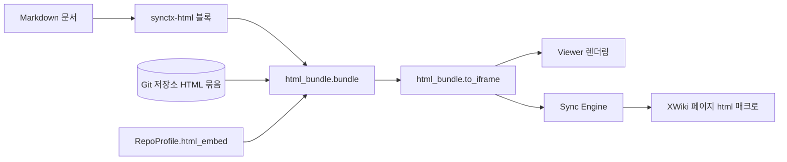
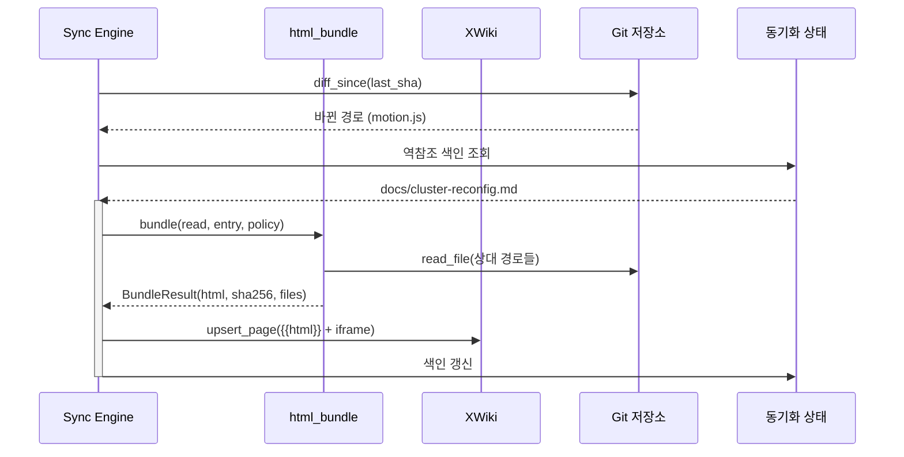

# 인터랙티브 HTML 임베드 설계

## 1. 개요

Markdown 문서 안에 저장소의 HTML 묶음(모션 그래픽처럼 JS로 움직이는 HTML 파일과 그 CSS·JS)을 넣는다. 넣은 HTML은 Viewer와 XWiki 양쪽에서 **조작 가능한 상태로** 보이게 한다.

### 목표

- ` ```synctx-html ` 블록 하나로 HTML 묶음을 문서 안 원하는 위치에 넣는다.
- Viewer와 XWiki 페이지 안에서 재생, 토글, 탐색을 그대로 쓸 수 있다.
- 넣은 HTML은 보는 사람의 Viewer·XWiki 세션에 접근할 수 없다.
- 폐쇄망 원칙을 지킨다. 런타임에 외부 네트워크에 접근하지 않고, 외부 주소는 허용 목록에 있는 사내 CDN만 쓴다.

### 범위 밖

- MP4·GIF 변환
- `.html` 파일 단독 동기화. Markdown에 포함된 경우만 다룬다.
- OpenProject 게시. OpenProject 대상 문서에서 블록은 안내 문구로 바꾼다.
- 신뢰하지 않는 저장소의 HTML 실행

## 2. 배경: XWiki 실험 결과 (2026-10-09, XWiki 16.10.17)

로컬 XWiki에서 파일 4개로 된 모션 그래픽(바닐라 JS, 외부 의존 없음)으로 임베드 방식 5가지를 시험했다. 결과는 **페이지 작성자의 권한**에 따라 갈렸다.

| 작성 계정 권한 | 첨부 + iframe | html 매크로에 직접 삽입 | 합본 + sandbox srcdoc |
|---|---|---|---|
| 프로그래밍 권한 | 동작 | 동작 | 동작 |
| 스크립트 권한만 (공간 한정) | 실패: HTML 첨부를 강제로 다운로드시킴 | 동작 | **동작** |
| 일반 사용자 | 실패: iframe 제거 | 실패: script 제거 | 실패: iframe 제거 |
| 격리 | XWiki와 같은 출처 | 격리 없음 (CSS도 XWiki 화면에 섞임) | **출처 분리 (`null`)** |

- `attachment.download.whitelist` 기본값에 `text/html`이 없다. 그래서 프로그래밍 권한이 없는 사용자가 올린 HTML 첨부는 `Content-Disposition: attachment`로 내려온다.
- 같은 CSP를 건 Viewer 시험 페이지에서 확인한 결과다(Chromium).
  - `frame-src 'none'`은 `src` iframe만 막는다. sandbox srcdoc iframe의 스크립트는 실행된다.
  - srcdoc 문서는 부모 페이지의 CSP를 물려받는다.

**결정:** HTML 묶음을 한 파일로 합치고, `sandbox="allow-scripts"` srcdoc iframe으로 넣는다. 동기화 계정에는 대상 공간에 한정한 스크립트 권한만 준다. 첨부 방식은 프로그래밍 권한을 주거나 XWiki 전체의 다운로드 정책을 풀어야 해서 채택하지 않는다.

## 3. 구성 요소



| 구성 요소 | 위치 | 역할 |
|---|---|---|
| `html_bundle` | `shared/synctx-common/src/synctx_common/html_bundle.py` (신규) | 블록 파싱, 묶음을 한 파일로 합치기, iframe 감싸기 |
| `HtmlEmbedConfig` | `shared/synctx-common/src/synctx_common/config.py` | `RepoProfile.html_embed` (신뢰 저장소 지정) |
| Viewer | `services/viewer/src/renderer.py`, `app.py` | 블록을 자리표시로 바꾸고, sanitizer를 거친 뒤 iframe으로 바꾸기 |
| Sync Engine | `services/sync/src/sync_engine.py` | `_process_html_blocks`, 묶음 파일 변경 시 다시 동기화 |

새 외부 의존성은 없다. HTML 해석은 표준 라이브러리 `html.parser`로 한다.

## 4. 블록 문법

````markdown
```synctx-html
src: ./cluster-motion/index.html
aspect: 16/10
title: 룰 엔진 클러스터 재구성 모션 그래픽
```
````

블록 내용은 YAML이다.

| 키 | 필수 | 기본값 | 설명 |
|---|---|---|---|
| `src` | O | - | 진입 HTML. Markdown 파일 기준 상대 경로 |
| `aspect` | | `16/9` | iframe 가로세로 비율 (`W/H`) |
| `height` | | - | 고정 높이(px). 지정하면 `aspect` 대신 쓴다 |
| `title` | | 진입 HTML의 `<title>` | iframe `title` 속성 (스크린리더용) |

문법 오류(YAML 오류, `src` 없음, 알 수 없는 키)는 6장의 오류 표시로 처리한다. GitHub처럼 synctx 밖에서 보면 블록은 코드 블록으로 보인다.

## 5. 합본 규칙 (`bundle`)

```python
def bundle(read: Callable[[str], bytes], entry: str, policy: HtmlEmbedConfig) -> BundleResult: ...
def to_iframe(result: BundleResult, aspect: str | None, height: int | None, title: str | None) -> str: ...
```

`read`는 저장소 루트 기준 경로를 받아 바이트를 돌려준다. 호출하는 쪽은 `GitRepoManager.read_file(path, ref)`를 넘긴다. `BundleResult`는 `html`, `sha256`, `size`, `files`(합본에 쓴 저장소 경로 목록)를 가진다.

| 대상 | 처리 |
|---|---|
| `<link rel="stylesheet" href="상대경로">` | `<style>`로 넣는다 |
| `<script src="상대경로">` | `<script>`로 넣는다. 본문의 `</script`는 `<\/script`로 바꾼다 |
| `<script type="module">` | 넣되, 안에 상대 경로 `import`가 있으면 오류 |
| CSS `url(상대경로)`, `` | `data:` URI로 바꾼다. MIME은 확장자로 정한다 |
| CSS `@import` | 오류 (지원하지 않음) |
| `http(s)://`, `//` 절대 주소 | 호스트가 `allowed_hosts`에 있으면 그대로 두고, 없으면 오류 |
| `data:`, `#fragment`, `about:` | 그대로 둔다 |

- 경로는 진입 HTML 위치를 기준으로 풀고, `GitRepoManager.validate_path`로 저장소 밖으로 나가는지 검사한다.
- 합본 크기가 `max_bundle_bytes`(기본 2MiB)를 넘으면 오류.
- 같은 입력이면 같은 출력이 나와야 한다. XWiki `upsert_page`가 내용이 같으면 갱신을 건너뛰기 때문이다.

`to_iframe` 출력 형식은 다음과 같다. 속성값은 `& < > " '`를 이스케이프한다.

```html
<iframe class="synctx-html" sandbox="allow-scripts" title="…" style="width:100%;aspect-ratio:16/10;border:0" srcdoc="…"></iframe>
```

- `allow-same-origin`, `allow-top-navigation`, `allow-forms`, `allow-popups`는 **어떤 설정으로도 붙지 않는다**. 테스트로 고정한다.
- `loading="lazy"`는 쓰지 않는다. srcdoc에서는 효과가 없다.

### HTML 작성자가 알아야 할 제약

합본은 출처가 `null`인 `about:srcdoc` 문서에서 실행된다.

- `location.search`·`location.hash`로 초기 상태를 받을 수 없다. 기본값으로 시작해야 한다.
- 상대 경로 `fetch`·XHR·`import()`는 동작하지 않는다. 런타임에 파일을 읽지 말고 데이터는 JS에 넣는다.
- `localStorage`·쿠키는 쓸 수 없다. 접근하면 예외가 나므로 try/catch로 감싼다.
- `history.replaceState`는 같은 주소로 호출하면 동작했다(실험). 다른 주소로 바꾸는 호출은 예외가 날 수 있다.

## 6. Viewer

1. `renderer.render_markdown`이 ` ```synctx-html ` 블록을 `<div class="synctx-html-slot" data-slot="N"></div>`로 바꾸고, 블록 내용은 따로 넘긴다.
2. `app._render_file_response`가 `_sanitize_html`을 **거친 뒤** 각 자리표시를 `to_iframe` 결과로 바꾼다. sanitizer는 그대로 두므로 Markdown 본문에 직접 쓴 `<iframe>`·`<script>`는 계속 지워진다.
3. `html_embed.enabled=false`인 저장소에서는 자리표시를 안내 상자로 바꾼다. 안내 상자에는 "이 저장소는 HTML 실행이 허용되지 않음"과 `src` 소스 보기 링크를 넣는다.
4. 합본에 실패하면 자리표시를 오류 상자로 바꾼다. 오류 상자에는 사유와 `src` 경로를 넣는다. 페이지의 나머지는 그대로 렌더링한다.
5. CSP는 바꾸지 않는다. 합본은 부모의 `script-src 'self' 'unsafe-inline' {CDN}`을 물려받으므로, 허용 목록 밖의 외부 스크립트는 브라우저에서도 한 번 더 막힌다.
6. `download?format=html`도 같은 iframe을 넣는다. 결과 파일은 한 파일로 오프라인에서 재생된다. `format=pdf`는 JS가 돌지 않으므로 "인터랙티브 콘텐츠: Viewer에서 보기" 안내로 바꾼다.

`.html` 파일을 직접 여는 화면은 지금처럼 소스 보기를 유지한다.

## 7. Sync Engine

### 7.1 블록 변환

`_process_html_blocks(repo, md_path, body, ref) -> str`를 `_process_mermaid_blocks` 바로 앞에서 호출한다(xwiki, both 경로 모두). 블록은 다음으로 바꾼다.

```
{{html clean="false"}}<iframe class="synctx-html" sandbox="allow-scripts" …></iframe>{{/html}}
```

- 첨부는 올리지 않는다. 합본은 페이지 본문에 들어간다.
- `html_embed.enabled=false` 저장소이거나 합본에 실패하면 블록을 안내·오류 문구로 바꾸고 동기화는 계속한다. 실패는 SyncReport와 메트릭에 남긴다.
- OpenProject 대상 본문에서는 블록을 "인터랙티브 콘텐츠: Viewer에서 보기" 링크로 바꾼다.

### 7.2 페이지 문법 (구현 첫 단계에서 확인)

지금은 페이지를 `markdown/1.2` 문법으로 보낸다(`XWikiTargetConfig.syntax`). 이번 실험 페이지는 모두 `xwiki/2.1`이었으므로, `markdown/1.2` 안에서 `{{html}}` 매크로가 실행되는지는 **아직 확인하지 않았다**.

- 동작하면 그대로 `markdown/1.2`로 보낸다.
- 동작하지 않으면 블록이 있는 페이지만 `xwiki/2.1`로 보낸다. 이 경우 Markdown 본문의 변환 방법은 별도로 정해야 하고, 이 설계의 범위를 넘으므로 다시 검토한다.

### 7.3 묶음 파일 변경 감지

지금은 `_should_process`가 `.md`만 통과시킨다. 그래서 `motion.js`만 바뀌면 다시 동기화되지 않는다.

- 동기화 상태에 **역참조 색인**을 저장한다. 색인은 `{묶음 파일 경로: [그 파일을 쓴 md 경로]}`이며 `BundleResult.files`로 만든다.
- `diff_since` 결과 중 `.md`가 아닌 경로가 색인에 있으면, 해당 `.md`를 처리 대상에 넣는다.
- 전체 재스캔 때는 색인을 새로 만든다.



## 8. 설정

### 8.1 신뢰 저장소 (`RepoProfile.html_embed`)

신뢰 여부는 운영자가 관리하는 플랫폼 설정에 둔다. 저장소 안의 `.synctx.yaml`에 두지 않는다. `.synctx.yaml`은 저장소 작성자가 스스로 켤 수 있기 때문이다.

```yaml
repositories:
  - id: example-infra
    url: https://gitlab.internal/infra/example-infra.git
    html_embed:
      enabled: true
      allowed_hosts: ["cdn.corp.example.com"]
      max_bundle_bytes: 2097152
```

| 키 | 기본값 | 설명 |
|---|---|---|
| `enabled` | `false` | HTML 실행 허용 여부 |
| `allowed_hosts` | `[]` | 합본이 참조해도 되는 외부 호스트 |
| `max_bundle_bytes` | `2097152` | 합본 크기 상한 |

### 8.2 XWiki 권한

- 동기화 계정에 **대상 공간에 한정한 스크립트 권한**을 준다. 공간의 `WebPreferences`에 `XWiki.XWikiGlobalRights`로 `users=동기화 계정`, `levels=script`, `allow=1`을 넣는다.
- 프로그래밍 권한과 위키 전체 스크립트 권한은 주지 않는다.
- XWiki의 `attachment.download.whitelist`는 바꾸지 않는다.

## 9. 보안

| 위협 | 대응 |
|---|---|
| 넣은 스크립트가 보는 사람 세션으로 Viewer·XWiki API를 호출 | sandbox에 `allow-same-origin`을 붙이지 않는다. 출처가 `null`이라 쿠키·CSRF 토큰·같은 출처 API에 접근할 수 없다 |
| 신뢰하지 않는 저장소가 HTML 실행을 스스로 켬 | `RepoProfile`(운영자 설정)에서만 켤 수 있다 |
| 외부 네트워크 호출 | 합본 단계에서 `allowed_hosts` 밖의 주소는 오류로 막는다. Viewer에서는 부모 CSP가 한 번 더 막는다. XWiki에는 CSP가 없으므로 합본 단계의 검사가 유일한 방어선이다 |
| 저장소 밖 파일 읽기 | `validate_path`로 경로를 검사한다 |
| srcdoc 속성 탈출 | `to_iframe`에서 속성값을 이스케이프하고, 테스트로 `" > <script>` 입력을 확인한다 |
| 큰 합본으로 페이지·DB 부하 | `max_bundle_bytes` 상한 |
| 상단 페이지 이동·팝업 | sandbox에 `allow-top-navigation`·`allow-popups`를 주지 않는다 |
| 동기화 계정 권한 남용 | 스크립트 권한을 공간으로 한정한다. 이 계정으로 작성되는 페이지 내용은 Git 원본에서만 나온다 |

## 10. 관측성

- 메트릭 `synctx_html_bundle_total{service, repo_id, result}`를 추가한다. `result`는 `ok`, `disabled`, `missing_file`, `disallowed_host`, `too_large`, `invalid_block`, `unsupported` 중 하나다.
- 합본 실패는 `synctx_sync_failures_total{error_type="html_bundle"}`에도 센다. 이때 페이지 동기화 자체는 성공으로 처리한다.
- Alert: 저장소별 `disallowed_host` 또는 `too_large`가 1시간 안에 1건 이상이면 warning.

## 11. 테스트

| 수준 | 대상 | 내용 |
|---|---|---|
| 단위 | `html_bundle` | CSS·JS 넣기, `</script` 이스케이프, 이미지 `data:` 변환, 저장소 밖 경로 거부, 허용 목록 밖 호스트 거부, `@import`·상대 module import 오류, 크기 상한, 같은 입력·같은 출력 |
| 단위 | `to_iframe` | 속성 이스케이프(`"`, `&`, `<`), sandbox 값이 정확히 `allow-scripts`인지 |
| Viewer | `test_viewer_api.py` | 블록이 iframe이 되는지, 본문에 직접 쓴 iframe은 여전히 지워지는지, 비신뢰 저장소의 안내 상자, 합본 실패 시 오류 상자, CSP 헤더 변화 없음 |
| Sync | `test_sync_engine.py` | 블록을 html 매크로로 바꾸는지, `motion.js`만 바뀌어도 md를 다시 동기화하는지, 비신뢰 저장소, OP 대상 링크 문구 |
| 수동 | 로컬 XWiki | `markdown/1.2` 안 `{{html}}` 매크로 실행 여부(7.2), 공간 한정 스크립트 권한 계정으로 재생 |
| 수동 | 운영 XWiki | 운영 버전에서 2장 결과 재확인, 실제 Chrome·Edge에서 재생 |

테스트 픽스처로 작은 모션 HTML 묶음(CSS 1, JS 1, 이미지 1)을 `services/*/tests/fixtures/`에 둔다.

## 12. 문서 반영 (CLAUDE.md 일관성 규칙)

| 문서 | 반영 내용 |
|---|---|
| `README.md` | 기능 목록에 HTML 임베드 추가. 서비스 추가가 아니므로 다이어그램은 바꾸지 않는다 |
| `docs/architecture.md` | Viewer·Sync 설계에 `html_bundle` 모듈과 렌더링 경로, Phase 표 |
| `docs/production-service-design.md` | 3장 보안(sandbox, 신뢰 저장소), 저장소 설정 스키마(`html_embed`), 7.2 Viewer 보안 문구, 메트릭·Alert, 테스트, Runbook(합본 실패·XWiki 스크립트 권한 부여 절차), Phase 체크리스트 |
| `CLAUDE.md` | Phase 순서 문구 |

**Phase(검토 필요):** 기존 Phase 번호를 바꾸지 않으려고 **Phase 9 "인터랙티브 HTML 임베드"** 를 새로 둔다. Viewer(Phase 1)와 XWiki Sync(Phase 3)에 의존한다.

## 13. 구현 순서

1. 로컬 XWiki에서 7.2(`markdown/1.2` + `{{html}}`)를 확인한다. 결과에 따라 7.2 방향을 정한다.
2. `HtmlEmbedConfig`와 `html_bundle` 모듈, 단위 테스트
3. Viewer 렌더링 경로와 테스트
4. Sync Engine 블록 변환, 역참조 색인과 테스트
5. 메트릭·Alert
6. 문서 반영(12장)
7. 룰 엔진 클러스터 모션 그래픽으로 종단 확인 (Viewer, 로컬 XWiki)
