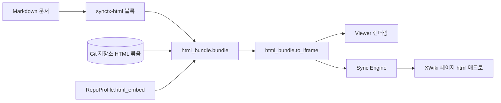
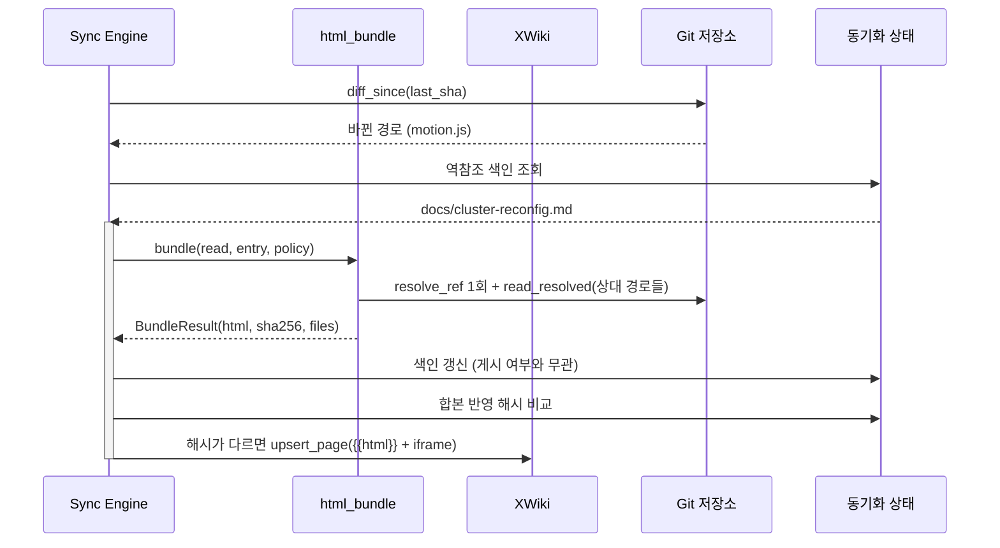

# 인터랙티브 HTML 임베드 설계

> 상태: `synctx-html` 블록은 Phase 9로 구현됐다(PR #27 이후 보강 포함). HTML 렌더 보기(`mode=render`, 14장)와 크게 보기 오버레이는 PR #63에서 구현했다(WP1~WP4). 운영 SSO 중첩 요청 시험(C1)과 Chromium 외 브라우저 확인은 남아 있다. 이 문서는 설계 기록이며, 현행 구조 요약은 `docs/architecture.md` Phase 9, 설정·보안·운영 절차는 `docs/production-service-design.md`에 있다. 아래 `지금`·`기존`·`(신규 설계)`는 구현 전을 기준으로 쓴 표현이다.

## 1. 개요

Markdown 문서 안에 저장소의 HTML 묶음(모션 그래픽처럼 JS로 움직이는 HTML 파일과 그 CSS·JS)을 넣는다. 넣은 HTML은 Viewer와 XWiki 양쪽에서 **조작 가능한 상태로** 보이게 한다.

### 목표

- ` ```synctx-html ` 블록 하나로 HTML 묶음을 문서 안 원하는 위치에 넣는다.
- Viewer와 XWiki 페이지 안에서 재생, 토글, 탐색을 그대로 쓸 수 있다.
- 넣은 HTML은 보는 사람의 Viewer·XWiki 세션에 접근할 수 없다.
- 폐쇄망 원칙을 지킨다. 런타임에 외부 네트워크에 접근하지 않고, 외부 주소는 허용 목록에 있는 사내 CDN만 쓴다.

### 범위 밖

- MP4·GIF 변환
- `.html` 파일 단독 동기화. XWiki 게시에는 Markdown에 포함된 경우만 다룬다. Viewer 전용 렌더 보기는 14장에서 다룬다.
- OpenProject 게시. OpenProject 대상 문서에서 블록은 안내 문구로 바꾼다.
- 신뢰하지 않는 저장소의 HTML 실행

## 2. 배경: XWiki 실험 결과 (2026-10-09, XWiki 16.10.17)

로컬 XWiki에서 파일 4개로 된 모션 그래픽(바닐라 JS, 외부 의존 없음)으로 임베드 방식 5가지를 시험했다. 결과는 **페이지 작성자의 권한**에 따라 갈렸다.

| 작성 계정 권한 | 첨부 + iframe | html 매크로에 직접 삽입 | 합본 + sandbox srcdoc |
|---|---|---|---|
| 프로그래밍 권한 | 동작 | 동작 | 동작 |
| 스크립트 권한만 (공간 한정) | 실패: HTML 첨부를 강제로 다운로드시킴 | 동작 | **동작** |
| 일반 사용자 | 실패: iframe 제거 | 실패: script 제거 | 실패: iframe 제거 |
| 격리 | XWiki와 같은 출처 | 격리 없음 (CSS도 XWiki 화면에 섞임) | **출처 분리 (`null`)** |

- `attachment.download.whitelist` 기본값에 `text/html`이 없다. 그래서 프로그래밍 권한이 없는 사용자가 올린 HTML 첨부는 `Content-Disposition: attachment`로 내려온다.
- 같은 CSP를 건 Viewer 시험 페이지에서 확인한 결과다(Chromium).
  - `frame-src 'none'`은 `src` iframe만 막는다. sandbox srcdoc iframe의 스크립트는 실행된다.
  - srcdoc 문서는 부모 페이지의 CSP를 물려받는다.

**결정:** HTML 묶음을 한 파일로 합치고, 실행 중 네트워크를 제한하는 CSP meta를 함께 넣어 `sandbox="allow-scripts"` srcdoc iframe으로 넣는다. 동기화 계정에는 대상 공간에 한정한 스크립트 권한만 준다. 첨부 방식은 프로그래밍 권한을 주거나 XWiki 전체의 다운로드 정책을 풀어야 해서 채택하지 않는다.

## 3. 구성 요소



| 구성 요소 | 위치 | 역할 |
|---|---|---|
| `html_bundle` | `shared/synctx-common/src/synctx_common/html_bundle.py` | 블록 파싱, 묶음을 한 파일로 합치기, iframe 감싸기 |
| `HtmlEmbedConfig` | `shared/synctx-common/src/synctx_common/config.py` | `RepoProfile.html_embed` (신뢰 저장소 지정) |
| Viewer | `services/viewer/src/embed_view.py`, `app.py` | 블록을 자리표시로 바꾸고, sanitizer를 거친 뒤 iframe으로 바꾸기 |
| Sync Engine | `services/sync/src/embed_sync.py`, `sync_engine.py` | 블록 분석·XWiki 매크로 변환(`analyze`, `render_for_xwiki`), 묶음 파일 변경 시 다시 동기화 |

새 외부 의존성은 없다. HTML 해석은 표준 라이브러리 `html.parser`로 한다.

## 4. 블록 문법

````markdown
```synctx-html
src: ./cluster-motion/index.html
aspect: 16/10
title: 룰 엔진 클러스터 재구성 모션 그래픽
```
````

블록 내용은 YAML이다.

| 키 | 필수 | 기본값 | 설명 |
|---|---|---|---|
| `src` | O | - | 진입 HTML. Markdown 파일 기준 상대 경로 |
| `aspect` | | `16/9` | iframe 가로세로 비율 (`W/H`) |
| `height` | | - | 고정 높이(px). 지정하면 `aspect` 대신 쓴다 |
| `title` | | 진입 HTML의 `<title>` | iframe `title` 속성 (스크린리더용) |

문법 오류(YAML 오류, `src` 없음, 알 수 없는 키)는 6장의 오류 표시로 처리한다. GitHub처럼 synctx 밖에서 보면 블록은 코드 블록으로 보인다.

블록은 CommonMark 펜스 규칙(들여쓰기 0~3칸)으로 찾는다. 목록 항목 안에 들여 쓴 블록은 여는 펜스의 들여쓰기만큼 본문 앞 공백을 걷어내고, 치환 결과의 각 줄에도 같은 들여쓰기를 붙인다. 그래서 XWiki(markdown/1.2)에서는 iframe이 목록 항목 안에 남는다. Viewer는 Python-Markdown이라 목록 안 펜스 코드를 지원하지 않으므로, 다른 펜스 블록처럼 목록 밖에 그려진다.

## 5. 합본 규칙 (`bundle`)

```python
def bundle(read: Callable[[str], bytes], entry: str, policy: HtmlEmbedConfig, *, frame_src: Literal["'none'", "'self'"] = "'none'") -> BundleResult: ...
def csp_meta(origins, *, frame_src: Literal["'none'", "'self'"] = "'none'") -> str: ...
def to_iframe(result: BundleResult, aspect: str = "16/9", height: int | None = None, title: str | None = None) -> str: ...
```

`frame_src` 인자는 추가할 설계다. 기본값은 기존과 같은 `"'none'"`이고, Viewer 렌더 보기만 `"'self'"`를 쓴다(14.5). `to_iframe`은 기존 인터페이스를 유지한다.

`read`는 저장소 루트 기준 경로를 받아 바이트를 돌려준다. 호출하는 쪽은 `repo_reader(manager, ref)`를 넘긴다. 이 함수는 첫 읽기에서 `GitRepoManager.resolve_ref(ref)`로 ref를 한 번만 해석(비기본 ref면 fetch)하고, 이후 파일은 `read_resolved(path, resolved)`로 읽는다. 해석 실패는 파일 없음으로 바꾸지 않고 그대로 올린다. 현행 `resolve_ref`의 반환값은 커밋 SHA가 아니라 `origin/<브랜치>`다. 렌더 보기에는 `repo_reader(manager, sha)`를 쓰지 않는다. SHA를 ref로 넘기면 첫 읽기에서 fetch가 실패하므로, WP1이 제공할 `resolved_reader(manager, resolved) -> Reader`에 확정 SHA를 넘긴다(14.2). `BundleResult`는 다음 필드를 가진다.

- `html`
- `sha256`
- `size`
- `files`: 합본에 쓴 저장소 경로 목록
- `title`: 진입 HTML의 `<title>`

합본에 실패하면 `BundleError`를 던진다. 여기에는 사유와 함께 다음이 들어 있다.

- `files`: 실패 전까지 읽은 경로
- `missing`: 찾지 못한 경로

실패한 블록도 이 두 목록으로 역참조 색인을 만든다(7.3). 그래야 빠진 파일을 나중에 추가했을 때 다시 처리된다.

| 대상 | 처리 |
|---|---|
| `<link rel="stylesheet" href="상대경로">` | `<style>`로 넣는다 |
| `<script src="상대경로">` | 같은 자리에 `<script>`로 넣는다. 본문의 `</script`는 `<\/script`로 바꾼다 |
| `<script defer src="상대경로">` | 문서에 module 스크립트가 없을 때만 지원한다. `<body>`의 마지막 자식 뒤로 옮겨 넣고, 여러 개면 원래 순서를 지킨다. 문서를 다 읽은 뒤 실행되고 다른 classic 스크립트보다 나중이라는 순서는 유지된다. 실행 순간의 `document.readyState`는 `interactive`가 아니라 `loading`이다 |
| `<script defer>`와 `<script type="module">`이 함께 있음 | 오류 (지원하지 않음). 둘은 문서를 다 읽은 뒤 등장 순서대로 실행되는 같은 대기열을 쓴다. defer만 classic 인라인으로 바꾸면 module보다 먼저 실행된다 |
| `<script async src="…">` | 오류 (지원하지 않음). 인라인 스크립트에서는 `async`가 무시되어 실행 시점이 달라지기 때문이다 |
| `<script type="module">` | 같은 자리에 넣는다(인라인 module도 기본으로 지연 실행된다) |
| import | module의 정적 import와 모든 인라인 스크립트의 동적 `import()`는 허용 출처의 https 문자열 리터럴만 허용한다. 상대 경로·bare specifier·템플릿 치환·리터럴이 아닌 인자(연산자·메서드 호출이 붙은 경우 포함)는 오류다. 주석이 끼어 있어도 검사한다. 판단할 수 없으면 거부하는 보수적 규칙이라 문자열 안의 import 비슷한 글자도 거부될 수 있다 |
| `<script defer>`와 외부 defer 스크립트가 함께 있음 | 오류 (지원하지 않음). 실행 순서를 보존할 수 없다 |
| `<video>`·`<audio>`·`<source>`·`<iframe>`·`<object>`·`<embed>`·`<base>`, SVG `<image>`·`<use>`·`<script>`의 외부 참조 | 오류 (지원하지 않음). 설계: 렌더 보기의 상대 HTML 프레임 참조만 14.5에 따라 허용 |
| `<link rel="icon">` | `data:` URI로 바꾼다. 그 밖의 상대 경로 `<link>`(preload 등)는 오류 |
| CSS `url(상대경로)`, `` | `data:` URI로 바꾼다. MIME은 확장자로 정한다. 글꼴(`woff`, `woff2`, `ttf`)도 포함하며, Viewer CSP의 `font-src`에 `data:`를 더한다(6장 5번) |
| CSS `@import` | 오류 (지원하지 않음) |
| `http(s)://`, `//` 절대 주소 | 출처(스킴 + 호스트 + 포트)가 `allowed_origins`의 항목과 정확히 같으면 그대로 두고, 아니면 오류. `//`로 시작하는 주소는 srcdoc에서 스킴이 정해지지 않으므로 오류. `http://`는 항목에 올 수 없으므로 항상 오류 |
| `data:`, `#fragment`, `about:` | 그대로 둔다 |

해석할 수 없는 주소(`https://[` 등)는 `disallowed_host`, 해석할 수 없는 상대 경로는 `unsupported`로 처리한다.

- 상대 경로의 기준은 그 경로가 적힌 파일이다.
  - HTML의 속성, `<style>`, `style` 속성 안의 경로는 진입 HTML 위치를 기준으로 푼다.
  - 외부 CSS 파일 안의 `url()`은 그 CSS 파일 위치를 기준으로 푼다.
  - 합본기에는 manager가 없으므로 `resolve_path(base_file, reference)`로 저장소 밖 경로를 거부한다. reader가 Git을 읽을 때는 `GitRepoManager.validate_path`도 적용한다.
- 합본 크기가 `max_bundle_bytes`(기본 2MiB)를 넘으면 오류.
- 같은 입력이면 같은 출력이 나와야 한다. XWiki `upsert_page`가 내용이 같으면 갱신을 건너뛰기 때문이다.

### 실행 중 네트워크 정책 (CSP meta 주입)

정적 검사는 JS가 실행 중에 만든 주소(`fetch`, `Image.src`, 동적 `<script>`)를 잡지 못한다. 출처가 `null`이어도 요청 송신 자체는 막히지 않는다. 그래서 모든 스크립트보다 앞에 CSP meta를 넣는다. 위치는 HTML 공백 문자만 앞에 있는 doctype이면 그 바로 뒤, 아니면 문서 맨 앞이다. 스크립트 뒤에 온 doctype은 따라가지 않는다. 브라우저는 이 meta를 `<head>`의 첫 요소로 해석한다. 주석이 doctype보다 앞에 있으면 meta가 doctype 앞에 온다. 이 합본을 독립 문서로 열면 quirks 모드(`BackCompat`)가 되지만, `synctx-html` 블록은 iframe srcdoc으로 전달되고 srcdoc 문서는 HTML 표준상 quirks 모드가 되지 않는다(Chromium에서 sandbox srcdoc `CSS1Compat` 확인, 2026-10-09). 그래서 `<!-->` 같은 해석이 갈리는 주석을 구분하는 검사를 CSP 위치 결정 경로에 더하지 않는다.

```html
<meta http-equiv="Content-Security-Policy" content="default-src 'none'; script-src 'unsafe-inline' {H}; style-src 'unsafe-inline' {H}; img-src data: {H}; font-src data: {H}; connect-src {H|'none'}; frame-src {F}; worker-src 'none'; form-action 'none'; base-uri 'none'">
```

- `{F}`는 `frame_src`다. 기본은 `'none'`, 렌더 보기만 `'self'`다(설계). 나머지 meta CSP 지시어는 그대로 유지한다.
- `{H}`는 저장소의 `allowed_origins` 항목(예: `https://cdn.corp.example.com`)을 공백으로 이은 것이다. 비어 있으면 해당 지시어에서 뺀다. `connect-src`는 비어 있으면 `'none'`이다.
- 항목은 8.1의 형식 검사를 통과한 출처이므로 **그대로 CSP 출처 표현으로 쓴다.**
  - 호스트 이름만 쓰면 안 된다. 스킴이 없는 호스트 표현은 보호 대상 문서의 스킴에 맞춰 해석되는데, srcdoc 문서의 주소는 `about:srcdoc`이라 `https` 리소스와 맞지 않는다.
  - 리뷰 재현 결과(Chromium)도 호스트 이름만 넣었을 때는 허용한 https 이미지가 막혔고, `https://`를 붙인 출처로 넣었을 때는 막히지 않았다.
- `synctx-html` 블록은 Viewer의 부모 CSP와 이 meta CSP가 함께 적용되므로 더 엄격한 쪽이 이긴다. XWiki에서는 이 meta CSP가 실행 중의 유일한 정책이다.
- **`synctx-html` 블록에서 두 환경의 실효 정책이 같아지는 조건:** 이 meta가 허용하는 모든 것을 Viewer 부모 CSP도 허용해야 한다. 그러면 두 환경 모두에서 이 meta가 실효 정책이 된다.
  - 출처: 저장소의 `allowed_origins`는 플랫폼 공통 `html_embed.allowed_origins`의 부분집합이어야 하고(설정을 읽을 때 검사, 8.1), Viewer 부모 CSP는 공통 목록을 포함한다(6장 5번).
  - `data:`: 부모 CSP의 `img-src`·`font-src`가 허용한다(6장 5번).
  - `blob:`이나 `media-src`는 넣지 않는다. 합본 규칙이 동영상·음성을 변환하지 않고, 부모 CSP도 허용하지 않기 때문이다.
- 렌더 보기는 Viewer 전용이며 이 실효 정책 동등성의 대상이 아니다. URL 문서이므로 srcdoc의 quirks 모드 예외도 적용되지 않는다. 원본 doctype 유무·위치에 따른 레이아웃은 별도로 확인한다(14.11).
- 작성자 HTML에 원래 있던 CSP meta는 남겨 둔다. 정책이 여럿이면 모두 적용되므로 더 느슨해지지 않는다.
- 확인 결과(Chromium, 부모에 CSP가 없는 페이지): 실행 중에 만든 주소로 보낸 `fetch`·`Image`·`<script>`가 각각 `connect-src`·`img-src`·`script-src-elem` 위반으로 막혔다. 다만 비교용 시험(meta 없음)은 내장 브라우저가 sandbox 요청을 자체적으로 막아 판정하지 못했다.
- 남는 위험: CSP와 sandbox 모두 iframe 자신의 주소 이동(`location.href = …`)과 WebRTC는 막지 못한다. 이 경로는 신뢰 저장소 지정(8.1)으로 통제하고, 운영 문서에 잔여 위험으로 적는다.

### iframe 감싸기와 XWiki 매크로 경계

`to_iframe` 출력 형식은 다음과 같다.

```html
<iframe class="synctx-html" sandbox="allow-scripts" title="…" style="width:100%;aspect-ratio:16/10;border:0" srcdoc="…"></iframe>
```

- 모든 속성값(`srcdoc`, `title`, `style`)에서 `& < > " '`를 엔티티로 바꾼다. **`{`와 `}`도 각각 `&#123;`·`&#125;`로 바꾼다.**
- XWiki는 `{{html}}` 매크로 본문을 HTML로 해석하기 전에 `{{/html}}`에서 매크로를 끝낸다. 합본이나 `title`에 `{{/html}}{{velocity}}…`가 있으면 그 뒤가 동기화 계정의 스크립트 권한으로 실행된다.
- 중괄호를 엔티티로 바꾸면 매크로 본문에 `{{`가 한 번도 나오지 않는다. 브라우저는 속성값의 엔티티를 되돌리므로 srcdoc 내용은 그대로다. iframe 밖에 나가는 문자열은 이 태그 하나뿐이다.
- 블록 하나의 XWiki 출력은 iframe이든 안내·오류 문구든 **항상 `{{html}}…{{/html}}` 매크로 하나**다. 안내·오류 문구에 들어가는 `src` 경로와 오류 사유도 HTML 텍스트로 넣는다. 이때 iframe 속성과 같은 규칙으로 `& < > " ' { }`를 모두 엔티티로 바꾼다.
- 그래서 매크로 본문에는 `{` `}` 문자가 한 글자도 남지 않는다. 블록에서 나온 문자열이 XWiki 문법으로 해석될 수 있는 자리가 없다.
- verbatim(`{{{ }}}`)이나 XWiki 문법 이스케이프(`~`)는 쓰지 않는다. XWiki 2.x에서 verbatim 내부의 `}}}`를 안전하게 이스케이프하는 방법이 보장되지 않기 때문이다.
- `allow-same-origin`, `allow-top-navigation`, `allow-forms`, `allow-popups`는 **어떤 설정으로도 붙지 않는다**. 테스트로 고정한다.
- `loading="lazy"`는 쓰지 않는다. srcdoc에서는 효과가 없다.

### HTML 작성자가 알아야 할 제약

`synctx-html` 블록의 합본은 출처가 `null`인 `about:srcdoc` 문서에서 실행된다. URL 문서로 실행하는 렌더 보기는 14장의 제약을 따른다.

- `location.search`·`location.hash`로 초기 상태를 받을 수 없다. 기본값으로 시작해야 한다.
- 상대 경로 `fetch`·XHR·`import()`는 동작하지 않는다. 런타임에 파일을 읽지 말고 데이터는 JS에 넣는다.
- `localStorage`·쿠키는 쓸 수 없다. 접근하면 예외가 나므로 try/catch로 감싼다.
- `history.replaceState`는 같은 주소로 호출하면 동작했다(실험). 다른 주소로 바꾸는 호출은 예외가 날 수 있다.
- 주입된 CSP 때문에 `allowed_origins` 밖의 주소는 실행 중에도 불러올 수 없다. `blob:` 이미지와 동영상·음성도 불러올 수 없다.
- `async` 스크립트는 쓸 수 없다. `defer`와 `module`을 한 문서에서 함께 쓸 수 없다.

## 6. Viewer

1. `embed_view.prepare`가 렌더링 전에 ` ```synctx-html ` 블록을 `<div class="synctx-html-slot" data-slot="N"></div>`로 바꾸고, 블록 내용은 따로 넘긴다.
2. `app._render_file_response`가 `_sanitize_html`을 **거친 뒤** `embed_view.fill`로 각 자리표시를 `to_iframe` 결과로 바꾼다. sanitizer는 그대로 두므로 Markdown 본문에 직접 쓴 `<iframe>`·`<script>`는 계속 지워진다.
3. `html_embed.enabled=false`인 저장소에서는 자리표시를 안내 상자로 바꾼다. 안내 상자에는 "이 저장소는 HTML 실행이 허용되지 않음"과 `src` 소스 보기 링크를 넣는다.
4. 합본에 실패하면 자리표시를 오류 상자로 바꾼다. 오류 상자에는 사유와 `src` 경로를 넣는다. 페이지의 나머지는 그대로 렌더링한다.
5. CSP(`csp_middleware`)를 두 군데 바꾼다.
   - `font-src`에 `data:`를 더한다. srcdoc 합본은 부모 CSP를 물려받으므로, 이 변경이 없으면 `data:` 글꼴이 막힌다. `img-src`에는 이미 `data:`가 있다. `data:` 글꼴은 스크립트를 실행할 수 없어서 Viewer 본문의 보안 수준은 그대로다.
   - 플랫폼 공통 `html_embed.allowed_origins`의 출처를 `script-src`·`style-src`·`img-src`·`font-src`·`connect-src`에 더한다. 지금 `cdn_base_url`에서 얻은 출처를 더하는 방식과 같다.
   - 이 두 변경으로 `synctx-html` 블록의 합본 meta CSP가 허용하는 것은 모두 부모 CSP도 허용한다. 그래서 이 블록은 Viewer에서도 XWiki와 같이 합본 meta CSP가 실효 정책이 된다(5장).
   - 설계: `mode=render` 화면 응답만 `frame-src 'self'`로 바꾼다. 나머지 Viewer HTML 화면은 `frame-src 'none'`과 `X-Frame-Options: DENY`를 유지한다. `/render` 응답은 별도 sandbox 헤더를 쓰므로 미들웨어의 CSP·XFO 덮어쓰기에서 제외한다(14.4).
6. `download?format=html`도 같은 iframe을 넣는다. 네트워크 없이 완전하게 재생된다는 보장은 **저장소의 `allowed_origins`가 비어 있을 때만** 한다.
   - 이때는 주입된 CSP가 실행 중 네트워크를 모두 막는다. 그래서 합본은 처음부터 네트워크 없이 동작하도록 만들어져 있어야 하고, Viewer·XWiki·다운로드 파일에서 동작이 같다.
   - `allowed_origins`가 비어 있지 않으면, 정적 참조가 없어도 JS가 실행 중에 허용 CDN 주소를 만들 수 있다. 그래서 다운로드 파일의 iframe 위에 항상 "사내 CDN 접근이 필요할 수 있는 콘텐츠" 안내를 붙인다.
   - 외부 리소스를 받아 합본에 넣는 기능은 범위 밖이다.
   - `format=pdf`는 JS가 돌지 않으므로 "인터랙티브 콘텐츠: Viewer에서 보기" 안내로 바꾼다.
   - `download_file`은 async 함수이므로 html·pdf 준비(Git 읽기와 합본)를 executor에서 실행한다.

`.html`·`.htm` 파일은 기본 소스 보기를 유지한다. 설계: `html_embed.enabled`와 `html_embed.render_files`가 모두 true인 저장소에만 `mode=render` 보기와 소스 보기의 "렌더링 / 새 탭에서 렌더링" 버튼을 추가한다. Viewer 화면의 Markdown `synctx-html` 블록에는 iframe을 다시 로드하지 않는 "크게 보기" 오버레이를 추가한다. 래퍼·버튼은 `download?format=html`에 넣지 않는다(14장).

## 7. Sync Engine

### 7.1 블록 변환

`embed_sync.analyze`로 블록을 분석하고 `render_for_xwiki`로 바꾼다. `SyncEngine._render_html_blocks_for_xwiki`가 XWiki 게시 전에 호출하며(xwiki, both 경로 모두) mermaid 변환(`_process_mermaid_blocks`)은 그 뒤 게시 단계에서 돈다. 블록은 다음으로 바꾼다.

```
{{html clean="false"}}<iframe class="synctx-html" sandbox="allow-scripts" …></iframe>{{/html}}
```

- 첨부는 올리지 않는다. 합본은 페이지 본문에 들어간다.
- `html_embed.enabled=false` 저장소이거나 합본에 실패하면, 블록을 안내·오류 문구를 담은 `{{html}}` 매크로로 바꾸고 동기화는 계속한다(5장 이스케이프 규칙 적용). 실패는 SyncReport와 메트릭에 남긴다.
- OpenProject 대상 본문에서는 블록을 "인터랙티브 콘텐츠: Viewer에서 보기" 링크로 바꾼다.

### 7.2 페이지 문법 (2026-10-09 확인)

페이지는 지금처럼 `markdown/1.2` 문법으로 보낸다(`XWikiTargetConfig.syntax`). 로컬 XWiki 16.10.17에서 `markdown/1.2` 페이지 안의 `{{html clean="false"}}` 매크로가 sandbox srcdoc iframe을 그대로 내보내고, iframe 안의 스크립트도 실행되는 것을 확인했다. 앞뒤의 Markdown 문단도 정상으로 렌더링됐다.

- 전제: XWiki 기본 배포(Standard Flavor)에는 `markdown/1.2` 파서가 없다. "CommonMark Markdown Syntax 1.2" 확장(`org.xwiki.contrib.markdown:syntax-markdown-commonmark12`, 확인 버전 8.9.1)이 설치되어 있어야 한다. 기존 문서(`xwiki-api-reference.md`, `production-service-design.md` 4장)가 이미 이 확장을 전제로 한다.
- 이 확인은 위키 소유자 계정으로 작성한 페이지로 했다. 이후 로컬 종단 확인(XWiki 16.10.17, `docs` 공간의 script right만 가진 전용 계정)에서 이 계정으로 만든 페이지의 재생과 토글도 확인했다. 운영 XWiki에서의 확인은 `production-service-design.md` Phase 9의 마지막 항목에 남아 있다.

### 7.3 다시 처리할 조건

구현 전의 `run_sync`에는 다시 처리를 막는 관문이 세 군데 있었다.

| 관문 | 위치 | 문제 |
|---|---|---|
| `last_successful_sha == head_sha`면 바로 종료 | `run_sync` | 플랫폼 설정(`html_embed`)만 바뀌면 처리하지 않는다 |
| `_should_process`가 `.md`만 통과 | `run_sync` 반복문 | `motion.js`만 바뀌면 처리 대상이 없다 |
| `is_file_changed(path, content_sha)` | `run_sync` 반복문 | md를 대상에 넣어도 md 본문 SHA가 같으면 건너뛴다 |

세 관문을 다음과 같이 바꾼다.

1. **역참조 색인 (두 번째 관문)**
   - 동기화 상태에 `{묶음 파일 경로: [그 파일을 쓴 md 경로]}`를 저장한다. `BundleResult.files`로 만든다.
   - 구현은 정방향 맵(`RepoState.html_dependencies`: md → 의존 경로)을 저장하고, 역참조는 실행 때 계산한다.
   - `diff_since` 결과 중 `.md`가 아닌 경로가 색인에 있으면, 해당 md를 처리 대상에 넣는다.
   - 전체 재스캔 때는 색인을 새로 만든다.
   - 합본에 실패하면 `BundleError.files`(실패 전까지 읽은 경로)와 `BundleError.missing`(찾지 못한 경로)을 모두 색인에 넣는다. 그래서 빠진 `motion.js`를 나중에 추가하면 그 추가가 `diff_since`에 잡혀 md를 다시 처리한다.
   - 빠진 파일이 CSS라 그 안의 참조를 아직 모르는 경우도 같다. CSS가 추가되면 다시 처리되고, 그때 새로 빠진 경로가 색인에 들어간다.
   - 비활성 저장소에서는 진입 HTML 경로만 넣는다. 정책이 바뀌면 3번에 따라 다시 처리된다.
2. **합본을 반영한 내용 해시 (세 번째 관문)**
   - `synctx-html` 블록이 있는 md는 `content_sha`를 md 본문만으로 계산하지 않는다.
   - 다음을 순서대로 이어 붙여 `sha256`을 계산한다.
     - md 본문
     - 블록마다: XWiki에 보낼 매크로 문자열(`xwiki_html_macro(조각)`)의 SHA. 합본 내용뿐 아니라 iframe·안내 문구 렌더링이 바뀌어도 다시 게시된다
     - 블록마다: 정렬한 의존 경로 목록(`files`와 `missing`)
     - 정책 지문
   - 의존 경로 목록을 넣으므로, 내용이 같은 `a.js`에서 `b.js`로 참조만 바뀌어 합본 SHA가 같아도 해시가 달라진다.
   - 합본은 CSP meta를 포함하므로 `allowed_origins`가 바뀌면 합본 SHA도 바뀐다. 블록이 없는 md는 지금처럼 본문 SHA를 쓴다.
   - **색인 갱신은 게시 여부와 분리한다.** 블록이 있는 md는 해시를 계산하려고 합본을 먼저 만든다. 그 결과로 색인을 항상 갱신하고, 그다음에 해시를 비교해 게시할지 건너뛸지 정한다. 건너뛰어도 색인은 이미 최신이다. XWiki `upsert_page`가 내용이 같아 갱신을 생략하는 경우도 마찬가지다.
3. **정책 지문 (첫 번째 관문)**
   - 저장소별 `html_embed` 설정을 정규화한 값의 SHA를 정책 지문으로 쓰고, 동기화 상태에 저장한다.
   - `head_sha` 비교 전에 지문을 먼저 비교한다. 다르면 HEAD가 같아도 색인에 있는 md 전부를 처리 대상으로 삼아 실행한다.
   - 실행이 성공하면 지문을 갱신한다.
   - 그래서 `enabled`를 `false`로 바꾸면 다음 실행에서 기존 XWiki 페이지의 iframe이 안내 문구로 바뀐다.

색인에 없는 md는 정책 변경과 무관하므로 처리하지 않는다. 동기화 상태에 색인이 아예 없으면 전체 스캔으로 색인을 만든다. 첫 실행이나 이 기능을 넣기 전의 상태가 여기에 해당한다. 그래서 HEAD가 같아도 빠지는 md가 없다.



## 8. 설정

### 8.1 신뢰 저장소 (`RepoProfile.html_embed`)

신뢰 여부는 운영자가 관리하는 플랫폼 설정에 둔다. 저장소 안의 `.synctx.yaml`에 두지 않는다. `.synctx.yaml`은 저장소 작성자가 스스로 켤 수 있기 때문이다.

```yaml
html_embed:
  allowed_origins: ["https://cdn.corp.example.com"]

repositories:
  - id: example-infra
    url: https://gitlab.internal/infra/example-infra.git
    html_embed:
      enabled: true
      render_files: false   # HTML 파일 렌더 보기는 별도 opt-in
      allowed_origins: ["https://cdn.corp.example.com"]
      max_bundle_bytes: 2097152
      xwiki_credential_env: XWIKI_HTML_CREDENTIAL
```

| 위치 | 키 | 기본값 | 설명 |
|---|---|---|---|
| 최상위 `html_embed` | `allowed_origins` | `[]` | 플랫폼 전체에서 합본이 참조할 수 있는 출처의 상한. Viewer 부모 CSP에 들어간다 |
| `repositories[].html_embed` | `enabled` | `false` | `synctx-html` 블록 실행 신뢰. 파일 렌더 보기에도 필요 |
| `repositories[].html_embed` | `render_files` (신규 설계) | `false` | `enabled`와 모두 true일 때만 Viewer 렌더 보기·`/render` 허용. 모든 `.html`·`.htm`과 모든 브랜치를 실행 대상으로 신뢰하는 별도 opt-in |
| `repositories[].html_embed` | `allowed_origins` | `[]` | 이 저장소의 합본이 참조할 수 있는 출처. 최상위 목록의 부분집합이어야 한다 |
| `repositories[].html_embed` | `max_bundle_bytes` | `2097152` | 합본 크기 상한 |
| `repositories[].html_embed` | `xwiki_credential_env` | 없음 | 이 저장소 페이지를 게시할 신뢰 저장소 전용 XWiki 계정의 자격 증명 환경변수. 최상위 `targets.xwiki`가 있고 `enabled: true`면 Viewer 전용 저장소에도 필수이며 `targets.xwiki.auth.credential_env`와 달라야 한다 |

설정을 읽을 때(pydantic validator) 다음을 검사하고, 어기면 서비스가 시작되지 않는다. Viewer와 Sync Engine은 같은 설정 모델을 쓰므로 두 서비스에서 같은 검사가 돈다.

- 출처 형식은 `https://호스트` 또는 `https://호스트:포트`만 허용한다.
  - 스킴은 `https`만 받는다. 운영과 로컬 모두 Ingress TLS를 쓰고, `http`는 https 페이지 안에서 혼합 콘텐츠로 막힌다.
  - 호스트는 소문자로 바꾼다. 와일드카드, 경로, 쿼리, 끝의 `/`는 받지 않는다.
  - 포트가 443이면 빼서 저장한다. 그래서 정적 검사와 CSP가 같은 문자열을 쓴다.
- 저장소의 `allowed_origins`는 정규화한 뒤 최상위 `allowed_origins`에 모두 들어 있어야 한다.

현행 공통 설정 검사는 최상위 `targets.xwiki`가 있고 저장소가 `enabled`이면 전용 `xwiki_credential_env`를 요구한다(`config.py`의 `SynctxConfig._check_html_embed_origins`). 저장소의 실제 게시 대상은 검사하지 않아 Viewer 전용 저장소도 이 요건에 걸린다. 완화는 결정 필요다. 실제 XWiki 게시 대상인 저장소에만 요구하면 대상 판정·라우팅 변경 시 검증이 필요하고, Viewer용 설정 모델·검사를 분리하면 서비스 간 설정 계약 관리가 늘어난다. 이 설계에서 검사를 완화한 것으로 간주하지 않는다.

### 8.2 XWiki 권한

- 스크립트 권한은 **신뢰 저장소 전용 계정**(`html_embed.xwiki_credential_env`)에만, **대상 공간에 한정해** 준다. 공간의 `WebPreferences`에 `XWiki.XWikiGlobalRights`로 `users=전용 계정`, `levels=script`, `allow=1`을 넣는다.
- 기본 동기화 계정(`targets.xwiki.auth`)에는 스크립트 권한을 주지 않는다. XWiki는 페이지를 마지막으로 작성한 계정의 권한으로 매크로를 실행하므로, 비신뢰 저장소가 본문에 직접 쓴 `{{html}}`·`{{velocity}}`는 기본 계정 권한으로 걸러진다. 공간 이름은 디렉터리에서 정해져 저장소끼리 공간을 공유하므로, 권한을 공간이 아니라 계정으로 나눠야 한다(2026-10-09 최종 검토 결정).
- 문서마다 XWiki에 게시한 계정을 상태 파일 `synced_files[].publisher`에 기록한다(`""`=기본 계정, 사용자 이름=전용 계정, `null`=모름). 매 실행에서 기록된 게시자가 현재 게시 계정과 다른 문서는 설정 변경 여부와 무관하게 다시 게시한다. 그래서 신뢰 지정·해제, 전용 계정 교체, 일부만 성공한 전환을 되돌린 경우 모두 실제 게시 기록을 기준으로 권한이 회수된다. 실패한 문서는 기록이 바뀌지 않아 다음 실행에서 다시 시도한다.
- 게시 계정이 바뀌는 쓰기(또는 전용 계정의 첫 게시)는 직전에 게시자를 모름(`null`)으로 상태 파일에 저장한다. XWiki 저장이 끝나면 OpenProject 등 뒤 단계의 성패와 상관없이 현재 계정으로 기록한다. 임시 저장만 성공했거나 실행이 중간에 끊겨도 기록이 모름으로 남아 다음 실행이 다시 처리한다.
- XWiki는 내용이 바뀐 저장에서만 content author를 갱신한다(16.10 `XWikiDocument.setContent`, 제목 변경도 `setTitle`이 content dirty를 세운다). 그래서 다시 게시할 때 제목과 상관없이 XWiki 본문이 같으면 임시 내용(`{{comment}}synctx: 작성자 갱신{{/comment}}`을 덧붙인 본문)을 먼저 저장하고 원래 본문을 다시 저장한다(`upsert_page(force_author=True)`). 페이지 기록에 버전이 하나 더 남는다.
- md에서 더 이상 게시하지 않는 XWiki 페이지(md 삭제 후 `on_delete: mark`·`ignore`, 경로 매핑상 페이지를 지우지 않는 삭제, `synctx.target`을 `openproject`로 변경)는 게시자가 기본 계정이 아니면 기록을 `xwiki_orphan: true`로 남긴다. 대상 변경 때는 OpenProject 기록과 함께 `resource_id`의 xwiki 항목과 게시자를 보존한다. 그 게시자가 기본 계정도 현재 계정도 아니게 되면 페이지의 현재 내용을 읽어 기본 계정으로 다시 저장한다(`force_author`). md에서 오지 않은 내용일 수 있으므로 전용 계정으로는 다시 저장하지 않는다. 페이지가 이미 없으면 기록을 지우고, md가 다시 XWiki로 게시되면 일반 문서로 돌아간다.
- 처리에 실패한 문서(`pending_failures`)는 본문 해시가 같아도 매 실행 다시 처리한다(예: XWiki는 성공하고 OpenProject가 실패한 `both` 문서). `validation_error`는 내용을 고쳐야 풀리므로 내용 변경을 기다린다.
- 게시자 불일치·실패 재시도로 다시 처리할 문서는 파일 목록으로 원본 존재를 명시적으로 확인한다(`file_paths`: 숨김 파일을 거르지 않는 `ls-tree -r -z --name-only`). 원본이 없는데 기록이 남아 있으면 놓친 삭제(성공 SHA 없이 전체 검색한 경우 등)로 보고 삭제로 처리해 `on_delete`에 따라 페이지를 지우거나 orphan 기록으로 바꾼다. 목록을 읽다 난 git 오류는 실행을 실패시키고 대기 기록을 유지한다.
- 게시자 기록이 없는 기존 상태: HTML 임베드 도입 전 상태(`html_dependencies` 없음)는 기본 계정만 있었으므로 기본 계정으로 읽는다. 도입 후 상태에서 기록이 빠진 항목은 모름으로 읽고 한 번 다시 게시한다.
- 프로그래밍 권한과 위키 전체 스크립트 권한은 주지 않는다.
- XWiki의 `attachment.download.whitelist`는 바꾸지 않는다.

## 9. 보안

| 위협 | 대응 |
|---|---|
| 넣은 스크립트가 보는 사람 세션으로 Viewer·XWiki API를 호출 | sandbox에 `allow-same-origin`을 붙이지 않는다. 출처가 `null`이라 쿠키·CSRF 토큰·같은 출처 API에 접근할 수 없다 |
| 신뢰하지 않는 저장소가 HTML 실행을 스스로 켬 | `RepoProfile`(운영자 설정)에서만 켤 수 있다 |
| 외부 네트워크 호출 (정적 주소) | 합본 단계에서 출처가 `allowed_origins` 항목과 정확히 같지 않은 주소는 오류로 막는다 |
| Viewer와 XWiki의 허용 범위 불일치 | 저장소 목록이 플랫폼 공통 목록의 부분집합인지 설정을 읽을 때 검사하고, Viewer 부모 CSP에 공통 목록을 넣는다. `synctx-html` 블록은 두 환경 모두 합본 meta CSP가 실효 정책이 된다. 렌더 보기는 Viewer 전용 설계다 |
| 외부 네트워크 호출 (실행 중 만든 주소) | 합본 `<head>` 맨 앞에 넣은 CSP meta가 실행 중에 막는다. Viewer의 `synctx-html` 블록에는 부모 CSP도 함께 적용된다 |
| iframe 자신의 주소 이동, WebRTC | CSP·sandbox로 막을 수 없는 잔여 위험이다. 신뢰 저장소 지정으로만 통제하고, 운영 문서에 적는다 |
| 저장소 밖 파일 읽기 | 합본기의 `resolve_path`로 각 경로를 그 경로가 적힌 파일 기준으로 풀고 저장소 밖 경로를 거부한다. Git reader에서도 `validate_path`로 검사한다 |
| srcdoc 속성 탈출 | `to_iframe`에서 속성값을 이스케이프하고, 테스트로 `" > <script>` 입력을 확인한다 |
| XWiki 매크로 경계 탈출 (`{{/html}}` 주입) | 블록 출력은 항상 `{{html}}` 매크로 하나이고, 안의 속성값과 텍스트에서 `{` `}`를 엔티티로 바꾼다. 매크로 본문에 중괄호가 남지 않는다 |
| 신뢰 해제 후에도 남는 iframe | 정책 지문이 바뀌면 HEAD가 같아도 해당 md를 다시 처리한다(7.3) |
| 신뢰 해제 후에도 전용 계정이 작성자로 남은 페이지 | 문서별 게시자 기록이 현재 계정과 다르면 블록이 없는 md까지 설정과 무관하게 다시 게시한다. 본문이 같으면 `force_author`로 임시 내용을 한 번 저장해 작성자를 실제로 바꾼다. 계정이 바뀌는 쓰기는 직전에 게시자를 모름으로 저장해, 임시 저장만 성공하거나 뒤 단계(OpenProject)가 실패해도 다시 처리한다(8.2) |
| md에서 더 이상 게시하지 않는 XWiki 페이지 | md 삭제(`sync.on_delete`가 `mark`(기본값)·`ignore`)나 대상의 `openproject` 변경으로 페이지가 남는다. 게시자가 기본 계정이 아니면 기록을 `xwiki_orphan: true`로 남기고, 그 게시자가 기본 계정도 현재 계정도 아니게 되면(신뢰 해제·계정 교체) 페이지의 현재 내용을 기본 계정으로 다시 저장해 작성자를 회수한다(8.2) |
| 큰 합본으로 페이지·DB 부하 | `max_bundle_bytes` 상한 |
| 상단 페이지 이동·팝업 | sandbox에 `allow-top-navigation`·`allow-popups`를 주지 않는다 |
| 동기화 계정 권한 남용 | 스크립트 권한은 신뢰 저장소 전용 계정에만, 공간에 한정해 준다. 이 계정으로 작성되는 페이지 내용은 Git 원본에서만 나온다 |
| 비신뢰 저장소가 본문에 `{{html}}`·`{{velocity}}`를 직접 씀 | 비신뢰 저장소는 스크립트 권한 없는 기본 계정으로 게시하므로 XWiki가 걸러 낸다. 신뢰 저장소 전용 계정은 설정 검사로 기본 계정과 분리한다 |

다음은 렌더 보기의 추가 보안 설계다.

| 위협 | 대응 |
|---|---|
| 토큰 경로 변조·다른 저장소 재사용 | `v1.{exp}.{ref_b64}.{sha}.{서명}`을 한 경로 세그먼트로 쓰고 `repo_id`·ref·SHA·만료를 HMAC으로 묶는다. `path`는 서명하지 않아 같은 저장소·스냅샷 안 이동을 허용한다 |
| 중첩 프레임이 차단됨 | `/render`에는 `frame-ancestors`·`X-Frame-Options`를 넣지 않는다. Chromium spike에서 출처 `null`인 조상은 `'self'`·명시 출처·`*` 어느 값과도 맞지 않았다. Referer도 실리지 않아 검증에 쓰지 않는다 |
| 외부 사이트의 삽입 | 토큰을 모르면 `/render`를 열 수 없고 `verify_viewer_access`도 통과해야 한다. 토큰이 유출되면 권한 있는 브라우저의 외부 iframe 요청은 통과할 수 있다. `Sec-Fetch-Dest`는 외부 iframe과 내부 iframe을 구분하지 않는다 |
| 토큰 유출 | 앱·접근 로그는 `/render/` 뒤 토큰을 가리고 응답에 `no-referrer`·`no-store`를 쓴다. 인그레스·EFK 로그, 브라우저 개발자 도구·URL 복사로 노출될 수 있다. 인그레스·EFK 잔존 위험은 수용하며 로그 접근권한·보존 기간을 관리한다 |
| 직접 열기·구형 브라우저 | `Sec-Fetch-Dest`가 `iframe`·`frame`일 때만 허용한다. 없거나 `document`면 403으로 닫는다(fail-closed). 토큰은 인증을 대체하지 않는다 |
| 실행 가능한 문서 범위 확대 | `enabled`만으로 기존 저장소의 실행 범위를 넓히지 않는다. 별도 `render_files`(기본 false)까지 켜면 저장소 전체 `.html`·`.htm`과 `?ref`로 선택한 모든 브랜치가 실행 대상이다. 운영자가 이 범위를 신뢰할 때만 둘 다 켠다 |
| 같은 출처의 다른 경로 프레임 | meta CSP `frame-src 'self'`는 같은 출처 전체를 허용한다. Viewer `csp_middleware`는 `text/html`에만 CSP·XFO를 붙이므로 `/api` JSON·`/raw`에는 XFO가 없다. 같은 호스트의 `/cdn`·`/marp`·`/slides`·`/drawio`도 프레임에 들어갈 수 있다. CDN은 XFO·CSP가 없고 SVG 업로드도 허용한다. 이렇게 열린 문서는 조상의 sandbox를 물려받지만 합본 meta CSP의 네트워크 제한은 물려받지 않는다. 출처 `null` 격리만으로 이 요청 범위를 제한할 수 없다. 경로 접두사 제한은 14.11의 검토 항목이다 |

## 10. 관측성

- 메트릭 `synctx_html_bundle_total{service, repo_id, result}`를 추가한다. `result`는 `ok`, `disabled`, `missing_file`, `outside_repo`, `disallowed_host`, `too_large`, `invalid_block`, `unsupported` 중 하나다.
- 합본 실패는 `synctx_sync_failures_total{error_type="html_bundle"}`에도 센다. 이때 페이지 동기화 자체는 성공으로 처리한다.
- Sync 실행 보고서(`SyncReport.summary()`)의 `html_errors`에 문서 경로·사유·메시지를 남긴다. 게시 성공·실패 수와는 따로 센다.
- Alert: 저장소별 `disallowed_host` 또는 `too_large`가 1시간 안에 1건 이상이면 warning.
- Sync 쪽 값은 CronJob이 저장소별 누적값을 Pushgateway로 보내 수집한다. 두 거부 사유는 처음 내보낼 때 0을 보내 첫 거부도 증가로 잡힌다(`production-service-design.md` 9.2).

## 11. 테스트

| 수준 | 대상 | 내용 |
|---|---|---|
| 단위 | `html_bundle` (`test_html_bundle.py`, `test_html_bundle_blocks.py`) | CSS·JS 넣기, `</script` 이스케이프, 이미지 `data:` 변환, 외부 CSS 안 `url()`을 CSS 파일 기준으로 푸는지(하위 폴더 CSS + 상위 폴더 이미지), 저장소 밖 경로 거부, 허용 목록 밖 출처 거부(같은 호스트의 다른 포트, `http://`, `//` 포함), `@import`·상대 module import·`async` 오류, `defer` 스크립트를 순서대로 `<body>` 끝으로 옮기는지, `defer`와 `module`이 함께 있으면 오류인지, 글꼴 `data:` 변환, CSP meta가 `<head>` 첫 자식이고 `allowed_origins`가 `https://` 출처 그대로 반영되며 `blob:`·`media-src`가 없는지, 실패 시 `BundleError.files`·`missing`, 크기 상한, 같은 입력·같은 출력 |
| 단위 | `to_iframe` | 속성 이스케이프(`"`, `&`, `<`, `{`, `}`), 합본·`title`에 `{{/html}}{{velocity}}`를 넣어도 출력에 `{{`가 없는지, sandbox 값이 정확히 `allow-scripts`인지 |
| Viewer | `test_embed_view.py` | 블록이 iframe이 되는지, 본문에 직접 쓴 iframe은 여전히 지워지는지, 비신뢰 저장소의 안내 상자, 합본 실패 시 오류 상자, CSP 헤더에 `font-src data:`와 공통 `allowed_origins`가 더해진 것 외에 변화 없음, `allowed_origins`가 비어 있지 않은 저장소의 다운로드 안내(정적 외부 참조가 없어도 붙는지) |
| Sync | `test_embed_sync.py`, `test_sync_engine.py` | 블록을 html 매크로로 바꾸는지, `motion.js`만 바뀌어도 md를 다시 동기화하는지(본문 SHA 같음), HEAD가 같아도 `enabled`·`allowed_origins` 변경 시 색인의 md를 다시 처리하는지, 색인이 없는 기존 상태에서 전체 스캔, `motion.js`가 빠져 실패한 뒤 그 파일만 추가해도 md를 다시 처리해 복구하는지, 비신뢰 저장소, 경로·오류 사유에 `{{/html}}`·`}}}`가 들어가도 안내 매크로 본문에 중괄호가 없는지, 내용이 같은 `a.js`에서 `b.js`로 참조만 바꾼 뒤 `b.js`를 고치면 다시 처리하는지(색인이 게시 생략과 무관하게 갱신되는지), OP 대상 링크 문구 |
| 단위 | 설정 모델 (`test_config_html_embed.py`) | `allowed_origins` 형식 검사(스킴 `https`만, 소문자, 443 생략, 경로·와일드카드·끝 `/` 거부), 저장소 목록이 공통 목록의 부분집합이 아니면 오류 |
| 수동 | 로컬 XWiki | `markdown/1.2` 안 `{{html}}` 매크로 실행 여부(7.2), 공간 한정 스크립트 권한 계정으로 재생, `{{/html}}`이 든 합본이 매크로 밖으로 새지 않는지 |
| 수동 | 운영 XWiki | 운영 버전에서 2장 결과 재확인, 실제 Chrome·Edge에서 재생과 CSP meta 차단(비교용 시험 포함) |

렌더 보기의 추가 테스트는 14.9에 둔다. 기존 Viewer CSP 불변 검증은 일반 화면과 `synctx-html` 블록에 적용하고, 렌더 화면과 `/render`의 헤더 예외는 별도로 검증한다.

테스트 입력(작은 모션 HTML 묶음)은 별도 픽스처 디렉터리 없이 각 테스트 파일 안에 문자열로 둔다.

## 12. 문서 반영 (CLAUDE.md 일관성 규칙)

| 문서 | 반영 내용 |
|---|---|
| `README.md` | 미구현 기능 소개는 추가하지 않는다. 사용자 기능 소개는 구현 때 반영한다 |
| `docs/architecture.md` | Viewer 전용 경로·CSP 예외·Phase 9 추가 설계를 요약한다 |
| `docs/production-service-design.md` | 보안, Secrets 표, 플랫폼 `.synctx.yaml`의 TTL 스키마·환경변수 참조, Viewer API·헤더, 메트릭, 테스트, 키 교체·만료 Runbook, 미구현 Phase 9 체크리스트 |
| `docs/local-development.md` | WP4에서 설정 자동 생성·비밀값 전달·로컬 무작위 키와 재시작 시 만료를 반영한다 |
| `docs/development.md` | WP4에서 Viewer 기능·새 공유 모듈·Phase 9 설계 링크를 반영한다. Phase 번호·서비스 구성은 유지한다 |
| `docs/help/` | 직접 고치지 않는다. 구현 후 필요하면 `scripts/motion/help_pages.py`를 고쳐 생성한다 |
| `CLAUDE.md` | Secret 추가 규칙에 따라 Secrets 표·스키마·Runbook을 함께 갱신한다. 새 서비스·Role·Phase가 없어 지침 자체는 바꾸지 않는다 |

**Phase:** 기존 Phase 번호를 바꾸지 않으려고 **Phase 9 "인터랙티브 HTML 임베드"** 를 새로 뒀다(3개 문서와 `CLAUDE.md`에 반영됨). Viewer(Phase 1)와 XWiki Sync(Phase 3)에 의존한다.

## 13. 구현 순서

1. 로컬 XWiki에서 7.2(`markdown/1.2` + `{{html}}`)를 확인한다. 결과에 따라 7.2 방향을 정한다.
2. `HtmlEmbedConfig`와 `html_bundle` 모듈, 단위 테스트
3. Viewer 렌더링 경로와 테스트
4. Sync Engine 블록 변환, 다시 처리할 조건(역참조 색인, 합본 반영 해시, 정책 지문)과 테스트
5. 메트릭·Alert
6. 문서 반영(12장)
7. 룰 엔진 클러스터 모션 그래픽으로 종단 확인 (Viewer, 로컬 XWiki) — 로컬에서 수행했다(PR #27)

### 렌더 보기 작업 묶음 (설계, PR #63에서 구현)

기존 1~7번은 `synctx-html` 블록의 구현 기록이다. 렌더 보기는 아래 계약을 기준으로 나눈다. 각 파일은 한 묶음만 소유한다. 새 파일은 아래에 `(신규 설계)`로 표시하며 아직 존재하지 않는다. WP1의 인터페이스와 WP2의 DOM 계약을 먼저 고정하면 별도 세션에서 구현하고 통합할 수 있다. WP2의 실행 검증은 WP1 완료 뒤에 한다. WP3는 WP2 DOM 계약을 고정한 마크업을 fixture로 써서 먼저 구현할 수 있으며, 실제 WP2 출력과의 통합 시험은 WP2 완료 뒤에 한다. WP4는 WP1의 설정·환경변수 이름(`_FILE` 포함)을 확정한 뒤 시작한다.

| 묶음 | 소유 파일 | 공개 인터페이스·의존 | 완료 기준 |
|---|---|---|---|
| WP1 공유 라이브러리 | `shared/synctx-common/src/synctx_common/`의 `render_token.py`(신규 설계), `html_bundle.py`, `config.py`, `git_manager.py`; `shared/synctx-common/tests/`의 `test_render_token.py`(신규 설계), `test_html_bundle.py`, `test_html_bundle_blocks.py`, `test_config_html_embed.py`, `test_git_manager.py` | 14.2의 토큰 함수·`GitRepoManager.resolve_commit_sha`·`GitRepoManager.ensure_commit_available`·`resolved_reader(manager, resolved) -> Reader`(예외 변환 포함)와 5장의 `bundle(frame_src=…)`·`csp_meta(frame_src=…)`. `ViewerConfig.render_token_ttl_seconds: int = Field(default=14400, gt=0)`·`HtmlEmbedConfig.render_files: bool = False`. `read_resolved`·`to_iframe` 계약 유지 | 서명·만료·교체 키·ref fetch 후 SHA 재확인·SHA reader 예외 변환·TTL·별도 opt-in 검증, 렌더용 상대 프레임 보존·기존 호출 회귀를 검증 |
| WP2 Viewer 서버 | `services/viewer/src/`의 `app.py`, `embed_view.py`, `viewer_ui.py`; `services/viewer/tests/`의 `test_viewer_api.py`, `test_embed_view.py`, `test_viewer_ui.py`; `shared/synctx-common/src/synctx_common/`의 `logging.py`, `observability.py`; `shared/synctx-common/tests/`의 `test_logging.py`, `test_observability.py` | WP1 API에 의존. `/render`를 catch-all 앞에 등록하고 `RESERVED_PATHS`에 `render` 추가. `mode=render`·`layout=full` 전달, 버튼·경고·도구 막대, 아래 DOM 계약, CSP 예외, 로그 마스킹·메트릭 | 14.3 순서·실패 응답, 토큰 발급 지점, 헤더 분리, 동일 SHA 읽기, 소스 보기 유지, 로그·메트릭에 토큰 없음 검증 |
| WP3 Viewer 클라이언트 | `services/viewer/src/static/`의 `viewer-core.js`, `viewer.js`, `viewer.css`; `services/viewer/tests/js/viewer-core.test.mjs`, `services/viewer/tests/test_static_assets.py` | 기존 `SynctxViewerCore` 순수 함수와 `viewer.js`의 `data-action` 처리 방식을 따른다. WP2의 아래 DOM 계약만 사용하고 서버·공유 모듈을 고치지 않는다 | 레이아웃·Fullscreen API 오류 처리, 확대·복귀 때 iframe 인스턴스·재생 상태 유지, Esc·닫기·포커스 복귀, 키보드 조작과 대비 검증 |
| WP4 배포·문서 반영 | `helm/synctx/values.yaml`, `values-local.yaml`, `values-production.yaml`, `templates/viewer-deployment.yaml`, `templates/validate.yaml`, `templates/viewer-render-secret.yaml`(신규 설계); `deploy/docker/compose.yaml`, `synctx.env.example`, `secrets.env.example`; `scripts/docker/deploy.sh`, `_common.sh`, `run-viewer.sh`; `scripts/local/run_viewer.py`, `run-lite.sh`, `services/viewer/src/standalone.py`; `scripts/tests/test_helm_options.py`, `test_docker_deploy.py`, `test_run_viewer.py`, `test_run_lite.py`, `test_run_viewer_docker.py`, `services/viewer/tests/test_standalone.py`; 12장 문서 | WP1 설정·환경변수 이름과 14.7 배포 계약. `run-lite.sh`는 `standalone.py`로 위임하는 현행 구조를 유지 | `values-production.yaml`의 복수 파드·공유 키 조건을 갱신하고 Helm Secret 참조·두 Docker 경로의 환경변수 전달·두 로컬 경로의 설정 생성을 검증. 신뢰 지정을 자동으로 켜지 않고 비밀값을 설정 파일에 쓰지 않는다. WP1~3 통합 뒤 12장 반영 |

위 표의 경로는 공통 접두어 아래의 파일을 뜻한다. WP4의 문서 수정은 통합 뒤에 하며 WP1~3은 문서를 동시에 수정하지 않는다.

#### 작업 묶음별 함수 계약

WP1은 5장·14.2의 시그니처를 따른다. WP2는 기존 화면 함수에 `layout`을 전달하고, 다음 경로 함수를 추가한다(모두 추가 설계).

```python
def render_html(request: Request, token: str, repo_id: str, path: str) -> HTMLResponse: ...
def _render_file_response(repo_id: str, path: str, theme: str = "github-light", ref: str | None = None, mode: str | None = None, layout: str | None = None): ...
```

`render_html`은 `/render/{token}/{repo_id}/{path:path}`의 동기 경로 함수다. FastAPI의 작업 스레드에서 Git 읽기·합본을 처리한다. `render_permalink`·`render_file`도 기존 인자 뒤에 `layout: str | None = None`을 받아 전달한다. `layout`은 없음·`full`만 허용하고, 일반 소스 보기와 회의 모드에서는 쓰지 않는다.

WP3는 `viewer-core.js`의 `SynctxViewerCore`에 다음 순수 함수를 추가하는 설계다. DOM 초기화와 이벤트는 기존 `viewer.js`의 즉시 실행 함수 안에 둔다.

```text
renderViewportHeight(viewportHeight, barsHeight) -> number
renderAspectRatio(aspect) -> number
```

`renderViewportHeight`는 0 이상 높이(px), `renderAspectRatio`는 양수 비율을 반환한다(잘못된 비율은 `16/9`).

WP4의 기존 생성 함수 시그니처는 `build_local_config(values_file: Path, port: int, cache_dir: Path) -> dict`(`scripts/local/run_viewer.py`), `prepare_config(args: argparse.Namespace) -> Path`(`services/viewer/src/standalone.py`)다. 두 함수는 인자를 유지하고 TTL 기본값·명시값을 반영한다. `run-lite.sh`는 후자로 위임한다. Helm·Docker 공개 계약은 14.7을 따른다.

#### WP2 → WP3 DOM 계약 (신규 설계)

| 요소 | 속성·동작 |
|---|---|
| 렌더 화면 루트 | `data-html-render`, `data-render-layout="fit"`(기본) 또는 `ratio`, `data-render-aspect="16/9"`. `layout=full`이면 `data-render-full="true"`를 더하고 일반 탐색 틀을 숨긴다 |
| 경고·도구 막대 | `data-render-bars`. 실제 높이를 재서 CSS 변수 `--render-bars-height`에 반영한다. 경고는 HTML 실행과 만료 후 화면 새로 고침을 안내한다 |
| 프레임 컨테이너·iframe | `data-render-stage` 안에 `iframe[data-render-frame]`, `title`, `sandbox="allow-scripts"`, 서버가 만든 `src`. JS는 `src`·`srcdoc`를 바꾸지 않는다 |
| 보기 방식 버튼 | `data-action="render-fit"`, `render-ratio`, `render-fullscreen`. fit·ratio 버튼은 `aria-pressed`로 현재 상태를 표시한다. 전체 화면은 iframe 내부가 아닌 컨테이너에 요청한다 |
| 새 탭 링크 | `data-action="render-new-tab"`, `href`는 `mode=render&layout=full`인 Viewer 화면, `target="_blank"`, `rel="noopener noreferrer"`. 서버가 `repo_id`·경로·`ref`를 이스케이프해 넣는다 |
| 소스 보기의 렌더링 링크 | `data-action="render-open"`은 같은 탭의 `mode=render`, 새 탭 링크는 위 계약을 쓴다. `.html`·`.htm`이면서 `enabled`·`render_files`가 모두 true인 경우만 마크업에 포함한다 |
| Markdown 블록 컨테이너 | WP2가 Viewer 화면의 `embed_view`에서만 `data-html-embed`로 iframe과 버튼을 감싼다. `download?format=html`에는 래퍼·버튼을 넣지 않는다. iframe은 기존 `iframe.synctx-html`·`srcdoc`·`title`을 유지한다. 공유 `to_iframe` 출력은 바꾸지 않는다 |
| 크게 보기·닫기 | `data-action="embed-expand"`, `embed-close`. WP3가 같은 컨테이너의 `data-embed-expanded="true"`와 CSS `position: fixed`로 확대한다. Esc·닫기로 복귀하고 기존 포커스·본문 스크롤을 복원한다. 닫기는 확대 중에만 표시한다 |

서버는 루트·버튼·CSS/JS 참조를 내고, 클라이언트는 이벤트와 상태·치수만 처리한다. 확대 시 iframe을 복제·재생성·다른 부모로 옮기지 않는다. iframe 안 키 입력은 부모로 전파되지 않으므로, 내부에 포커스가 있을 때 Esc 전달은 미확인이다. 키보드로 닿는 닫기 버튼을 항상 제공하고 브라우저 수용 시험에서 확인한다.

## 14. 렌더 보기 (`mode=render`)

### 14.1 목적·구성 요소

PR #63에서 구현했다. `.html`·`.htm`의 기본 소스 보기를 유지하고 `html_embed.enabled`와 `html_embed.render_files`가 모두 true인 저장소에서만 실행 화면을 연다. 사내 문서 위계 HTML의 첫 화면에서 링크를 누르면 원래의 `<iframe name="pf">` 오른쪽 패널에 대상 HTML이 열리게 한다. 원본의 링크·`target`·프레임 이름을 유지하고 CSS·JS·그림은 기존 합본 규칙을 적용한다. XWiki·Sync Engine·`synctx-html` 블록의 합본 기본 동작은 바꾸지 않는다.

| 구성 요소 | 위치 | 역할 |
|---|---|---|
| Viewer 화면 | 기존 `services/viewer/src/app.py`의 `_render_file_response`, `render_permalink`, `render_file`; `viewer_ui.py` | `mode=render` 화면, 경고·도구 막대·iframe, 소스 보기 버튼. `layout` 인자 전달은 신규 설계 |
| 렌더 경로 | 같은 `app.py`에 추가할 `/render/{token}/{repo_id}/{path:path}` | 권한·토큰·요청 대상·정책·파일 검사 후 합본을 HTML 응답으로 전달 |
| 토큰 | `shared/synctx-common/src/synctx_common/render_token.py` (신규 설계) | 발급·검증·키 읽기. 토큰 전용 발급 API는 만들지 않는다 |
| 합본·설정 | 기존 `html_bundle.py`, `config.py` | `frame_src`·SHA reader·`HtmlEmbedConfig.render_files`·`ViewerConfig.render_token_ttl_seconds` 추가 설계 |
| 클라이언트 | 기존 `services/viewer/src/static/viewer-core.js`, `viewer.js`, `viewer.css` | 화면 맞춤·비율·전체 화면, Markdown 블록 크게 보기 |

사용자 주소는 `/view/{repo_id}/{path}.html?mode=render`다. iframe은 `/render/{token}/{repo_id}/{path}` 경로를 쓴다. 이 문서의 `/render`·`/raw`·`/api`는 Viewer 앱 내부 경로이며, 현행 Ingress·Docker 게이트웨이·로컬 Mount의 공개 주소에는 `/view`가 붙는다. 따라서 실제 iframe `src`는 `/view/render/{token}/{repo_id}/{path}`다. 별도 루트 `/render` 라우팅을 추가하지 않는다.

새 탭도 같은 Viewer 화면을 `mode=render&layout=full`로 연다. `/render` 주소를 직접 여는 버튼은 없다. 상대 링크 `문서/x.html`은 같은 토큰·저장소 아래로 해석되어 중첩 문서도 같은 스냅샷을 쓴다. `ref` 쿼리는 상대 링크로 이어지지 않으므로 토큰 경로에 SHA를 넣는다. 저장소 루트 기준 절대 링크와 외부 링크까지 자동으로 고치는 기능은 범위 밖이다.

### 14.2 토큰·공개 인터페이스

형식은 `v1.{exp}.{ref_b64}.{sha}.{signature}`다. `exp`는 선행 0 없는 양의 만료 epoch초(1~11자리 ASCII 숫자), `sha`는 커밋 SHA 40자(소문자 16진수)다. SHA-256 object-format(64자 SHA) 저장소는 지원하지 않는다. `ref`는 `origin/` 접두어 없는 선택 브랜치명이며, 생략된 ref는 설정의 기본 브랜치명으로 확정한다. 유효한 Git 브랜치명인지 검사하고 제어 문자·`|`는 거부하며 UTF-8로 1~255바이트만 허용한다. `ref_b64`는 이 바이트의 패딩 없는 base64url(2~340자)이다. `/`가 있는 브랜치도 단일 경로 세그먼트에 안전하게 실린다. 토큰 최대 길이는 419자다.

파서는 `re.fullmatch`에 해당하는 전체 일치와 ASCII 숫자를 사용한다. 고정 정규식은 `^v1\.([1-9][0-9]{0,10})\.([A-Za-z0-9_-]{2,340})\.([0-9a-f]{40})\.([A-Za-z0-9_-]{22})$`다. ref·서명은 엄격하게 base64url 디코딩한 뒤 다시 인코딩해 원문과 일치해야 한다(패딩·별칭 인코딩 거부). ref의 UTF-8·길이·브랜치명과 서명의 16바이트 길이도 검사한다. 서명 입력은 UTF-8의 `render|v1|{repo_id}|{ref}|{sha}|{exp}`이며, ref는 디코딩한 원문, exp는 파싱 전 숫자 문자열 그대로 쓴다. HMAC-SHA256 앞 16바이트(128비트)를 패딩 없는 base64url로 인코딩하고 `hmac.compare_digest`로 비교한다. `repo_id`는 설정 등록값이며 구분자 `|`를 허용하지 않는다. `path`는 같은 저장소·스냅샷 안 이동을 위해 서명하지 않는다.

다음은 WP1이 소유하는 신규 공개 인터페이스다. `RenderTokenError(ValueError)`도 신규 설계다.

```python
def load_render_keys(environ: Mapping[str, str] | None = None) -> tuple[bytes, bytes | None]: ...
def issue_render_token(repo_id: str, ref: str, sha: str, *, key: bytes, ttl_seconds: int = 14400, now: int | None = None) -> str: ...
def verify_render_token(token: str, repo_id: str, *, key: bytes, previous_key: bytes | None = None, now: int | None = None) -> tuple[str, str]: ...
def resolved_reader(manager, resolved: str) -> Reader: ...
```

- `load_render_keys`는 시작할 때 한 번 호출한다. UTF-8 인코딩 뒤 각 키가 32바이트 이상인지 검사하고 짧으면 시작에 실패한다. `_FILE` 읽기와 무작위 폴백 조건은 14.7을 따른다. 요청마다 키를 다시 만들지 않는다.
- 발급은 현재 키만 쓰고 검증은 현재 키와 이전 키를 후보로 순서대로 시도한다. 기존 `services/feedback/src/signer.py`의 `FeedbackSigner.verify`가 후보 키와 `hmac.compare_digest`를 쓰는 선례를 따른다. Feedback 키·서명 형식은 공유하지 않는다.
- `verify_render_token`은 서명·버전·정규형·만료(`now >= exp` 거부)·요청 `repo_id` 결합을 확인해 `(ref, sha)`를 돌려준다. 그 밖에는 `RenderTokenError`로 실패한다. 다른 저장소 요청은 HMAC 불일치로 거부한다.
- 토큰은 권한과 `enabled`·`render_files`를 확인한 `mode=render` 화면 생성 함수에서 발급한다. 이 함수를 공유하는 `render_file` API 응답에도 토큰이 나갈 수 있다. 토큰 전용 발급 API는 두지 않으며 일반 소스 보기·클라이언트 JS·`/render` 요청은 발급하지 않는다. 검증 뒤 `ref` 쿼리나 브랜치 최신 SHA로 토큰 SHA를 덮어쓰지 않는다.
- `resolved_reader`는 ref 해석·fetch 없이 `manager.read_resolved(path, resolved)`만 호출한다. `CalledProcessError`는 `FileNotFoundError(path)`로, 경로 검사의 `ValueError`는 `BundleError("unsupported", …)`로 변환한다. 구현·예외 변환·테스트 모두 WP1 소유다. `/render`는 진입 HTML과 모든 합본 의존 파일을 이 reader에 확정 SHA를 넘겨 읽는다. `Reader`는 기존 `Callable[[str], bytes]` 별칭이며 `html_bundle.py`에서 제공한다.

현행 `GitRepoManager.resolve_ref(ref)`는 SHA가 아니라 `origin/<브랜치>`를 돌려주고 `head_sha()`는 기본 브랜치만 다룬다. 따라서 WP1이 다음 메서드를 추가하며 기존 메서드 의미는 바꾸지 않는다.

```python
class GitRepoManager:
    def resolve_commit_sha(self, ref: str | None = None) -> str: ...
    def ensure_commit_available(self, ref: str, sha: str) -> None: ...
```

선택 브랜치는 기존 `resolve_ref(ref)`로 해석(비기본 브랜치는 fetch)한 뒤 `rev-parse --verify <resolved>^{commit}`으로 SHA를 확정한다. 유효한 40자 SHA가 아니면 발급하지 않는다.

운영 `values-production.yaml`의 Viewer는 파드 2개이며 저장소 캐시를 각자 clone한다. 비기본 ref와 webhook fetch도 요청받은 파드 하나만 갱신하므로 공유 서명 키만으로 SHA 존재를 보장하지 못한다. `ensure_commit_available`은 `/render`를 받은 파드에서 `cat-file -e {sha}^{commit}`을 먼저 검사한다. 실패하면 서명 검증된 ref를 `refs/heads/{ref}`에서 해당 원격 추적 ref로 fetch한다(기본 브랜치도 실제 fetch). 이후 토큰의 같은 SHA를 다시 검사한다. fetch 실패·force-push·shallow 이력 등으로 여전히 없으면 404와 원래 Viewer 화면의 "새로 고침" 안내를 낸다. 이 실패는 `FileNotFoundError`로 전달하며 다른 최신 SHA로 대체하지 않는다. Git 명령은 셸 문자열 대신 검증한 인자를 배열로 넘긴다. 캐시의 브랜치가 이후 이동해도 발급 토큰의 SHA는 바뀌지 않는다.

### 14.3 `/render` 검증 순서

모든 검증과 합본에 성공했을 때만 200이다. 실패하면 원문 HTML을 반환하지 않는다(fail-closed). 운영 authz는 14.12의 SSO 사전 시험이 전제이며, 현재 설계에서 토큰은 인증을 대체하지 않는다.

| 순서 | 검사 | 실패 처리 |
|---|---|---|
| 1 | 기존 `verify_viewer_access`로 `X-Forwarded-Groups`의 Viewer·관리자 권한 확인 | authz가 켜진 환경에서 권한 없음 403 |
| 2 | 토큰 정규형·서명·만료와 요청 `repo_id` 결합 확인 | 403, `denied_token`. 모르는 저장소도 통과시키지 않는다 |
| 3 | `Sec-Fetch-Dest`가 `iframe` 또는 `frame` | 없음·`document`·그 밖의 값은 403, `denied_dest`. Referer는 검사에 쓰지 않는다 |
| 4 | 로드된 운영자 설정의 `html_embed.enabled`·`render_files`가 모두 true | 하나라도 꺼졌으면 403, `disabled`. 설정은 import 때 한 번 읽으므로 유효 토큰도 신뢰 해제 설정 반영을 위한 Viewer 재시작 후 거부 |
| 5 | 확장자가 `.html`·`.htm`인지(대소문자 정규화) | 415, `not_html` |
| 6 | `GitRepoManager.validate_path`로 저장소 밖 경로 거부 | 400. `%2e%2e`를 디코딩한 경로도 같은 검사로 거부하며 원문·예외 상세를 내보내지 않는다 |
| 7 | `ensure_commit_available(ref, sha)`로 해당 파드의 SHA 존재 확인·필요 시 ref fetch·동일 SHA 재확인 | 여전히 없으면 404와 "새로 고침" 안내 |
| 8 | 읽기 전 `blob_size_resolved(path, sha) > max_bundle_bytes` 검사, 합본 중 전체 크기 상한 적용 | 사전 크기 초과 413, `too_large`. 의존 파일도 같은 SHA로 읽고 합본기가 전체 상한 적용 |

파일 없음은 404다. 크기 사전 검사는 `file_size(ref=sha)`나 읽은 바이트 길이 대신 기존 `blob_size_resolved(path, sha)`를 쓴다. 합본의 `BundleError`는 사유를 HTML 이스케이프한 간단한 오류 HTML로 내고 `bundle_error`로 센다(크기 초과 413, 누락 404, 그 밖의 합본 실패 422). 오류 응답에도 14.4의 sandbox·no-referrer·no-store 헤더를 똑같이 붙인다.

만료는 "유효 시간이 지났습니다. 원래 Viewer 화면을 새로 고치세요"로 안내한다. 상대 `../`가 저장소 루트를 넘어가면 브라우저가 다른 `repo_id`로 해석해 서명 불일치가 될 수 있으므로 "문서 주소 또는 토큰이 유효하지 않습니다. 원래 Viewer 화면에서 다시 여세요"로 안내해 만료와 구분한다. iframe 스스로 토큰을 갱신하거나 상단 이동을 시도하지 않는다.

경로 거부·authz·파일 조회 실패는 기존 HTTP 메트릭·상태 코드로 확인한다. 새 렌더 메트릭은 14.8의 결과에만 올리고 경로 거부를 토큰 오류로 섞지 않는다.

### 14.4 응답 헤더·Viewer CSP

| `/render` 응답 헤더 | 값·이유 |
|---|---|
| `Content-Type` | 성공·합본 오류 HTML은 `text/html; charset=utf-8`. FastAPI JSON 오류는 JSON 형식 유지 |
| `Content-Security-Policy` | `sandbox allow-scripts`. `allow-same-origin`·`allow-popups`·`allow-top-navigation`·`allow-forms` 없음 |
| `Referrer-Policy` | `no-referrer` |
| `X-Content-Type-Options` | `nosniff` |
| `Cache-Control` | `no-store` |
| `frame-ancestors` | 넣지 않는다. 출처 `null`인 sandbox 조상이 있으면 `'self'`·명시 출처·`*` 모두 Chromium spike에서 중첩 프레임을 차단했다 |
| `X-Frame-Options` | 넣지 않는다. 중첩 프레임 허용은 토큰·권한·요청 대상 검사로 통제한다 |

`csp_middleware`는 실제 렌더 화면 응답에만 `frame-src 'self'`를 쓰고 XFO `DENY`는 유지한다. 쿼리에 `mode=render`가 있다는 이유만으로 비HTML 파일·오류·비활성 저장소 응답의 CSP를 넓히지 않는다. 다른 Viewer HTML 화면은 `frame-src 'none'`·XFO `DENY`를 유지한다. `/render`의 성공·오류 응답은 `scope["route"]`의 경로 함수·이름 또는 응답 표식으로 식별해 미들웨어가 CSP·XFO를 덮어쓰지 않는다. 현행 미들웨어는 `text/html`에만 적용되므로 별도 분기를 콘텐츠 형식 검사 앞에 두어 JSON 오류도 보호한다. authz는 핸들러 안에서 직접 호출하거나 `/render` 전용 예외 처리기로 감싸고, authz 403·FastAPI 검증 422·파일/SHA 없음 404 모두 이 헤더를 보장한다. 경로 문자열만으로 판별하지 않는다. standalone의 `Mount("/view")` 아래에서는 `/view/render/…`, K8s에서는 `/render/…`로 보이므로 두 경로를 시험한다. 앞단 프록시에서도 `/render`에 XFO·`frame-ancestors`를 일괄 주입하지 않아야 한다.

### 14.5 합본 `frame_src`

`bundle`·`csp_meta`에 5장의 키워드 인자를 추가한다. 임의의 CSP 문자열은 받지 않고 `'none'`·`'self'` 두 값만 받는다. 렌더 보기만 `'self'`, Sync Engine·XWiki·`synctx-html` 블록·다운로드 경로는 기본값 `'none'`을 쓴다. 나머지 meta CSP 지시어는 그대로다. Chromium spike에서 sandbox URL 문서의 meta CSP `frame-src 'self'`는 Viewer 주소와 맞았다.

현행 `_Bundler.check_tag`는 초기 `src`가 없는 `<iframe name="pf">`를 이미 통과시킨다. 완화 대상은 초기 `src`가 있는 `iframe`·`frame`뿐이다. `'self'`일 때만 상대 `.html`·`.htm`을 허용하며 확장자는 쿼리·해시를 뺀 URL 경로로 검사한다. 합본기에는 manager가 없으므로 `resolve_path(entry, src)`로 진입 HTML 기준 경로·저장소 경계를 검사한다. 원래 `src` 문자열·`name`·링크 `target`은 보존하고 자식 문서를 부모 합본에 재귀 포함하지 않는다. 자식 요청은 같은 토큰으로 별도 검증·합본한다.

`src="about:blank"`는 렌더용 `'self'`에서도 허용하지 않는 것으로 정한다. 빈 패널은 `src` 없는 iframe을 쓴다. `srcdoc`·`data:` 프레임은 계속 거부한다. JS가 나중에 정한 `src`는 CSP와 자식 요청 검사의 적용을 받지만, 같은 출처의 다른 경로는 합본 meta CSP를 물려받지 않는 위험이 있다(9장). `'none'`에서는 초기 `src` 거부와 `src` 없는 iframe 통과라는 기존 동작을 유지하며 미디어·`object`·`embed`·`base` 등 다른 금지 항목도 그대로다.

### 14.6 레이아웃

- 렌더 화면은 경고 막대 + 도구 막대 + iframe이다. 도구 막대는 "화면 맞춤 / 비율 고정 / 전체 화면 / 새 탭"이다.
- 화면 맞춤이 기본이다. 높이는 `calc(100vh - var(--render-bars-height))`로 두 막대를 뺀다. 비율 고정은 기본 `16/9`를 쓰고 긴 문서는 화면 안에서 스크롤한다.
- `layout=full`은 일반 Viewer 탐색 틀을 숨겨 iframe이 막대를 제외한 창 전체를 쓴다. 경고·도구 막대는 유지한다.
- 전체 화면은 사용자 클릭에서 컨테이너의 Fullscreen API를 호출한다. 실패하면 안내하고 기존 레이아웃을 유지한다. 실제 Chromium spike에서 사용자 클릭 필요를 확인했으며 헤드리스 동작은 미확인이다.
- Viewer 화면의 Markdown 블록에만 "크게 보기" 래퍼·버튼을 넣고 `download?format=html`에서는 제외한다. "크게 보기"는 같은 iframe을 CSS `position: fixed`로 확대·복귀한다. 다시 로드하지 않으므로 재생 상태를 유지한다. Esc와 닫기 버튼, 포커스 복귀를 제공한다(13장 DOM 계약).
- JS·CSS는 기존 `static/` 파일 규칙을 따르고 레이블·키보드 조작·배경과 글자색 쌍·일반 텍스트 대비 4.5:1을 유지한다.

### 14.7 설정·비밀값·배포

| 위치 | 키 | 기본값 | 설명 |
|---|---|---|---|
| 저장소 `html_embed` | `render_files` (신규 설계) | `false` | `enabled`와 함께 켜야 렌더 보기·`/render` 사용 가능 |
| 플랫폼 `viewer` | `render_token_ttl_seconds` (신규 설계) | `14400` | 양의 정수, 토큰 유효 기간 4시간. 저장소 작성자가 바꾸는 값이 아니다 |
| 환경변수 | `SYNCTX_RENDER_SECRET` (신규 설계) | 없음 | UTF-8 인코딩 뒤 32바이트 이상. 토큰 발급·검증에 사용 |
| 환경변수 | `SYNCTX_RENDER_SECRET_PREVIOUS` (신규 설계) | 없음 | 검증 전용 보조 키. 보통 이전 키이며 교체 준비 단계에는 다음 키를 넣는다. 32바이트 이상 |
| 환경변수 | `SYNCTX_RENDER_SECRET_FILE`·`SYNCTX_RENDER_SECRET_PREVIOUS_FILE` (신규 설계) | 없음 | 해당 키를 읽을 mounted UTF-8 파일 경로. 직접 값과 동시 지정은 오류 |

키는 `openssl rand -base64 32`로 생성할 수 있다. 출력의 base64 텍스트 자체를 UTF-8 키로 쓰며 다시 디코딩하지 않는다. `_FILE`은 마지막 줄바꿈 하나(LF 또는 CRLF)만 제거한 뒤 같은 길이 검사를 하고, 읽기 실패는 시작 오류다. 이전 키만 있고 현재 키가 없는 설정도 오류다. 현재 키의 직접 값·파일 지정이 모두 없으면 서버 시작 때 무작위 키를 만들어 단일 인스턴스·로컬에서만 쓴다. 재시작하면 이전 토큰을 검증할 수 없어 화면 새로 고침이 필요하다. 단일 파드여도 롤링 업데이트 중 구·신 파드의 무작위 키가 공존하면 요청이 간헐적으로 실패하므로 렌더를 운영할 때는 유지되는 공유 Secret을 쓴다. **복수 인스턴스·프로세스 운영에서는 같은 `SYNCTX_RENDER_SECRET`을 반드시 공유한다.** 롤링 교체 때 이전 키도 모든 인스턴스가 같은 값이어야 한다. 비밀값을 `.synctx.yaml`·URL·로그·ConfigMap에 넣지 않는다. 플랫폼 스키마에는 TTL·저장소 `render_files`만 넣고 키는 환경변수·`_FILE` 참조로 설명한다. 저장소 안 `.synctx.yaml`로 실행 신뢰를 켜지 않는다.

WP4 배포 계약은 신규 설계다. Helm `viewer.renderTokenSecret` 아래 `create`, `existingSecret`, `current`, `previous`를 두고 Secret 키 `render-secret`·`render-secret-previous`를 Viewer 환경변수에 연결한다. 운영은 `existingSecret`을 우선하며, `create`와 중복 지정은 거부한다. `synctxConfig.data`의 `viewer.render_token_ttl_seconds`에 TTL을 둔다. `render_files: true`인 저장소가 하나라도 있을 때만 복수 파드의 공유 키 참조 누락을 Helm 검증에서 거부한다. 렌더를 쓰지 않는 기존 운영 업그레이드에는 이 검증을 적용하지 않는다. `values-production.yaml`에는 렌더 키 참조를 두지 않는다. 렌더를 켜는 운영 배포가 `--set viewer.renderTokenSecret.existingSecret=<Secret 이름>` 또는 별도 values로 지정하며, 지정하지 않으면 Viewer 파드는 Secret 없이 뜬다. 현재 `helm/synctx/templates/secret.yaml`은 Feedback 전용이므로 렌더 키는 신규 `helm/synctx/templates/viewer-render-secret.yaml`로 분리한다.

Docker Compose는 `deploy/docker/compose.yaml`의 Viewer 환경변수와 `scripts/docker/`의 배포·단일 Viewer 실행 경로 모두에서 두 키와 `_FILE` 변형을 전달하고 파일 경로를 쓰면 해당 파일도 읽을 수 있게 마운트한다. 옵션·시크릿 파일은 예제와 전달 경로만 구현하고 실제 시크릿 파일을 코드에 넣지 않는다. 로컬 `scripts/local/run_viewer.py`의 `build_local_config`와 `run-lite.sh`가 위임하는 `services/viewer/src/standalone.py`의 `prepare_config`가 TTL 기본값·명시값을 생성 설정에 반영하도록 한다. 신뢰 저장소 `enabled`·`render_files`는 자동으로 켜지 않는다. 로컬에 키를 주지 않으면 서버의 무작위 생성 경로를 쓰고, 비밀값을 생성 YAML에 기록하지 않는다.

키 교체는 기존 현재 키를 유지한 채 새 키를 검증 후보(`SYNCTX_RENDER_SECRET_PREVIOUS`)에 먼저 전 인스턴스로 배포한다. 이름은 PREVIOUS지만 준비 단계에서만 다음 키를 담는 보조 검증 슬롯이며 발급에는 쓰지 않는다. 그다음 현재 키=새 키·이전 키=기존 키로 전환해 롤링 배포 중에도 두 서명을 검증한다. 마지막 전환부터 기존 토큰의 최대 TTL이 지난 뒤 이전 키를 제거한다. 상세 절차는 `production-service-design.md` Runbook 12.9에 둔다.

### 14.8 관측성

메트릭은 `synctx_html_render_total{repo_id, result}`다. `result`는 `ok`, `denied_token`, `denied_dest`, `disabled`, `not_html`, `too_large`, `bundle_error`다. `too_large`는 합본 전 `blob_size_resolved` 사전 검사에서 거부한 413, `bundle_error`는 합본 중 오류(크기 초과 포함)다. `/render` 응답 결과를 세며 화면의 토큰 발급은 세지 않는다. 알 수 없는 `repo_id`는 고정값 `unknown`으로 묶고 토큰·SHA·문서 경로는 라벨에 넣지 않는다.

접근 로그와 앱 로그의 `/render/` 다음 세그먼트를 가린다. 공개 `/view/render/`도 포함하고, 성공·실패·예외·text/JSON 출력 모두에 적용한다. `uvicorn.access`의 인자형 URL도 가리며 현재 로그 레벨을 낮춰 둔 것만으로 대체하지 않는다. 현행 `SynctxJsonFormatter`의 키=값 마스킹은 경로 토큰을 가리지 못한다. 기존 HTTP 메트릭 `_normalize_path`도 이 경로를 처리하지 않으므로 `scope["route"]`·응답 표식을 기준으로 `/render/{token}/{repo_id}/{path}` 고정 라벨로 정규화한다. 로그 식별도 같은 기준과 마운트 정보를 사용하고 접근 로그의 원문 URL도 가린다. 경로 문자열 하나만 가정하지 않으며 standalone `/view/render/…`·K8s `/render/…` 모두 토큰 유출·카디널리티 증가를 막는다.

인그레스·EFK에 남는 토큰은 위험을 알리고 수용한다. `no-referrer`는 이미 기록된 로그를 지우지 않는다. `denied_token` 증가는 만료·키 불일치 Runbook으로, `denied_dest`는 브라우저·프록시의 헤더 전달 확인으로 연결한다. 신규 Alert 임계값은 운영 확인 뒤 정하며 이 설계에서 확정하지 않는다.

### 14.9 테스트 (추가 설계)

| 수준 | 대상 | 내용 |
|---|---|---|
| 단위 | WP1 토큰 | 정상·변조·잘못된 버전/형식·다른 저장소·만료 경계, 40자 SHA·64자 SHA 미지원, ref UTF-8 1~255바이트·슬래시 브랜치·길이 초과, exp 원문 서명, 선행 0·유니코드 숫자·패딩·별칭 인코딩·끝 줄바꿈 등 정규형 아닌 토큰 거부, 16바이트 서명·base64url, 현재 키 발급·이전 키 검증 전용, 짧은 키·직접 값과 `_FILE` 동시 지정·파일 읽기 실패·이전 키만 지정 시 시작 실패, 파일 줄바꿈 처리, 무작위 키 재사용·재시작 영향 |
| 단위 | WP1 Git·설정·합본 | 기본·비기본 브랜치 SHA 확정과 이후 fetch에도 스냅샷 유지, `resolved_reader`의 ref 재해석 없음·`CalledProcessError`→`FileNotFoundError`·`ValueError`→`BundleError`, 양의 TTL·`render_files` 기본 false·두 플래그 조합, `frame_src` 두 값과 나머지 CSP 불변, src 없는 iframe 통과·초기 상대 HTML src의 쿼리/해시 제외 확장자 검사·`resolve_path` 경계 검사·`about:blank`/`srcdoc`/`data:` 거부, 기본 호출의 기존 거부·동일 출력 유지 |
| Viewer | WP2 서버 | 검증 순서와 각 실패의 비200, authz 헤더·토큰·`Sec-Fetch-Dest`(없음/`document` 포함), Viewer 재시작 후 신뢰 해제·render_files 해제 거부, 확장자·경로·사전 크기 검사, `%2e%2e`를 포함한 경로가 `validate_path`에서 400인지(클라이언트 정규화를 피한 ASGI 요청 포함), 루트 초과 `../`의 repo_id 서명 불일치 안내와 만료 안내 구분, `blob_size_resolved` 초과 시 읽기 전 413, 같은 SHA 읽기, 오류 사유 이스케이프, authz 403·FastAPI 422·404의 JSON 응답에도 sandbox·no-referrer·no-store 및 XFO 부재, 일반 화면·렌더 화면·`/render`의 CSP/XFO 분리, 소스 버튼 조건·새 탭 화면 URL·발급 지점 |
| 단위·통합 | WP2 관측성 | 앱·uvicorn 접근 로그의 원문/인자·text/JSON·예외에서 토큰 비노출, standalone `/view/render`·K8s `/render`의 route/표식 식별·HTTP path 라벨 정규화·로그 마스킹·CSP 예외, 사전 413의 `too_large`와 합본 중 413의 `bundle_error` 구분, 결과별 카운터와 `unknown` 저장소 라벨 |
| 클라이언트 | WP3 | 기존 `node --test` 방식의 상태·치수 계산, DOM 이벤트로 맞춤·비율·전체 화면 실패 복구, iframe을 재생성하지 않는 확대·복귀, Esc·닫기·포커스·스크롤 복원 |
| 배포 | WP4 | `values-production.yaml` 파드 2개·Helm Secret·TTL 검증, render_files 미사용 기존 운영 업그레이드 통과·사용 시 공유 키 누락 거부, 롤링 중 무작위 키 공존 실패와 공유 키 교체 성공, Compose·단일 Docker의 키/`_FILE` 환경변수 전달·파일 마운트, 로컬 두 실행 경로 자동 생성과 명시값 보존, 비밀값이 생성 설정·로그에 없음 |
| 통합 | C2 복수 파드 | 독립 clone 파드 2개 중 한쪽만 비기본 ref 또는 webhook fetch 후 발급한 토큰을 다른 쪽에서 요청. SHA 부재 → ref fetch → 같은 SHA 응답, force-push 등으로 재확인 실패 시 404·새로 고침 안내, 최신 SHA 대체 없음 |
| 운영 브라우저 | C1 구현 전 SSO 시험 | 실제 운영 SSO 쿠키의 SameSite·Secure 속성으로 Viewer → sandbox 문서 → `pf`의 2단계 중첩 요청·링크 클릭 시험. Sec-Fetch-Site·쿠키 송신·로그인 리다이렉트 확인. 실패 시 14.12의 두 대안을 비교하고 선택 전 운영 완료로 판정하지 않음. 로컬·무인증 Chromium 결과와 구분 |
| 브라우저 | Chromium 종단 수용 | 첫 HTML → `target=pf` 상대 링크 → 중첩 프레임이 같은 토큰 SHA로 열림, 부모 출처 `null`, meta `frame-src 'self'`, 조상 제한 헤더 부재, 직접 열기 403, 만료·새로 고침 복구, 실제 클릭 전체 화면·확대 중 재생 유지 |
| 회귀 | 기존 Viewer·Sync | `synctx-html` 블록·다운로드·XWiki의 기본 `frame-src 'none'`, 다운로드 HTML에 크게 보기 래퍼·버튼 없음, 매크로 이스케이프·동기화 결과 유지 |

Chromium spike는 설계 근거이며 구현 후 수용 시험은 별도로 수행한다.

### 14.10 문서 반영

12장의 일관성 표와 함께 반영한다. 현재 문서 수정과 WP4의 구현 후 반영을 구분한다.

| 문서 | 렌더 보기 반영 범위 |
|---|---|
| `docs/html-embed-design.md` | 1·5·6·8.1·9·11·12·13장의 범위·원칙·설정·테스트·문서 반영·작업 계약을 수정하고 이 장을 설계로 추가 |
| `docs/architecture.md` | Viewer 설계·API·기능과 Phase 9에 미구현 설계를 요약 |
| `docs/production-service-design.md` | 3.6 보안, Secrets, TTL 스키마·키 환경변수, Viewer API·CSP, 메트릭, 테스트, Phase 9 미완료 항목, Runbook 12.9 |
| `README.md` | 앞서 추가한 미구현 기능 소개는 되돌린다. 구현 때 사용자 기능을 추가 |
| `docs/local-development.md`, `docs/development.md` | WP4에서 구현 후 로컬 자동 생성·키 전달·모듈·기능을 반영 |
| `CLAUDE.md`, `docs/help/` | 지침 변경은 필요 없다. 도움말은 직접 고치지 않고 구현 후 원본에서 생성 |

### 14.11 남는 위험·미확인

| 항목 | 상태·대응 |
|---|---|
| Edge·Firefox·Safari | 동작 미확인. Chromium spike 결과를 다른 브라우저로 일반화하지 않는다 |
| `frame-src`의 `/render/` 접두사 제한 | 결정 필요. `config.runtime.public_base_url`(`app.py`의 `_render_download_html`·`_prepare_pdf_markdown`이 쓰는 값)로 만든 `https://host/view/render/` 경로 소스를 검토한다. sandbox 문서에서의 경로 매칭은 미확인이며 14.12 운영 시험과 함께 확인한다. 현재 안의 `'self'`는 같은 출처 전체 범위다 |
| 운영 SSO 쿠키·중첩 요청 | 운영 전제이며 구현 전 시험 필요. `null` 조상 때문에 cross-site가 되어 Lax/Strict 쿠키가 빠지고 로그인으로 리다이렉트될 수 있다. 대안은 14.12에서 결정 필요로 남긴다 |
| Viewer 전용 저장소의 XWiki 계정 요건 | 현행 공통 validator의 요건이 그대로 적용된다. 실제 게시 대상에 한정하거나 Viewer 검사를 분리할지는 8.1의 결정 필요 항목이다 |
| 구형 브라우저의 `Sec-Fetch-Dest` 부재 | 403으로 차단하는 결정. 호환성을 위해 검사를 생략하지 않는다 |
| iframe 자신의 주소 이동·WebRTC | 기존 잔여 위험과 같다. `allow-same-origin`·팝업·상단 이동 금지, 신뢰 저장소·폐쇄망·외부 네트워크 금지 원칙은 유지한다 |
| 만료 뒤 문서 링크 | 새 자식 요청 실패. 원래 `mode=render` 화면 새로 고침 안내 페이지를 내고 새 토큰은 Viewer 화면 생성 함수에서 발급하며 이를 공유하는 `render_file` API에도 실릴 수 있다. 이미 실행 중인 문서를 만료 시 강제 종료하지 않는다 |
| Fullscreen API·Esc | 사용자 클릭 필요. 헤드리스 전체 화면과 iframe 내부 포커스에서 오버레이 Esc 전달은 미확인 |
| URL 문서의 doctype·상대 경로 | srcdoc와 다른 렌더링 모드, 원본의 루트 기준 링크·쿼리 사용에 따른 화면 보존은 미확인. 대표 사내 문서로 수용 시험한다 |

### 14.12 운영 전제 / 구현 전 시험

운영 Ingress SSO에서의 중첩 프레임 인증은 미확인이다. `pf`의 조상에 출처 `null`인 sandbox 문서가 있어 `Sec-Fetch-Site`가 cross-site가 되고, `SameSite=Lax`·`Strict` 인증 쿠키가 빠져 링크 클릭 요청이 로그인으로 리다이렉트될 수 있다. 실제 운영 SSO 쿠키의 `SameSite`·`Secure` 속성으로 Viewer → 첫 sandbox 문서 → `pf` 대상의 2단계 중첩 요청을 구현 전에 시험한다. 쿠키 송신·리다이렉트·SSO 헤더 전달까지 확인한다. 로컬·무인증(`authz.enabled=false`) 사용은 이 전제와 무관하며 실제 Chromium에서 동작을 확인했다. 그 결과를 운영 SSO 검증으로 간주하지 않는다.

실패하면 아래 두 대안 중 선택이 필요하다. 이 문서에서는 결정하지 않는다.

| 대안 | 장점 | 운영 조건·단점 |
|---|---|---|
| SSO 쿠키를 `SameSite=None; Secure`로 운영 | 기존 Ingress 인증과 "토큰은 인증을 대체하지 않는다" 원칙 유지 | HTTPS·SSO 운영 정책 변경과 cross-site 쿠키 허용이 필요. 브라우저 쿠키 차단 정책을 시험하고 CSRF·외부 삽입 위험을 다시 검토해야 함 |
| Ingress 인증에서 `/view/render/` 예외 + 토큰 capability | 중첩 요청의 SSO 쿠키 의존을 없앰 | 토큰 소지만으로 허용하는 권한 증표가 되어 유출 영향이 커짐. "토큰은 인증을 대체하지 않는다" 원칙과 `/render` authz 계약을 수정하고, 위조 가능한 전달 헤더를 신뢰하지 않도록 앱 권한 처리도 함께 설계해야 함. Ingress 예외만 추가해서는 현재 authz 검사를 통과하지 못함 |

선택 전에는 14.3의 authz 검사를 유지한다. 운영 적용의 완료 조건은 사전 시험 통과 또는 선택한 대안의 보안 계약·배포·시험 반영이다.
