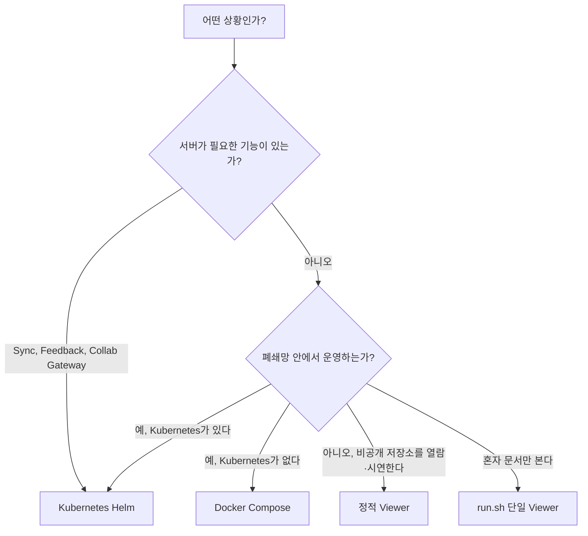

# 설치 방식 선택

synctx는 구성(무엇을 설치할까)과 대상(어디에 설치할까)을 따로 고른다. 이 문서는 선택 기준과 대상별 명령, 사전 정의 구성(프리셋), 정적 Viewer(Cloudflare Pages) 설치와 롤백을 한곳에 모은다. 새 설치 도구는 없고, 기존 Helm·Compose 스크립트의 서비스별 켜기·끄기를 프리셋 파일로 묶었다.

## 무엇을 어디에 설치할까



### 구성

| 구성 | 포함 | 용도 |
|------|------|------|
| 전체 | Viewer, CDN, Marp, Slides, Draw.io, Sync, Feedback(선택), Collab Gateway(선택), Jitsi(선택) | 사내 운영 |
| 서비스별 선택 | 위 목록에서 필요한 것만 | 부분 도입 |
| 정적 Viewer | 읽기 전용 Viewer 화면을 정적 파일로 내보낸 사이트 | 비공개 저장소 열람·시연 |

### 구성 × 대상 지원 범위

| | 전체 | 서비스별 선택 | 정적 Viewer |
|---|---|---|---|
| Kubernetes(Helm) | 지원(`helm/synctx`) | 지원(`<서비스>.enabled`) | 해당 없음 |
| Docker Compose | **Compose 지원 서비스 전체**(viewer·cdn·marp·slides·drawio)만 지원. Jitsi는 `SYNCTX_JITSI`로 따로 켠다. Sync·Feedback·Collab Gateway는 Helm만 | 지원(`SYNCTX_SERVICES`) | 해당 없음 |
| Cloudflare Pages | 해당 없음(서버 기능 필요) | 해당 없음 | 지원 |
| 단일 Viewer 로컬 | — | `run.sh`(Viewer만) | — |

「전체」는 대상마다 뜻이 다르다. Helm의 전체는 차트의 서비스 전부이고, Compose의 전체는 Compose가 지원하는 서비스 전부다. 그래서 프리셋 이름도 구분한다(Helm `full`, Compose `all-supported`).

### 구성별 기능 가용

| 기능 | Helm | Compose | 정적 Viewer |
|------|:----:|:-------:|:-----------:|
| 문서·저장소 목록·파일 트리 열람 | 지원 | 지원 | 지원 |
| 테마 전환(7종, 기본 `corporate`) | 지원 | 지원 | 지원 |
| 검색 | 지원 | 지원 | 안 됨 |
| 회의 API·회의 화면 | 지원 | 지원 | 안 됨 |
| 발표(Marp·Slides) | 지원 | 지원 | 안 됨 |
| 다운로드 | 지원 | 지원 | 안 됨 |
| `synctx-html` 블록·HTML 렌더 보기 | 지원 | 지원 | 안 됨 |
| Draw.io | 지원 | 지원 | 안 됨 |
| Sync(XWiki·OpenProject 동기화) | 지원 | Helm만 | 안 됨 |
| Feedback | 지원 | Helm만 | 안 됨 |
| Collab Gateway | 지원 | Helm만 | 안 됨 |
| Jitsi | 지원(선택) | 지원(`SYNCTX_JITSI`, 선택) | 안 됨 |

정적 Viewer는 저장소당 ref 하나를 빌드 시점에 내보낸 읽기 전용 사본이다. 안 되는 기능의 진입점은 화면에서 숨긴다. 문서 저장소가 바뀌어도 사이트는 다시 내보내기 전까지 그대로다.

## 구성 프리셋

| 이름 | 포함 서비스 | Helm | Compose |
|------|-------------|------|---------|
| 문서만 | viewer, cdn | `helm/synctx/values-profile-docs.yaml` | `deploy/docker/profiles/docs.env` |
| 발표 포함 | viewer, cdn, marp, slides | `helm/synctx/values-profile-present.yaml` | `deploy/docker/profiles/present.env` |
| 전체(Helm) | 위 + drawio, sync, feedback | `helm/synctx/values-profile-full.yaml` | — |
| 지원 서비스 전체(Compose) | viewer, cdn, marp, slides, drawio | — | `deploy/docker/profiles/all-supported.env` |

기본 `helm/synctx/values.yaml`과 `deploy/docker/synctx.env.example`은 바뀌지 않았다. 프리셋은 그 위에 덧씌우는 파일이다.

## Kubernetes(Helm)

운영 값 파일을 먼저, 프리셋을 뒤에 둔다. 뒤에 오는 파일이 앞의 값을 덮어쓰므로 프리셋이 정한 서비스 집합이 운영 값 파일의 `enabled` 값보다 우선한다.

```bash
helm upgrade --install synctx ./helm/synctx --namespace synctx -f values-production.yaml -f helm/synctx/values-profile-present.yaml
```

- 이미지 태그는 SemVer `0.7.0-<git-sha>` 형식을 쓰고 `latest`는 쓰지 않는다. 프리셋은 이미지 태그를 바꾸지 않으므로 운영 값 파일에서 지정한다.
- `helm upgrade`에는 `--reuse-values`를 쓰지 않는다.
- 서비스를 끄면 Deployment·Service·Ingress 경로는 사라지지만 PVC는 남는다.
- 전체 프리셋의 Feedback은 미리 만든 Secret `synctx-feedback`을 참조한다. Secret 키는 `helm/synctx/values.yaml`의 `feedback.secrets` 설명을 따른다. 이름을 바꾸려면 값 파일에서 `feedback.secrets.existingSecret`을 덮어쓴다.
- Collab Gateway와 Jitsi는 사이트별 값이 필요해 프리셋에 넣지 않았다. 켜려면 `collabGateway.enabled`와 `.synctx.yaml`의 `collab` 설정(`synctxConfig.create: true`), Jitsi는 `jitsi.enabled`와 호스트·TLS·시크릿 값을 운영 값 파일에 둔다. 상세는 `docs/production-service-design.md`를 따른다.

## Docker Compose

Compose는 viewer·cdn·marp·slides·drawio만 지원한다. **Sync·Feedback·Collab Gateway는 Helm만** 쓸 수 있다.

```bash
cp deploy/docker/profiles/present.env deploy/docker/synctx.env
```

프리셋 파일은 `synctx.env.example`에서 `SYNCTX_SERVICES`만 바꾼 완성본이다. 복사한 뒤 `SYNCTX_IMAGE_TAG`(`latest` 불가, `0.7.0-<git-sha>` 형식), `SYNCTX_IMAGE_PREFIX`, `SYNCTX_CONFIG_FILE`, Slides를 켜는 경우 `SYNCTX_SLIDES_REPO_URL`을 채운다. 시크릿은 `secrets.env.example`을 복사해 쓴다.

```bash
scripts/docker/deploy.sh --check
```

```bash
scripts/docker/deploy.sh
```

- 직접 `docker compose up`은 쓰지 않는다. 게이트웨이 설정과 설정 해시는 `deploy.sh`가 만든다.
- 중지는 `scripts/docker/down.sh`, 운영 명령은 `scripts/docker/compose.sh -- <명령>`이다.
- 서비스를 바꾸려면 `SYNCTX_SERVICES`를 고치고 `deploy.sh`를 다시 실행한다. 꺼진 서비스는 정리된다.

### Compose에서 Jitsi 켜기

Jitsi는 프리셋에 포함하지 않고(`SYNCTX_JITSI=false`) 필요할 때 따로 켠다. `SYNCTX_JITSI=true`로 바꾸면 `deploy.sh --check`가 다음을 요구한다.

| 항목 | 설정 |
|------|------|
| Viewer | `SYNCTX_SERVICES`에 viewer 포함 |
| 이미지 태그 | 고정 `stable-<번호>`(`latest` 금지). 기본값은 `helm/synctx/values.yaml`의 `jitsi.imageTag` |
| 호스트 | `SYNCTX_JITSI_HOST` |
| 공개 주소 | `SYNCTX_JITSI_PUBLIC_URL`은 `https://<SYNCTX_JITSI_HOST>` 형식 |
| TLS | `SYNCTX_TLS_CERT`·`SYNCTX_TLS_KEY` 인증서와 키 |
| 미디어 광고 주소 | `SYNCTX_JITSI_ADVERTISE_IPS`에 브라우저에서 닿는 JVB 주소 |
| 시크릿 | `secrets.env`의 XMPP 암호와 JWT 비밀 |

정확한 검사 조건은 `scripts/docker/deploy.sh`가 기준이다.

## 정적 Viewer(Cloudflare Pages)

비공개 Git 저장소의 Markdown을 Viewer 화면 그대로 정적 사이트로 내보내 Cloudflare Pages(Direct Upload)에 올리고 Cloudflare Access로 열람자를 제한한다. 폐쇄망 운영 구성이 아니라 시연·열람용이다.

### 준비물

| 항목 | 내용 |
|------|------|
| 설정 파일 | 저장소 루트의 `static-export.yaml`. 저장소 항목은 `.synctx.yaml`과 같은 필드(`auth.credential_env` 포함) |
| 빌드 스크립트 | `scripts/static-export/build.sh` |
| 접근 점검 스크립트 | `scripts/static-export/check-access.sh <URL>` |
| 워크플로 | GitHub Actions(`workflow_dispatch`, 선택적 `schedule`). `pull_request`에서는 시크릿을 쓰지 않는다 |
| Pages 프로젝트 | Direct Upload 프로젝트를 미리 만든다. Git 연동 프로젝트로 바꿀 수 없다 |

GitHub Actions 저장소 시크릿 3종을 등록한다.

| 시크릿 | 내용 |
|--------|------|
| `CLOUDFLARE_API_TOKEN` | Account → Cloudflare Pages → Edit 권한 토큰 |
| `CLOUDFLARE_ACCOUNT_ID` | Cloudflare 계정 ID |
| `GIT_READ_TOKEN` | 대상 문서 저장소 Contents 읽기 전용 토큰(fine-grained 권장, 만료일 설정). 워크플로의 `GITHUB_TOKEN`으로는 다른 비공개 저장소를 읽을 수 없다 |

GitHub Actions 저장소 Variables 2종도 등록한다. 비어 있으면 배포 또는 점검 단계가 실패한다.

| 변수 | 내용 |
|------|------|
| `CLOUDFLARE_PAGES_PROJECT` | Pages(Direct Upload) 프로젝트 이름 |
| `STATIC_EXPORT_CHECK_URLS` | 접근 점검 대상 https 주소를 공백으로 구분한 목록(운영 `*.pages.dev`·미리보기·커스텀 도메인의 `/view/`) |

토큰은 URL·로그·산출물에 남기지 않는다. 설정 파일에는 환경변수 이름만 둔다.

### 첫 배포 순서

1. **Access 앱**: 운영 `*.pages.dev`, 미리보기(`*.<프로젝트>.pages.dev`), 커스텀 도메인 각각에 Access 앱을 만들고 허용 대상을 명시 이메일 목록으로 둔다. Pages의 「Enable access policy」는 미리보기 배포만 보호한다. 커스텀 도메인은 Access를 걸기 전에 연결한다.
2. **사전 점검**: 비밀이 없는 자리표시 페이지만 먼저 올린 뒤, 보호할 호스트마다 `scripts/static-export/check-access.sh <URL>`을 실행한다. 세션 없이 요청했을 때 문서가 200으로 열리지 않고 Access 로그인(302 등)으로 가야 통과다. 하나라도 실패하면 다음으로 가지 않는다.
3. **배포**: GitHub Actions 워크플로를 `workflow_dispatch`로 실행한다. 빌드 job의 산출물 검사(한도, 깨진 링크, 토큰 문자열, `.git`)가 실패하면 배포 job은 실행되지 않는다. 배포 브랜치는 항상 운영 브랜치로 고정되어 있다.
4. **배포 후 점검**: 배포 직후 같은 `check-access.sh`가 워크플로 안에서 실행된다. 실패하면 워크플로도 실패한다. 이미 올라간 배포는 자동으로 지워지지 않으므로 아래 롤백 순서로 사람이 막는다.

점검을 통과하기 전에는 주소를 공유하지 않는다. 주소를 알려 주지 않는 것만으로는 올라간 문서가 막히지 않는다.

### 내보내기 범위

저장소의 모든 문서가 올라가는 것이 아니다. 경로의 어느 구간이든 점(`.`)으로 시작하면(`.claude/`·`.github/`·`.hidden.md`) 기본으로 제외한다. 비공개 저장소의 내부 노트가 실수로 공개되지 않게 하려는 것이다. 숨김 경로를 올리려면 `static-export.yaml`의 `include`에 그 경로를 직접 적는다(예: `.github/docs/`). `include: ["docs/"]`는 `docs/.draft/`를 켜지 않는다. `exclude`는 항상 `include`보다 우선한다. 이 제한은 본문 페이지뿐 아니라 파일 트리, 파일 목록, 그림, 회의 근거 발췌에도 같게 적용된다.

### 한도

사이트당 파일 20,000개, 파일당 25 MiB(Wrangler 업로드 한도). 넘으면 빌드가 실패한다. 지원하지 않는 확장자나 렌더 크기 제한을 넘는 파일만 건너뛰고 보고서에 남긴다.

### 미확인

Cloudflare 쪽 다음 사항은 공식 문서로 확인하지 못했다. 계정에서 직접 확인한 뒤 쓴다.

- Access 무료 조건(사용자 수·로그 보관)
- Pages 미리보기 배포 비활성화 가능 여부, 브랜치 별칭(`<브랜치>.<프로젝트>.pages.dev`)의 Access 보호 여부
- Direct Upload에 월 빌드 한도가 적용되는지, GitHub Actions 러너 사용량
- `Cloudflare Pages: Edit` 토큰 권한으로 배포 삭제가 가능한지(그래서 자동 제거를 넣지 않았다)
- Pages와 Workers Static Assets 중 현재 권장 방식

Access 설정의 실제 적용 상태는 자동 시험으로 보장되지 않는다. 배포 후 점검 결과가 유일한 확인 수단이다.

## 롤백

두 종류의 변경은 서로 독립이라 하나만 되돌릴 수 있다.

### 정적 사이트 내리기

1. 사이트를 먼저 내린다. Cloudflare Pages 배포 목록에서 이전 배포로 되돌리거나 프로젝트를 삭제한다.
2. 사이트가 내려간 것을 확인한 뒤 Access 앱을 지운다. Access 앱을 먼저 지우면 인증 없이 열릴 수 있다.
3. 노출이 의심되면 `GIT_READ_TOKEN`과 `CLOUDFLARE_API_TOKEN`을 즉시 폐기하고 재발급한다. GitHub Actions 시크릿도 새 값으로 바꾼다.

### 정적 기능 코드 되돌리기

정적 기능(`services/viewer/src/static_export/`, `scripts/static-export/`, 워크플로, 이 문서와 프리셋)은 새로 추가된 파일이라 되돌려도 기존 서비스에 영향이 없다. 정적 기능 커밋만 되돌린다.

### `corporate` 테마 되돌리기

`services/viewer/src/renderer.py`의 `CORPORATE_CSS`와 `THEME_VARS_CSS`의 `corporate` 블록 갱신은 운영 Viewer와 HTML 내보내기의 `corporate` 모양을 바꾼다. 되돌리면 모양이 이전(`#E01E1F`, Public Sans)으로 돌아간다. 정적 기능과 별도 커밋이므로 이 커밋만 되돌린다.
