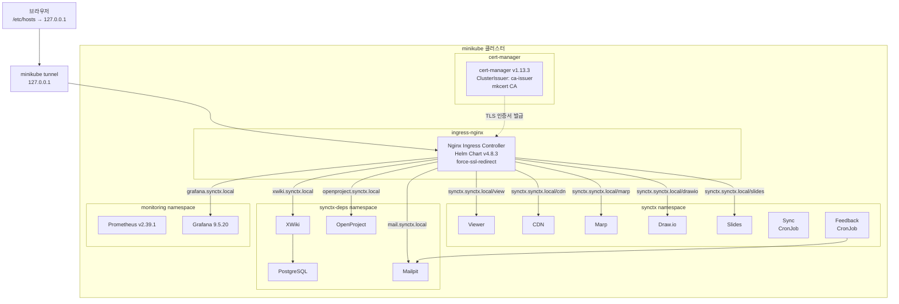

# 로컬 개발 환경 (minikube)

이 문서는 경량 Viewer, Marp 포함 로컬 프로세스, minikube 클러스터의 실행 방법을 설명한다.

## 0. 클러스터 없이 실행

### 0.1 Markdown·회의 Viewer (소스 또는 단일 Docker 컨테이너)

소스 실행은 저장소 체크아웃·`uv`·Git·Python 3.13 이상이 필요하다. 체크아웃 위치에서 다음과 같이 실행하며, URL은 실제 저장소 주소로 바꾼다. 최초 의존성 설치와 이미지 빌드는 네트워크가 필요하므로 폐쇄망 반입 전에 준비한다. 실행 중에는 지정한 Git 서버만 사용하며 브라우저 렌더링에 외부 CDN을 쓰지 않는다.

```bash
./run.sh --repo https://git.example/team/docs.git
./run.sh --repo "../meeting docs" --ref main --refresh-interval 30
./run.sh --config "./my configs/viewer.yaml" --port 18100

# Docker Engine 실행 필요. Viewer 이미지만 기존 빌드 스크립트로 빌드
./run.sh --docker --build --repo https://git.example/team/docs.git
# 준비된 이미지 사용: 호스트 Python·uv·Git 불필요
./run.sh --docker --image synctx/viewer:0.7.0-abcdef0 --repo https://git.example/team/docs.git
```

접속 주소는 http://127.0.0.1:18000/view/ 이다. 루트 `run.sh`의 첫 인자가 `--docker`면 `scripts/docker/run-viewer.sh`, 그 밖에는 `scripts/local/run-lite.sh`가 같은 `services/viewer/src/standalone.py`를 실행한다. Docker는 Compose·게이트웨이 없이 컨테이너 하나를 포그라운드로 실행한다. 준비된 이미지에는 standalone 코드와 vendor 파일이 있어야 하며, 이미지와 실행 스크립트를 같은 커밋에서 준비한다. `--image` 실행은 Git 메타데이터가 없는 스크립트 묶음에서도 가능하다.

| 인자 | 의미·기본값 |
|------|------------|
| `--repo URL_OR_PATH` | 반복 가능. `--config`와 함께 쓸 수 없음. `--ref` 기본 `main` |
| `--ref REF` | `--repo`로 만드는 저장소의 브랜치. `--config`와 함께 주면 거부한다(설정 파일의 `default_ref`를 쓴다) |
| `--config FILE` | 저장소가 하나 이상인 `.synctx.yaml`. 명시한 인증·협업 설정 유지 |
| `--refresh-interval SECONDS` | 시작 시 clone/fetch 뒤 기본 60초마다 갱신. `0`이면 주기 갱신 끔 |
| `--public-base-url URL` | 내보내기 원문 링크의 공개 주소 |
| 소스 `--host`, `--port`, `--cache-dir` | `127.0.0.1`, `18000`, `~/.cache/synctx/lite` |
| Docker `--bind`, `--port` | 호스트 `127.0.0.1:18000` 공개. 컨테이너는 `0.0.0.0:8000` 고정 |
| Docker `--name`, `--volume` | `synctx-viewer`, `synctx-viewer-cache` (이름 있는 캐시 볼륨) |
| Docker `--image IMAGE` | 사전 빌드 이미지. `0.7.0-abcdef0` 같은 SemVer-SHA 태그 필수 |
| Docker `--build` | 기본 이미지 빌드. `--image`와 함께 쓸 수 없음 |
| Docker `--env NAME` | 추가 환경변수 이름만 전달. `NAME=value`와 실행 스크립트가 정하는 `SYNCTX_*`·`GIT_CONFIG_*` 이름은 거부 |

- `--repo`로 생성하는 프로필은 `collab.enabled: true`, `authz.enabled: false`이고 HTTP(S) Git 인증은 `GIT_READ_TOKEN`을 참조한다. `--config`의 명시한 `authz`·저장소별 `collab`은 그대로 유지한다. 토큰을 URL에 넣으면 앱이 거부한다. 원격 URL·ref·갱신 간격 등 앱 인자 오류와 clone/auth 오류는 포그라운드 실행 로그에서 확인한다.
- 토큰은 실행 전 환경변수로 제공한다. Docker는 `GIT_READ_TOKEN`·`SYNCTX_SERVICE_TOKEN`·`SYNCTX_RENDER_SECRET`·`SYNCTX_RENDER_SECRET_PREVIOUS`를 이름만으로 전달하며, 사용자 정의 `credential_env`라면 `--env MY_GIT_TOKEN`을 추가한다. `SYNCTX_RENDER_SECRET_FILE`·`SYNCTX_RENDER_SECRET_PREVIOUS_FILE`을 주면 그 파일을 `/run/secrets/`에 읽기 전용으로 마운트한다(직접 값과 함께 지정하면 거부). 값은 명령 인자·생성 YAML에 기록하지 않는다. Marp가 없으므로 쓰기 토큰은 필요 없다.
- HTML 렌더 보기(`mode=render`)는 `--config`에서 저장소의 `html_embed.enabled`·`render_files`를 함께 켠 경우에만 쓴다(`--repo` 프로필은 켜지 않는다). 생성 설정의 `viewer.render_token_ttl_seconds` 기본값은 14400이다. `SYNCTX_RENDER_SECRET`이 없으면 실행할 때마다 무작위 키를 만들므로, 다시 시작하면 기존 렌더 주소는 만료되고 원래 화면을 새로 고쳐야 한다.
- 상대 경로는 호출한 디렉터리 기준이며 공백이 있으면 따옴표로 감싼다. 로컬 `--repo` 디렉터리는 실제 경로로 정규화한 뒤 Docker 안에서도 같은 절대 경로에 읽기 전용으로 마운트한다(상위 디렉터리는 마운트하지 않음). `--config`는 `/etc/synctx/standalone.yaml`에 읽기 전용 마운트한다. Docker의 로컬 `--repo`는 `file:///path/to/repo`와 `file://localhost/path/to/repo`도 실제 디렉터리로 정규화하며 `%20` 같은 URL 이스케이프를 해석한다. 그 밖의 file URL 호스트는 거부한다. `.git`이 파일인 linked worktree·submodule은 외부 Git 관리 디렉터리를 마운트해야 하므로 지원하지 않는다. 원격 Git URL을 대신 사용한다. Docker의 설정 파일 안 저장소 URL은 컨테이너에서 접근 가능한 Git URL을 사용한다. 호스트 로컬 저장소는 명시적 `--repo`로 지정한다. bind 구문 때문에 설정 파일 경로에 콜론은 쓸 수 없다.
- 소스 캐시와 Docker `/data/viewer`에는 생성 설정과 `repos/`가 남는다. Docker에서 Ctrl-C로 종료하면 `--rm`으로 컨테이너만 지워지고 볼륨은 재실행 때 재사용한다. 다른 캐시를 쓰려면 `--volume another-viewer-cache`를 지정한다. 메모는 이 볼륨이 아니라 브라우저 localStorage에 있어 주소·포트·브라우저가 달라지면 별도로 보관된다.
- `--build`는 `scripts/local/steps/build.sh --only viewer --no-load --tag 0.7.0-<git-sha>`만 호출한다. 기본 이미지는 `${DOCKER_REGISTRY:-synctx}/viewer:0.7.0-<git-sha>`이며 `DOCKER_REGISTRY=registry.local:5000/synctx`처럼 접두사를 바꾸면 빌드와 실행에 함께 적용된다. `DOCKER_REGISTRY` 없이 기본 이미지를 쓰면 Docker Hub에서 받지 않도록 `--pull never`로 실행하고, 로컬에 이미지가 없으면 Docker를 실행하기 전에 `--build`나 `--image`를 쓰라고 안내한다. `DOCKER_REGISTRY`를 지정했거나 `--image`를 준 경우는 Docker 기본 pull 정책을 따른다. `latest`·태그 없는 이미지는 거부한다. 베이스 이미지는 기존 `python:3.13.16-slim-trixie` 그대로다.
- 공개 URL 우선순위는 `--public-base-url` → 설정의 명시적 `runtime.public_base_url` → `SYNCTX_VIEWER_PUBLIC_BASE_URL` → 소스 바인딩 주소다. Docker는 환경변수가 비어 있으면 호스트 공개 주소를 넣는다(`0.0.0.0`·`::`는 링크에서 loopback으로 변환). 외부 사용자는 실제 URL을 `--public-base-url https://docs.example`로 지정한다.
- 기본 loopback 공개를 유지한다. `--bind 0.0.0.0` 등으로 외부에 열 때는 TLS·인증 프록시와 방화벽을 먼저 구성하고, 프록시만 Viewer에 접근할 수 있게 제한한다. `--repo` 프로필에는 사용자 인증이 없고 `--config`의 인증을 자동으로 끄지 않는다. 기존 authz가 켜져 있으면 신뢰할 수 있는 프록시 헤더가 없을 때 403인 것이 정상이다.

경량 모드는 `viewer.asset_source: bundled`와 `SYNCTX_ENABLED_SERVICES=viewer`를 사용한다. Mermaid·코드 하이라이팅은 기존 `services/viewer/src/static/vendor/`에서 제공하고 Marp·CDN 서비스는 로드하지 않는다. 기존 Helm·Compose의 기본 자산 방식은 `cdn`이다. 일반 HTML 다운로드는 기본 렌더 HTML이며, 회의 모드의 메모 포함 HTML 내보내기(`meeting-export`)는 vendor와 현재 브라우저 메모를 포함한 자체 완결형 사본이다. PDF·Marp 슬라이드 변환·출판은 Marp 포함 실행 방식을 쓴다.

회의 문서는 기존 `synctx.meeting`의 `id`·`title`·`starts_at`·`channel`이 필수다. 회의 입장은 본문에 `[회의 입장](https://meet.example/room)` 같은 일반 HTTPS Markdown 링크를 둔다. 영상 SDK·iframe 통합·서버 메모 동기화는 추가하지 않는다. 브라우저 메모·형광펜과 내보내기/가져오기를 그대로 사용한다.

자동 테스트는 fake Docker로 인자·볼륨·토큰 전달·빌드 위임을 검증한다. 실제 이미지 빌드·daemon·아키텍처·인증 프록시·Git 서버 연결은 대상 환경에서 별도 확인한다. 소스와 Docker에서 같은 Markdown·회의 문서, 주기 갱신, 내보내기, 종료 후 캐시 재사용을 확인한다.

### 0.2 Marp를 포함한 로컬 프로세스 (Docker·minikube 없이)

문서 보기, 회의 모드, 모션 그래픽(`synctx-html`), Marp 슬라이드 미리보기·PDF만 필요하면 클러스터 없이 프로세스 하나로 띄운다.

```bash
scripts/local/run-viewer.sh            # http://127.0.0.1:18000/view/
scripts/local/run-viewer.sh --port 18100
```

- **구성**: uvicorn 하나에 `/view`(Viewer), `/marp`(Marp), `/cdn`(저장소의 `cdn-data/` 정적 파일)을 Ingress와 같은 경로로 묶는다. Draw.io·Sync·Feedback은 띄우지 않고, Viewer에는 `SYNCTX_ENABLED_SERVICES=viewer,cdn,marp`를 넘겨 Draw.io 버튼을 숨긴다.
- **설정**: `helm/synctx/values-local.yaml`의 `synctxConfig.data`(minikube와 같은 저장소 목록)에서 `~/.cache/synctx/synctx.local.yaml`을 만들고, 공개 주소·CDN 주소·Marp 주소·저장소 캐시 위치(`~/.cache/synctx/repos`)만 로컬 값으로 바꾼다. 다른 설정을 쓰려면 `--config <.synctx.yaml>`.
- **토큰**: `GIT_READ_TOKEN` 환경변수가 있으면 쓰고, 없으면 `values-local.secret.yaml`의 `git.secrets.readToken`을 실행 시점에만 읽는다. Marp 출판은 `GIT_PUBLISH_TOKEN`이 없으면 이 읽기 토큰으로 대신 push하므로(쓰기 권한이 있으면 공유 저장소에 push된다) 만든 설정에서는 `marp.publish_repo`를 비워 출판을 끈다. 출판 버튼도 나오지 않는다. `--config`로 직접 준 설정은 그대로 쓰므로 `publish_repo`를 비워 두어야 한다.
- **실행 요구사항**: `uv`. `uv run --frozen --all-packages`로 실행하며 Python은 3.13 이상(`requires-python`)이다.
- **Marp 요구사항**: `npm install -g @marp-team/marp-cli @mermaid-js/mermaid-cli`와 Chrome(또는 Chromium). 없으면 경고를 내고 Marp를 끈 채 Viewer만 실행한다. Chrome 경로는 `CHROME_PATH`로 바꿀 수 있다.
- **저장소 갱신**: Viewer는 시작할 때만 저장소를 받아 온다. 그 뒤 원격에 올라간 변경을 보려면 다시 실행하거나 저장소별로 갱신을 요청한다. 처음부터 다시 받으려면 `~/.cache/synctx/repos`를 지우고 다시 실행한다.

  ```bash
  curl -X POST -H 'Content-Type: application/json' -d '{}' http://127.0.0.1:18000/view/api/repos/meeting-docs/webhook
  ```

### 0.3 선택 실행 Chromium 브라우저 시험

시스템 Google Chrome과 루트 dependency group `browser`의 Playwright(Python)가 필요하다. 브라우저 바이너리는 내려받지 않으며 `channel="chrome"`으로 설치된 Chrome을 실행한다. 개발 의존성은 네트워크가 가능한 환경에서 미리 준비한다(`uv sync`는 worktree의 `.venv`에 workspace 전체와 `browser` group을 설치한다).

```bash
uv sync --all-packages --group browser
uv run --group browser pytest services/viewer/tests/browser -v
```

시험은 임시 Git 저장소와 loopback 포트의 Viewer·CSP 요청 수신 서버를 사용한다. 외부 네트워크 요청은 허용하지 않으며, 종료 시 서버 스레드와 Chrome을 정리한다. 일반 `uv run pytest`나 `uv run pytest services/viewer/tests -q`에서는 browser 시험을 skip한다. 선택 실행하려면 위처럼 browser 디렉터리(또는 그 안의 시험 파일)만 명시한다. 다른 시험 경로와 한 명령에 섞으면 환경 변수·이벤트 루프가 남아 무관한 시험이 깨지므로 시험이 사용 오류로 거부한다. Playwright 또는 시스템 Chrome이 없을 때도 collection 오류 없이 skip한다. 실행 결과에 skip이 있으면 해당 브라우저 동작을 확인한 것으로 보지 않는다.

시험 범위는 `synctx-html` 버튼 동작, opaque origin·부모 document/저장소/쿠키 격리, CSP의 fetch·이미지 차단, 렌더 보기의 상대 링크와 ref·SHA 유지, 위조 토큰 거부, 만료 안내 뒤 원래 Viewer 화면 새로 고침, 블록 크게 보기·Esc·포커스 복귀다. 위조·만료 토큰의 응답은 설계 14.3에 따라 403이며 자동 토큰 갱신은 하지 않는다. 독립 캐시 파드 2개·운영 SSO·Edge·Firefox·Safari·실제 클릭 전체 화면은 별도 확인이 필요하다.

### 0.4 정적 Viewer 내보내기 로컬 실행 (시연용)

비공개 저장소의 Markdown을 정적 사이트로 만들어 브라우저에서 확인한다. Cloudflare에 올리지 않고 로컬에서만 열어 본다. 설정은 `static-export.sample.yaml`을 `static-export.yaml`로 복사해 저장소 항목을 채운다(토큰은 환경변수 이름만 적는다).

```bash
export GIT_READ_TOKEN=...            # 비공개 저장소일 때만. 값은 설정 파일에 쓰지 않는다
scripts/static-export/build.sh --config static-export.yaml --out dist
python3 -m http.server 8080 --directory dist
```

`build.sh`는 빌드 끝에서 산출물 검사(토큰·`.git`·한도·깨진 링크)를 돌리고 실패하면 종료 코드 1로 끝난다(`dist`는 남는다). 설정 오류는 2다. `--repos a,b`나 환경변수 `STATIC_EXPORT_REPOS`로 일부 저장소만 내보내며 인자가 우선한다. 출력 디렉터리는 전용 폴더여야 하고(이전 빌드 표지가 없는 비어 있지 않은 폴더는 거부) 시작 때 비운다. http://127.0.0.1:8080/view/ 를 연다(`/`를 `/view/`로 보내는 `_redirects`는 Cloudflare Pages에서만 적용되고 `http.server`는 무시한다). 검색·회의·발표·다운로드는 정적 사이트에서 숨겨진다. 설치·배포·Access 설정은 [설치 방식 선택](install.md)을 따른다.

## 1. 운영 vs 로컬 환경 비교

| 구성 요소 | 운영 (폐쇄망) | 로컬 (minikube) |
|----------|--------------|-----------------|
| **K8s 클러스터** | 온프레미스 K8s (Kubespray, CRI-O, 3+ 노드) | minikube (단일 노드, Docker 드라이버) |
| **Ingress** | Nginx Ingress Controller (Helm Chart) | Nginx Ingress Controller (Helm Chart, v4.8.3) |
| **TLS** | Ingress TLS Secret 직접 마운트 | cert-manager v1.13.3 + mkcert CA 자동 발급 |
| **Docker Registry** | `registry.local:5000` (내부) | 로컬 빌드 → `minikube image load` (`pullPolicy: Never`) |
| **Git 저장소** | 내부 GitLab 미러 | GitHub (`github.com`) |
| **XWiki** | 내부 XWiki 서버 | minikube 내 Docker 배포 (`xwiki:16-postgres-tomcat`) |
| **OpenProject** | 내부 OpenProject 서버 | minikube 내 Docker 배포 (`openproject/openproject:15`) |
| **SMTP** | 승인된 메일 게이트웨이 | Mailpit (클러스터 내, 실제 발송 없음) |
| **PVC** | NFS/Ceph StorageClass | minikube 기본 `standard` StorageClass |
| **Monitoring** | Prometheus + Grafana (EFK Stack 로깅) | Prometheus + Grafana (`monitoring` namespace) |
| **Feedback** | CronJob + 승인된 SMTP | CronJob + Mailpit |
| **도메인** | `*.corp.example.com`, `*.dev.example.com` (사내) | `*.synctx.local` (127.0.0.1) |

## 2. 사전 요구사항

```bash
# macOS 기준
brew install minikube helm kubectl docker mkcert node uv
```

| 도구 | 최소 버전 | 용도 |
|------|----------|------|
| minikube | 1.30+ | 로컬 K8s 클러스터 |
| helm | 3.12+ | 차트 배포 |
| kubectl | 1.28+ | K8s CLI |
| docker | 24+ | 이미지 빌드 |
| mkcert | 1.4+ | 로컬 CA 인증서 생성 (TLS) |
| node | 18+ | 회의 모드 JS 단위 테스트 (`node --test`, `make test`) |
| uv (Python 3.13+) | - | `run-viewer.sh`, 전체 테스트 (`make test` = `scripts/test-all.sh`, 내부에서 `uv run --frozen --all-packages pytest`) |

minikube 리소스 권장: CPU 4코어, RAM 8GB, 디스크 30GB. `setup.sh`는 `MINIKUBE_CPUS`(기본 4)와 `MINIKUBE_MEMORY`(MB, 기본 8192)로 바꿀 수 있다. Docker Desktop 메모리는 minikube 메모리보다 커야 하고, 이미 만든 클러스터의 메모리는 바꿀 수 없다(지우고 다시 만들어야 한다).

다른 프로젝트가 기본 minikube 클러스터를 쓰고 있으면 `MINIKUBE_PROFILE=synctx`처럼 전용 프로필을 지정한다(기본 `minikube`). `scripts/local/` 스크립트는 minikube·kubectl·helm을 모두 이 프로필의 클러스터로 실행하므로 현재 kubectl 컨텍스트와 상관없다. 모든 스크립트를 같은 값으로 실행하고, 접속할 때는 `minikube tunnel -p <프로필>`을 쓴다. `cleanup.sh --delete-cluster`는 이 프로필의 클러스터만 지운다.

## 3. 아키텍처



### TLS 구성

로컬 환경에서는 **mkcert**로 생성한 로컬 CA를 cert-manager의 `ClusterIssuer`에 등록하여 모든 `*.synctx.local` 도메인에 대해 자동으로 TLS 인증서를 발급한다.

1. `mkcert -install` → 시스템 trust store에 로컬 CA 등록
2. `rootCA.pem` + `rootCA-key.pem` → cert-manager namespace의 `ca-key-pair` Secret
3. `ClusterIssuer(ca-issuer)` → Secret 참조
4. 각 Ingress에 `cert-manager.io/cluster-issuer: ca-issuer` annotation → 자동 Certificate 발급

## 4. 빠른 시작

```bash
# 전체 설치 (인프라 → 의존성 → 빌드 → 배포)
./scripts/local/setup.sh

# 별도 터미널에서 tunnel 실행 (MINIKUBE_PROFILE을 지정했다면 같은 프로필)
minikube tunnel -p "${MINIKUBE_PROFILE:-minikube}"

# 상태 확인
./scripts/local/verify.sh
```

## 5. 단계별 설치

### 5.1 인프라 설정

```bash
./scripts/local/steps/infra.sh
```

수행 내용:
- 사전 요구사항 확인 (mkcert, minikube, helm)
- `/etc/hosts`에 호스트 등록 (`synctx.synctx.local`, `xwiki.synctx.local`, `openproject.synctx.local`, `mail.synctx.local`)
- minikube 시작 (미실행 시)
- Helm Repository 추가 (`ingress-nginx`, `jetstack`)
- Nginx Ingress Controller 설치 (Helm Chart v4.8.3, `force-ssl-redirect: true`)
- cert-manager 설치 (v1.13.3)
- mkcert CA Secret + ClusterIssuer(`ca-issuer`) 생성
- 네임스페이스 생성 (`synctx`, `synctx-deps`)

### 5.2 의존성 배포

```bash
# 전체 의존성
./scripts/local/steps/deploy-deps.sh

# 선택적 배포
./scripts/local/steps/deploy-deps.sh --skip-xwiki        # XWiki 제외
./scripts/local/steps/deploy-deps.sh --skip-op            # OpenProject 제외
./scripts/local/steps/deploy-deps.sh --skip-mailpit       # Mailpit 제외 (예전 이름 --skip-mailhog도 경고와 함께 동작)
./scripts/local/steps/deploy-deps.sh --skip-images        # 이미지 pull 건너뜀
./scripts/local/steps/deploy-deps.sh --skip-xwiki --skip-op --skip-mailpit --mattermost   # Collab Gateway 시험용 Mattermost만
```

`--mattermost`(기본 꺼짐)는 Mattermost(`mattermost/mattermost-team-edition:10.11.19`)와 전용 PostgreSQL을 `synctx-deps`에 띄운다. 공식 Mattermost 이미지는 **amd64 전용**이라 ARM64 기기(Apple Silicon)에서는 Docker의 amd64 에뮬레이션(qemu binfmt)이 있어야 실행된다. 스크립트는 `LOAD_IMAGE_PLATFORM=linux/amd64`로 호스트 Docker에서 받아 minikube에 올린다. 메모리를 약 1.5GiB 더 쓰므로 XWiki를 끄고 쓴다. 이어서 아래 순서로 Gateway까지 시험한다.

```bash
./scripts/local/steps/setup-mattermost.sh            # 팀(synctx)·채널(team-docs)·봇·토큰·/synctx 슬래시 명령 → helm/synctx/values-local.collab.secret.yaml(커밋 제외)
./scripts/local/steps/verify-collab.sh               # Gateway의 Mattermost 어댑터로 시험 글을 올리고 채널에서 읽어 확인
./scripts/local/steps/deploy-synctx.sh               # 위 값 파일이 있으면 Collab Gateway도 배포
```

봇 계정·토큰과 `/synctx` 슬래시 명령은 `mmctl --local`이 지원하지 않아 관리자로 로그인해 REST API로 만든다(`scripts/local/steps/mattermost_bot.py`). 슬래시 명령의 호출 주소는 `http://synctx-collab-gateway.synctx.svc.cluster.local/api/collab/mattermost/command`(환경변수 `SYNCTX_COMMAND_URL`로 바꿈)이고, Mattermost가 발급한 명령 토큰이 Gateway Secret의 `command-token`이 된다. 명령은 Gateway가 클러스터에 배포된 뒤(`deploy-synctx.sh`) 채널에서 `/synctx 도움말`로 시험한다. 관리자 계정(`admin`)의 비밀번호는 `~/.cache/synctx/mattermost-admin-password`(권한 600)에 저장된다. 접속은 `kubectl port-forward -n synctx-deps svc/mattermost 8065:8065`.

이 기기처럼 amd64 에뮬레이션이 없으면 Mattermost 파드가 `exec format error`로 재시작을 반복한다(Docker Desktop의 Rosetta는 minikube 노드 안의 중첩 컨테이너에서 쓸 수 없다). Docker Desktop 설정으로 QEMU 에뮬레이션을 쓰거나 `docker run --privileged --rm tonistiigi/binfmt --install amd64`로 qemu binfmt를 등록해야 한다(Docker VM 전체에 적용된다). 등록은 Docker VM이 다시 시작되면 사라질 수 있다. 등록 뒤 이미 재시작을 반복하는 Mattermost 파드는 삭제해 새로 띄운다.

배포되는 서비스:

| 서비스 | 이미지 | 접속 URL | 초기 계정 |
|--------|--------|----------|----------|
| XWiki | `xwiki:16-postgres-tomcat` | https://xwiki.synctx.local | 초기 설정 위저드 |
| PostgreSQL (XWiki용) | `postgres:16-alpine` | 클러스터 내부 전용 | xwiki / xwiki-local-password |
| OpenProject | `openproject/openproject:15` | https://openproject.synctx.local | admin / admin |
| Mailpit | `axllent/mailpit:latest` | https://mail.synctx.local | 없음 (SMTP: `mailpit.synctx-deps.svc.cluster.local:1025`, 어떤 SMTP 로그인이든 허용) |

### 5.3 이미지 빌드

```bash
# 전체 빌드
./scripts/local/steps/build.sh

# 선택적 빌드
./scripts/local/steps/build.sh --only viewer,cdn,marp     # 코어만
./scripts/local/steps/build.sh --skip feedback             # Feedback 제외
./scripts/local/steps/build.sh --tag 0.7.0-$(git rev-parse --short HEAD)   # 태그 지정 (기본 latest)
./scripts/local/steps/build.sh --no-load --tag 0.7.0-$(git rev-parse --short HEAD)   # minikube에 올리지 않고 호스트 Docker에만 (Docker Compose 배포 확인용)
```

빌드 대상은 `viewer, cdn, marp, sync, feedback`이다. Slides와 Draw.io는 3rd-party 이미지(`nginx`, `alpine/git`, `jgraph/drawio`)를 minikube에 올린다.

### 5.4 synctx 배포

```bash
./scripts/local/steps/deploy-synctx.sh
```

`helm/synctx/values-local.yaml`을 사용하여 배포한다(`values-local.secret.yaml`이 있으면 그 뒤에 적용). 추가 인자는 `helm upgrade`에 그대로 넘기므로 서비스별 배포 옵션을 바꿀 수 있다(예: `./scripts/local/steps/deploy-synctx.sh --set drawio.enabled=false`). 배포가 끝나면 `pullPolicy: Never` 이미지를 새로 쓰도록 모든 Deployment를 재시작한다.

배포 후 `cdn-data/`의 vendor 파일(Mermaid, Chart.js, highlight.js)을 CDN 업로드 API(`POST /api/cdn/upload`)로 PVC에 적재한다. `kubectl port-forward`(기본 포트 `18081`, `CDN_SEED_PORT`로 변경)를 사용하며, 내용이 같은 파일은 건너뛰고 다른 파일은 `force=true`로 덮어쓴다. CDN이 꺼져 있으면(`cdn.enabled=false`) 건너뛴다.

## 6. 설정 파일

### 6.1 values-local.yaml

`helm/synctx/values-local.yaml`이 로컬 환경의 핵심 설정 파일이다.

주요 차이점 (vs 운영):
- `<서비스>.image.pullPolicy: Never` — viewer·cdn·marp·sync·feedback은 minikube에 로드된 로컬 이미지 사용 (slides·drawio는 3rd-party 이미지라 `IfNotPresent`)
- `<서비스>.image.tag: "latest"` — 로컬 빌드는 latest 태그 (운영은 `0.7.0-<git-sha>`)
- `slides.persistence.enabled: false` — emptyDir 사용
- `feedback.secrets.create: true` — Secret 자동 생성 (운영은 existingSecret)
- `git.secrets.create: true` — Git 토큰 Secret 자동 생성 (실제 토큰은 `values-local.secret.yaml`)
- `ingress.tls` — cert-manager 자동 발급 (운영은 수동 Secret)
- `metrics.enabled: false` — ServiceMonitor·PrometheusRule·Pushgateway를 만들지 않는다 (차트 기본값은 `true`)
- `synctxConfig.create: true` — ConfigMap으로 `.synctx.yaml` 주입
- `podSecurityContext.runAsNonRoot: false` — 3rd-party 이미지의 root 실행 허용

### 6.2 변경이 필요한 설정

| 설정 | 파일 | 설명 |
|------|------|------|
| `slides.publishRepoUrl` | values-local.yaml | Slides sidecar가 clone할 Git repo URL |
| `synctxConfig.data.repositories[].url` | values-local.yaml | Sync Engine이 동기화할 Git repo URL |
| `synctxConfig.data.targets.openproject.status_map` | values-local.yaml | OpenProject status ID 매핑 |
| `synctxConfig.data.targets.xwiki.base_url` | values-local.yaml | XWiki REST API URL (클러스터 내부) |
| `git.secrets.readToken`, `git.secrets.publishToken` | values-local.secret.yaml | private 저장소 clone·publish용 GitHub PAT |

`helm/synctx/values-local.secret.yaml`은 `.gitignore`에 등록된 파일로, 있으면 `deploy-synctx.sh`가 `values-local.yaml` 다음에 적용한다. 토큰처럼 커밋하지 않는 값만 넣는다.

```yaml
git:
  secrets:
    readToken: "<GitHub PAT>"
    publishToken: "<GitHub PAT>"
```

### 6.3 XWiki 초기 설정

1. https://xwiki.synctx.local 접속
2. 초기 설정 위저드 완료
3. **Administration → Extensions → Markdown Syntax** 확장 설치
4. REST API 활성화 확인: `GET https://xwiki.synctx.local/rest/wikis`

### 6.4 OpenProject 초기 설정

1. https://openproject.synctx.local 접속 (admin/admin)
2. 새 프로젝트 생성 (identifier: `synctx-local`)
3. **Administration → API** 에서 API token 생성
4. Status ID, Type ID, Priority ID 확인:
   ```
   GET /api/v3/statuses
   GET /api/v3/types
   GET /api/v3/priorities
   ```
5. `values-local.yaml`의 `synctxConfig.data.targets.openproject`에 `status_map`, `type_map` 업데이트
6. 생성한 API token을 `values-local.yaml`의 `feedback.secrets.opApiKey`에 설정 후 재배포:
   ```bash
   # values-local.yaml 수정 후
   ./scripts/local/steps/deploy-synctx.sh
   ```

### 6.5 Sync dry-run 모드

로컬 기본 설정은 `sync.dry_run: true`로 되어 있어, Sync Engine이 XWiki/OpenProject에 **실제 쓰기를 하지 않고** 동기화 계획만 출력한다.
실제 upsert 경로를 검증하려면 `synctxConfig.data`에서 `sync.dry_run: false`로 변경 후 재배포한다.

```yaml
# values-local.yaml → synctxConfig.data 내부
sync:
  on_delete: mark
  dry_run: false    # 실제 XWiki/OpenProject 쓰기 활성화
```

### 6.6 Slides 테스트용 Git repo

```bash
# GitHub에 빈 repo 생성 후
git init synctx-slides-test
cd synctx-slides-test
echo "# Test Slides" > README.md
git add . && git commit -m "init"
git remote add origin https://github.com/<user>/synctx-slides-test.git
git push -u origin main
```

`values-local.yaml`의 `slides.publishRepoUrl`을 이 repo URL로 설정.

## 7. 모니터링

로컬 스크립트는 모니터링을 설치하지 않는다. `monitoring` 네임스페이스에 Prometheus·Grafana를 따로 설치한 클러스터에서만 쓸 수 있고(`MINIKUBE_PROFILE`로 새로 만든 클러스터에는 없다, `verify.sh`는 없으면 경고만 한다), `grafana.synctx.local`은 `/etc/hosts`에 직접 추가한다.

- **Grafana**: https://grafana.synctx.local
- **Prometheus**: 클러스터 내부 접근 (`monitoring-prometheus.monitoring.svc.cluster.local:9090`)

`values-local.yaml`은 `metrics.enabled: false`라서 synctx 서비스의 ServiceMonitor, Alert 규칙, Sync·Feedback용 Pushgateway를 배포하지 않는다. 켜려면 `monitoring.coreos.com` CRD가 있는 Prometheus가 필요하고, Sync나 Feedback이 켜져 있으면 `sync.persistence.enabled: true`여야 한다(의존성 규칙 D8, 아니면 Helm 렌더가 중단된다).

## 8. 일상 작업

### 코드 수정 후 재배포

```bash
# 특정 서비스만 빌드 + 재배포
./scripts/local/steps/build.sh --only viewer
kubectl rollout restart deployment synctx-viewer -n synctx

# 전체 재배포 (Helm 적용 + 모든 Deployment 재시작 + CDN 시딩)
./scripts/local/steps/build.sh
./scripts/local/steps/deploy-synctx.sh
```

### 로그 확인

```bash
# 특정 서비스 로그
kubectl logs -f -l app.kubernetes.io/name=viewer -n synctx
kubectl logs -f -l app.kubernetes.io/name=sync -n synctx

# 의존성 로그
kubectl logs -f -l app=xwiki -n synctx-deps
kubectl logs -f -l app=openproject -n synctx-deps
```

### Sync Engine 수동 실행

```bash
# CronJob에서 수동 Job 생성
kubectl create job --from=cronjob/synctx-sync synctx-sync-manual -n synctx

# 결과 확인
kubectl logs job/synctx-sync-manual -n synctx
```

### Mailpit 메일 확인

https://mail.synctx.local 에서 Feedback Exporter가 발송한 메일을 확인할 수 있다.

## 9. 스크립트 목록

| 스크립트 | 용도 |
|---------|------|
| `scripts/local/run-viewer.sh` | Docker·minikube 없이 Viewer+Marp+CDN 파일을 한 프로세스로 실행 (0절) |
| `scripts/local/setup.sh` | 전체 환경 설치 (원스텝) |
| `scripts/local/verify.sh` | 환경 검증 |
| `scripts/local/cleanup.sh` | 환경 정리 |
| `scripts/local/steps/infra.sh` | 인프라 설정 (minikube, ingress, cert-manager, CA) |
| `scripts/local/steps/build.sh` | 이미지 빌드 + minikube 로드 |
| `scripts/local/steps/deploy-deps.sh` | 의존성 배포 (XWiki, OpenProject, Mailpit) |
| `scripts/local/steps/deploy-synctx.sh` | synctx Helm 배포 + CDN vendor 파일 시딩 |

K8s 없는 Docker 서버용 Compose 배포 스크립트(`scripts/docker/*`)는 `scripts/README.md`와 `docs/production-service-design.md` 8.6을 본다.

## 10. 문제 해결

`MINIKUBE_PROFILE`을 지정했다면 이 절의 `kubectl`·`minikube` 명령에도 `--context <프로필>`·`-p <프로필>`을 붙인다.

### minikube tunnel이 동작하지 않을 때

```bash
# tunnel 프로세스 확인
ps aux | grep "minikube tunnel"

# 재시작
sudo kill $(pgrep -f "minikube tunnel")
minikube tunnel -p "${MINIKUBE_PROFILE:-minikube}"
```

### 이미지 pull 실패 (ImagePullBackOff)

로컬 빌드 이미지는 `pullPolicy: Never`여야 한다. `values-local.yaml` 확인.

```bash
# minikube 내 이미지 목록 확인
minikube -p "${MINIKUBE_PROFILE:-minikube}" image ls | grep synctx
```

### XWiki/OpenProject가 느리게 시작될 때

첫 실행 시 초기화에 2~5분 소요될 수 있다.

```bash
# 상태 확인
kubectl get pods -n synctx-deps -w
```

### TLS 인증서 문제

```bash
# Certificate 상태 확인
kubectl get certificate -A

# cert-manager 로그 확인
kubectl logs -l app.kubernetes.io/name=cert-manager -n cert-manager

# mkcert CA가 시스템에 신뢰되어 있는지 확인
mkcert -CAROOT
# 출력된 경로에 rootCA.pem이 있어야 함
```

브라우저에서 `NET::ERR_CERT_AUTHORITY_INVALID` 오류가 발생하면 `mkcert -install` 재실행 후 브라우저 재시작.

### PVC 데이터 초기화

```bash
kubectl delete pvc --all -n synctx-deps
kubectl delete pvc --all -n synctx
# 재배포
./scripts/local/steps/deploy-deps.sh --skip-images
./scripts/local/steps/deploy-synctx.sh
```

## 선택 Jitsi 시험 (Phase 8.2)

기본 setup.sh에는 Jitsi가 포함되지 않는다. 기본 인프라·mkcert CA·ca-issuer가 준비된 전용 프로필에서 `MINIKUBE_PROFILE=synctx scripts/local/steps/deploy-jitsi.sh`를 선택 실행한다. `--host meet.synctx.local`, `--advertise-ips '노드IP'`(여러 IP는 쉼표 구분), `--skip-images`를 지원하며 기본 광고 주소는 포트 없는 minikube IP다. NodePort는 JVB_PORT·containerPort·Service port·nodePort가 모두 UDP 31000(기본값)이며 광고 주소에 포트를 붙이지 않는다. hostPort·Compose는 UDP 10000을 유지한다. 기존 build.sh처럼 공통 load_image를 사용해 네 공식 이미지를 로드한다. 반입 전에 이미지 실존·아키텍처를 별도 확인해야 한다.

4GiB 상한에서는 Mattermost와 동시에 띄우지 않는다. 스크립트는 Mattermost Deployment가 실행 중이면 경고 후 중단한다. Jitsi는 Java 프로세스 두 개와 web·prosody가 추가되므로 다른 무거운 선택 서비스도 줄이고 자원을 확인한다. 경량 run.sh·run-lite.sh에는 포함하지 않는다.

서로 다른 앱·방 이름 키와 내부 XMPP 암호는 ~/.cache/synctx/jitsi/에 생성하고 재사용한다(디렉터리 700·파일 600). Helm 전달 파일 helm/synctx/values-local.jitsi.secret.yaml도 600이며 gitignore 대상이다. 파일이나 키를 커밋·출력하지 않는다. deploy-jitsi.sh는 values-local.yaml과 선택 Git 토큰 값 파일에 Jitsi 값만 덧붙여 배포하고 Collab Gateway를 끈다. 이후 일반 deploy-synctx.sh는 Jitsi 값 파일을 자동 적용하지 않아 Jitsi를 끄므로 다시 선택 배포해야 한다(추가 Helm 인자로 덮어쓰지 않은 경우). 두 스크립트는 이 상호 전환을 출력으로 경고한다.

https://meet.synctx.local의 DNS/hosts를 Ingress 주소에 맞추고 mkcert CA를 신뢰한다. ca-issuer가 해당 호스트의 jitsi-tls를 발급하며 터널은 `minikube tunnel -p synctx`를 사용한다. Viewer의 회의 참여 버튼을 통해 입장한다. `scripts/local/verify.sh --jitsi`는 기존 검증에 네 Deployment 준비 상태를 추가한다. 브라우저에서 참가자 역할·발표자 따라가기 데이터 채널을 따로 확인한다.

로컬 검증 범위는 접속·입장·데이터 채널까지이며 UDP 미디어는 검증하지 않는다. 이번 A2 구현에서는 minikube를 실행하지 않았고, 실제 입장·역할·미디어는 미확인이다. tcpFallback은 기본 false이며 stable-9823 템플릿에 TCP 하베스터 처리가 없어 동작하지 않는다. JVB_DISABLE_STUN=1과 web ENABLE_P2P=false로 외부 STUN 의존을 끊도록 지정한다. web 변수의 stable-9823 유효성과 실제 외부 STUN 요청 차단은 확인 필요다. 장애·키 교체·방화벽 절차는 production-service-design.md 12.11을 따른다.
