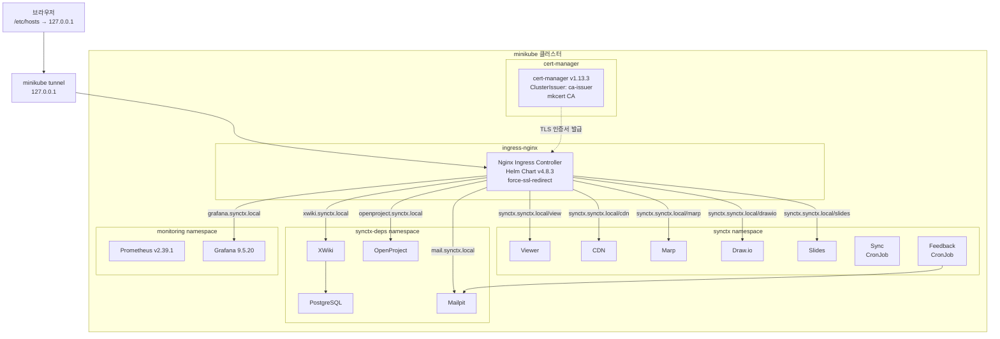

# 로컬 개발 환경 (minikube)

이 문서는 synctx를 로컬 minikube 클러스터에서 실행하는 방법을 설명한다.

## 0. Viewer만 가볍게 실행 (Docker·minikube 없이)

문서 보기, 회의 모드, 모션 그래픽(`synctx-html`), Marp 슬라이드 미리보기·PDF만 필요하면 클러스터 없이 프로세스 하나로 띄운다.

```bash
scripts/local/run-viewer.sh            # http://127.0.0.1:18000/view/
scripts/local/run-viewer.sh --port 18100
```

- **구성**: uvicorn 하나에 `/view`(Viewer), `/marp`(Marp), `/cdn`(저장소의 `cdn-data/` 정적 파일)을 Ingress와 같은 경로로 묶는다. Draw.io·Sync·Feedback은 띄우지 않고, Viewer에는 `SYNCTX_ENABLED_SERVICES=viewer,cdn,marp`를 넘겨 Draw.io 버튼을 숨긴다.
- **설정**: `helm/synctx/values-local.yaml`의 `synctxConfig.data`(minikube와 같은 저장소 목록)에서 `~/.cache/synctx/synctx.local.yaml`을 만들고, 공개 주소·CDN 주소·Marp 주소·저장소 캐시 위치(`~/.cache/synctx/repos`)만 로컬 값으로 바꾼다. 다른 설정을 쓰려면 `--config <.synctx.yaml>`.
- **토큰**: `GIT_READ_TOKEN` 환경변수가 있으면 쓰고, 없으면 `values-local.secret.yaml`의 `git.secrets.readToken`을 실행 시점에만 읽는다. Marp 출판은 `GIT_PUBLISH_TOKEN`이 없으면 이 읽기 토큰으로 대신 push하므로(쓰기 권한이 있으면 공유 저장소에 push된다) 만든 설정에서는 `marp.publish_repo`를 비워 출판을 끈다. 출판 버튼도 나오지 않는다. `--config`로 직접 준 설정은 그대로 쓰므로 `publish_repo`를 비워 두어야 한다.
- **실행 요구사항**: `uv`. `uv run --frozen --all-packages`로 실행하며 Python은 3.13 이상(`requires-python`)이다.
- **Marp 요구사항**: `npm install -g @marp-team/marp-cli @mermaid-js/mermaid-cli`와 Chrome(또는 Chromium). 없으면 경고를 내고 Marp를 끈 채 Viewer만 실행한다. Chrome 경로는 `CHROME_PATH`로 바꿀 수 있다.
- **저장소 갱신**: Viewer는 시작할 때만 저장소를 받아 온다. 그 뒤 원격에 올라간 변경을 보려면 다시 실행하거나 저장소별로 갱신을 요청한다. 처음부터 다시 받으려면 `~/.cache/synctx/repos`를 지우고 다시 실행한다.

  ```bash
  curl -X POST -H 'Content-Type: application/json' -d '{}' http://127.0.0.1:18000/view/api/repos/meeting-docs/webhook
  ```

## 1. 운영 vs 로컬 환경 비교

| 구성 요소 | 운영 (폐쇄망) | 로컬 (minikube) |
|----------|--------------|-----------------|
| **K8s 클러스터** | 온프레미스 K8s (Kubespray, CRI-O, 3+ 노드) | minikube (단일 노드, Docker 드라이버) |
| **Ingress** | Nginx Ingress Controller (Helm Chart) | Nginx Ingress Controller (Helm Chart, v4.8.3) |
| **TLS** | Ingress TLS Secret 직접 마운트 | cert-manager v1.13.3 + mkcert CA 자동 발급 |
| **Docker Registry** | `registry.local:5000` (내부) | 로컬 빌드 → `minikube image load` (`pullPolicy: Never`) |
| **Git 저장소** | 내부 GitLab 미러 | GitHub (`github.com`) |
| **XWiki** | 내부 XWiki 서버 | minikube 내 Docker 배포 (`xwiki:16-postgres-tomcat`) |
| **OpenProject** | 내부 OpenProject 서버 | minikube 내 Docker 배포 (`openproject/openproject:15`) |
| **SMTP** | 승인된 메일 게이트웨이 | Mailpit (클러스터 내, 실제 발송 없음) |
| **PVC** | NFS/Ceph StorageClass | minikube 기본 `standard` StorageClass |
| **Monitoring** | Prometheus + Grafana (EFK Stack 로깅) | Prometheus + Grafana (`monitoring` namespace) |
| **Feedback** | CronJob + 승인된 SMTP | CronJob + Mailpit |
| **도메인** | `*.corp.example.com`, `*.dev.example.com` (사내) | `*.synctx.local` (127.0.0.1) |

## 2. 사전 요구사항

```bash
# macOS 기준
brew install minikube helm kubectl docker mkcert node uv
```

| 도구 | 최소 버전 | 용도 |
|------|----------|------|
| minikube | 1.30+ | 로컬 K8s 클러스터 |
| helm | 3.12+ | 차트 배포 |
| kubectl | 1.28+ | K8s CLI |
| docker | 24+ | 이미지 빌드 |
| mkcert | 1.4+ | 로컬 CA 인증서 생성 (TLS) |
| node | 18+ | 회의 모드 JS 단위 테스트 (`node --test`, `make test`) |
| uv (Python 3.13+) | - | `run-viewer.sh`, 전체 테스트 (`make test` = `scripts/test-all.sh`, 내부에서 `uv run --frozen --all-packages pytest`) |

minikube 리소스 권장: CPU 4코어, RAM 8GB, 디스크 30GB. `setup.sh`는 `MINIKUBE_CPUS`(기본 4)와 `MINIKUBE_MEMORY`(MB, 기본 8192)로 바꿀 수 있다.

## 3. 아키텍처



### TLS 구성

로컬 환경에서는 **mkcert**로 생성한 로컬 CA를 cert-manager의 `ClusterIssuer`에 등록하여 모든 `*.synctx.local` 도메인에 대해 자동으로 TLS 인증서를 발급한다.

1. `mkcert -install` → 시스템 trust store에 로컬 CA 등록
2. `rootCA.pem` + `rootCA-key.pem` → cert-manager namespace의 `ca-key-pair` Secret
3. `ClusterIssuer(ca-issuer)` → Secret 참조
4. 각 Ingress에 `cert-manager.io/cluster-issuer: ca-issuer` annotation → 자동 Certificate 발급

## 4. 빠른 시작

```bash
# 전체 설치 (인프라 → 의존성 → 빌드 → 배포)
./scripts/local/setup.sh

# 별도 터미널에서 tunnel 실행
minikube tunnel

# 상태 확인
./scripts/local/verify.sh
```

## 5. 단계별 설치

### 5.1 인프라 설정

```bash
./scripts/local/steps/infra.sh
```

수행 내용:
- 사전 요구사항 확인 (mkcert, minikube, helm)
- `/etc/hosts`에 호스트 등록 (`synctx.synctx.local`, `xwiki.synctx.local`, `openproject.synctx.local`, `mail.synctx.local`)
- minikube 시작 (미실행 시)
- Helm Repository 추가 (`ingress-nginx`, `jetstack`)
- Nginx Ingress Controller 설치 (Helm Chart v4.8.3, `force-ssl-redirect: true`)
- cert-manager 설치 (v1.13.3)
- mkcert CA Secret + ClusterIssuer(`ca-issuer`) 생성
- 네임스페이스 생성 (`synctx`, `synctx-deps`)

### 5.2 의존성 배포

```bash
# 전체 의존성
./scripts/local/steps/deploy-deps.sh

# 선택적 배포
./scripts/local/steps/deploy-deps.sh --skip-xwiki        # XWiki 제외
./scripts/local/steps/deploy-deps.sh --skip-op            # OpenProject 제외
./scripts/local/steps/deploy-deps.sh --skip-mailpit       # Mailpit 제외 (예전 이름 --skip-mailhog도 경고와 함께 동작)
./scripts/local/steps/deploy-deps.sh --skip-images        # 이미지 pull 건너뜀
```

배포되는 서비스:

| 서비스 | 이미지 | 접속 URL | 초기 계정 |
|--------|--------|----------|----------|
| XWiki | `xwiki:16-postgres-tomcat` | https://xwiki.synctx.local | 초기 설정 위저드 |
| PostgreSQL (XWiki용) | `postgres:16-alpine` | 클러스터 내부 전용 | xwiki / xwiki-local-password |
| OpenProject | `openproject/openproject:15` | https://openproject.synctx.local | admin / admin |
| Mailpit | `axllent/mailpit:latest` | https://mail.synctx.local | 없음 (SMTP: `mailpit.synctx-deps.svc.cluster.local:1025`, 어떤 SMTP 로그인이든 허용) |

### 5.3 이미지 빌드

```bash
# 전체 빌드
./scripts/local/steps/build.sh

# 선택적 빌드
./scripts/local/steps/build.sh --only viewer,cdn,marp     # 코어만
./scripts/local/steps/build.sh --skip feedback             # Feedback 제외
./scripts/local/steps/build.sh --tag 0.6.0-$(git rev-parse --short HEAD)   # 태그 지정 (기본 latest)
./scripts/local/steps/build.sh --no-load --tag 0.6.0-$(git rev-parse --short HEAD)   # minikube에 올리지 않고 호스트 Docker에만 (Docker Compose 배포 확인용)
```

빌드 대상은 `viewer, cdn, marp, sync, feedback`이다. Slides와 Draw.io는 3rd-party 이미지(`nginx`, `alpine/git`, `jgraph/drawio`)를 minikube에 올린다.

### 5.4 synctx 배포

```bash
./scripts/local/steps/deploy-synctx.sh
```

`helm/synctx/values-local.yaml`을 사용하여 배포한다(`values-local.secret.yaml`이 있으면 그 뒤에 적용). 추가 인자는 `helm upgrade`에 그대로 넘기므로 서비스별 배포 옵션을 바꿀 수 있다(예: `./scripts/local/steps/deploy-synctx.sh --set drawio.enabled=false`). 배포가 끝나면 `pullPolicy: Never` 이미지를 새로 쓰도록 모든 Deployment를 재시작한다.

배포 후 `cdn-data/`의 vendor 파일(Mermaid, Chart.js, highlight.js)을 CDN 업로드 API(`POST /api/cdn/upload`)로 PVC에 적재한다. `kubectl port-forward`(기본 포트 `18081`, `CDN_SEED_PORT`로 변경)를 사용하며, 내용이 같은 파일은 건너뛰고 다른 파일은 `force=true`로 덮어쓴다. CDN이 꺼져 있으면(`cdn.enabled=false`) 건너뛴다.

## 6. 설정 파일

### 6.1 values-local.yaml

`helm/synctx/values-local.yaml`이 로컬 환경의 핵심 설정 파일이다.

주요 차이점 (vs 운영):
- `<서비스>.image.pullPolicy: Never` — viewer·cdn·marp·sync·feedback은 minikube에 로드된 로컬 이미지 사용 (slides·drawio는 3rd-party 이미지라 `IfNotPresent`)
- `<서비스>.image.tag: "latest"` — 로컬 빌드는 latest 태그 (운영은 `0.6.0-<git-sha>`)
- `slides.persistence.enabled: false` — emptyDir 사용
- `feedback.secrets.create: true` — Secret 자동 생성 (운영은 existingSecret)
- `git.secrets.create: true` — Git 토큰 Secret 자동 생성 (실제 토큰은 `values-local.secret.yaml`)
- `ingress.tls` — cert-manager 자동 발급 (운영은 수동 Secret)
- `metrics.enabled: false` — ServiceMonitor·PrometheusRule·Pushgateway를 만들지 않는다 (차트 기본값은 `true`)
- `synctxConfig.create: true` — ConfigMap으로 `.synctx.yaml` 주입
- `podSecurityContext.runAsNonRoot: false` — 3rd-party 이미지의 root 실행 허용

### 6.2 변경이 필요한 설정

| 설정 | 파일 | 설명 |
|------|------|------|
| `slides.publishRepoUrl` | values-local.yaml | Slides sidecar가 clone할 Git repo URL |
| `synctxConfig.data.repositories[].url` | values-local.yaml | Sync Engine이 동기화할 Git repo URL |
| `synctxConfig.data.targets.openproject.status_map` | values-local.yaml | OpenProject status ID 매핑 |
| `synctxConfig.data.targets.xwiki.base_url` | values-local.yaml | XWiki REST API URL (클러스터 내부) |
| `git.secrets.readToken`, `git.secrets.publishToken` | values-local.secret.yaml | private 저장소 clone·publish용 GitHub PAT |

`helm/synctx/values-local.secret.yaml`은 `.gitignore`에 등록된 파일로, 있으면 `deploy-synctx.sh`가 `values-local.yaml` 다음에 적용한다. 토큰처럼 커밋하지 않는 값만 넣는다.

```yaml
git:
  secrets:
    readToken: "<GitHub PAT>"
    publishToken: "<GitHub PAT>"
```

### 6.3 XWiki 초기 설정

1. https://xwiki.synctx.local 접속
2. 초기 설정 위저드 완료
3. **Administration → Extensions → Markdown Syntax** 확장 설치
4. REST API 활성화 확인: `GET https://xwiki.synctx.local/rest/wikis`

### 6.4 OpenProject 초기 설정

1. https://openproject.synctx.local 접속 (admin/admin)
2. 새 프로젝트 생성 (identifier: `synctx-local`)
3. **Administration → API** 에서 API token 생성
4. Status ID, Type ID, Priority ID 확인:
   ```
   GET /api/v3/statuses
   GET /api/v3/types
   GET /api/v3/priorities
   ```
5. `values-local.yaml`의 `synctxConfig.data.targets.openproject`에 `status_map`, `type_map` 업데이트
6. 생성한 API token을 `values-local.yaml`의 `feedback.secrets.opApiKey`에 설정 후 재배포:
   ```bash
   # values-local.yaml 수정 후
   ./scripts/local/steps/deploy-synctx.sh
   ```

### 6.5 Sync dry-run 모드

로컬 기본 설정은 `sync.dry_run: true`로 되어 있어, Sync Engine이 XWiki/OpenProject에 **실제 쓰기를 하지 않고** 동기화 계획만 출력한다.
실제 upsert 경로를 검증하려면 `synctxConfig.data`에서 `sync.dry_run: false`로 변경 후 재배포한다.

```yaml
# values-local.yaml → synctxConfig.data 내부
sync:
  on_delete: mark
  dry_run: false    # 실제 XWiki/OpenProject 쓰기 활성화
```

### 6.6 Slides 테스트용 Git repo

```bash
# GitHub에 빈 repo 생성 후
git init synctx-slides-test
cd synctx-slides-test
echo "# Test Slides" > README.md
git add . && git commit -m "init"
git remote add origin https://github.com/<user>/synctx-slides-test.git
git push -u origin main
```

`values-local.yaml`의 `slides.publishRepoUrl`을 이 repo URL로 설정.

## 7. 모니터링

로컬 minikube 클러스터에는 `monitoring` 네임스페이스에 Prometheus와 Grafana가 배포되어 있다.

- **Grafana**: https://grafana.synctx.local
- **Prometheus**: 클러스터 내부 접근 (`monitoring-prometheus.monitoring.svc.cluster.local:9090`)

`values-local.yaml`은 `metrics.enabled: false`라서 synctx 서비스의 ServiceMonitor, Alert 규칙, Sync·Feedback용 Pushgateway를 배포하지 않는다. 켜려면 `monitoring.coreos.com` CRD가 있는 Prometheus가 필요하고, Sync나 Feedback이 켜져 있으면 `sync.persistence.enabled: true`여야 한다(의존성 규칙 D8, 아니면 Helm 렌더가 중단된다).

## 8. 일상 작업

### 코드 수정 후 재배포

```bash
# 특정 서비스만 빌드 + 재배포
./scripts/local/steps/build.sh --only viewer
kubectl rollout restart deployment synctx-viewer -n synctx

# 전체 재배포 (Helm 적용 + 모든 Deployment 재시작 + CDN 시딩)
./scripts/local/steps/build.sh
./scripts/local/steps/deploy-synctx.sh
```

### 로그 확인

```bash
# 특정 서비스 로그
kubectl logs -f -l app.kubernetes.io/name=viewer -n synctx
kubectl logs -f -l app.kubernetes.io/name=sync -n synctx

# 의존성 로그
kubectl logs -f -l app=xwiki -n synctx-deps
kubectl logs -f -l app=openproject -n synctx-deps
```

### Sync Engine 수동 실행

```bash
# CronJob에서 수동 Job 생성
kubectl create job --from=cronjob/synctx-sync synctx-sync-manual -n synctx

# 결과 확인
kubectl logs job/synctx-sync-manual -n synctx
```

### Mailpit 메일 확인

https://mail.synctx.local 에서 Feedback Exporter가 발송한 메일을 확인할 수 있다.

## 9. 스크립트 목록

| 스크립트 | 용도 |
|---------|------|
| `scripts/local/run-viewer.sh` | Docker·minikube 없이 Viewer+Marp+CDN 파일을 한 프로세스로 실행 (0절) |
| `scripts/local/setup.sh` | 전체 환경 설치 (원스텝) |
| `scripts/local/verify.sh` | 환경 검증 |
| `scripts/local/cleanup.sh` | 환경 정리 |
| `scripts/local/steps/infra.sh` | 인프라 설정 (minikube, ingress, cert-manager, CA) |
| `scripts/local/steps/build.sh` | 이미지 빌드 + minikube 로드 |
| `scripts/local/steps/deploy-deps.sh` | 의존성 배포 (XWiki, OpenProject, Mailpit) |
| `scripts/local/steps/deploy-synctx.sh` | synctx Helm 배포 + CDN vendor 파일 시딩 |

K8s 없는 Docker 서버용 Compose 배포 스크립트(`scripts/docker/*`)는 `scripts/README.md`와 `docs/production-service-design.md` 8.6을 본다.

## 10. 문제 해결

### minikube tunnel이 동작하지 않을 때

```bash
# tunnel 프로세스 확인
ps aux | grep "minikube tunnel"

# 재시작
sudo kill $(pgrep -f "minikube tunnel")
minikube tunnel
```

### 이미지 pull 실패 (ImagePullBackOff)

로컬 빌드 이미지는 `pullPolicy: Never`여야 한다. `values-local.yaml` 확인.

```bash
# minikube 내 이미지 목록 확인
minikube image ls | grep synctx
```

### XWiki/OpenProject가 느리게 시작될 때

첫 실행 시 초기화에 2~5분 소요될 수 있다.

```bash
# 상태 확인
kubectl get pods -n synctx-deps -w
```

### TLS 인증서 문제

```bash
# Certificate 상태 확인
kubectl get certificate -A

# cert-manager 로그 확인
kubectl logs -l app.kubernetes.io/name=cert-manager -n cert-manager

# mkcert CA가 시스템에 신뢰되어 있는지 확인
mkcert -CAROOT
# 출력된 경로에 rootCA.pem이 있어야 함
```

브라우저에서 `NET::ERR_CERT_AUTHORITY_INVALID` 오류가 발생하면 `mkcert -install` 재실행 후 브라우저 재시작.

### PVC 데이터 초기화

```bash
kubectl delete pvc --all -n synctx-deps
kubectl delete pvc --all -n synctx
# 재배포
./scripts/local/steps/deploy-deps.sh --skip-images
./scripts/local/steps/deploy-synctx.sh
```
