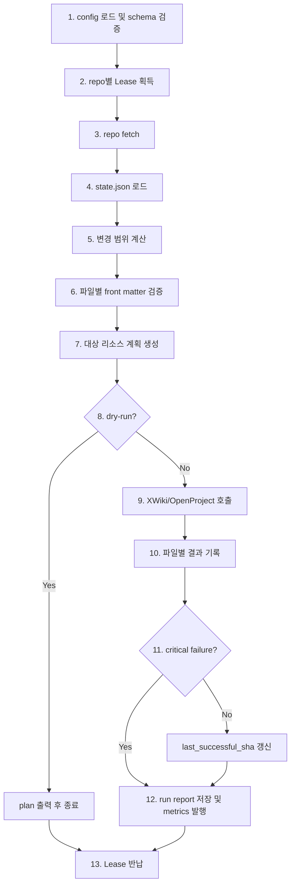
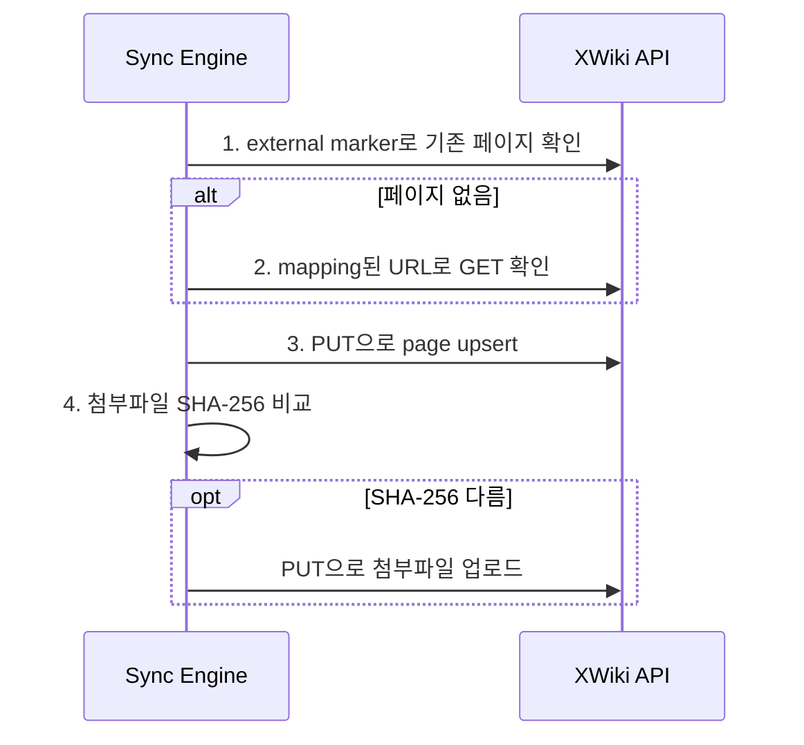
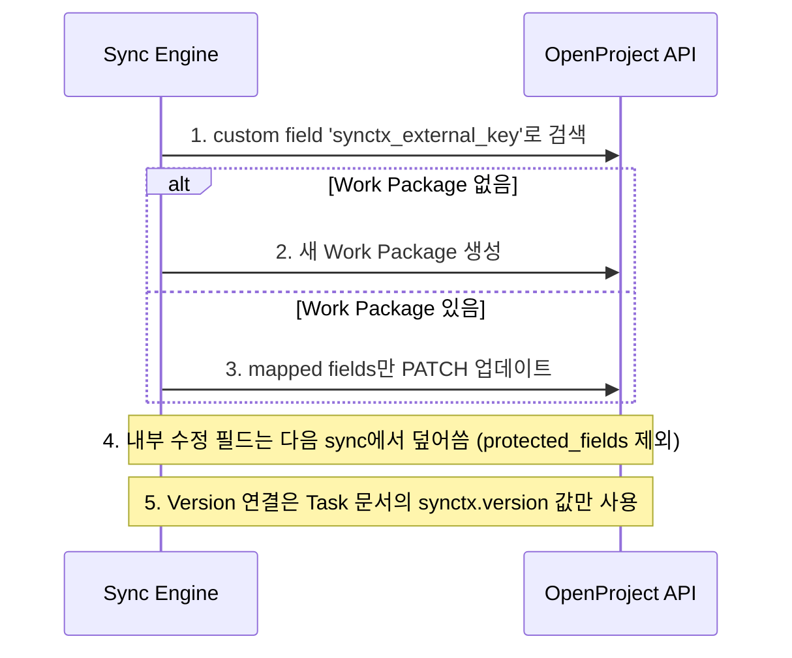

# Production Service Design

이 문서는 synctx를 MVP가 아니라 실제 내부 서비스로 운영하기 위한 상세 설계와 구현 체크리스트를 정의한다.
기본 아키텍처는 [architecture.md](architecture.md)를 따른다. 여기서는 운영 안정성, 보안, 동기화 일관성, 배포 재현성, 단계별 완료 기준을 구체화한다.

## 1. 서비스 가능 범위

### 1.1 목표

첫 운영 버전은 다음을 만족해야 한다.

- 내부 GitLab 미러의 Markdown 저장소를 웹에서 안정적으로 탐색하고 렌더링한다.
- Mermaid, highlight.js, Marp, draw.io를 외부 인터넷 없이 사용할 수 있다.
- Markdown 문서를 XWiki로, 이슈 문서를 OpenProject로 단방향 동기화한다.
- 동기화 실패가 일부 파일에만 영향을 주며, 다음 실행에서 안전하게 재시도된다.
- 사용자, 관리자, 서비스 계정 권한이 분리된다.
- 모든 외부 의존성은 버전과 해시가 고정되어 폐쇄망 반입이 재현 가능하다.

### 1.2 비목표

다음은 첫 운영 버전에서 제외한다.

- 내부 도구(XWiki/OpenProject)에서 GitHub 또는 외부망으로의 역동기화
- 브라우저 기반 Markdown 편집기
- draw.io 파일의 서버사이드 저장
- 다중 테넌트 과금/조직 관리
- XWiki/OpenProject의 모든 필드 자동 발견과 자동 매핑

## 2. 운영 아키텍처 결정

### 2.1 출판 데이터의 단일 원천

출판된 슬라이드 HTML의 단일 원천은 `publish_repo` Git 저장소다.

- Marp Service는 HTML 생성 후 `publish_repo`에 커밋하고 push한다.
- Slides Server는 PVC에 직접 쓰지 않는다.
- Slides Server는 `slides-sync` sidecar가 `publish_repo`를 pull한 working tree를 읽기 전용으로 서빙한다.
- Marp Service는 push 성공 후 내부 refresh API를 호출한다. refresh 실패 시에도 sidecar의 polling이 최종 반영한다.

이 결정으로 Git 이력과 서빙 상태의 기준이 분리되지 않는다.

### 2.2 동기화 상태 저장소

Sync Engine 상태는 내부 PVC에 저장한다.

```
/data/sync-state/
├── repos/
│   └── {repo_id}/
│       ├── state.json
│       ├── state.json.bak
│       ├── runs/
│       │   └── 2026-06-19T10-30-00Z.json
│       └── failures/
│           └── {run_id}.json
└── locks/
```

상태 파일은 Git 저장소에 커밋하지 않는다. 내부 동기화 상태는 운영 파생 데이터이며 외부 반출 대상이 아니다.

### 2.3 실행 잠금

중복 실행은 세 단계로 막는다.

- K8s CronJob: `concurrencyPolicy: Forbid` (CronJob 스케줄 간의 중복 실행 방지)
- Webhook Receiver: 별도의 경량 **Deployment**로 동작하며, GitLab Push Event 수신 시 Kubernetes API를 호출하여 `synctx-sync` CronJob 기반의 일회성 Job을 즉시 생성한다. (최소 권한 원칙에 따라 Job 생성/조회 권한만 가진 **Webhook 전용 ServiceAccount**를 사용)
- Sync Engine: Kubernetes Lease 기반 per-repo lock
  - **상호작용 (안전망)**: Webhook이 생성한 수동 Job과 CronJob이 생성한 스케줄 Job은 서로 다른 주체에 의해 생성되므로 `concurrencyPolicy: Forbid`가 상호 간의 중복을 막아주지 못한다. 따라서 Webhook Job과 CronJob Job이 동시에 실행되더라도, **최종적으로 Kubernetes Lease를 획득한 하나의 Pod만 동기화를 수행**하고 나머지는 대기 후 종료된다. CronJob은 Webhook이 놓친 변경을 주기적으로 처리하는 안전망(Safety Net) 역할을 한다.

Lease 이름은 `synctx-sync-{repo_id}`다. 수동 실행, CronJob, 재시작 상황이 겹쳐도 같은 repo는 동시에 처리하지 않는다.
Lease 권한이 없는 로컬 개발 환경에서는 파일 lock으로 fallback한다.

### 2.4 상태 갱신 원칙

`last_successful_sha`는 해당 run의 critical item이 모두 성공했을 때만 전진한다.

부분 실패가 있으면 다음 실행도 이전 `last_successful_sha..HEAD` 범위를 다시 계산한다.
이미 성공한 파일은 `synced_files[path].content_sha`가 같으면 skip하므로 중복 호출을 피한다.

### 2.5 대상 리소스 식별자

모든 외부 대상에는 synctx 관리 식별자를 남긴다.

```
synctx_external_key = "{repo_id}:{normalized_path}"
```

- XWiki: 페이지 본문 하단에 HTML comment marker를 기록한다.
- OpenProject: 전용 custom field `synctx_external_key`를 우선 사용한다. custom field를 만들 수 없는 환경에서는 description marker를 fallback으로 사용한다.
- Slides: published HTML에 `meta name="synctx:source"` 값을 기록한다.

## 3. 보안 설계

### 3.1 인증 경계

운영 환경은 Ingress 앞단의 사내 SSO/OIDC 또는 reverse proxy 인증을 기본으로 한다.
서비스는 다음 헤더를 신뢰하되, 이 헤더는 Ingress에서만 주입 가능해야 한다.

| 헤더 | 의미 |
|------|------|
| `X-Forwarded-User` | 사용자 ID |
| `X-Forwarded-Email` | 사용자 이메일 |
| `X-Forwarded-Groups` | 그룹 목록 |
| `X-Request-Id` | 요청 추적 ID |

Ingress 우회 접근은 NetworkPolicy로 차단한다.

### 3.2 역할

| 역할 | 권한 |
|------|------|
| `viewer` | 저장소 목록, 문서 렌더링, 파일 다운로드 |
| `publisher` | Marp PDF/HTML 변환, 슬라이드 출판 |
| `cdn-admin` | CDN 파일 업로드, 삭제, manifest 갱신 |
| `sync-admin` | dry-run 실행, 수동 sync 실행, 실패 재처리 |
| `platform-admin` | 설정 변경, Secret 연결, 배포 관리 |
| `service` | 내부 서비스 간 refresh/webhook 호출 |

역할 매핑은 `.synctx.yaml`에 그룹명으로 정의한다.

```yaml
authz:
  group_header: X-Forwarded-Groups
  role_mappings:
    viewer: ["dev-team", "biz-team"]
    publisher: ["dev-team"]
    cdn-admin: ["platform-team"]
    sync-admin: ["platform-team"]
    platform-admin: ["platform-admin"]
```

### 3.3 서비스 간 인증

내부 API는 별도 service token을 요구한다.

- `POST /api/repos/{id}/webhook`
- `POST /internal/slides/refresh`

토큰은 K8s Secret에서 주입하며, ConfigMap에 저장하지 않는다.

### 3.4 Secret 관리

| Secret | 사용처 | 권한 |
|--------|--------|------|
| `GIT_READ_TOKEN` | Viewer, Sync Engine, Marp | source repo read |
| `GIT_PUBLISH_TOKEN` | Marp, slides-sync | publish repo write/read |
| `GITLAB_WEBHOOK_SECRET` | Sync Webhook Receiver | GitLab push event 검증 |
| `XWIKI_CREDENTIAL` | Sync Engine | page/attachment write |
| `OPENPROJECT_API_KEY` | Sync Engine | work package write |
| `SYNCTX_SERVICE_TOKEN` | internal API | service-to-service |

모든 Secret은 env 또는 mounted file로만 전달한다. 로그에는 credential 값과 credential이 포함된 URL을 출력하지 않는다.

### 3.5 업로드 보안

CDN 업로드는 운영에서 `cdn-admin` 권한을 요구하는 방식으로 활성화한다. 운영 기본값은 `enabled: true`와 `required_role: cdn-admin`이다.

업로드 검증 규칙:

- 경로는 `library/version/file` 형식만 허용한다.
- `..`, 절대 경로, 숨김 파일, 제어 문자를 거부한다.
- 허용 확장자와 MIME type을 둘 다 검사한다.
- 동일 version 파일은 기본적으로 immutable이다. 교체는 `force=true`와 admin audit log가 필요하다.
- 업로드 후 `manifest.json`에 SHA-256을 기록한다.

## 4. 설정 스키마

`.synctx.yaml`은 Pydantic 모델로 검증한다. 부팅 시 검증 실패하면 서비스는 ready 상태가 되지 않는다.

```yaml
synctx:
  version: "1"

runtime:
  environment: production
  public_base_url: "https://synctx.internal"
  request_id_header: X-Request-Id

authz:
  enabled: true
  group_header: X-Forwarded-Groups
  role_mappings:
    viewer: ["dev-team", "biz-team"]
    publisher: ["dev-team"]
    cdn-admin: ["platform-team"]
    sync-admin: ["platform-team"]
    platform-admin: ["platform-admin"]

repositories:
  - id: project-docs
    name: "Team Docs"
    url: "https://gitlab.internal/team/docs.git"
    default_ref: main
    auth:
      type: token
      credential_env: GIT_READ_TOKEN
    watch_paths:
      - "docs/**/*.md"
      - "issues/**/*.md"
      - "slides/**/*.md"
      - "diagrams/**/*.drawio"
    ignore_paths:
      - "docs/drafts/**"
      - "_published/**"
      - ".context/**"

mappings:
  - match:
      path_prefix: "docs/"
      extensions: [".md"]
    target: xwiki
    xwiki:
      space_from: directory
      page_from: filename
  - match:
      path_prefix: "issues/"
      extensions: [".md"]
    target: openproject
    openproject:
      project: example-project

targets:
  xwiki:
    base_url: "https://wiki.internal"
    wiki: xwiki
    syntax: markdown/1.2
    auth:
      type: basic
      credential_env: XWIKI_CREDENTIAL
    concurrency: 5
    timeout_seconds: 30
    retry:
      max_attempts: 3
      backoff_seconds: [1, 5, 15]
  openproject:
    base_url: "https://op.internal"
    auth:
      type: token
      credential_env: OPENPROJECT_API_KEY
    external_key_custom_field: synctx_external_key
    protected_fields: ["assignee"]
    type_map:
      task: 1
      bug: 2
      requirement: 3
    status_map:
      open: 1
      in_progress: 7
      blocked: 8
      done: 12
    priority_map:
      low: 7
      normal: 8
      high: 9
      urgent: 10

viewer:
  repo_cache_path: "/data/repos"
  max_render_size_bytes: 5242880
  cdn_base_url: "https://synctx.internal/cdn"

cdn:
  storage_path: "/data/cdn"
  upload_auth:
    enabled: true
    required_role: cdn-admin
  allowed_extensions: [".js", ".css", ".woff", ".woff2", ".ttf", ".svg", ".png", ".map"]

marp:
  publish_repo: "https://gitlab.internal/team/published-slides.git"
  publish_branch: main
  publish_base_path: "_published/slides"
  worktree_path: "/data/marp/publish-worktree"
  conversion_timeout_seconds: 120
  max_input_size_bytes: 10485760

slides:
  worktree_path: "/data/slides/worktree"
  refresh_mode: webhook_and_polling
  polling_interval_seconds: 60

sync:
  state_path: "/data/sync-state"
  lease_namespace: synctx
  schedule: "*/5 * * * *"
  on_delete: mark
  force_push_policy: full_rescan
  dry_run: false
```

`force_push_policy` 값은 다음 중 하나다.

| 값 | 동작 |
|----|------|
| `full_rescan` | `last_successful_sha`가 현재 HEAD의 ancestor가 아니면 watch path 전체를 재평가한다. 운영 기본값 |
| `fail` | force-push를 감지하면 run을 실패 처리하고 운영자 개입을 요구한다 |
| `ignore` | force-push를 무시하고 현재 state 기준으로 계속 진행한다. 운영 사용 금지 |

## 5. Front Matter 스키마

### 5.1 공통 규칙

- `synctx.target`은 `xwiki`, `openproject`, `ignore` 중 하나다.
- front matter가 없으면 path mapping을 적용한다.
- front matter와 path mapping이 충돌하면 front matter가 우선한다.
- 검증 실패 파일은 skip하고 run 결과에 `validation_error`로 기록한다.
- 필수 필드가 없을 때 자동 추론 가능한 값은 dry-run 경고를 남긴다.

### 5.2 XWiki 문서

```yaml
---
synctx:
  target: xwiki
  space: "아키텍처/백엔드"
  page: "시스템 설계"
  title: "시스템 설계"
  tags: ["architecture", "backend"]
  attachments:
    - "images/context.svg"
  delete_policy: mark
---
```

필드:

| 필드 | 필수 | 설명 |
|------|------|------|
| `space` | 선택 | 없으면 `docs/` 아래 디렉토리로 추론 |
| `page` | 선택 | 없으면 파일명으로 추론 |
| `title` | 선택 | 없으면 첫 번째 H1, 없으면 page |
| `tags` | 선택 | XWiki 태그 또는 본문 marker에 기록 |
| `attachments` | 선택 | 상대 경로 파일을 첨부파일로 업로드 |
| `delete_policy` | 선택 | `mark`, `delete`, `ignore` |

### 5.3 OpenProject 이슈

```yaml
---
synctx:
  target: openproject
  project: example-project
  type: task
  subject: "요건 분석 정리"
  status: in_progress
  priority: normal
  assignee: "hong.gildong"
  version: "Sprint 1"
  due_date: "2026-07-04"
---
```

필드:

| 필드 | 필수 | 설명 |
|------|------|------|
| `project` | 필수 | OpenProject project identifier |
| `type` | 필수 | `type_map`으로 OpenProject type id에 매핑 |
| `subject` | 선택 | 없으면 첫 번째 H1, 없으면 파일명 |
| `status` | 선택 | 없으면 `open` |
| `priority` | 선택 | 없으면 `normal` |
| `assignee` | 선택 | 사용자 매핑 테이블 또는 login/email로 해석 |
| `version` | 선택 | version name 또는 id |
| `due_date` | 선택 | ISO date |

OpenProject 중복 방지는 `synctx_external_key` custom field로 한다.

Version(스프린트) 연결의 source of truth는 Task 문서의 `synctx.version` 필드다.
Version 문서의 `issues` 목록은 Viewer의 보드 렌더링과 dry-run 검증용 manifest로만 사용하며, Sync Engine은 이 목록만 보고 Task의 OpenProject version을 할당하지 않는다.
Task가 여러 Version 문서에 동시에 포함되어도 `synctx.version` 값만 OpenProject Work Package의 version 연결에 반영한다.

### 5.4 Marp 슬라이드

```yaml
---
marp: true
theme: gaia
paginate: true
synctx:
  target: slides
  publish_path: "architecture/system-design.html"
  visibility: internal
---
```

`publish_path`는 저장소별 namespace 아래에 배치된다.

```
_published/slides/{repo_id}/{publish_path}
```

## 6. Sync Engine 상세 설계

### 6.1 실행 흐름



### 6.2 변경 감지

기본 명령:

```bash
git diff --name-status -M <last_successful_sha>..HEAD -- <watch_paths>
```

처리 규칙:

| 상태 | 처리 |
|------|------|
| `A` | 새 target resource 생성 |
| `M` | 기존 target resource 업데이트 |
| `D` | delete policy에 따라 mark/delete/ignore |
| `R` | old resource mark 후 new resource upsert. target key가 동일하면 update |

`last_successful_sha`가 현재 HEAD의 ancestor가 아니면 force-push로 판단하고 full rescan을 수행한다.

### 6.3 idempotent upsert

XWiki:



OpenProject:



`protected_fields`는 `.synctx.yaml`의 `targets.openproject.protected_fields`에 정의한다.
예를 들어 `assignee`가 protected이면 최초 생성 때만 설정하고 이후 내부 OpenProject 변경을 덮어쓰지 않는다.

### 6.4 실패 분류

| 분류 | 예 | 재시도 | state advance |
|------|----|--------|---------------|
| `validation_error` | front matter invalid | 아니오 | 가능, 파일은 skipped로 기록 |
| `transient_error` | 429, 5xx, timeout | 예 | 불가 |
| `auth_error` | 401, 403 | 아니오 | 불가 |
| `mapping_error` | unknown status/type | 아니오 | 불가 |
| `conflict_error` | duplicate external key | 아니오 | 불가 |

validation error는 운영자가 수정할 수 있도록 run report와 metrics에 남긴다.

### 6.5 상태 파일 예시

상태 파일은 atomic write로 갱신한다.

1. 기존 `state.json`을 `state.json.bak`으로 복사한다.
2. 새 상태를 같은 디렉토리의 임시 파일 `state.json.tmp.{pid}`에 쓴다.
3. 파일 내용을 `fsync`한다.
4. 부모 디렉토리를 `fsync`한다.
5. `os.replace(tmp, state.json)`로 rename한다.
6. rename 후 부모 디렉토리를 다시 `fsync`한다.

읽기 시 `state.json`이 JSON 파싱에 실패하면 `state.json.bak`을 읽고 `state_recovered_from_backup` 이벤트를 남긴다.

```json
{
  "schema_version": 1,
  "repo_id": "project-docs",
  "last_successful_sha": "abc1234",
  "last_run_id": "2026-06-19T10-30-00Z",
  "synced_files": {
    "docs/architecture/system-design.md": {
      "content_sha": "sha256:...",
      "target": "xwiki",
      "external_key": "project-docs:docs/architecture/system-design.md",
      "resource_id": "xwiki:아키텍처.시스템-설계",
      "last_synced_sha": "def5678",
      "last_synced_at": "2026-06-19T10:30:00Z"
    }
  },
  "pending_failures": [
    {
      "path": "issues/TASK-001.md",
      "error_type": "mapping_error",
      "message": "unknown status: review"
    }
  ]
}
```

## 7. Service API 설계

### 7.1 공통 endpoint

모든 FastAPI 서비스는 다음 endpoint를 제공한다.

| Endpoint | 용도 |
|----------|------|
| `GET /healthz` | 프로세스 생존 확인 |
| `GET /readyz` | 설정, 필수 의존성, 저장소 접근 준비 확인 |
| `GET /metrics` | Prometheus metrics |
| `GET /version` | git sha, build time, dependency manifest |

### 7.2 Viewer Service

| Method | Path | 권한 | 설명 |
|--------|------|------|------|
| GET | `/api/repos` | viewer | 접근 가능한 repo 목록 |
| GET | `/api/repos/{repo_id}/tree?ref=&path=` | viewer | Git tree 조회 |
| GET | `/api/repos/{repo_id}/render?ref=&path=` | viewer | Markdown HTML 렌더링 |
| GET | `/api/repos/{repo_id}/raw?ref=&path=` | viewer | 원본 파일 다운로드 |
| GET | `/api/repos/{repo_id}/download?format=html|pdf` | viewer | 변환 다운로드 |
| POST | `/api/repos/{repo_id}/webhook` | service | Git push 알림 |

보안:

- `path`는 repo root 밖으로 벗어날 수 없다.
- 렌더링 최대 파일 크기를 넘으면 413을 반환한다.
- HTML은 sanitization 또는 신뢰 저장소 정책 중 하나를 명시한다. 운영 기본값은 신뢰 저장소 + CSP다.

### 7.3 CDN Service

| Method | Path | 권한 | 설명 |
|--------|------|------|------|
| GET | `/cdn/{path}` | viewer | 정적 파일 서빙 |
| GET | `/api/cdn/manifest` | viewer | 라이브러리 manifest |
| POST | `/api/cdn/upload?force=false` | cdn-admin | 파일 업로드. 기존 파일 교체는 `force=true` 필요 |
| DELETE | `/api/cdn/{path}` | cdn-admin | 파일 삭제 또는 disable |

운영 기본값:

- version path는 immutable이다.
- 기존 파일이 있고 `force=false`이면 409를 반환한다.
- `force=true`는 `cdn-admin` 권한, 변경 사유, audit log를 요구한다.
- 삭제는 실제 파일 삭제 대신 manifest에서 disabled 처리한다.
- `/cdn/latest` alias는 운영 사용을 금지하고 개발 환경에서만 허용한다.

`manifest.json` 예시:

```json
{
  "schema_version": 1,
  "generated_at": "2026-06-19T10:30:00Z",
  "libraries": {
    "mermaid": {
      "10.9.1": {
        "files": {
          "mermaid.min.js": {
            "sha256": "sha256:...",
            "size": 2890123,
            "content_type": "application/javascript",
            "uploaded_by": "platform-admin",
            "uploaded_at": "2026-06-19T10:30:00Z",
            "disabled": false
          }
        }
      }
    }
  }
}
```

### 7.4 Marp Service

| Method | Path | 권한 | 설명 |
|--------|------|------|------|
| POST | `/api/marp/convert` | publisher | PDF/HTML 변환 |
| POST | `/api/marp/publish` | publisher | HTML 생성 후 publish repo push |
| GET | `/api/marp/themes` | viewer | 사용 가능 테마 |

출판 규칙:

- publish 작업은 repo별 Kubernetes Lease lock을 획득한다. Lease 이름은 `synctx-marp-publish-{repo_id}`다.
- 로컬 개발 환경에서는 publish worktree 안의 `.synctx-publish.lock` 파일 lock으로 fallback한다.
- push 실패가 non-fast-forward이면 fetch/rebase 후 1회 재시도한다.
- 같은 `publish_path`는 새 commit으로 갱신한다.

### 7.5 Sync Webhook & Admin API

Sync Engine은 기본적으로 CLI와 CronJob으로 동작하며, 즉시 동기화를 위한 Webhook Receiver를 별도로 운영한다.

| Method | Path | 권한 | 설명 |
|--------|------|------|------|
| POST | `/api/sync/webhook/gitlab` | service | GitLab Push Event 수신 및 Sync Job 생성 |

Webhook Receiver 정책:

- 별도의 경량 Deployment로 동작하며, 최소 권한 원칙(Least Privilege)에 따라 Job 생성/조회 권한만 가진 Webhook 전용 ServiceAccount를 사용한다.
- GitLab `X-Gitlab-Token` 헤더를 `GITLAB_WEBHOOK_SECRET`과 비교하여 검증한다.
- Push 이벤트 수신 시 Kubernetes API를 호출하여 `synctx-sync` CronJob 기반의 일회성 Job을 생성한다.
- 이미 실행 중인 Sync Job이 있으면 새 Job을 생성하지 않고 200 OK(Ignored)를 반환한다.

수동 실행이 필요하면 `kubectl create job --from=cronjob/synctx-sync`를 사용한다.
운영 UI/API는 Phase 4 이후 추가한다.

## 8. 배포 설계

### 8.1 이미지와 의존성 고정

운영 이미지는 `latest` 태그를 사용하지 않는다.

| 이미지 | 태그 정책 |
|--------|-----------|
| synctx/viewer | SemVer + git sha |
| synctx/cdn | SemVer + git sha |
| synctx/marp | SemVer + git sha |
| synctx/sync | SemVer + git sha |
| jgraph/drawio | 검증 완료한 명시 버전 |
| nginx | 검증 완료한 명시 버전 |

`npm install -g @marp-team/marp-cli`는 빌드 시 버전을 고정한다.
외부에서 다운로드한 모든 JS/CSS/font/image tarball은 SHA-256 manifest에 기록한다.

### 8.2 K8s 기본값

모든 자체 서비스에 적용한다.

```yaml
securityContext:
  runAsNonRoot: true
  readOnlyRootFilesystem: true
  allowPrivilegeEscalation: false
  capabilities:
    drop: ["ALL"]

resources:
  requests:
    cpu: 100m
    memory: 256Mi
  limits:
    cpu: 1000m
    memory: 1Gi
```

추가 요구:

- liveness/readiness probe 필수
- NetworkPolicy로 필요한 egress만 허용
- PodDisruptionBudget는 Viewer/CDN에 적용
- ConfigMap 변경 시 rolling restart
- Secret은 chart values에 직접 넣지 않고 기존 Secret 이름을 참조

### 8.3 PVC

| PVC | 접근 | 사용처 |
|-----|------|--------|
| `repo-cache` | RWO/RWX | Viewer, Sync, Marp의 clone cache. 서비스별 분리 권장 |
| `cdn-data` | RWX | CDN 정적 파일 |
| `sync-state` | RWO | Sync Engine 상태 |
| `slides-worktree` | RWO | `/data/slides/worktree`에 mount되는 slides-sync working tree |
| `marp-work` | RWO | Marp 변환 임시 작업 |

가능하면 서비스별 PVC를 분리한다. 공유 PVC는 locking과 권한 문제가 커진다.

### 8.4 로컬 시뮬레이션 (Minikube)

개발 완료 후 실제 운영 환경과 유사한 조건에서 검증하기 위해 Minikube를 활용한 로컬 시뮬레이션을 수행한다.

**시뮬레이션 환경 구성:**
- **Minikube Cluster**: `minikube start --addons=ingress,metrics-server` 명령으로 Ingress Controller와 Metrics Server가 활성화된 클러스터 구성.
- **Minikube Docker Daemon**: `eval $(minikube docker-env)`를 통해 로컬 Docker 데몬을 Minikube와 공유하여 빠른 로컬 빌드 및 테스트를 수행. (단, 운영 환경의 내부 레지스트리 및 imagePullSecret 검증이 필요한 경우 `registry` addon을 활성화하여 별도 테스트 수행)
- **Helm 배포**: 작성된 Helm Chart를 사용하여 전체 마이크로서비스(Viewer, CDN, Marp, Draw.io, Sync Engine, Slides Server)를 `synctx` 네임스페이스에 배포.

**주요 검증 항목:**
- **Ingress 라우팅**: `/view/*`, `/cdn/*`, `/api/sync/webhook/gitlab` 등 모든 Ingress Path가 올바른 Service로 라우팅되는지 확인.
- **PVC 마운트 및 권한**: `repo-cache`, `sync-state` 등 PVC가 정상적으로 프로비저닝되고 각 Pod에 올바른 권한(RWO/RWX)으로 마운트되는지 검증. (기본 Minikube storage provisioner는 RWX를 완벽히 지원하지 않으므로, 운영 환경 수준의 RWX/NFS 동작 검증을 위해서는 NFS/CSI addon 또는 별도의 dev StorageClass 구성이 필요함)
- **Webhook & CronJob 동작**: 가상의 GitLab Push Event를 `curl`로 Ingress에 전송하여 Webhook Receiver가 정상적으로 일회성 Sync Job을 생성하는지, 그리고 CronJob 스케줄과 겹칠 때 Lease 기반 잠금이 의도대로 작동하는지 확인.
- **서비스 간 내부 통신**: Viewer가 CDN의 정적 자산을 정상적으로 로드하는지, Marp Service가 내부 API를 통해 PDF 변환을 수행하는지 점검.

## 9. 관측성과 운영

### 9.1 로그

모든 로그는 JSON으로 남긴다.

공통 필드:

- `timestamp`
- `level`
- `service`
- `request_id`
- `repo_id`
- `path`
- `run_id`
- `user`
- `event`
- `duration_ms`
- `result`

Secret, token, Basic Auth, signed URL은 마스킹한다.

### 9.2 Metrics

필수 metrics:

- `synctx_http_requests_total`
- `synctx_http_request_duration_seconds`
- `synctx_render_requests_total`
- `synctx_marp_convert_total`
- `synctx_marp_publish_total`
- `synctx_sync_runs_total`
- `synctx_sync_items_total`
- `synctx_sync_failures_total`
- `synctx_sync_last_success_timestamp`
- `synctx_cdn_bytes_served_total`

### 9.3 Alert

초기 alert:

- Sync가 30분 이상 성공하지 못함
- Sync failure ratio가 최근 3회 평균 10% 초과
- XWiki/OpenProject auth error 발생
- Marp publish push 실패
- Slides Server sidecar pull 실패 또는 worktree 손상
- PVC 사용량 80% 초과
- readiness failure 5분 지속

## 10. 테스트 전략

### 10.1 테스트 레벨

| 레벨 | 대상 | 완료 기준 |
|------|------|-----------|
| Unit | renderer, path security, front matter parser, mapper | 핵심 분기 80% 이상 |
| Contract | XWiki/OpenProject fake server | upsert/delete/retry/idempotency 검증 |
| Integration | local Git repo + FastAPI TestClient | API 정상/오류 흐름 검증 |
| E2E | Kind 또는 dev cluster | Viewer 렌더링, Marp publish, Sync dry-run |
| Security | path traversal, upload validation, authz | 권한 없는 요청 403 |
| Offline build | vendor artifact only | 외부 네트워크 없이 이미지 빌드 |

### 10.2 운영 전 수용 기준

- 같은 sync run을 3회 반복 실행해도 외부 대상이 중복 생성되지 않는다.
- XWiki 또는 OpenProject가 1회 timeout을 반환하면 재시도 후 성공한다.
- 특정 파일 validation error가 있어도 다른 파일은 동기화된다.
- Sync 중 pod가 종료되어도 다음 실행에서 일관된 상태로 재시도된다.
- `latest` 태그가 values-production에 존재하지 않는다.
- CDN 업로드 권한 없는 사용자는 업로드할 수 없다.
- Marp publish 결과가 Git repo commit과 Slides URL에서 동일하게 확인된다.

## 11. 단계별 개발 체크리스트

이 단계는 운영 가능한 구현을 만들기 위한 체크리스트다.
[architecture.md](architecture.md)의 제품 로드맵과 번호를 맞추기 위해 Phase 5는 운영 준비, Phase 6은 하네스/스크럼 확장으로 둔다.

### Phase 0: 운영 설계 확정

- [x] 서비스별 책임과 데이터 원천 결정
- [x] Sync 상태 저장소와 lock 전략 결정
- [x] Marp/Slides 출판 기준 결정
- [ ] `.synctx.yaml` Pydantic schema 작성
- [ ] Front Matter schema와 validation error 포맷 작성
- [ ] OpenProject custom field 및 status/type id 확인
- [ ] XWiki Markdown Syntax 확장 설치 여부 확인

완료 기준:

- config sample이 schema validation을 통과한다.
- XWiki/OpenProject 운영 환경별 필수 id 매핑 표가 채워져 있다.

### Phase 1: 기반 패키지와 Viewer/CDN

- [ ] `shared/synctx-common` 패키지 생성
- [ ] config loader, auth helper, front matter parser 구현
- [ ] Git manager 이식 및 path traversal 방어 테스트 작성
- [ ] CDN Service 정적 서빙 구현
- [ ] CDN upload validation과 manifest 구현
- [ ] Viewer Service renderer 이식
- [ ] Viewer API authz 적용
- [ ] healthz/readyz/metrics/version endpoint 구현
- [ ] Dockerfile과 Helm 기본 chart 작성

완료 기준:

- 폐쇄망 vendor 파일만으로 Viewer가 Mermaid와 highlight.js를 렌더링한다.
- 권한 없는 CDN upload가 403을 반환한다.
- `helm template`과 unit test가 통과한다.

### Phase 2: Marp/Slides/Draw.io

- [ ] Marp convert API 구현
- [ ] Marp publish lock 구현
- [ ] publish repo commit/push 구현
- [ ] slides-sync sidecar 구현
- [ ] Slides Server Nginx 설정 구현
- [ ] Draw.io 이미지 버전 pinning 및 Helm 배포 추가
- [ ] Viewer에 Marp/Draw.io 연동 UI 추가

완료 기준:

- Markdown 슬라이드를 PDF로 다운로드할 수 있다.
- publish 후 Git commit과 Slides URL이 모두 확인된다.
- 외부 네트워크 없이 draw.io 화면이 열린다.

### Phase 3: XWiki Sync

- [ ] Sync Engine CLI 구현
- [ ] Kubernetes Lease lock 구현
- [ ] state.json atomic read/write 구현
- [ ] git diff `A/M/D/R` 처리 구현
- [ ] XWiki page upsert 구현
- [ ] attachment upload와 SHA skip 구현
- [ ] Mermaid SVG 변환 및 첨부 구현
- [ ] partial failure 재시도 구현
- [ ] CronJob/ServiceAccount/RBAC/NetworkPolicy 추가

완료 기준:

- 같은 문서를 반복 sync해도 XWiki 페이지가 중복 생성되지 않는다.
- Mermaid 문서가 SVG 첨부로 변환된다.
- 일부 실패 시 `last_successful_sha`가 전진하지 않고 다음 run에서 재시도된다.

### Phase 4: OpenProject Sync

- [ ] OpenProject type/status/priority/user mapping 설정 작성
- [ ] external key custom field 조회 구현
- [ ] Work Package create/update 구현
- [ ] protected fields 정책 구현
- [ ] version/sprint 매핑 구현
- [ ] mapping error와 duplicate error report 구현

완료 기준:

- Markdown issue가 Work Package로 생성된다.
- status 변경이 idempotent하게 반영된다.
- unknown status는 다른 파일 처리를 막지 않고 report에 남는다.

### Phase 5: 운영 준비

- [ ] production values 작성
- [ ] 이미지/벤더 artifact SHA-256 manifest 작성
- [ ] offline build 검증
- [ ] Prometheus metrics scrape 설정
- [ ] 기본 alert rule 작성
- [ ] runbook 작성
- [ ] 백업/복구 절차 작성
- [ ] 권한 매핑 운영 검토

완료 기준:

- dev cluster에서 end-to-end smoke test가 통과한다.
- 운영 반입 artifact 목록이 고정되어 있다.
- 장애 시나리오별 runbook이 있다.

### Phase 6: 하네스 엔지니어링 및 스크럼 보드

- [ ] `.context/` 디렉토리 규격 작성
- [ ] LLM 간 공유 컨텍스트 YAML/Markdown 포맷 작성
- [ ] Viewer Service 칸반 보드 렌더링 구현
- [ ] Version 문서의 `issues` 목록 검증 구현
- [ ] Task `version` 필드와 Version 문서 `issues` 목록 불일치 리포트 구현
- [ ] OpenProject 상태 변환 mapping 고도화

완료 기준:

- Task의 `synctx.version`을 기준으로 OpenProject version 연결이 동기화된다.
- Version 문서의 `issues` 목록으로 Viewer 보드가 렌더링된다.
- Task version과 Version manifest 불일치가 dry-run report에 표시된다.

## 12. Runbook 초안

### 12.1 Sync 실패

1. `synctx_sync_last_success_timestamp` 확인
2. 최근 run report 확인: `/data/sync-state/repos/{repo_id}/runs/`
3. `auth_error`면 Secret 만료 여부 확인
4. `mapping_error`면 `.synctx.yaml`의 map 또는 문서 front matter 수정
5. `transient_error`면 대상 서비스 상태 확인 후 Job 재실행

### 12.2 Marp publish 실패

1. Marp Service log에서 `publish_path`, `repo_id`, `commit_sha` 확인
2. publish repo non-fast-forward 여부 확인
3. worktree lock stale 여부 확인
4. 재시도해도 실패하면 publish repo 권한과 branch protection 확인

### 12.3 CDN 파일 교체

1. 같은 version 파일 교체가 필요한지 확인
2. 가능하면 새 version 디렉토리로 업로드
3. 불가피한 교체는 `force=true`로 업로드
4. manifest diff와 audit log 확인

### 12.4 Slides Server 장애

1. Slides Server readiness와 Nginx access/error log 확인
2. `slides-sync` sidecar log에서 최근 pull 시각과 commit sha 확인
3. publish repo 접근 권한과 `GIT_PUBLISH_TOKEN` 만료 여부 확인
4. worktree 손상이 의심되면 pod를 재시작하여 clean clone으로 복구
5. 특정 publish path만 404이면 Marp publish commit에 해당 파일이 포함되었는지 확인

## 13. 남은 외부 검증 항목

다음은 구현 전에 실제 운영 환경에서 확인해야 한다.

- XWiki 버전과 Markdown Syntax 확장 설치 가능 여부
- XWiki REST attachment size 제한
- OpenProject API token 권한 범위
- OpenProject status/type/priority id
- OpenProject custom field 생성 권한
- GitLab mirror 지연 시간과 webhook 사용 가능 여부
- K8s StorageClass의 RWX/RWO 지원과 NFS flock/Lease 정책
- 사내 Ingress 인증 헤더와 그룹 포맷
