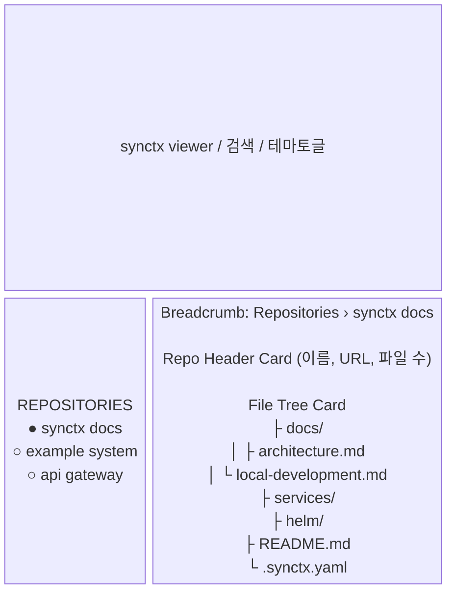
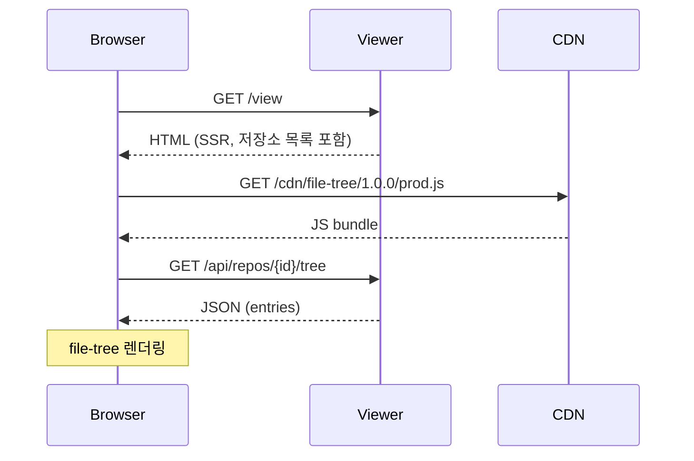

# Viewer Index Page 설계

## 1. 개요

Viewer 서비스의 `/view` 진입점에 **저장소 목록 + 파일 트리** 인덱스 페이지를 추가한다.
현재 `/view`는 404를 반환하며, `/view/{repo_id}/{path}` 형태로만 접근 가능하다.

### 목표
- `/view` 또는 `/view/` 접속 시 등록된 저장소 목록 표시
- `/view/{repo_id}` 접속 시 해당 저장소의 파일 트리 표시
- 파일 클릭 시 기존 `/view/{repo_id}/{path}` 렌더링 페이지로 이동
- 다크/라이트 테마 지원

## 2. 기술 스택

| 항목 | 선택 | 이유 |
|------|------|------|
| 파일 트리 | [@webreflection/file-tree](https://github.com/WebReflection/file-tree) | Web Component, Zero dependency, MIT |
| 디자인 | example-fe 디자인 토큰 | 사내 일관성 (Primary #6950E8, Grey scale, Public Sans) |
| 정적 자산 호스팅 | synctx CDN 서비스 | 폐쇄망 독립, `/cdn/{lib}/{ver}/{file}` 경로 |
| 렌더링 | FastAPI + Jinja2 (SSR) | 별도 FE 빌드 불필요, 기존 Viewer 패턴 유지 |

### CDN 자산 배치 계획

```
/data/cdn/
  file-tree/
    1.0.0/
      prod.js        # @webreflection/file-tree 번들
      prod.css        # 기본 스타일
```

업로드: `POST /cdn/api/cdn/upload` (path=`file-tree/1.0.0/prod.js`)

## 3. 라우트 설계

### 신규 라우트

| Method | Path | 설명 |
|--------|------|------|
| `GET` | `/view` `/view/` | 저장소 목록 (인덱스 페이지) |
| `GET` | `/view/{repo_id}` | 저장소 파일 트리 |

### 기존 라우트 (변경 없음)

| Method | Path | 설명 |
|--------|------|------|
| `GET` | `/view/{repo_id}/{path:path}` | 파일 렌더링 (기존) |
| `GET` | `/api/repos` | 저장소 목록 JSON |
| `GET` | `/api/repos/{repo_id}/tree` | 파일 트리 JSON |

### 라우트 충돌 해결

FastAPI 라우트 등록 순서:
1. `/view` (exact) → 인덱스 페이지
2. `/view/{repo_id}` → 파일 트리 (path 파라미터 없음)
3. `/view/{repo_id}/{path:path}` → 기존 파일 렌더링

`/view/{repo_id}` vs `/view/{repo_id}/{path:path}` 구분:
- path가 없으면 → 파일 트리 (인덱스)
- path가 있으면 → 파일 렌더링 (기존)

## 4. 화면 구성



### 레이아웃
- **Header** (고정 64px): 로고, 검색, 테마 토글
- **Sidebar** (고정 320px): 저장소 목록, 클릭 시 main 영역 갱신
- **Main**: Breadcrumb + Repo Header Card + File Tree Card

### 반응형
- 768px 이하: Sidebar 숨김, 저장소 목록을 드롭다운으로 전환

## 5. 데이터 흐름

### 페이지 로드 시퀀스



### API 응답 → file-tree 매핑

```javascript
// GET /view/api/repos/synctx-docs/tree 응답
{
  "path": "",
  "entries": [
    { "name": "docs", "type": "tree", "path": "docs" },
    { "name": "README.md", "type": "blob", "path": "README.md", "size": 5800 }
  ]
}

// file-tree 변환
import { Tree, Folder, File } from '/cdn/file-tree/1.0.0/prod.js';

const tree = new Tree();
for (const entry of entries) {
  if (entry.type === 'tree') {
    const folder = new Folder(entry.name);
    tree.append(folder);
    // 폴더 클릭 시 lazy load: GET /view/api/repos/{id}/tree?path={entry.path}
  } else {
    tree.append(new File([], entry.name));
  }
}
document.querySelector('#tree-mount').append(tree);
```

## 6. 디자인 토큰 (example-fe 기반)

```css
:root {
  /* Primary */
  --primary: #6950E8;
  --primary-light: #A996F8;
  --primary-lighter: #E4DCFD;
  --primary-dark: #3828A7;

  /* Grey Scale */
  --grey-50: #FCFDFD;
  --grey-100: #F4F6F8;
  --grey-200: #E9ECEF;
  --grey-500: #919EAB;
  --grey-600: #637381;
  --grey-800: #1C252E;
  --grey-900: #141A21;

  /* Semantic */
  --bg-default: #FFFFFF;
  --bg-neutral: #F4F6F8;
  --text-primary: #1C252E;
  --text-secondary: #637381;

  /* Shape */
  --radius-sm: 8px;
  --radius-lg: 16px;
  --shadow-card: 0 0 2px 0 rgba(145,158,171,0.2),
                 0 12px 24px -4px rgba(145,158,171,0.12);

  /* Typography */
  --font-primary: 'Public Sans', sans-serif;
  --font-mono: 'D2Coding', monospace;
}
```

## 7. 구현 계획

### Phase 1: 기반 작업
1. CDN에 `@webreflection/file-tree` 번들 업로드
2. Viewer에 `/view` 라우트 추가 (HTML 템플릿)
3. `/view/{repo_id}` 라우트 추가 (파일 트리)

### Phase 2: 파일 트리 연동
4. `/api/repos/{repo_id}/tree` API를 file-tree Web Component로 렌더링
5. 폴더 lazy loading (클릭 시 하위 트리 로드)
6. 파일 클릭 시 `/view/{repo_id}/{path}` 이동

### Phase 3: UX 개선
7. 파일 검색/필터 기능
8. 다크/라이트 테마 토글
9. 반응형 레이아웃 (모바일)
10. 폰트 CDN 등록 (Public Sans, D2Coding)

## 8. 파일 변경 목록

| 파일 | 변경 |
|------|------|
| `services/viewer/src/app.py` | `/view`, `/view/{repo_id}` 라우트 추가 |
| `services/viewer/src/templates/index.html` | 인덱스 페이지 Jinja2 템플릿 (신규) |
| `services/viewer/src/templates/repo.html` | 저장소 트리 페이지 Jinja2 템플릿 (신규) |
| `services/viewer/src/static/style.css` | 디자인 토큰 + 레이아웃 CSS (신규) |

### CDN 업로드 (빌드 타임)
| CDN 경로 | 원본 |
|----------|------|
| `file-tree/1.0.0/prod.js` | `@webreflection/file-tree` npm 패키지 |
| `file-tree/1.0.0/prod.css` | 동일 패키지 CSS |
